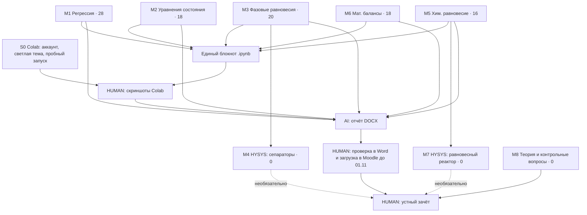

# ROADMAP – МХТП, вариант 1 (Филимонов А.А., ЗХТ-232)

Жёсткий срок: загрузка в Moodle до **01.11.2026 00:00** (фактически – до конца субботы 31.10). Сегодня 12.10.2026 → 19 дней.
Порог зачёта – 60 баллов из 100. Баллы дают только M1, M2, M3, M5, M6; M4, M7, M8 – 0 баллов по слайду 2.

## Граф зависимостей

Модули M1, M2, M3, M5, M6 независимы друг от друга – порядок определяется только отдачей.

## Очередь исполнения

Время – оценка участия человека (проверка result.md, контрольные числа на калькуляторе, скриншоты). Команда для ассистента – в столбце «Запуск».

### Фаза 1 – 80 баллов, каждая задача < 90 мин (до 18.10)

| № | Задача | Запуск | Баллы | Время | Баллы/час |
|---|---|---|---|---|---|
| 1.0 | [HUMAN] Войти в Colab, Settings → Site → Theme = light, выполнить `print(1)` | – | 0 | 10 мин | – (блокирует скриншоты) |
| 1.1 | M1: задачи 1.1–1.4 | `module 1` | 28 | 60 мин | 28 |
| 1.2 | M6: задачи 5.1, 5.2 (линейные балансы, без вариантов) | `module 6` | 18 | 45 мин | 24 |
| 1.3 | M5: задачи 4.1, 4.2а, 4.2б (без вариантов) | `module 5` | 16 | 45 мин | 21 |
| 1.4 | M2: задачи 2.1, 2.2 | `module 2` | 18 | 60 мин | 18 |

После фазы 1 решены задачи на 80 баллов – порог 60 перекрыт даже при частичных снятиях.

### Фаза 2 – оставшиеся 20 баллов (до 22.10)

| № | Задача | Запуск | Баллы | Время |
|---|---|---|---|---|
| 2.1 | M3: 3.1 (ТНК/ТКК) + 3.2 (3 сепаратора, исследование T₁, выбор режима) | `module 3` | 20 | 90–120 мин (3.2 – самая объёмная задача курса) |

### Фаза 3 – сдача (до 27.10, запас 4 дня до срока)

| № | Задача | Исполнитель | Время |
|---|---|---|---|
| 3.1 | Единый блокнот `.ipynb` из solve.py пяти модулей | [AI] | – |
| 3.2 | Run all в Colab, скриншоты ячеек и выводов по списку, отправка ассистенту | [HUMAN] | 60–90 мин |
| 3.3 | Сборка отчёта DOCX: титул, содержание, 12 задач, скриншоты одинаковой ширины, выводы, литература; линтер (∙, тире, десятичный разделитель) | [AI] | – |
| 3.4 | Открыть в Word, «обновить поля», проверить титул и ФИО, загрузить в Moodle | [HUMAN] | 20 мин |

### Фаза 4 – зачёт (до даты зачёта; в файлах не указана)

| № | Задача | Запуск | Время |
|---|---|---|---|
| 4.1 | M8: ответы на контрольные вопросы + конспект Л1, Л8 | `module 8` | 2 × 45 мин чтения |
| 4.2 | Повторить defense.md модулей M1–M6 (ключевые числа – на одну карточку) | [HUMAN] | 60 мин |
| 4.3 | M4 (HYSYS, сепараторы) – только если преподаватель требует | `module 4` + [HYSYS] | 40–60 мин в HYSYS |
| 4.4 | M7 (HYSYS, равновесный реактор NH₃) – только если требует | `module 7` + [HYSYS] | 20–40 мин в HYSYS |

## Правила для сессий (ADHD-режим)

- Одна сессия = один `module N`. В начале сессии – только INDEX.md и TASKS.md, без перечитывания исходников.
- Каждый модуль заканчивается закрытым результатом: числа в result.md проверены независимо, расхождения перечислены.
- Если сессия срывается – следующая начинается с первой невыполненной строки этой очереди; статус отмечать здесь: `[x]` перед номером строки.
