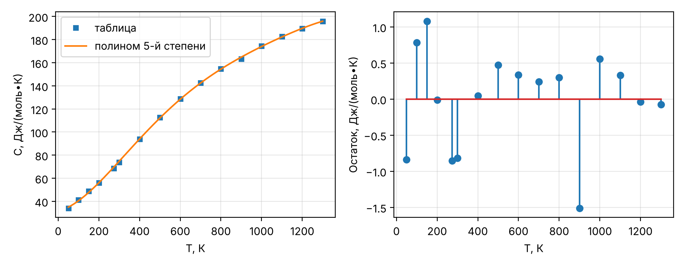
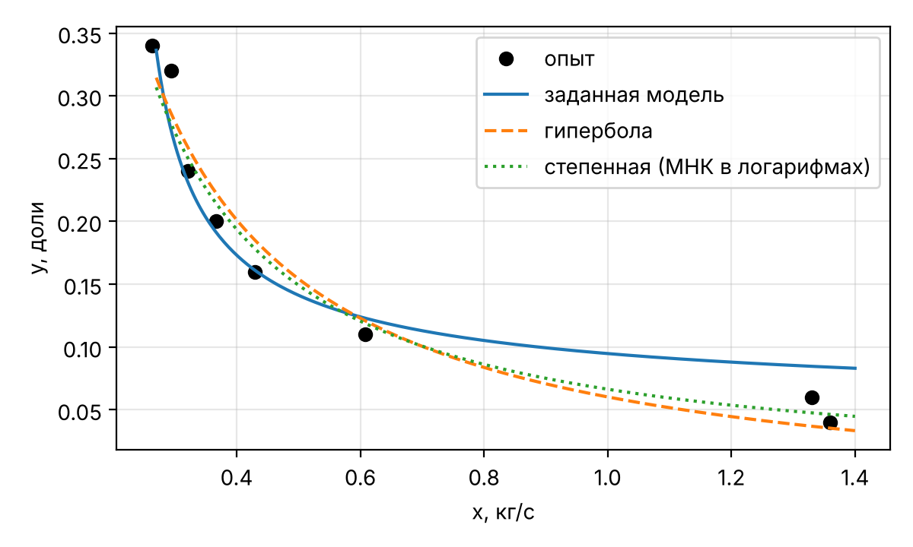
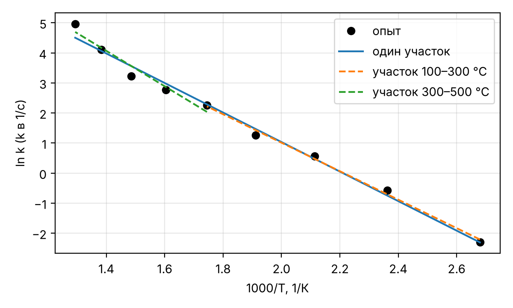
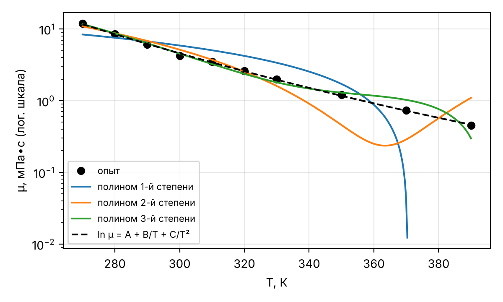
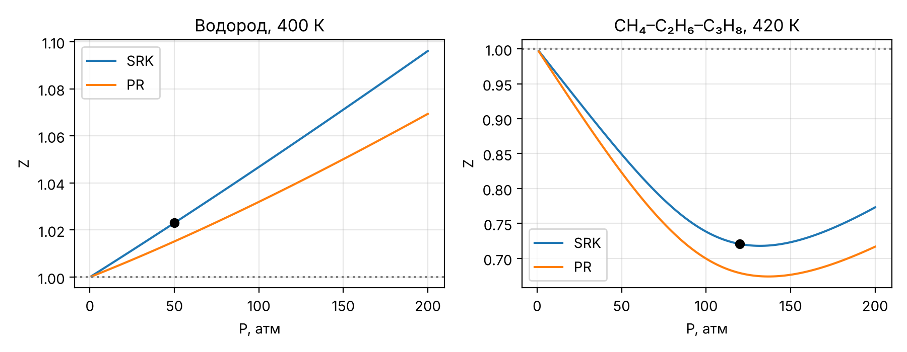
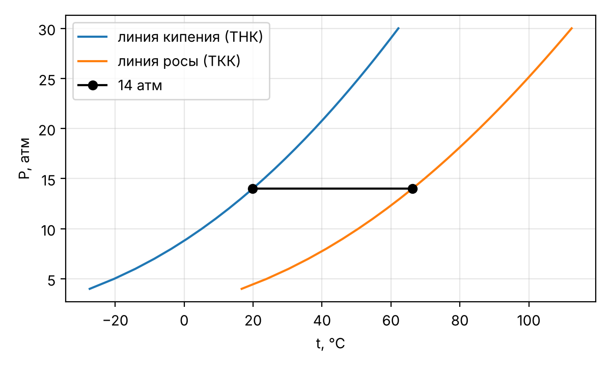
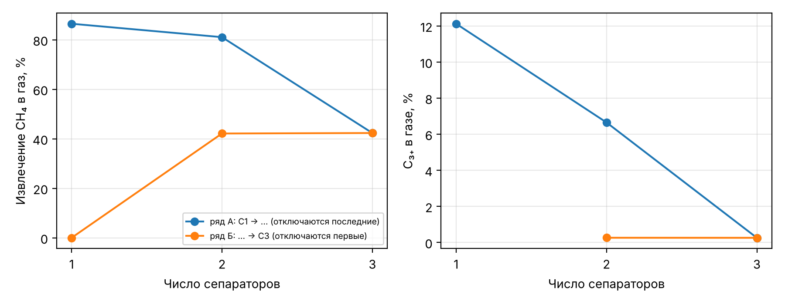
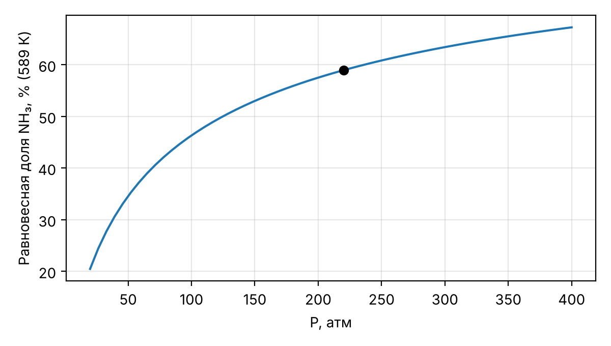
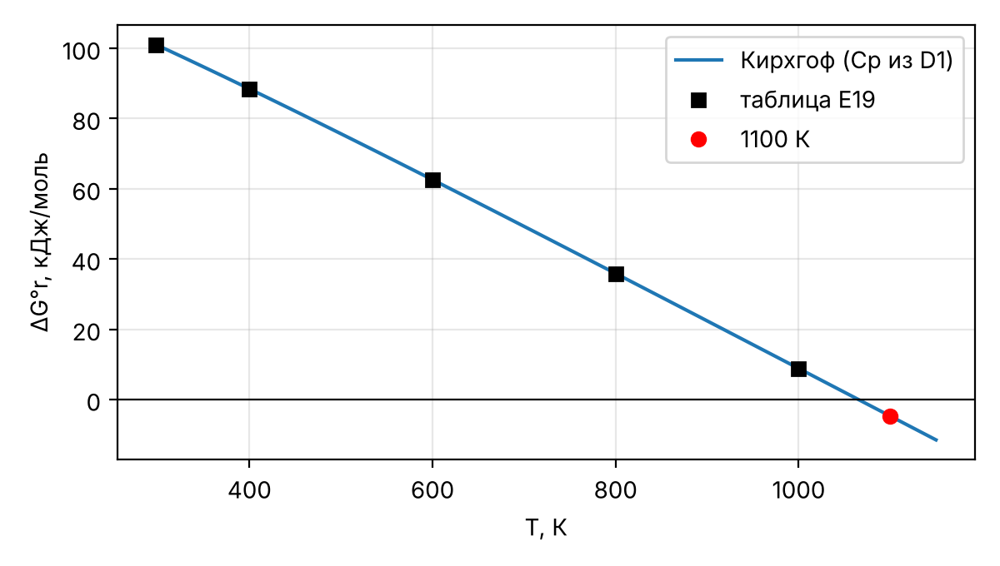
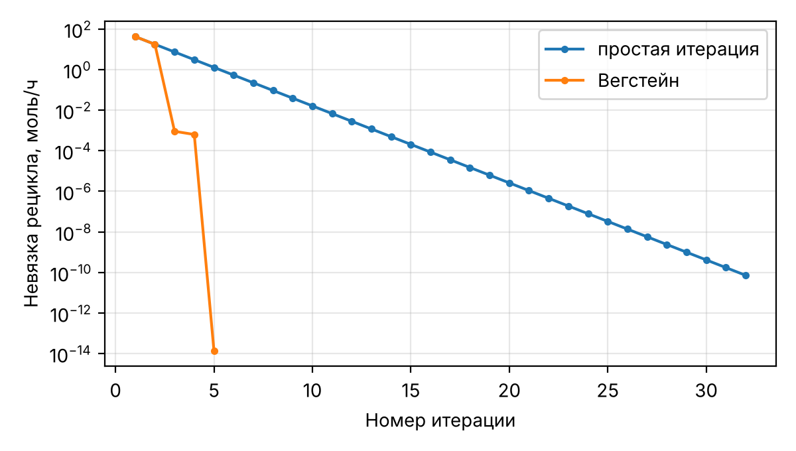

# Введение

В образце приведено решение двенадцати расчётных задач 7 семестра курса «Моделирование химико-технологических процессов» для варианта 10 (в таблицах вариантов задания – строка «9 и 10») [1]. Решение намеренно построено иначе, чем «прямой» путь через готовые функции библиотек: там, где это возможно, использованы альтернативные численные методы и дополнительные проверки. Показано, что разные корректные способы решения приводят к одним и тем же результатам там, где ответ однозначно определяется данными, и к близким – там, где решение зависит от принятых допущений (например, экстраполяция справочных данных).

Особенности образца:

- регрессия – через МНК в масштабированных переменных с явной оценкой обусловленности матрицы, сравнение моделей по F-критерию Фишера;
- уравнения состояния – решение кубического уравнения методом Ньютона и сравнение RK и SRK с уравнением Пенга–Робинсона [2];
- фазовые равновесия – метод Ньютона для уравнения Рачфорда–Райса [3], построение фазовой диаграммы смеси;
- химическое равновесие – константа равновесия по уравнению Кирхгофа с теплоёмкостями из справочника [4], сведение системы двух уравнений к одному;
- материальные балансы – собственная реализация метода Гаусса и последовательный модульный расчёт схемы с рециклом с ускорением Вегстейна [5].

Методологическая основа – курс лекций [6] и учебные пособия [7, 8, 9], первоисточник постановок – задачник Б. Финлейсона [10]. Программа написана на Python 3 (Google Colab) с библиотеками NumPy и SciPy [11, 12]. Единицы внутри расчётов – СИ; пересчёт из атм, °C, psia, °R и кал выполнен явно (1 атм = 101325 Па, 1 psi = 6894.757 Па, T(°R) = 1.8∙T(К), 1 кал = 4.184 Дж). Десятичный разделитель – точка.

Программа (ячейка Google Colab):

```python
# Ячейка 0. Библиотеки, константы, вспомогательные функции
import numpy as np
import matplotlib.pyplot as plt
from scipy import optimize, integrate

R = 8.314462618      # Дж/(моль∙К)
ATM = 101325.0       # Па
PSI = 6894.757       # Па
CAL = 4.184          # Дж


def quality(y, y_model, n_par):
    """Показатели адекватности модели: SSE, R2, скорректированный R2, s, max отн. ошибка, %."""
    y, y_model = np.asarray(y, float), np.asarray(y_model, float)
    e = y - y_model
    sse = float(e @ e)
    sst = float(((y - y.mean()) ** 2).sum())
    n = len(y)
    r2 = 1 - sse / sst
    return dict(SSE=sse, R2=r2, R2adj=1 - (1 - r2) * (n - 1) / (n - n_par),
                s=np.sqrt(sse / (n - n_par)), dmax=float(np.max(np.abs(e / y))) * 100)


FIG_DIR = None      # папка для сохранения рисунков; None - рисунки выводятся в конце
RESULTS = {}        # результаты по задачам (печатаются в последней ячейке)
FIGS = []
_TASK = [None]


def task(key, title):
    _TASK[0] = key
    RESULTS[key] = {"title": title, "lines": []}


def report(*args, sep=" "):
    RESULTS[_TASK[0]]["lines"].append(sep.join(str(a) for a in args))


def draw(fig, name):
    fig.tight_layout()
    if FIG_DIR is None:
        FIGS.append(fig)
    else:
        fig.savefig(f"{FIG_DIR}/{name}.png", dpi=200)
    plt.close(fig)


def show_results():
    for r in RESULTS.values():
        print("=" * 78)
        print(r["title"])
        print("=" * 78)
        print("\n".join(r["lines"]))
        print()


def show_figures():
    from IPython.display import display
    for fig in FIGS:
        display(fig)


plt.rcParams.update({"figure.dpi": 110, "font.size": 10, "axes.grid": True, "grid.alpha": 0.3})
```


Функция quality() возвращает показатели адекватности модели с $p$ параметрами по $n$ точкам:

$$SSE = \sum_{i=1}^{n} (y_i - \hat{y}_i)^{2}, \quad R^{2} = 1 - \frac{SSE}{\sum (y_i - \bar{y})^{2}}, \quad R^{2}_{скорр} = 1 - (1 - R^{2}) \cdot \frac{n - 1}{n - p}, \quad s = \sqrt{\frac{SSE}{n - p}}, \quad \delta_{max} = \max_i \left| \frac{y_i - \hat{y}_i}{y_i} \right|,$$

где $y_i$ – опытное значение; $\hat{y}_i$ – расчётное; $\bar{y}$ – среднее; $s$ – стандартное отклонение остатков (в единицах отклика); $\delta_{max}$ – наибольшая относительная ошибка.


```{=openxml}
<w:p><w:r><w:br w:type="page"/></w:r></w:p>
```


# 1 Эмпирические модели и регрессия

## 1.1 Средняя теплоёмкость пропана

**Постановка.** По табличной зависимости C(T) построить полином 5-й степени (вариант 10), по нему найти среднюю теплоёмкость в интервале 50–1300 К и сравнить с численным интегрированием табличных данных методом трапеций [1].


: Таблица 1 – Исходные данные задачи 1.1: теплоёмкость пропана [1]

| T, К | C | T, К | C | T, К | C | T, К | C |
|--------------|:------------:|:----------:|:--------------:|:----------:|:--------------:|:----------:|:--------------:|
| 50 | 34.16 | 100 | 41.3 | 150 | 48.79 | 200 | 56.07 |
| 273.15 | 68.74 | 300 | 73.93 | 400 | 94.01 | 500 | 112.59 |
| 600 | 128.7 | 700 | 142.67 | 800 | 154.77 | 900 | 163.35 |
| 1000 | 174.6 | 1100 | 182.67 | 1200 | 189.74 | 1300 | 195.85 |

Значения таблицы по величине соответствуют мольной теплоёмкости пропана в Дж/(моль∙К) (при 300 К по справочнику [4, разд. D1] 74.04 Дж/(моль∙К)), поэтому результаты даны в этих единицах; от трактовки шапки «кДж/кг К» числа не зависят.

**Модель.** Чтобы элементы матрицы МНК были одного порядка, аргумент масштабирован: $\tau = T/1000$, $\tau \in [0.05; 1.3]$:

$$C(\tau) = \sum_{j=0}^{5} c_j \cdot \tau^{j}, \qquad \langle C \rangle = \frac{1}{T - T_0} \int_{T_0}^{T} C\,dT = \frac{1000}{T - T_0} \sum_{j=0}^{5} \frac{c_j}{j + 1} \left( \tau^{j+1} - \tau_0^{j+1} \right),$$

где $c_j$ – коэффициенты, Дж/(моль∙К); $T_0$ = 50 К, $T$ = 1300 К. Задача МНК $V c \approx C$ с матрицей Вандермонда $V$ решена функцией numpy.linalg.lstsq (ортогональные разложения, без составления нормальных уравнений). Число обусловленности матрицы: $2.80 \cdot 10^{3}$ для τ против $8.92 \cdot 10^{15}$ для T в кельвинах – без масштабирования задача численно неустойчива. Интеграл таблицы найден двумя способами: формулой трапеций (вручную) и формулой Симпсона для неравномерной сетки (scipy.integrate.simpson).

Программа (ячейка Google Colab):

```python
# Задача 1.1. Теплоёмкость пропана: полином 5-й степени по τ = T/1000
task("t11", "Задача 1.1")
T = np.array([50, 100, 150, 200, 273.15, 300, 400, 500, 600, 700,
              800, 900, 1000, 1100, 1200, 1300])
C = np.array([34.16, 41.3, 48.79, 56.07, 68.74, 73.93, 94.01, 112.59,
              128.7, 142.67, 154.77, 163.35, 174.6, 182.67, 189.74, 195.85])
deg, T0, T1 = 5, 50.0, 1300.0
tau = T / 1000                               # безразмерная температура
V = np.vander(tau, deg + 1, increasing=True)  # столбцы 1, τ, τ^2, ..., τ^5
c, *_ = np.linalg.lstsq(V, C, rcond=None)     # МНК через QR/SVD
cond_tau = np.linalg.cond(V)
cond_T = np.linalg.cond(np.vander(T, deg + 1, increasing=True))
C_mod = V @ c
q11 = quality(C, C_mod, deg + 1)
# интеграл полинома: ∫C dT = 1000·Σ c_j·τ^(j+1)/(j+1)
F = lambda t: 1000 * sum(cj * t ** (j + 1) / (j + 1) for j, cj in enumerate(c))
I_mod = F(T1 / 1000) - F(T0 / 1000)
I_trap = float(np.sum((C[1:] + C[:-1]) / 2 * np.diff(T)))   # трапеции вручную
I_simp = float(integrate.simpson(C, x=T))                    # Симпсон (неравном. сетка)
Cm = {k: v / (T1 - T0) for k, v in (("модель", I_mod), ("трапеции", I_trap), ("Симпсон", I_simp))}
for j, cj in enumerate(c):
    report(f"c{j} = {cj:10.4f} Дж/(моль·К)")
report(f"cond(V): по τ = {cond_tau:.3e}, по T = {cond_T:.3e}")
report(f"R2 = {q11['R2']:.6f}, s = {q11['s']:.3f} Дж/(моль·К), max δ = {q11['dmax']:.2f} %")
for k, v in Cm.items():
    report(f"<C>({k:9s}) = {v:.3f} Дж/(моль·К)")
res11 = dict(c=c, q=q11, I=dict(модель=I_mod, трапеции=I_trap, Симпсон=I_simp), Cm=Cm,
             cond_tau=cond_tau, cond_T=cond_T, e=C - C_mod, T=T.copy(), C=C.copy())

fig, ax = plt.subplots(1, 2, figsize=(9, 3.5))
tg = np.linspace(T0, T1, 300) / 1000
ax[0].plot(T, C, "s", ms=4, label="таблица")
ax[0].plot(tg * 1000, np.vander(tg, deg + 1, increasing=True) @ c, label="полином 5-й степени")
ax[0].set(xlabel="T, К", ylabel="C, Дж/(моль∙К)")
ax[0].legend()
ax[1].stem(T, C - C_mod)
ax[1].set(xlabel="T, К", ylabel="Остаток, Дж/(моль∙К)")
draw(fig, "o11")
```

Результат работы программы:

```text
c0 =    31.7258 Дж/(моль·К)
c1 =    38.7288 Дж/(моль·К)
c2 =   580.1396 Дж/(моль·К)
c3 =  -940.8495 Дж/(моль·К)
c4 =   610.9064 Дж/(моль·К)
c5 =  -146.6088 Дж/(моль·К)
cond(V): по τ = 2.803e+03, по T = 8.915e+15
R2 = 0.999856, s = 0.840 Дж/(моль·К), max δ = 2.46 %
<C>(модель   ) = 128.869 Дж/(моль·К)
<C>(трапеции ) = 128.832 Дж/(моль·К)
<C>(Симпсон  ) = 128.848 Дж/(моль·К)
```


**Результаты.**


: Таблица 2 – Коэффициенты полинома C(τ) = Σ c~j~∙τ^j^, τ = T/1000, Дж/(моль∙К)

| c~0~ | c~1~ | c~2~ | c~3~ | c~4~ | c~5~ |
|---------------|:---------------:|:----------------:|:------------------:|:----------------:|:------------------:|
| 31.7258 | 38.7288 | 580.1396 | −940.8495 | 610.9064 | −146.6088 |


: Таблица 3 – Средняя теплоёмкость пропана в интервале 50–1300 К тремя способами

| Способ | ∫C dT, Дж/моль | ⟨C⟩, Дж/(моль∙К) | Отличие от модели, % |
|-------------------------|:-------------------------:|:-------------------------:|:-----------------------:|
| модель | 161085.9 | 128.869 | 0.000 |
| трапеции | 161039.5 | 128.832 | −0.029 |
| Симпсон | 161059.8 | 128.848 | −0.016 |


{width=16cm}


**Обсуждение.** Модель описывает таблицу с R^2^ = 0.999856 и s = 0.84 Дж/(моль∙К); наибольшая относительная ошибка 2.46 % – в начале интервала, где теплоёмкость мала. Остатки знакопеременные и не превышают 1.51 Дж/(моль∙К). Три способа дают ⟨C⟩ в пределах 0.029 %: формула Симпсона, точная для кубической параболы на каждой паре шагов, занимает промежуточное положение, а метод трапеций даёт наименьшее значение, так как для выпуклой кривой хорды лежат под графиком.

**Вывод.** Средняя теплоёмкость пропана в интервале 50–1300 К равна 128.87 Дж/(моль∙К) по полиному 5-й степени (128.83 – по трапециям, 128.85 – по Симпсону). При густой таблице численное интегрирование даёт тот же результат без построения модели; масштабирование аргумента обязательно при полиномах высоких степеней.

## 1.2 Содержание воды в дистилляте

**Постановка.** Построить модель $y = a \cdot (\ln(x/b))^{-2/3}$ зависимости содержания воды в дистилляте y (доли) от расхода пара x (кг/с) и предложить другую форму модели [1]. Данные: x = 0.263, 0.294, 0.321, 0.367, 0.429, 0.608, 1.33, 1.36 кг/с; y = 0.34, 0.32, 0.24, 0.20, 0.16, 0.11, 0.06, 0.04.

**Модель и алгоритм.** Заданная модель существует только при $x > b$, поэтому параметр ограничен: 0 < b < 0.263 кг/с. Параметры найдены функцией scipy.optimize.least_squares (метод доверительной области с учётом границ). В качестве альтернатив выбраны модели, линейные по параметрам после замены переменных: гипербола $y = A/x + B$ (линейна по $1/x$) и степенная $y = K x^{-n}$ (линейна в координатах $\ln x$, $\ln y$). Их параметры найдены линейным МНК без итераций.

Программа (ячейка Google Colab):

```python
# Задача 1.2. Модель y = a·(ln(x/b))^(-2/3): least_squares и две альтернативы
task("t12", "Задача 1.2")
x = np.array([0.263, 0.294, 0.321, 0.367, 0.429, 0.608, 1.33, 1.36])
y = np.array([0.34, 0.32, 0.24, 0.20, 0.16, 0.11, 0.06, 0.04])
f_given = lambda p, x: p[0] * np.log(x / p[1]) ** (-2 / 3)
sol = optimize.least_squares(lambda p: f_given(p, x) - y, x0=[0.1, 0.2],
                             bounds=([0, 1e-4], [np.inf, 0.2629]))
a, b = sol.x
q_given = quality(y, f_given(sol.x, x), 2)
# альтернатива 1: гипербола y = A/x + B (линейна по 1/x)
M = np.column_stack([1 / x, np.ones_like(x)])
(Ah, Bh), *_ = np.linalg.lstsq(M, y, rcond=None)
q_hyp = quality(y, Ah / x + Bh, 2)
# альтернатива 2: степенная y = K·x^(-n), МНК в логарифмах: ln y = ln K - n·ln x
slope, ln_K = np.polyfit(np.log(x), np.log(y), 1)
K_p, n_p = np.exp(ln_K), -slope
q_pow = quality(y, K_p * x ** (-n_p), 2)
report(f"заданная:  a = {a:.4f}, b = {b:.4f} кг/с; R2 = {q_given['R2']:.4f}, SSE = {q_given['SSE']:.5f}")
report(f"гипербола: A = {Ah:.4f} кг/с, B = {Bh:.4f}; R2 = {q_hyp['R2']:.4f}, SSE = {q_hyp['SSE']:.5f}")
report(f"степенная: K = {K_p:.4f}, n = {n_p:.4f}; R2 = {q_pow['R2']:.4f}, SSE = {q_pow['SSE']:.5f}")
res12 = dict(a=a, b=b, q=q_given, hyp=(Ah, Bh, q_hyp), pow=(K_p, n_p, q_pow),
             y_given=f_given(sol.x, x), x=x.copy(), y=y.copy())

fig, ax = plt.subplots(figsize=(6, 3.6))
xg = np.linspace(0.27, 1.4, 300)
ax.plot(x, y, "ko", label="опыт")
ax.plot(xg, f_given(sol.x, xg), label="заданная модель")
ax.plot(xg, Ah / xg + Bh, "--", label="гипербола")
ax.plot(xg, K_p * xg ** (-n_p), ":", label="степенная (МНК в логарифмах)")
ax.set(xlabel="x, кг/с", ylabel="y, доли")
ax.legend()
draw(fig, "o12")
```

Результат работы программы:

```text
заданная:  a = 0.1264, b = 0.2144 кг/с; R2 = 0.9355, SSE = 0.00570
гипербола: A = 0.0940 кг/с, B = -0.0338; R2 = 0.9592, SSE = 0.00360
степенная: K = 0.0664, n = 1.1688; R2 = 0.9629, SSE = 0.00328
```


: Таблица 4 – Модели задачи 1.2

| Модель | Параметры | Способ оценки | R^2^ | SSE |
|---------------------|:-------------------------------:|:-----------------------------:|:--------:|:---------:|
| y = a∙(ln(x/b))^−2/3^ | a = 0.1264; b = 0.2144 кг/с | нелинейный МНК с границами | 0.9355 | 0.00570 |
| y = A/x + B | A = 0.0940 кг/с; B = −0.0338 | линейный МНК по 1/x | 0.9592 | 0.00360 |
| y = K∙x^−n^ | K = 0.0664; n = 1.1688 | линейный МНК по ln x, ln y | 0.9629 | 0.00328 |


{width=14cm}


**Обсуждение.** Заданная модель с параметрами a = 0.1264, b = 0.2144 кг/с объясняет 93.6 % дисперсии; её недостаток – особенность при x → b, из-за которой форма кривой у левой границы задаётся параметром b, близким к минимальному расходу пара. Гипербола и степенная модель с тем же числом параметров точнее (R^2^ = 0.959 и 0.963). Степенная модель, оценённая в логарифмах, минимизирует относительные отклонения и лучше передаёт малые y при больших расходах пара.

**Вывод.** Параметры заданной модели: a = 0.1264, b = 0.2144 кг/с (R^2^ = 0.936). Предложены две более простые и точные модели, параметры которых находятся без итераций: $y = 0.0664 \cdot x^{-1.169}$ (рекомендуется) и $y = 0.0940/x - 0.0338$.

## 1.3 Уравнение Аррениуса

**Постановка.** По данным задания найти энергию активации и предэкспоненциальный множитель уравнения $k = A \cdot e^{-E_a/(R T)}$ [1].


: Таблица 5 – Исходные данные задачи 1.3 (строка «9 и 10») [1]

| t, °C | 100 | 150 | 200 | 250 | 300 | 350 | 400 | 450 | 500 |
|-----------|:--------:|:--------:|:--------:|:--------:|:--------:|:----------:|:----------:|:----------:|:-----------:|
| k, с^−1^ | 0.10 | 0.56 | 1.76 | 3.54 | 9.53 | 15.98 | 25.04 | 60.74 | 143.60 |

**Модель и алгоритм.** Линейная форма $\ln k = \ln A - E_a \cdot \dfrac{1}{R T}$ записана в матричном виде $X \theta = \ln k$ со столбцами $1$ и $-1/(R T)$, так что МНК сразу даёт $\ln A$ и $E_a$ в Дж/моль (T = t + 273.15, К). Линеаризация минимизирует отклонения логарифмов, т.е. относительные ошибки k лишь приближённо. Поэтому вторым способом решена задача с явной минимизацией относительных отклонений $\sum ((k_{расч} - k)/k)^{2}$ (least_squares). Третий способ – раздельная обработка двух участков, 100–300 и 300–500 °C, чтобы проверить постоянство $E_a$.

Программа (ячейка Google Colab):

```python
# Задача 1.3. Аррениус: линеаризация, МНК по относительным ошибкам, два участка
task("t13", "Задача 1.3")
t = np.arange(100, 501, 50.0)
k = np.array([0.10, 0.56, 1.76, 3.54, 9.53, 15.98, 25.04, 60.74, 143.60])
TK = t + 273.15
X = np.column_stack([np.ones_like(TK), -1 / (R * TK)])     # ln k = ln A - Ea/(R·T)
(lnA, Ea), *_ = np.linalg.lstsq(X, np.log(k), rcond=None)
q_ln = quality(np.log(k), X @ [lnA, Ea], 2)
# МНК по относительным отклонениям: (k_расч - k)/k -> min
rel = optimize.least_squares(lambda p: (np.exp(p[0] - p[1] / (R * TK)) - k) / k, x0=[lnA, Ea])
lnA_r, Ea_r = rel.x
q_rel = quality(k, np.exp(lnA_r - Ea_r / (R * TK)), 2)
# два участка: 100-300 °C и 300-500 °C
seg = {}
for name, msk in (("100–300 °C", t <= 300), ("300–500 °C", t >= 300)):
    (l_A, E), *_ = np.linalg.lstsq(X[msk], np.log(k[msk]), rcond=None)
    seg[name] = (E, np.exp(l_A), quality(np.log(k[msk]), X[msk] @ [l_A, E], 2)["R2"])
report(f"линеаризация: Ea = {Ea/1000:.2f} кДж/моль, A = {np.exp(lnA):.4e} 1/с, R2(ln k) = {q_ln['R2']:.4f}")
report(f"МНК по отн. ошибкам: Ea = {Ea_r/1000:.2f} кДж/моль, A = {np.exp(lnA_r):.4e} 1/с, "
       f"max δ = {q_rel['dmax']:.1f} %")
for name, (E, A_, r2_) in seg.items():
    report(f"участок {name}: Ea = {E/1000:.2f} кДж/моль, A = {A_:.4e} 1/с, R2(ln k) = {r2_:.4f}")
res13 = dict(Ea=Ea, A=np.exp(lnA), q_ln=q_ln, Ea_r=Ea_r, A_r=np.exp(lnA_r), q_rel=q_rel, seg=seg,
             e_ln=np.log(k) - X @ [lnA, Ea], t=t.copy(), k=k.copy())

fig, ax = plt.subplots(figsize=(6, 3.6))
ax.plot(1000 / TK, np.log(k), "ko", label="опыт")
ax.plot(1000 / TK, X @ [lnA, Ea], label="один участок")
for name, msk in (("100–300 °C", t <= 300), ("300–500 °C", t >= 300)):
    E, A_, _ = seg[name]
    ax.plot(1000 / TK[msk], np.log(A_) - E / (R * TK[msk]), "--", label=f"участок {name}")
ax.set(xlabel="1000/T, 1/К", ylabel="ln k (k в 1/с)")
ax.legend()
draw(fig, "o13")
```

Результат работы программы:

```text
линеаризация: Ea = 40.83 кДж/моль, A = 5.1752e+04 1/с, R2(ln k) = 0.9894
МНК по отн. ошибкам: Ea = 39.80 кДж/моль, A = 3.8532e+04 1/с, max δ = 45.1 %
участок 100–300 °C: Ea = 39.37 кДж/моль, A = 3.5638e+04 1/с, R2(ln k) = 0.9949
участок 300–500 °C: Ea = 48.98 кДж/моль, A = 2.2273e+05 1/с, R2(ln k) = 0.9463
```


: Таблица 6 – Параметры уравнения Аррениуса, полученные разными способами

| Способ | Интервал | E~a~, кДж/моль | A, с^−1^ | Показатель качества |
|---------------------------------------|:--------------:|:--------:|:--------------:|:-----------------------:|
| МНК по ln k (линеаризация) | 100–500 °C | 40.83 | $5.175 \cdot 10^{4}$ | R^2^(ln k) = 0.9894 |
| МНК по относительным ошибкам k | 100–500 °C | 39.80 | $3.853 \cdot 10^{4}$ | δ~max~ = 45.1 % |
| МНК по ln k, участок | 100–300 °C | 39.37 | $3.564 \cdot 10^{4}$ | R^2^(ln k) = 0.9949 |
| МНК по ln k, участок | 300–500 °C | 48.98 | $2.227 \cdot 10^{5}$ | R^2^(ln k) = 0.9463 |


{width=13cm}


**Обсуждение.** Оценки по ln k и по относительным ошибкам близки (40.8 и 39.8 кДж/моль), так как обе работают с относительной мерой отклонений. Однако на всём интервале наибольшая относительная ошибка достигает 45 %, а остатки ln k имеют систематический характер. Раздельная обработка показывает, что в области 300–500 °C энергия активации выше (49.0 против 39.4 кДж/моль при 100–300 °C), т.е. наклон аррениусовской прямой с ростом температуры увеличивается. Нелинейный МНК по абсолютным отклонениям здесь не рекомендуется: он «подгоняет» модель к точке 500 °C (k = 143.6 с^−1^) за счёт остальных.

**Вывод.** Параметры уравнения Аррениуса для интервала 100–500 °C: E~a~ = 40.83 кДж/моль, A = 51752 с^−1^ (R^2^ = 0.9894 в координатах ln k – 1/T). Энергия активации не постоянна: для точных расчётов лучше пользоваться двумя наборами параметров – 39.4 кДж/моль до 300 °C и 49.0 кДж/моль выше 300 °C.

## 1.4 Вязкость глицерина

**Постановка.** Построить полиномы 1–3 степени для зависимости вязкости глицерина от температуры, оценить адекватность по R^2^ и остаточной сумме, сравнить [1]. При 250 и 260 К данных в задании нет, модели строятся по 10 точкам.


: Таблица 7 – Исходные данные задачи 1.4: вязкость глицерина, мПа∙с [1]

| T, К | 270 | 280 | 290 | 300 | 310 | 320 | 330 | 350 | 370 | 390 |
|-------|:----------:|:---------:|:---------:|:---------:|:---------:|:---------:|:---------:|:---------:|:---------:|:---------:|
| μ | 12.000 | 8.500 | 6.050 | 4.250 | 3.500 | 2.600 | 2.000 | 1.200 | 0.730 | 0.450 |

**Модель и алгоритм.** Полиномы записаны по центрированной и нормированной переменной $z = (T - 330)/60$, $z \in [-1; 1]$: $\mu = \sum_{j=0}^{d} b_j z^{j}$, μ – в мПа∙с. Так коэффициенты одного порядка, а $b_0$ имеет смысл вязкости при 330 К. Чтобы решить, оправдано ли добавление очередного члена полинома, использован F-критерий Фишера:

$$F = \frac{SSE_{d-1} - SSE_d}{SSE_d/(n - d - 1)}, \qquad F > F_{кр}(0.95; 1; n - d - 1),$$

где $SSE_{d-1}$, $SSE_d$ – остаточные суммы полиномов степени $d - 1$ и $d$; $n$ = 10. Для сравнения построена модель $\ln \mu = A + B/T + C/T^{2}$ – уравнение Андраде с квадратичной поправкой (линейный МНК по $\ln \mu$).

Программа (ячейка Google Colab):

```python
# Задача 1.4. Вязкость глицерина: полиномы по z = (T - 330)/60, F-критерий, ln μ(1/T)
task("t14", "Задача 1.4")
from scipy import stats
Tv = np.array([270, 280, 290, 300, 310, 320, 330, 350, 370, 390.0])   # при 250, 260 К данных нет
mu = np.array([12.00, 8.500, 6.050, 4.250, 3.500, 2.600, 2.000, 1.200, 0.730, 0.450])
z = (Tv - 330) / 60
fits, n = {}, len(mu)
for d in (1, 2, 3):
    Vd = np.vander(z, d + 1, increasing=True)
    bd, *_ = np.linalg.lstsq(Vd, mu, rcond=None)
    fits[d] = dict(b=bd, mu=Vd @ bd, q=quality(mu, Vd @ bd, d + 1))
for d in (2, 3):                              # нужен ли следующий член полинома?
    s1, s2 = fits[d - 1]["q"]["SSE"], fits[d]["q"]["SSE"]
    fits[d]["F"] = (s1 - s2) / (s2 / (n - d - 1))
    fits[d]["Fcr"] = stats.f.ppf(0.95, 1, n - d - 1)
# сравнение: ln μ = A + B/T + C/T^2 (уравнение Андраде с поправкой; линейный МНК по ln μ)
W = np.column_stack([np.ones_like(Tv), 1 / Tv, 1 / Tv ** 2])
pa, *_ = np.linalg.lstsq(W, np.log(mu), rcond=None)
q_and = quality(mu, np.exp(W @ pa), 3)
for d, f_ in fits.items():
    report(f"степень {d}: b = {np.round(f_['b'], 4)}")
    extra = f"; F = {f_['F']:.1f} (Fкр = {f_['Fcr']:.2f})" if "F" in f_ else ""
    report(f"   R2 = {f_['q']['R2']:.4f}, SSE = {f_['q']['SSE']:.3f}, "
           f"max δ = {f_['q']['dmax']:.1f} %{extra}")
report(f"ln mu = {pa[0]:.4f} + {pa[1]:.1f}/T + ({pa[2]:.4e})/T^2; R2 = {q_and['R2']:.5f}, "
       f"max δ = {q_and['dmax']:.2f} %")
res14 = dict(fits=fits, lnmu=(pa, q_and), T=Tv.copy(), mu=mu.copy())

fig, ax = plt.subplots(figsize=(6, 3.6))
Tg = np.linspace(270, 390, 300)
ax.semilogy(Tv, mu, "ko", label="опыт")
for d in (1, 2, 3):
    mg = np.vander((Tg - 330) / 60, d + 1, increasing=True) @ fits[d]["b"]
    ax.semilogy(Tg[mg > 0], mg[mg > 0], label=f"полином {d}-й степени")
ax.semilogy(Tg, np.exp(pa[0] + pa[1] / Tg + pa[2] / Tg ** 2), "k--", label="ln μ = A + B/T + C/T²")
ax.set(xlabel="T, К", ylabel="μ, мПа∙с (лог. шкала)")
ax.legend(fontsize=8)
draw(fig, "o14")
```

Результат работы программы:

```text
степень 1: b = [ 3.3772 -5.0055]
   R2 = 0.7691, SSE = 29.025, max δ = 461.9 %
степень 2: b = [ 1.601  -4.8965  4.39  ]
   R2 = 0.9677, SSE = 4.057, max δ = 143.2 %; F = 43.1 (Fкр = 5.59)
степень 3: b = [ 1.7992 -2.5735  4.213  -3.1409]
   R2 = 0.9957, SSE = 0.545, max δ = 40.5 %; F = 38.7 (Fкр = 5.99)
ln mu = -11.7670 + 5295.2/T + (-3.9272e+05)/T^2; R2 = 0.99810, max δ = 7.60 %
```


: Таблица 8 – Модели вязкости глицерина (z = (T − 330)/60)

| Модель | Коэффициенты | R^2^ | R^2^~скорр~ | SSE, (мПа∙с)^2^ | δ~max~, % | F > F~кр~ |
|-----------------------|:------------------------------------------:|:--------:|:---------:|:----------:|:-------:|:-------------:|
| полином 1-й степени | $b_0 = 3.3772$; $b_1 = -5.0055$ | 0.7691 | 0.7402 | 29.025 | 461.9 | — |
| полином 2-й степени | $b_0 = 1.6010$; $b_1 = -4.8965$; $b_2 = 4.3900$ | 0.9677 | 0.9585 | 4.057 | 143.2 | 43.1 > 5.59 |
| полином 3-й степени | $b_0 = 1.7992$; $b_1 = -2.5735$; $b_2 = 4.2130$; $b_3 = -3.1409$ | 0.9957 | 0.9935 | 0.545 | 40.5 | 38.7 > 5.99 |
| ln μ = A + B/T + C/T^2^ | A = −11.767; B = 5295 К; C = $-3.927 \cdot 10^{5}$ К^2^ | 0.9981 | 0.9976 | 0.239 | 7.6 | — |


{width=13cm}


**Обсуждение.** По F-критерию и квадратичный, и кубический члены значимы (F = 43.1 и 38.7 при F~кр~ = 5.59 и 5.99), так что из полиномов адекватнее всего кубический (R^2^ = 0.9957). Логарифмический график показывает, однако, слабость всех полиномов: при 370–390 К относительная ошибка кубического полинома достигает 40 %, а прямая даёт отрицательную вязкость. Модель для ln μ с тремя параметрами описывает весь интервал с ошибкой не более 7.6 %.

**Вывод.** Среди полиномов 1–3 степени лучший – кубический: μ = 1.7992 − 2.5735∙z + 4.2130∙z^2^ − 3.1409∙z^3^ мПа∙с, z = (T − 330)/60. Для вязкости, меняющейся в десятки раз, правильнее аппроксимировать ln μ: модель ln μ = −11.767 + 5295/T − 3.927∙10^5^/T^2^ точнее при том же числе параметров.


```{=openxml}
<w:p><w:r><w:br w:type="page"/></w:r></w:p>
```


# 2 Уравнения состояния и расчёт однофазных потоков

## 2.0 Обобщённая форма кубических уравнений

Уравнения Редлиха–Квонга [13], Соаве–Редлиха–Квонга [14] и Пенга–Робинсона [2] записаны в единой форме:

$$P = \frac{R T}{v - b} - \frac{a}{v^{2} + u b v + w b^{2}}, \qquad a = \Omega_a \frac{(R T_c)^{2}}{P_c} \alpha(T_r, \omega), \qquad b = \Omega_b \frac{R T_c}{P_c},$$

где $P$ – давление, Па; $v$ – мольный объём, м^3^/моль; $T$ – температура, К; $T_c$, $P_c$ – критические параметры; $T_r = T/T_c$; $\omega$ – ацентрический фактор; $u$, $w$, $\Omega_a$, $\Omega_b$ – постоянные уравнения (таблица 10). Через $Z = Pv/(RT)$, $A = aP/(RT)^{2}$, $B = bP/(RT)$ получается кубическое уравнение

$$Z^{3} - (1 + B - uB) Z^{2} + (A + wB^{2} - uB - uB^{2}) Z - (AB + wB^{2} + wB^{3}) = 0.$$

Газовый корень найден методом Ньютона $Z_{k+1} = Z_k - f(Z_k)/f'(Z_k)$ с начальным приближением $Z_0 = 1$ (идеальный газ): итерации монотонно сходятся к наибольшему корню. Для смеси $a = (\sum y_i \sqrt{a_i})^{2}$, $b = \sum y_i b_i$ (k~ij~ = 0).


: Таблица 9 – Критические параметры и ацентрический фактор [4, разд. A2]

| Вещество | T~c~, К | P~c~, атм | ω |
|---------------------------------|:-----------------------:|:--------------------:|:-----------------------:|
| Водород | 33.2 | 12.8 | -0.22 |
| Метан | 190.6 | 45.4 | 0.008 |
| Этан | 305.4 | 48.2 | 0.098 |
| Пропан | 369.8 | 41.9 | 0.152 |


: Таблица 10 – Параметры кубических уравнений состояния

| Уравнение | u | w | Ω~a~ | Ω~b~ | α(T~r~, ω) |
|-------------|:-------:|:-------:|:----------:|:----------:|:--------------------------------------------------:|
| RK | 1 | 0 | 0.42748 | 0.08664 | T~r~^−0.5^ |
| SRK | 1 | 0 | 0.42748 | 0.08664 | (1 + m(1 − √T~r~))^2^, m = 0.480 + 1.574ω − 0.176ω^2^ |
| PR | 2 | −1 | 0.45724 | 0.07780 | (1 + m(1 − √T~r~))^2^, m = 0.37464 + 1.54226ω − 0.26992ω^2^ |

Программа (ячейка Google Colab):

```python
# Задачи 2.1–2.2. Общая часть: RK, SRK, PR и метод Ньютона для Z
# Tc, К; Pc, атм; ω — справочник IFP Training, раздел A2
PROPS = {"H2": (33.2, 12.8, -0.22), "CH4": (190.6, 45.4, 0.008),
         "C2H6": (305.4, 48.2, 0.098), "C3H8": (369.8, 41.9, 0.152)}
# u, w в P = RT/(v - b) - a/(v^2 + u·b·v + w·b^2); Ωa, Ωb
EOS = {"RK": (1, 0, 0.42748, 0.08664), "SRK": (1, 0, 0.42748, 0.08664),
       "PR": (2, -1, 0.45724, 0.07780)}


def alpha(eos, Tr, w):
    if eos == "RK":
        return Tr ** -0.5
    m = (0.480 + 1.574 * w - 0.176 * w ** 2) if eos == "SRK" else (0.37464 + 1.54226 * w - 0.26992 * w ** 2)
    return (1 + m * (1 - np.sqrt(Tr))) ** 2


def z_newton(A, B, u, w, z0=1.0, tol=1e-12):
    """Корень кубического уравнения в Z методом Ньютона от газового приближения Z0 = 1."""
    c2, c1, c0 = -(1 + B - u * B), A + w * B ** 2 - u * B - u * B ** 2, -(A * B + w * B ** 2 + w * B ** 3)
    z, it = z0, 0
    while True:
        f, df = z ** 3 + c2 * z ** 2 + c1 * z + c0, 3 * z ** 2 + 2 * c2 * z + c1
        dz = f / df
        z, it = z - dz, it + 1
        if abs(dz) < tol:
            return z, it


def molar_volume(comp, y, T, P_atm, eos):
    P = P_atm * ATM
    u, w, Oa, Ob = EOS[eos]
    ai, bi = [], []
    for g in comp:
        Tc, Pc, om = PROPS[g]
        ai.append(Oa * (R * Tc) ** 2 / (Pc * ATM) * alpha(eos, T / Tc, om))
        bi.append(Ob * R * Tc / (Pc * ATM))
    ai, bi = np.array(ai), np.array(bi)
    sa = np.sqrt(ai)
    a, b = float((y @ sa) ** 2), float(y @ bi)          # правила смешения, kij = 0
    A, B = a * P / (R * T) ** 2, b * P / (R * T)
    z, it = z_newton(A, B, u, w)
    return dict(Z=z, v=z * R * T / P, a=a, b=b, A=A, B=B, it=it, ai=ai, bi=bi)


def table_volumes(comp, y, T, P_atm):
    vols = {"ИГ": dict(Z=1.0, v=R * T / (P_atm * ATM), it=0)}
    for eos in ("RK", "SRK", "PR"):
        vols[eos] = molar_volume(comp, y, T, P_atm, eos)
    report(f"{'модель':6s} {'Z':>8s} {'v, л/моль':>10s} {'итераций':>9s}")
    for k, d in vols.items():
        report(f"{k:6s} {d['Z']:8.4f} {d['v']*1000:10.4f} {d['it']:9d}")
    return vols
```


## 2.1 Водород при 50 атм и 400 К

**Постановка.** Мольный объём водорода по уравнениям идеального газа, RK и SRK; дополнительно – по уравнению Пенга–Робинсона [1]. P = 50∙101325 = 5066250 Па; T~r~ = 400/33.2 = 12.05; P~r~ = 50/12.8 = 3.91.

Программа (ячейка Google Colab):

```python
# Задача 2.1. Водород: P = 50 атм, T = 400 К
task("t21", "Задача 2.1")
res21 = table_volumes(["H2"], np.array([1.0]), 400.0, 50.0)
```

Результат работы программы:

```text
модель        Z  v, л/моль  итераций
ИГ       1.0000     0.6565         0
RK       1.0250     0.6729         5
SRK      1.0230     0.6716         5
PR       1.0152     0.6664         4
```


: Таблица 11 – Мольный объём водорода при 50 атм и 400 К

| Модель | Z | v, л/моль | v/v~ИГ~ | Итераций Ньютона |
|-------------------|:-------------------:|:-------------------:|:-------------------:|:-----------------------:|
| ИГ | 1.0000 | 0.6565 | 1.0000 | 0 |
| RK | 1.0250 | 0.6729 | 1.0250 | 5 |
| SRK | 1.0230 | 0.6716 | 1.0230 | 5 |
| PR | 1.0152 | 0.6664 | 1.0152 | 4 |

Проверка SRK: $v = Z R T / P = 1.0230 \cdot 8.314 \cdot 400 / 5066250 = 6.7157 \cdot 10^{-4}$ м^3^/моль = 0.6716 л/моль; $A = 0.00549$, $B = 0.02809$.

**Обсуждение и вывод.** Все три кубических уравнения дают Z > 1 (1.015–1.025): при T~r~ ≈ 12 притяжение молекул несущественно (A = 0.0055 меньше B = 0.0281), и объём больше идеального за счёт собственного объёма молекул. Отклонение от идеального газа – 2.3 % по SRK, расхождение между уравнениями – около 1 %. Мольный объём водорода: 0.6565 (ИГ), 0.6729 (RK), 0.6716 (SRK), 0.6664 л/моль (PR); водород при этих условиях можно считать почти идеальным газом.

## 2.2 Смесь метан – этан – пропан при 120 атм и 420 К

**Постановка.** Смесь: 25 % CH~4~, остальное C~2~H~6~ : C~3~H~8~ = 1 : 3, т.е. y = 0.25 / 0.1875 / 0.5625. P = 120∙101325 = 12159000 Па, T = 420 К [1].

Программа (ячейка Google Colab):

```python
# Задача 2.2. CH4 25 %, C2H6 : C3H8 = 1 : 3; P = 120 атм, T = 420 К
task("t22", "Задача 2.2")
y22 = np.array([0.25, 0.75 / 4, 0.75 * 3 / 4])
res22 = table_volumes(["CH4", "C2H6", "C3H8"], y22, 420.0, 120.0)
Tpc = sum(yi * PROPS[g][0] for yi, g in zip(y22, ["CH4", "C2H6", "C3H8"]))
Ppc = sum(yi * PROPS[g][1] for yi, g in zip(y22, ["CH4", "C2H6", "C3H8"]))
report(f"Правило Кэя: Tpc = {Tpc:.1f} К, Ppc = {Ppc:.1f} атм; Tpr = {420/Tpc:.3f}, Ppr = {120/Ppc:.3f}")

# изотерма Z(P) смеси при 420 К по SRK и PR – где газ перестаёт быть идеальным
Pg = np.linspace(1, 200, 120)
fig, ax = plt.subplots(1, 2, figsize=(9, 3.5))
for eos in ("SRK", "PR"):
    ax[0].plot(Pg, [molar_volume(["H2"], np.array([1.0]), 400.0, p, eos)["Z"] for p in Pg], label=eos)
    ax[1].plot(Pg, [molar_volume(["CH4", "C2H6", "C3H8"], y22, 420.0, p, eos)["Z"] for p in Pg], label=eos)
ax[0].plot(50, res21["SRK"]["Z"], "ko")
ax[1].plot(120, res22["SRK"]["Z"], "ko")
ax[0].set(xlabel="P, атм", ylabel="Z", title="Водород, 400 К")
ax[1].set(xlabel="P, атм", ylabel="Z", title="CH₄–C₂H₆–C₃H₈, 420 К")
for a_ in ax:
    a_.axhline(1, color="gray", ls=":")
    a_.legend()
draw(fig, "o2")
```

Результат работы программы:

```text
модель        Z  v, л/моль  итераций
ИГ       1.0000     0.2872         0
RK       0.6831     0.1962         7
SRK      0.7206     0.2070         7
PR       0.6790     0.1950         7
Правило Кэя: Tpc = 312.9 К, Ppc = 44.0 атм; Tpr = 1.342, Ppr = 2.730
```


: Таблица 12 – Мольный объём смеси CH~4~–C~2~H~6~–C~3~H~8~ при 120 атм и 420 К

| Модель | Z | v, л/моль | v/v~ИГ~ | Итераций Ньютона |
|-------------------|:-------------------:|:-------------------:|:-------------------:|:-----------------------:|
| ИГ | 1.0000 | 0.2872 | 1.0000 | 0 |
| RK | 0.6831 | 0.1962 | 0.6831 | 7 |
| SRK | 0.7206 | 0.2070 | 0.7206 | 7 |
| PR | 0.6790 | 0.1950 | 0.6790 | 7 |


{width=16cm}


**Обсуждение.** Псевдокритические параметры смеси по правилу Кэя: T~pc~ = 312.9 К, P~pc~ = 44.0 атм, поэтому T~pr~ = 1.34, P~pr~ = 2.73 – вблизи критической области. Здесь притяжение молекул велико, и Z = 0.68–0.72: объём на 28–32 % меньше идеального. Уравнения RK и PR близки (0.1962 и 0.1950 л/моль), SRK даёт на 6.1 % больший объём. Для плотной углеводородной фазы PR обычно точнее SRK, так как лучше передаёт критический коэффициент сжимаемости (0.307 против 0.333). Изотермы Z(P) на рисунке показывают, что смесь отклоняется от идеальности уже при 20–30 атм, а водород до 200 атм остаётся в пределах 10 %.

**Вывод.** Мольный объём смеси при 120 атм и 420 К: 0.2872 (ИГ), 0.1962 (RK), 0.2070 (SRK), 0.1950 л/моль (PR). Газ не является идеальным (Z = 0.721 по SRK); расчёт объёмных расходов таких смесей по уравнению идеального газа даёт ошибку около 40 %.


```{=openxml}
<w:p><w:r><w:br w:type="page"/></w:r></w:p>
```


# 3 Расчёт фазовых равновесий

## 3.0 Константы фазового равновесия

Константы $K_i = y_i/x_i$ рассчитываются по корреляции задания [1, 15]: $\ln K = -A/T^{2} + B - C \ln P + D/P^{2}$ (форма 1) или $+ D/P$ (форма 2), где T – в °R, P – в psia. Функция Kval() принимает T в К и P в Па и выполняет перевод единиц. Уравнение Рачфорда–Райса [3]

$$f(e) = \sum_{i} \frac{z_i (K_i - 1)}{1 + e (K_i - 1)} = 0, \qquad f'(e) = -\sum_{i} \frac{z_i (K_i - 1)^{2}}{(1 + e (K_i - 1))^{2}} < 0$$

решено методом Ньютона: функция монотонно убывает, поэтому из начального приближения e = 0.5 метод сходится за 5–7 итераций; шаг, выводящий за асимптоты $1/(1 - K_{max})$ и $1/(1 - K_{min})$, заменяется половинным. Однофазные состояния определяются заранее: при $\sum z_i K_i \le 1$ – жидкость, при $\sum z_i/K_i \le 1$ – газ.

Программа (ячейка Google Colab):

```python
# Задачи 3.1–3.2. Общая часть: K-корреляция задания и метод Ньютона для Рачфорда–Райса
# A, B, C, D, форма: (1) ln K = -A/T^2 + B - C·ln P + D/P^2; (2) ... + D/P; T в °R, P в psia
KDATA = {"C2H4": (600076.9, 7.90595, 0.84677, 42.94594, 1),
         "CH4": (292860.0, 8.2445, 0.8951, 59.8465, 1),
         "C2H6": (687248.2, 7.90694, 0.866, 49.02654, 1),
         "C3H8": (970688.6, 7.15059, 0.76984, 6.90224, 2),
         "iC4": (1166846.0, 7.72668, 0.92213, 0.0, 1),
         "nC4": (1280557.0, 7.94986, 0.96455, 0.0, 1),
         "nC5": (1524891.0, 7.33129, 0.89143, 0.0, 1)}


def Kval(comp, T_K, P_Pa):
    TR, P = 1.8 * T_K, P_Pa / PSI
    A, B, Cc, D, form = (np.array([KDATA[c][i] for c in comp]) for i in range(5))
    return np.exp(-A / TR ** 2 + B - Cc * np.log(P) + np.where(form == 1, D / P ** 2, D / P))


def rr_newton(z, K, tol=1e-13):
    """Уравнение Рачфорда–Райса методом Ньютона (функция монотонна, старт e = 0.5)."""
    if z @ K <= 1:
        return 0.0, 0
    if z @ (1 / K) <= 1:
        return 1.0, 0
    lo, hi = 1 / (1 - K.max()), 1 / (1 - K.min())      # асимптоты функции
    e, it = 0.5, 0
    while True:
        d = 1 + e * (K - 1)
        f, df = np.sum(z * (K - 1) / d), -np.sum(z * (K - 1) ** 2 / d ** 2)
        e_new = e - f / df
        if not lo < e_new < hi:                  # страховка: шаг пополам к границе
            e_new = (e + (hi if e_new >= hi else lo)) / 2
        it += 1
        if abs(e_new - e) < tol:
            return min(max(e_new, 0.0), 1.0), it
        e = e_new
```


## 3.1 Температуры начала и конца кипения

**Постановка.** Смесь этилен 20 %, пропан 30 %, изобутан 30 %, н-бутан 20 %, P = 14 атм = 1418550 Па = 205.74 psia; смесь идеальная [1].

**Алгоритм.** Уравнения записаны в логарифмической форме $\ln \sum K_i z_i = 0$ (ТНК) и $\ln \sum z_i/K_i = 0$ (ТКК): логарифм делает функции почти линейными по T, и метод секущих (scipy.optimize.newton без производной) сходится за несколько итераций из приближений 280 и 330 К. Тем же способом построены линии кипения и росы при давлениях 4–30 атм.

Программа (ячейка Google Colab):

```python
# Задача 3.1. ТНК и ТКК смеси этилен 20 %, пропан 30 %, изобутан 30 %, н-бутан 20 % при 14 атм
task("t31", "Задача 3.1")
comp31 = ["C2H4", "C3H8", "iC4", "nC4"]
z31 = np.array([0.20, 0.30, 0.30, 0.20])


def bubble_dew(P_atm):
    P = P_atm * ATM
    # ln ΣKz = 0 и ln Σz/K = 0: логарифм делает функции почти линейными по T -> метод секущих
    fb = lambda T: np.log(z31 @ Kval(comp31, T, P))
    fd = lambda T: np.log(z31 @ (1 / Kval(comp31, T, P)))
    return optimize.newton(fb, 280.0), optimize.newton(fd, 330.0)


Tb, Td = bubble_dew(14.0)
Kb, Kd = Kval(comp31, Tb, 14 * ATM), Kval(comp31, Td, 14 * ATM)
report(f"P = 14 атм = {14*ATM/1e6:.4f} МПа = {14*ATM/PSI:.2f} psia")
report(f"ТНК = {Tb:.2f} К ({Tb-273.15:.2f} °C), ТКК = {Td:.2f} К ({Td-273.15:.2f} °C)")
report("y пузырька:", np.round(Kb * z31, 4), " x капли:", np.round(z31 / Kd, 4))
Pgrid = np.arange(4.0, 31.0, 1.0)
curve = np.array([bubble_dew(p) for p in Pgrid])
res31 = dict(Tb=Tb, Td=Td, Kb=Kb, Kd=Kd, Pgrid=Pgrid, curve=curve)

fig, ax = plt.subplots(figsize=(6, 3.6))
ax.plot(curve[:, 0] - 273.15, Pgrid, label="линия кипения (ТНК)")
ax.plot(curve[:, 1] - 273.15, Pgrid, label="линия росы (ТКК)")
ax.plot([Tb - 273.15, Td - 273.15], [14, 14], "ko-", label="14 атм")
ax.set(xlabel="t, °C", ylabel="P, атм")
ax.legend()
draw(fig, "o31")
```

Результат работы программы:

```text
P = 14 атм = 1.4185 МПа = 205.74 psia
ТНК = 293.05 К (19.90 °C), ТКК = 339.38 К (66.23 °C)
y пузырька: [0.691  0.2001 0.0756 0.0334]  x капли: [0.0334 0.1852 0.4098 0.3716]
```


: Таблица 13 – Константы равновесия и составы равновесных фаз в точках ТНК и ТКК (14 атм)

| Компонент | z~i~ | K~i~(ТНК) | y~i~ пузырька | K~i~(ТКК) | x~i~ капли |
|--------------------|:-----------:|:----------------:|:------------------:|:----------------:|:---------------:|
| Этилен | 0.20 | 3.4550 | 0.6910 | 5.9807 | 0.0334 |
| Пропан | 0.30 | 0.6668 | 0.2001 | 1.6199 | 0.1852 |
| Изобутан | 0.30 | 0.2519 | 0.0756 | 0.7321 | 0.4098 |
| н-Бутан | 0.20 | 0.1669 | 0.0334 | 0.5383 | 0.3716 |


: Таблица 14 – Температуры начала и конца кипения смеси при разных давлениях

| P, атм | 5 | 10 | 14 | 20 | 25 | 30 |
|-------------------|:--------------:|:------------:|:------------:|:------------:|:------------:|:--------------:|
| ТНК, °C | −20.3 | 5.1 | 19.9 | 37.9 | 50.7 | 62.2 |
| ТКК, °C | 24.0 | 50.5 | 66.2 | 85.7 | 99.7 | 112.4 |


{width=13cm}


**Вывод.** При 14 атм смесь начинает кипеть при 19.90 °C (293.05 К) и полностью испаряется при 66.23 °C (339.38 К). Первый пузырёк пара на 69 % состоит из этилена, последняя капля жидкости – на 78 % из бутанов. С ростом давления обе линии смещаются в область более высоких температур; ширина области двухфазных состояний при 4–30 атм составляет 44–50 °C.

## 3.2 Расчёт сепарационного блока

**Постановка.** Блок С1 → С2 → С3 (газ каждой ступени – питание следующей), сырьё: CH~4~ 0.72211, C~2~H~6~ 0.03608, C~3~H~8~ 0.22363, i-C~4~ 0.00646, C~4~ 0.00466, C~5~ 0.00706; С1 – 9.8 МПа, 40.8 °C; С2 – 8.7 МПа, 12.8 °C; С3 – 8.7 МПа, −40.8 °C. Исследовать влияние количества сепараторов (1, 2 или 3) и выбрать эффективный вариант [1]. Расчёт выполнен на 100 моль/ч сырья в покомпонентных потоках (моль/ч), что позволяет сразу проверить материальный баланс.


![Рисунок 7 – Схема сепарационного блока [1]](fig/scheme32.png){width=9cm}


Программа (ячейка Google Colab):

```python
# Задача 3.2. Сепараторы: базовый режим (С1 9.8 МПа/40.8 °C, С2 8.7/12.8, С3 8.7/-40.8)
task("t32", "Задача 3.2 (базовый режим)")
comp32 = ["CH4", "C2H6", "C3H8", "iC4", "nC4", "nC5"]
zF = np.array([0.72211, 0.03608, 0.22363, 0.00646, 0.00466, 0.00706])
STAGE = {"С1": (9.8e6, 40.8), "С2": (8.7e6, 12.8), "С3": (8.7e6, -40.8)}


def run_block(stages, F=100.0):
    """Цепочка сепараторов на 100 моль/ч сырья; возвращает ступени и покомпонентные потоки."""
    feed, result, liq = F * zF, [], np.zeros(len(zF))
    for s in stages:
        P, t = STAGE[s]
        Fs = feed.sum()
        zs = feed / Fs
        K = Kval(comp32, t + 273.15, P)
        e, it = rr_newton(zs, K)
        x = zs / (1 + e * (K - 1))
        yv = K * x if e > 0 else np.zeros_like(zs)
        x = x if e < 1 else np.zeros_like(zs)
        result.append(dict(name=s, e=e, it=it, K=K, x=x, y=yv, F=Fs))
        liq += Fs * (1 - e) * x
        feed = Fs * e * yv
    return result, feed, liq                        # feed – товарный газ, моль/ч по компонентам


base, gas, liq = run_block(["С1", "С2", "С3"])
for s in base:
    report(f"{s['name']}: e = {s['e']:.5f} ({s['it']} итераций Ньютона), питание {s['F']:.3f} моль/ч")
    report("   x:", " ".join(f"{v:.5f}" for v in s["x"]))
    report("   y:", " ".join(f"{v:.5f}" for v in s["y"]))
report(f"Газ: {gas.sum():.3f} моль/ч; жидкость: {liq.sum():.3f} моль/ч; "
       f"баланс: {100 - gas.sum() - liq.sum():.1e}")
res32 = dict(base=base, gas=gas, liq=liq)
```

Результат работы программы:

```text
С1: e = 0.73609 (6 итераций Ньютона), питание 100.000 моль/ч
   x: 0.37006 0.05181 0.51682 0.02035 0.01562 0.02534
   y: 0.84833 0.03044 0.11851 0.00148 0.00073 0.00051
С2: e = 0.87614 (7 итераций Ньютона), питание 73.609 моль/ч
   x: 0.42963 0.06204 0.49001 0.00940 0.00507 0.00385
   y: 0.90752 0.02597 0.06600 0.00036 0.00012 0.00003
С3: e = 0.47754 (5 итераций Ньютона), питание 64.492 моль/ч
   x: 0.82986 0.04517 0.12400 0.00069 0.00022 0.00006
   y: 0.99249 0.00498 0.00253 0.00000 0.00000 0.00000
Газ: 30.798 моль/ч; жидкость: 69.202 моль/ч; баланс: 1.4e-14
```


: Таблица 15 – Составы фаз в сепараторах (базовый режим)

| Компонент | С1: x~i~ | С1: y~i~ | С2: x~i~ | С2: y~i~ | С3: x~i~ | С3: y~i~ |
|-------------------|:-------------:|:-------------:|:-------------:|:-------------:|:-------------:|:-------------:|
| CH~4~ | 0.37006 | 0.84833 | 0.42963 | 0.90752 | 0.82986 | 0.99249 |
| C~2~H~6~ | 0.05181 | 0.03044 | 0.06204 | 0.02597 | 0.04517 | 0.00498 |
| C~3~H~8~ | 0.51682 | 0.11851 | 0.49001 | 0.06600 | 0.12400 | 0.00253 |
| i-C~4~ | 0.02035 | 0.00148 | 0.00940 | 0.00036 | 0.00069 | 0.00000 |
| C~4~ | 0.01562 | 0.00073 | 0.00507 | 0.00012 | 0.00022 | 0.00000 |
| C~5~ | 0.02534 | 0.00051 | 0.00385 | 0.00003 | 0.00006 | 0.00000 |
| Всего | 1.00000 | 1.00000 | 1.00000 | 1.00000 | 1.00000 | 1.00000 |
| Доля отгона | 0.73609 |  | 0.87614 |  | 0.47754 |  |


: Таблица 16 – Покомпонентный баланс блока, моль/ч (сырьё 100 моль/ч)

| Компонент | Сырьё | Газ С3 | Жидкость (С1 + С2 + С3) | Небаланс |
|---------------------|:-----------------:|:---------------:|:-------------------:|:-------------------------:|
| CH~4~ | 72.211 | 30.566 | 41.645 | $2.1 \cdot 10^{-14}$ |
| C~2~H~6~ | 3.608 | 0.153 | 3.455 | $-4.4 \cdot 10^{-16}$ |
| C~3~H~8~ | 22.363 | 0.078 | 22.285 | $1.0 \cdot 10^{-30}$ |
| i-C~4~ | 0.646 | 0.000 | 0.646 | $1.1 \cdot 10^{-16}$ |
| C~4~ | 0.466 | 0.000 | 0.466 | $5.6 \cdot 10^{-17}$ |
| C~5~ | 0.706 | 0.000 | 0.706 | $-2.2 \cdot 10^{-16}$ |
| Всего | 100.000 | 30.798 | 69.202 | — |

**Результаты базового режима.** Доли отгона С1, С2, С3: 0.7361, 0.8761, 0.4775. Из 100 моль/ч сырья получается 30.80 моль/ч газа с содержанием метана 99.25 %; в жидкость переходит 99.65 % пропана. Небаланс по каждому компоненту – на уровне ошибок округления ЭВМ. При 8.7–9.8 МПа корреляция используется за пределами области построения номограмм ДеПриестера (примерно до 7 МПа), поэтому результаты оценочные.

### 3.2.1 Влияние количества сепараторов

Количество ступеней меняется двумя способами: ряд А – ступени отключаются с конца (С1; С1 + С2; С1 + С2 + С3), ряд Б – с начала, так что газ всегда выводится с самой холодной ступени (С3; С2 + С3; С1 + С2 + С3). Показатели: количество товарного газа, извлечение метана в газ, содержание C~3+~ в газе и извлечение пропана в жидкость.

Программа (ячейка Google Colab):

```python
# Задача 3.2. Исследование: влияние количества сепараторов (1, 2 или 3)
task("t32_study", "Задача 3.2 (исследование числа сепараторов)")
SCHEMES = [("1", ["С1"]), ("2", ["С1", "С2"]), ("3", ["С1", "С2", "С3"]),     # ряд А: С1 -> ...
           ("1", ["С3"]), ("2", ["С2", "С3"]), ("3", ["С1", "С2", "С3"])]     # ряд Б: ... -> С3
study = []
for nst, st in SCHEMES:
    _, g, l = run_block(st)
    G = g.sum()
    study.append(dict(n=int(nst), stages=" + ".join(st), G=G,
                      CH4_gas=g[0] / (100 * zF[0]) * 100,                     # извлечение метана в газ, %
                      C3p_gas=g[2:].sum() / G * 100 if G > 0 else np.nan,     # C3+ в газе, %
                      C3_liq=l[2] / (100 * zF[2]) * 100))                     # пропан в жидкость, %
report(f"{'схема':16s} {'газ, моль/ч':>11s} {'CH4 в газ, %':>13s} {'C3+ в газе, %':>14s} {'C3H8 в жидк., %':>16s}")
for r_ in study:
    c3 = "—" if np.isnan(r_["C3p_gas"]) else f"{r_['C3p_gas']:.3f}"
    report(f"{r_['n']}: {r_['stages']:13s} {r_['G']:11.3f} {r_['CH4_gas']:13.2f} {c3:>14s} {r_['C3_liq']:16.2f}")
res32["study"] = study

fig, ax = plt.subplots(1, 2, figsize=(9, 3.5))
for lab, part in (("ряд А: С1 → … (отключаются последние)", study[:3]),
                  ("ряд Б: … → С3 (отключаются первые)", study[3:])):
    ax[0].plot([r_["n"] for r_ in part], [r_["CH4_gas"] for r_ in part], "o-", label=lab)
    ax[1].plot([r_["n"] for r_ in part], [r_["C3p_gas"] for r_ in part], "o-", label=lab)
ax[0].set(xlabel="Число сепараторов", ylabel="Извлечение CH₄ в газ, %", xticks=[1, 2, 3])
ax[1].set(xlabel="Число сепараторов", ylabel="C₃₊ в газе, %", xticks=[1, 2, 3])
ax[0].legend(fontsize=7)
draw(fig, "o32")
```

Результат работы программы:

```text
схема            газ, моль/ч  CH4 в газ, %  C3+ в газе, %  C3H8 в жидк., %
1: С1                 73.609         86.48         12.123            60.99
2: С1 + С2            64.492         81.05          6.650            80.97
3: С1 + С2 + С3       30.798         42.33          0.254            99.65
1: С3                  0.000          0.00              —           100.00
2: С2 + С3            30.648         42.13          0.257            99.65
3: С1 + С2 + С3       30.798         42.33          0.254            99.65
```


: Таблица 17 – Влияние количества сепараторов (сырьё 100 моль/ч)

| Ряд | Число ступеней | Схема | Газ, моль/ч | Извлечение CH~4~ в газ, % | C~3+~ в газе, % | Извлечение C~3~H~8~ в жидкость, % |
|--------|:--------------:|:--------------------:|:-----------:|:-----------------:|:-----------:|:-----------------:|
| А | 1 | С1 | 73.609 | 86.48 | 12.123 | 60.99 |
| А | 2 | С1 + С2 | 64.492 | 81.05 | 6.650 | 80.97 |
| А | 3 | С1 + С2 + С3 | 30.798 | 42.33 | 0.254 | 99.65 |
| Б | 1 | С3 | 0.000 | 0.00 | — | 100.00 |
| Б | 2 | С2 + С3 | 30.648 | 42.13 | 0.257 | 99.65 |
| Б | 3 | С1 + С2 + С3 | 30.798 | 42.33 | 0.254 | 99.65 |


{width=16cm}


**Обсуждение.** В ряду А газ получается тем чище, чем больше ступеней: C~3+~ снижается с 12.1 % (одна ступень) до 0.254 %, но извлечение метана в газ падает с 86.5 до 42.3 %: холодная ступень С3 отделяет пропан ценой растворения метана в жидкости. В ряду Б одна холодная ступень неработоспособна: сырьё при −40.8 °C и 8.7 МПа находится ниже точки начала кипения ($\sum z_i K_i$ = 0.872 < 1) и целиком конденсируется. Две ступени С2 + С3 дают почти тот же результат, что и три (30.65 против 30.80 моль/ч газа, C~3+~ 0.257 и 0.254 %). Таким образом, качество газа определяется наличием холодной ступени, а предварительная отпарка жидкости при более высокой температуре слегка повышает выход газа.

**Вывод.** Эффективна схема из трёх сепараторов: при требовании C~3+~ ≤ 0.3 % она даёт наибольшее количество товарного газа (30.80 моль/ч на 100 моль/ч сырья) и наибольшее извлечение пропана в жидкость (99.65 %). Схема С2 + С3 уступает ей лишь на 0.5 % по газу и может применяться как упрощённая; схемы без низкотемпературной ступени (С1, С1 + С2) не обеспечивают отделения пропана, а схема из одной холодной ступени невозможна.


```{=openxml}
<w:p><w:r><w:br w:type="page"/></w:r></w:p>
```


# 4 Расчёт химического равновесия

## 4.1 Синтез аммиака

**Постановка.** ½N~2~ + 3/2H~2~ ⇄ NH~3~ (или N~2~ + 3H~2~ ⇄ 2NH~3~; баланс: N 2 = 2, H 6 = 6); на входе N~2~ : H~2~ : NH~3~ = 1.1 : 3 : 0.2 (расчёт на 4.3 моль/ч); K~p~ = 0.05 атм^−1^, T = 589 К, P = 220 атм [1].

**Модель и алгоритм.** При степени полноты ξ: $n_{N_2} = 1.1 - \xi/2$, $n_{H_2} = 3 - 3\xi/2$, $n_{NH_3} = 0.2 + \xi$, $n = 4.3 - \xi$. Условие равновесия $y_{NH_3}/(y_{N_2}^{0.5} y_{H_2}^{1.5}) = K_p P$ после возведения в квадрат и освобождения от знаменателей превращается в полином 4-й степени:

$$(0.2 + \xi)^{2} (4.3 - \xi)^{2} - (K_p P)^{2} (1.1 - \xi/2)(3 - 3\xi/2)^{3} = 0, \qquad K_p P = 0.05 \cdot 220 = 11.$$

Все корни найдены функцией roots класса numpy.polynomial.Polynomial; физический корень лежит в интервале 0 < ξ < 2 (при ξ = 2 исчерпывается азот и водород).

Программа (ячейка Google Colab):

```python
# Задача 4.1. Синтез аммиака: уравнение равновесия как полином по степени полноты ξ
task("t41", "Задача 4.1")
Kp, P, T = 0.05, 220.0, 589.0                # 1/атм, атм, К
nN, nH, nA = 1.1, 3.0, 0.2                   # моль/ч на входе
# yA/(yN^0.5·yH^1.5) = Kp·P;  n = 4.3 - ξ  ->  (nA + ξ)^2·n^2 = (Kp·P)^2·(nN - ξ/2)(nH - 3ξ/2)^3
p = np.polynomial.Polynomial
xi_ = p([0, 1])
lhs = (nA + xi_) ** 2 * (nN + nH + nA - xi_) ** 2
rhs = (Kp * P) ** 2 * (nN - xi_ / 2) * (nH - 1.5 * xi_) ** 3
roots = (lhs - rhs).roots()
xi = float([r.real for r in roots if abs(r.imag) < 1e-9 and 0 < r.real < 2][0])
n41 = np.array([nN - xi / 2, nH - 1.5 * xi, nA + xi])
y41 = n41 / n41.sum()
report("корни полинома 4-й степени:", np.round(roots, 4))
report(f"физический корень ξ = {xi:.6f} моль/ч (0 < ξ < 2)")
for nm, a, b, c in zip(("N2", "H2", "NH3"), (nN, nH, nA), n41, y41):
    report(f"{nm:4s} {a:.4f} -> {b:.4f} моль/ч, y = {c:.4f}")
report(f"проверка: Kp = {y41[2] / (y41[0] ** 0.5 * y41[1] ** 1.5) / P:.6f} 1/атм")
# влияние давления на равновесный выход NH3 (Kp при 589 К постоянна)
Pg = np.linspace(20, 400, 60)
yA = []
for Pi in Pg:
    rr = ((nA + xi_) ** 2 * (4.3 - xi_) ** 2 - (Kp * Pi) ** 2 * (nN - xi_ / 2) * (nH - 1.5 * xi_) ** 3).roots()
    x_ = [r.real for r in rr if abs(r.imag) < 1e-9 and -0.2 < r.real < 2][0]
    yA.append((nA + x_) / (4.3 - x_))
res41 = dict(xi=xi, n=n41, y=y41, roots=roots, Pg=Pg, yA=np.array(yA))

fig, ax = plt.subplots(figsize=(6, 3.4))
ax.plot(Pg, np.array(yA) * 100)
ax.plot(P, y41[2] * 100, "ko")
ax.set(xlabel="P, атм", ylabel="Равновесная доля NH₃, % (589 К)")
draw(fig, "o41")
```

Результат работы программы:

```text
корни полинома 4-й степени: [1.4691+0.j     2.0493-0.6107j 2.0493+0.6107j 2.6323+0.j    ]
физический корень ξ = 1.469134 моль/ч (0 < ξ < 2)
N2   1.1000 -> 0.3654 моль/ч, y = 0.1291
H2   3.0000 -> 0.7963 моль/ч, y = 0.2813
NH3  0.2000 -> 1.6691 моль/ч, y = 0.5896
проверка: Kp = 0.050000 1/атм
```


: Таблица 18 – Состав на входе и выходе реактора синтеза аммиака

| Вещество | Начало, моль/ч | Конец (равновесие), моль/ч | y~i~ |
|-----------------------|:---------------------:|:-----------------------------------:|:-------------------:|
| N~2~ | 1.1 | 0.3654 | 0.1291 |
| H~2~ | 3.0 | 0.7963 | 0.2813 |
| NH~3~ | 0.2 | 1.6691 | 0.5896 |
| Всего | 4.3 | 2.8309 | 1.0000 |


{width=13cm}


**Вывод.** Из четырёх корней полинома физическому смыслу отвечает один: ξ = 1.4691 моль/ч. На выходе 0.3654 моль/ч N~2~, 0.7963 моль/ч H~2~, 1.6691 моль/ч NH~3~ (y~NH3~ = 0.5896). Расчёт по давлению показывает, что при 589 К повышение давления с 50 до 400 атм увеличивает равновесную долю аммиака с 35 до 67 % – реакция идёт с уменьшением числа молей.

## 4.2 Дегидрирование этана

### 4.2.1 Одна реакция при 1100 К

**Постановка.** C~2~H~6~ ⇄ C~2~H~4~ + H~2~ (баланс: C 2 = 2, H 6 = 4 + 2), чистый этан, 1100 К, 1 атм; K рассчитать по справочным данным [1].

**Модель.** Справочник [4] содержит ΔG°~f~ только до 1000 К, поэтому K(1100 К) рассчитана «от стандартных условий» по уравнениям Кирхгофа с полиномами теплоёмкости:

$$\Delta H^{\circ}(T) = \Delta H^{\circ}_{298} + \int_{298}^{T} \Delta C_p\,dT, \qquad \Delta S^{\circ}(T) = \Delta S^{\circ}_{298} + \int_{298}^{T} \frac{\Delta C_p}{T}\,dT, \qquad K = \exp\left( -\frac{\Delta H^{\circ} - T \Delta S^{\circ}}{R T} \right),$$

где $\Delta C_p = C_{p,C_2H_4} + C_{p,H_2} - C_{p,C_2H_6}$; $\Delta S^{\circ}_{298} = (\Delta H^{\circ}_{298} - \Delta G^{\circ}_{298})/298.15$. Интегралы вычислены квадратурой Гаусса–Кронрода (scipy.integrate.quad); 1 кал = 4.184 Дж. Метод проверен при 1000 К по табличному значению ΔG°~f~.


: Таблица 19 – Теплоёмкости C~p~ = a + bT + cT^2^ + dT^3^, кал/(моль∙К), и данные при 298 К [4, разд. D1, E18, E19]

| Вещество | a | b | c | d | ΔH°~f,298~, кал/моль | ΔG°~f,298~, кал/моль |
|-------------|:---------:|:---------------:|:-----------------:|:---------------:|:--------------:|:--------------:|
| C~2~H~6~ | 1.648 | 4.124∙10^−2^ | −1.53∙10^−5^ | 1.74∙10^−9^ | −20236 | −7860 |
| C~2~H~4~ | 0.944 | 3.735∙10^−2^ | −1.993∙10^−5^ | 4.22∙10^−9^ | 12496 | 16282 |
| H~2~ | 6.483 | 0.221∙10^−2^ | −0.333∙10^−5^ | 1.826∙10^−9^ | 0 | 0 |

Программа (ячейка Google Colab):

```python
# Задача 4.2а. C2H6 <=> C2H4 + H2 при 1100 К: K по уравнению Кирхгофа от 298 К
task("t42a", "Задача 4.2а")
# ΔH°f, ΔG°f (298 К), кал/моль – справочник IFP, E18, E19; Cp = a + bT + cT^2 + dT^3, кал/(моль·К) – D1
dHf = {"C2H6": -20236.0, "C2H4": 12496.0, "H2": 0.0}
dGf = {"C2H6": -7860.0, "C2H4": 16282.0, "H2": 0.0}
cp = {"C2H6": (1.648, 4.124e-2, -1.53e-5, 1.74e-9),
      "C2H4": (0.944, 3.735e-2, -1.993e-5, 4.22e-9),
      "H2": (6.483, 0.221e-2, -0.333e-5, 1.826e-9)}
nu = {"C2H4": 1, "H2": 1, "C2H6": -1}
dCp = lambda T: sum(v * (cp[s][0] + cp[s][1] * T + cp[s][2] * T ** 2 + cp[s][3] * T ** 3) for s, v in nu.items())
dH298 = sum(v * dHf[s] for s, v in nu.items()) * CAL               # Дж/моль
dG298 = sum(v * dGf[s] for s, v in nu.items()) * CAL
dS298 = (dH298 - dG298) / 298.15


def K_kirchhoff(T):
    dH = dH298 + integrate.quad(dCp, 298.15, T)[0] * CAL
    dS = dS298 + integrate.quad(lambda x: dCp(x) / x, 298.15, T)[0] * CAL
    dG = dH - T * dS
    return np.exp(-dG / (R * T)), dH, dG


K1000_table = np.exp(-(28249 - 26130) * CAL / (R * 1000))   # по ΔG°f при 1000 К из таблицы
K1000, _, _ = K_kirchhoff(1000.0)
K42, dH1100, dG1100 = K_kirchhoff(1100.0)
x42 = np.sqrt(K42 / (K42 + 1.0))                              # P = 1 атм
n42 = np.array([1 - x42, x42, x42])
y42 = n42 / n42.sum()
report(f"ΔH°298 = {dH298/1000:.2f} кДж/моль, ΔG°298 = {dG298/1000:.2f} кДж/моль, ΔS°298 = {dS298:.2f} Дж/(моль·К)")
report(f"проверка при 1000 К: K(Кирхгоф) = {K1000:.4f}, K(таблица ΔG°f) = {K1000_table:.4f}")
report(f"1100 К: ΔH° = {dH1100/1000:.2f} кДж/моль, ΔG° = {dG1100/1000:.3f} кДж/моль, K = {K42:.4f}")
report(f"x = {x42:.5f}; y: C2H6 {y42[0]:.4f}, C2H4 {y42[1]:.4f}, H2 {y42[2]:.4f}")
Tg = np.linspace(300, 1150, 60)
res42 = dict(dH298=dH298, dG298=dG298, dS298=dS298, K1000=K1000, K1000_table=K1000_table,
             K=K42, dH1100=dH1100, dG1100=dG1100, x=x42, n=n42, y=y42,
             curve=np.array([K_kirchhoff(t_)[2] for t_ in Tg]), Tg=Tg)

fig, ax = plt.subplots(figsize=(6, 3.4))
Tt = np.array([298, 400, 600, 800, 1000.0])
dGt = (np.array([16282, 17675, 20918, 24490, 28249]) - np.array([-7860, -3447, 5970, 15920, 26130])) * CAL
ax.plot(Tg, res42["curve"] / 1000, label="Кирхгоф (Cp из D1)")
ax.plot(Tt, dGt / 1000, "ks", label="таблица E19")
ax.plot(1100, dG1100 / 1000, "ro", label="1100 К")
ax.axhline(0, color="k", lw=0.8)
ax.set(xlabel="T, К", ylabel="ΔG°r, кДж/моль")
ax.legend()
draw(fig, "o42")
```

Результат работы программы:

```text
ΔH°298 = 136.95 кДж/моль, ΔG°298 = 101.01 кДж/моль, ΔS°298 = 120.55 Дж/(моль·К)
проверка при 1000 К: K(Кирхгоф) = 0.3456, K(таблица ΔG°f) = 0.3443
1100 К: ΔH° = 144.48 кДж/моль, ΔG° = -4.728 кДж/моль, K = 1.6769
x = 0.79147; y: C2H6 0.1164, C2H4 0.4418, H2 0.4418
```


Расчёт: ΔH°~298~ = (12496 + 20236)∙4.184 = 136951 Дж/моль; ΔG°~298~ = (16282 + 7860)∙4.184 = 101010 Дж/моль; ΔS°~298~ = 120.55 Дж/(моль∙К). При 1000 К: K = 0.3456 по Кирхгофу и 0.3443 по табличной ΔG°~f~ (расхождение 0.4 %). При 1100 К: ΔH° = 144.48 кДж/моль, ΔG° = −4.728 кДж/моль, K = 1.6769; степень превращения

$$x = \sqrt{\frac{K}{K + P}} = \sqrt{\frac{1.6769}{1.6769 + 1}} = 0.7915.$$


: Таблица 20 – Равновесный состав при 1100 К и 1 атм (на 1 моль этана)

| Вещество | Начало, моль | Конец, моль | y~i~ |
|----------------------------|:-------------------------:|:----------------------:|:----------------------:|
| C~2~H~6~ | 1.0 | 0.2085 | 0.1164 |
| C~2~H~4~ | 0.0 | 0.7915 | 0.4418 |
| H~2~ | 0.0 | 0.7915 | 0.4418 |
| Всего | 1.0 | 1.7915 | 1.0000 |


{width=13cm}


**Вывод.** Уравнение Кирхгофа с теплоёмкостями справочника воспроизводит табличные значения ΔG° во всём интервале 298–1000 К (рисунок) и даёт при 1100 К K = 1.677. Равновесная степень превращения этана 79.1 %; состав: C~2~H~6~ 11.64 %, C~2~H~4~ и H~2~ по 44.18 % (мол.). Реакция эндотермична (ΔH° ≈ 144 кДж/моль), ΔG° меняет знак между 1000 и 1100 К, поэтому при 1100 К K > 1.

### 4.2.2 Две реакции при 1367 К

**Постановка.** Добавляется C~2~H~4~ ⇄ C~2~H~2~ + H~2~ (баланс: C 2 = 2, H 4 = 2 + 2); K~p1~ = 37.6, K~p2~ = 0.769, P = 1 атм [1].

**Алгоритм.** При степенях полноты x~1~, x~2~: C~2~H~6~ 1 − x~1~, C~2~H~4~ x~1~ − x~2~, H~2~ x~1~ + x~2~, C~2~H~2~ x~2~, всего 1 + x~1~ + x~2~. Второе условие равновесия при заданном x~1~ – квадратное уравнение относительно x~2~:

$$(1 + K_2) x_2^{2} + (x_1 + K_2) x_2 - K_2 x_1 (1 + x_1) = 0,$$

его положительный корень $x_2(x_1)$ подставляется в первое условие $y_{C_2H_4} y_{H_2} - K_1 y_{C_2H_6} = 0$, которое решается методом Брента на (0; 1). Система двух уравнений сведена к одному уравнению с одним неизвестным, и начальное приближение не требуется.

Программа (ячейка Google Colab):

```python
# Задача 4.2б. Две реакции при 1367 К: сведение системы к одному уравнению
task("t42b", "Задача 4.2б")
K1, K2 = 37.6, 0.769                          # P = 1 атм


def x2_of_x1(x1):
    """Из K2 = x2·(x1 + x2)/((x1 - x2)·(1 + x1 + x2)) — квадратное уравнение относительно x2."""
    a = 1 + K2
    b = x1 + K2                              # (1 + K2)·x2^2 + (x1 + K2)·x2 - K2·x1·(1 + x1) = 0
    c = -K2 * x1 * (1 + x1)
    return (-b + np.sqrt(b * b - 4 * a * c)) / (2 * a)


def g(x1):
    x2 = x2_of_x1(x1)
    n_ = np.array([1 - x1, x1 - x2, x1 + x2, x2])
    y_ = n_ / n_.sum()
    return y_[1] * y_[2] - K1 * y_[0]


x1 = optimize.brentq(g, 1e-9, 1 - 1e-12, xtol=1e-14)
x2 = x2_of_x1(x1)
n43 = np.array([1 - x1, x1 - x2, x1 + x2, x2])
y43 = n43 / n43.sum()
report(f"x1 = {x1:.5f}, x2 = {x2:.5f}")
for nm, a, b in zip(("C2H6", "C2H4", "H2", "C2H2"), n43, y43):
    report(f"{nm:5s} {a:.5f} моль  y = {b:.4f}")
report(f"проверка: K1 = {y43[1]*y43[2]/y43[0]:.4f}, K2 = {y43[3]*y43[2]/y43[1]:.5f}")
res43 = dict(x1=x1, x2=x2, n=n43, y=y43)
```

Результат работы программы:

```text
x1 = 0.99292, x2 = 0.55472
C2H6  0.00708 моль  y = 0.0028
C2H4  0.43820 моль  y = 0.1720
H2    1.54764 моль  y = 0.6075
C2H2  0.55472 моль  y = 0.2177
проверка: K1 = 37.6000, K2 = 0.76900
```


: Таблица 21 – Равновесный состав при 1367 К и 1 атм (на 1 моль этана)

| Вещество | Начало, моль | Конец, моль | y~i~ |
|----------------------------|:-------------------------:|:----------------------:|:----------------------:|
| C~2~H~6~ | 1.0 | 0.0071 | 0.0028 |
| C~2~H~4~ | 0.0 | 0.4382 | 0.1720 |
| H~2~ | 0.0 | 1.5476 | 0.6075 |
| C~2~H~2~ | 0.0 | 0.5547 | 0.2177 |
| Всего | 1.0 | 2.5476 | 1.0000 |

**Вывод.** x~1~ = 0.9929, x~2~ = 0.5547: этан превращается практически полностью, более половины этилена переходит в ацетилен; равновесная смесь: H~2~ 60.7 %, C~2~H~2~ 21.8 %, C~2~H~4~ 17.2 %, C~2~H~6~ 0.28 % (мол.).


```{=openxml}
<w:p><w:r><w:br w:type="page"/></w:r></w:p>
```


# 5 Расчёт материальных балансов

## 5.1 Схема разделения ксилол – стирол – толуол – бензол

**Постановка.** Найти расходы и составы потоков схемы из трёх колонн при F = 1000 моль/ч [1].


![Рисунок 11 – Схема разделения [1]](fig/scheme51.png){width=11cm}


**Алгоритм.** Покомпонентные балансы всей схемы по четырём компонентам дают систему $\sum_{j} x_{j,i} \cdot P_j = x_{F,i} F$ относительно расходов продуктов $P_j$ = D~1~, B~1~, D~2~, B~2~. Система решена собственной реализацией метода Гаусса с выбором главного элемента по столбцу (прямой ход – исключение неизвестных, обратный ход – подстановка). Затем найдены промежуточные потоки D = D~1~ + B~1~, B = D~2~ + B~2~, их составы и степени извлечения компонентов в дистиллят колонны №1: $\varphi_i = D x_{D,i}/(F x_{F,i})$.

Программа (ячейка Google Colab):

```python
# Задача 5.1. Три колонны: метод Гаусса с выбором главного элемента (собственная реализация)
task("t51", "Задача 5.1")
def gauss(A, b):
    A, b = np.array(A, float), np.array(b, float)
    n = len(b)
    for i in range(n):                                   # прямой ход
        p_ = i + np.argmax(np.abs(A[i:, i]))
        A[[i, p_]], b[[i, p_]] = A[[p_, i]], b[[p_, i]]
        for j in range(i + 1, n):
            f = A[j, i] / A[i, i]
            A[j, i:] -= f * A[i, i:]
            b[j] -= f * b[i]
    x = np.zeros(n)
    for i in range(n - 1, -1, -1):                       # обратный ход
        x[i] = (b[i] - A[i, i + 1:] @ x[i + 1:]) / A[i, i]
    return x


comps = ["ксилол", "стирол", "толуол", "бензол"]
F = 1000.0
xF = np.array([15, 25, 40, 20]) / 100
xD1, xB1 = np.array([7, 4, 54, 35]) / 100, np.array([18, 24, 42, 16]) / 100
xD2, xB2 = np.array([15, 10, 54, 21]) / 100, np.array([24, 65, 10, 1]) / 100
D1, B1, D2, B2 = gauss(np.column_stack([xD1, xB1, xD2, xB2]), F * xF)
D, B = D1 + B1, D2 + B2
xD, xB = (D1 * xD1 + B1 * xB1) / D, (D2 * xD2 + B2 * xB2) / B
# степень извлечения компонента колонной №1 в дистиллят: D·xD,i / (F·xF,i)
rec1 = D * xD / (F * xF) * 100
streams = {"F": (F, xF), "D": (D, xD), "B": (B, xB), "D1": (D1, xD1), "B1": (B1, xB1),
           "D2": (D2, xD2), "B2": (B2, xB2)}
report("поток   расход, моль/ч   " + "  ".join(f"{c:>7s}" for c in comps))
for k, (Fl, xx) in streams.items():
    report(f"{k:5s} {Fl:12.2f}       " + "  ".join(f"{v:7.4f}" for v in xx))
report("извлечение в D колонны №1, %:", "  ".join(f"{c} {v:.1f}" for c, v in zip(comps, rec1)))
report(f"проверка общего баланса: F - (D1 + B1 + D2 + B2) = {F - D1 - B1 - D2 - B2:.2e} моль/ч")
res51 = dict(streams=streams, rec1=rec1)
```

Результат работы программы:

```text
поток   расход, моль/ч    ксилол   стирол   толуол   бензол
F          1000.00        0.1500   0.2500   0.4000   0.2000
D           625.00        0.1140   0.1200   0.4920   0.2740
B           375.00        0.2100   0.4667   0.2467   0.0767
D1          375.00        0.0700   0.0400   0.5400   0.3500
B1          250.00        0.1800   0.2400   0.4200   0.1600
D2          125.00        0.1500   0.1000   0.5400   0.2100
B2          250.00        0.2400   0.6500   0.1000   0.0100
извлечение в D колонны №1, %: ксилол 47.5  стирол 30.0  толуол 76.9  бензол 85.6
проверка общего баланса: F - (D1 + B1 + D2 + B2) = -2.84e-14 моль/ч
```


: Таблица 22 – Расходы и составы потоков схемы разделения

|  | F | D | B | D~1~ | B~1~ | D~2~ | B~2~ |
|---------------------|:------------:|:----------:|:----------:|:----------:|:----------:|:----------:|:----------:|
| **Расход, моль/ч** |  |  |  |  |  |  |  |
| Ксилол | 150.00 | 71.25 | 78.75 | 26.25 | 45.00 | 18.75 | 60.00 |
| Стирол | 250.00 | 75.00 | 175.00 | 15.00 | 60.00 | 12.50 | 162.50 |
| Толуол | 400.00 | 307.50 | 92.50 | 202.50 | 105.00 | 67.50 | 25.00 |
| Бензол | 200.00 | 171.25 | 28.75 | 131.25 | 40.00 | 26.25 | 2.50 |
| Всего | 1000.00 | 625.00 | 375.00 | 375.00 | 250.00 | 125.00 | 250.00 |
| **Доля** |  |  |  |  |  |  |  |
| Ксилол | 0.1500 | 0.1140 | 0.2100 | 0.0700 | 0.1800 | 0.1500 | 0.2400 |
| Стирол | 0.2500 | 0.1200 | 0.4667 | 0.0400 | 0.2400 | 0.1000 | 0.6500 |
| Толуол | 0.4000 | 0.4920 | 0.2467 | 0.5400 | 0.4200 | 0.5400 | 0.1000 |
| Бензол | 0.2000 | 0.2740 | 0.0767 | 0.3500 | 0.1600 | 0.2100 | 0.0100 |

**Вывод.** D~1~ = 375.0, B~1~ = 250.0, D~2~ = 125.0, B~2~ = 250.0 моль/ч; D = 625.0, B = 375.0 моль/ч. Колонна №1 извлекает в дистиллят 85.6 % бензола и 76.9 % толуола, но только 30.0 % стирола – стирол концентрируется в кубе B (x = 0.4667). Метод Гаусса даёт точное решение (небаланс порядка 10^−14^ моль/ч).

## 5.2 Процесс Toray с рециклом толуола

**Постановка.** 2C~7~H~8~ ⇄ C~6~H~6~ + C~8~H~10~ (баланс: C 14 = 6 + 8, H 16 = 6 + 10; «кислол» в тексте задания – ксилол), свежий толуол 100 моль/ч, конверсия за проход 58 %; S~1~: в бензольный поток 4 – 99.5 % бензола, 0.1 % толуола, без ксилола; S~2~: в рецикл 7 – весь бензол, 99.5 % толуола и 0.1 % ксилола [1].


![Рисунок 12 – Схема процесса Toray [1]](fig/scheme52.png){width=15cm}


**Алгоритм.** Использован последовательный модульный подход, как в моделирующих программах: схема рассчитывается по аппаратам M → R → S~1~ → S~2~, поток рецикла 7 «разрывается» и уточняется итерациями. Простая итерация $x_{k+1} = g(x_k)$ сходится линейно, со скоростью, определяемой долей рециркулирующего толуола. Ускорение Вегстейна [5] использует наклон $s = (g_k - g_{k-1})/(x_k - x_{k-1})$ и следующее приближение

$$x_{k+1} = q x_k + (1 - q) g(x_k), \qquad q = \frac{s}{s - 1}.$$

Программа (ячейка Google Colab):

```python
# Задача 5.2. Процесс Toray: последовательный модульный расчёт, разрыв по рециклу (поток 7)
task("t52", "Задача 5.2")
F1, conv = 100.0, 0.58          # свежий толуол, моль/ч; конверсия толуола за проход
# компоненты: [толуол, бензол, ксилол]


def flowsheet(s7):
    """Один проход по схеме при заданном рецикле s7; возвращает все потоки."""
    s1 = np.array([F1, 0, 0])
    s2 = s1 + s7                                        # смеситель M
    xi = conv * s2[0] / 2                               # реактор R: 2 C7H8 -> C6H6 + C8H10
    sR = np.array([-2 * xi, xi, xi])
    s3 = s2 + sR
    s4 = np.array([0.001 * s3[0], 0.995 * s3[1], 0.0])  # S1: бензольная фракция
    s5 = s3 - s4
    s7_new = np.array([0.995 * s5[0], s5[1], 0.001 * s5[2]])   # S2: рецикл
    s6 = s5 - s7_new
    return dict(s1=s1, s2=s2, R=sR, s3=s3, s4=s4, s5=s5, s6=s6, s7=s7_new, xi=xi)


def solve_recycle(method, tol=1e-10, maxit=500):
    s7, hist = np.zeros(3), []
    g_prev = x_prev = None
    for it in range(1, maxit + 1):
        g = flowsheet(s7)["s7"]                          # g(x): новое значение рецикла
        err = np.max(np.abs(g - s7))
        hist.append((it, s7[0], err))
        if err < tol:
            return flowsheet(s7), hist
        if method == "Вегстейн" and g_prev is not None:  # ускорение по каждому компоненту
            dx = s7 - x_prev
            sl = np.divide(g - g_prev, dx, out=np.zeros(3), where=np.abs(dx) > 1e-14)
            q = np.clip(sl / (sl - 1), -5, 0)
            x_new = q * s7 + (1 - q) * g
        else:
            x_new = g                                    # простая итерация
        x_prev, g_prev, s7 = s7, g, x_new
    raise RuntimeError("нет сходимости")


sol = {}
for meth in ("простая итерация", "Вегстейн"):
    sol[meth] = solve_recycle(meth)
    report(f"{meth}: {len(sol[meth][1])} итераций")
S = sol["Вегстейн"][0]
report(f"{'':8s}" + "".join(f"{k:>9s}" for k in ("1", "2", "R", "3", "4", "5", "6", "7")))
for i, c in enumerate(("Толуол", "Бензол", "Ксилол")):
    report(f"{c:8s}" + "".join(f"{S[k][i]:9.3f}" for k in ("s1", "s2", "R", "s3", "s4", "s5", "s6", "s7")))
report(f"{'Всего':8s}" + "".join(f"{S[k].sum():9.3f}" for k in ("s1", "s2", "R", "s3", "s4", "s5", "s6", "s7")))
X_xyl = S["s6"][2] / F1
X_tot = 1 - (S["s4"][0] + S["s6"][0]) / F1
Y_benz = S["s4"][1] / F1                                 # выход бензола на свежий толуол
report(f"конверсия толуола в ксилол {X_xyl*100:.2f} %, общая конверсия толуола {X_tot*100:.2f} %")
report(f"выход бензола {Y_benz*100:.2f} % (моль на моль свежего толуола)")
res52 = dict(S=S, hist={m: h for m, (_, h) in sol.items()}, X_xyl=X_xyl, X_tot=X_tot, Y_benz=Y_benz)

fig, ax = plt.subplots(figsize=(6, 3.4))
for meth, (_, h) in sol.items():
    h = np.array(h)
    ax.semilogy(h[:, 0], h[:, 2], "o-", ms=3, label=meth)
ax.set(xlabel="Номер итерации", ylabel="Невязка рецикла, моль/ч")
ax.legend()
draw(fig, "o52")
```

Результат работы программы:

```text
простая итерация: 32 итераций
Вегстейн: 5 итераций
                1        2        R        3        4        5        6        7
Толуол    100.000  171.669  -99.568   72.101    0.072   72.029    0.360   71.669
Бензол      0.000    0.250   49.784   50.034   49.784    0.250    0.000    0.250
Ксилол      0.000    0.050   49.784   49.834    0.000   49.834   49.784    0.050
Всего     100.000  171.969    0.000  171.969   49.856  122.113   50.144   71.969
конверсия толуола в ксилол 49.78 %, общая конверсия толуола 99.57 %
выход бензола 49.78 % (моль на моль свежего толуола)
```


: Таблица 23 – Материальный баланс процесса Toray, моль/ч (R – изменение в реакторе)

|  | 1 | 2 | R | 3 | 4 | 5 | 6 | 7 |
|-------------------------------|:----------:|:--------:|:--------:|:--------:|:-------:|:--------:|:-------:|:-------:|
| Толуол | 100.00 | 171.67 | −99.57 | 72.10 | 0.07 | 72.03 | 0.36 | 71.67 |
| Бензол | 0.00 | 0.25 | 49.78 | 50.03 | 49.78 | 0.25 | 0.00 | 0.25 |
| Ксилол | 0.00 | 0.05 | 49.78 | 49.83 | 0.00 | 49.83 | 49.78 | 0.05 |
| Всего | 100.00 | 171.97 | 0.00 | 171.97 | 49.86 | 122.11 | 50.14 | 71.97 |
| Конверсия толуола в ксилол | 49.78 % |  |  |  |  |  |  |  |


: Таблица 24 – Сходимость расчёта рецикла (толуол в потоке 7, моль/ч)

| Итерация | 1 | 2 | 3 | 5 | 10 | 20 | 32 |
|------------------------|:---------:|:----------:|:----------:|:----------:|:----------:|:----------:|:----------:|
| Простая итерация | 0.000 | 41.748 | 59.177 | 69.491 | 71.641 | 71.669 | 71.669 |


{width=13cm}


**Вывод.** Рецикл толуола 71.67 моль/ч, на реактор поступает 171.97 моль/ч, число пробегов реакции ξ = 49.78 моль/ч. Продукты: бензол 49.78 моль/ч, ксилол 49.78 моль/ч. Конверсия толуола в ксилол (моль ксилола на моль свежего толуола) 49.78 % при стехиометрическом пределе 50 %; общая конверсия толуола 99.57 %. Простая итерация потребовала 32 итераций, метод Вегстейна – 5: для схем с большой долей рецикла ускорение сходимости существенно.


```{=openxml}
<w:p><w:r><w:br w:type="page"/></w:r></w:p>
```


# Заключение


: Таблица 25 – Сводка результатов

| № | Величина | Результат |
|------|----------------------------------------------|:----------------------------------------------:|
| 1.1 | ⟨C⟩ пропана (полином / трапеции / Симпсон) | 128.87 / 128.83 / 128.85 Дж/(моль∙К) |
| 1.2 | Заданная модель: a; b | 0.1264; 0.2144 кг/с |
| 1.3 | E~a~; A (100–500 °C) | 40.83 кДж/моль; 51752 с^−1^ |
| 1.4 | Лучший полином; модель ln μ(1/T) | 3-я степень (R^2^ = 0.9957); δ~max~ = 7.6 % |
| 2.1 | v водорода (ИГ / RK / SRK / PR) | 0.6565 / 0.6729 / 0.6716 / 0.6664 л/моль |
| 2.2 | v смеси (ИГ / RK / SRK / PR) | 0.2872 / 0.1962 / 0.2070 / 0.1950 л/моль |
| 3.1 | ТНК / ТКК при 14 атм | 19.90 / 66.23 °C |
| 3.2 | Эффективная схема | 3 сепаратора: газ 30.80 моль/ч на 100 моль/ч, C~3+~ 0.254 % |
| 4.1 | ξ; NH~3~ на выходе | 1.4691; 1.6691 моль/ч |
| 4.2а | K(1100 К) по Кирхгофу; x | 1.6769; 0.7915 |
| 4.2б | x~1~; x~2~ | 0.9929; 0.5547 |
| 5.1 | D~1~ / B~1~ / D~2~ / B~2~ | 375.0 / 250.0 / 125.0 / 250.0 моль/ч |
| 5.2 | Рецикл; конверсия толуола в ксилол | 71.67 моль/ч; 49.78 % |

Альтернативный ход решения подтвердил, что результаты, однозначно следующие из данных задания (параметры регрессий, объёмы по уравнениям состояния, температуры кипения, составы фаз, равновесные составы при заданных константах, материальные балансы), не зависят от выбранного численного метода. Различаются только величины, опирающиеся на допущения: константа равновесия при 1100 К, рассчитанная по уравнению Кирхгофа (1.677), на 0.4 % отличается от значения, полученного экстраполяцией табличных ΔG°, что меняет степень превращения этана лишь в третьем знаке.

Методические выводы образца:

1. Полиномы высокой степени требуют масштабирования аргумента; адекватность модели оценивают не только по R^2^, но и по остаткам, F-критерию и относительным ошибкам.
2. Для плотных углеводородных смесей уравнение идеального газа неприменимо; RK, SRK и PR дают близкие результаты, выбор между ними определяется требуемой точностью по жидкой фазе.
3. Метод Ньютона для уравнения Рачфорда–Райса надёжен благодаря монотонности функции; при давлениях выше 7 МПа корреляция K даёт лишь оценку.
4. Сведение системы уравнений равновесия к одному уравнению избавляет от выбора начального приближения.
5. Последовательный модульный расчёт схем с рециклом с ускорением Вегстейна сходится в несколько раз быстрее простой итерации.

# Список литературы

1. Горбунов, В. А. Задачи для 7 семестра по курсу «Моделирование химико-технологических процессов» / В. А. Горбунов ; Омский государственный технический университет. – Омск : ОмГТУ, 2026. – 9 с. – Текст : электронный.
2. Peng, D.-Y. A New Two-Constant Equation of State / D.-Y. Peng, D. B. Robinson // Industrial & Engineering Chemistry Fundamentals. – 1976. – Vol. 15, № 1. – P. 59–64. – Текст : непосредственный.
3. Rachford, H. H. Procedure for use of electronic digital computers in calculating flash vaporization hydrocarbon equilibrium / H. H. Rachford, J. D. Rice // Journal of Petroleum Technology. – 1952. – Vol. 4, № 10. – P. 19. – Текст : непосредственный.
4. Refining & Chemicals. Folder Zero : Index of Data and Diagrams / IFP Training. – Rueil-Malmaison : IFP Training, 2014. – 309 p. – Текст : непосредственный.
5. Wegstein, J. H. Accelerating convergence of iterative processes / J. H. Wegstein // Communications of the ACM. – 1958. – Vol. 1, № 6. – P. 9–13. – Текст : непосредственный.
6. Горбунов, В. А. Моделирование химико-технологических процессов : курс лекций и практических занятий / В. А. Горбунов ; Омский государственный технический университет. – Омск : ОмГТУ, 2025. – Текст : электронный.
7. Математическое моделирование химико-технологических процессов : учебное пособие / Ас. М. Гумеров, Н. Н. Валеев, Аз. М. Гумеров, В. М. Емельянов ; Казанский государственный технологический университет. – Казань : КГТУ, 2006. – 216 с. – Текст : непосредственный.
8. Математическое моделирование химико-технологических процессов : учебное пособие / Н. В. Ушева, О. Е. Мойзес, О. Е. Митянина, Е. А. Кузьменко ; Томский политехнический университет. – Томск : Изд-во ТПУ, 2014. – 135 с. – Текст : непосредственный.
9. Самойлов, Н. А. Моделирование в химической технологии и расчет реакторов : учебное пособие / Н. А. Самойлов. – Уфа : Изд-во УГНТУ, 2006. – 195 с. – Текст : непосредственный.
10. Finlayson, B. A. Introduction to Chemical Engineering Computing / B. A. Finlayson. – 2nd ed. – Hoboken : John Wiley & Sons, 2012. – 391 p. – ISBN 978-0-470-93295-7. – Текст : непосредственный.
11. NumPy documentation : официальный сайт. – URL: https://numpy.org/doc/stable/ (дата обращения: 12.10.2026). – Текст : электронный.
12. SciPy documentation : официальный сайт. – URL: https://docs.scipy.org/doc/scipy/ (дата обращения: 12.10.2026). – Текст : электронный.
13. Redlich, O. On the Thermodynamics of Solutions. V. An Equation of State. Fugacities of Gaseous Solutions / O. Redlich, J. N. S. Kwong // Chemical Reviews. – 1949. – Vol. 44, № 1. – P. 233–244. – Текст : непосредственный.
14. Soave, G. Equilibrium constants from a modified Redlich–Kwong equation of state / G. Soave // Chemical Engineering Science. – 1972. – Vol. 27, № 6. – P. 1197–1203. – Текст : непосредственный.
15. McWilliams, M. L. An equation to relate K-factors to pressure and temperature / M. L. McWilliams // Chemical Engineering. – 1973. – Vol. 80, № 25. – P. 138. – Текст : непосредственный.

