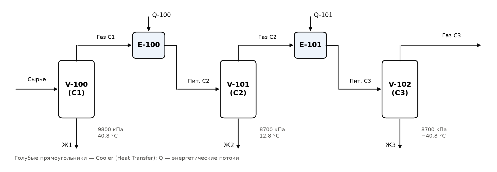
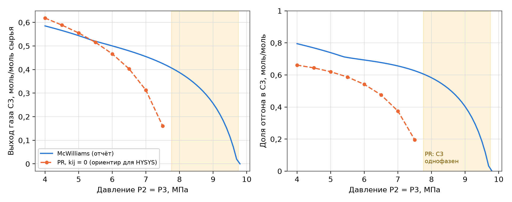

# Как пользоваться

Пошаговая инструкция для компьютерного класса с Aspen HYSYS. Это **необязательная перекрёстная проверка** (0 баллов: темы САПР по лекциям 4 и 13 не оцениваются); она пригодится, если преподаватель попросит показать расчёт в САПР. Дома HYSYS нет – всё ниже рассчитано на один визит в класс: около 1,5 ч на три сценария.

**Что взять:** этот файл (на телефоне или распечатку разделов 2–5), флешку для файлов .hsc и скриншотов, отчёт (таблицы 17–22, 25).

**Названия кнопок** даны по английскому интерфейсу, как на слайдах лекций 4 и 13; в скобках – русский интерфейс (часть слайдов лекции 13 сняты в нём: «Главн.», «Рабочая книга», «Примеры»). Десятичный разделитель в полях HYSYS – как в настройках Windows (в русской Windows обычно запятая; если поле не принимает – точка). Названия, которых нет на слайдах (клавиша F4, группа Manipulator для операции Set, поле Reaction Set на вкладке Reactions реактора), даны по типовому интерфейсу HYSYS последних версий; если в классе версия другая – искать по смыслу, ориентир – скриншоты лекций 4 и 13.

**Откуда числа для сверки:** из отчёта (вывод программы mhtp_v8.py) и из контрольного расчёта по уравнению Пенга–Робинсона src/pr_flash.py – это тот же пакет свойств, что выбирается в HYSYS (подробно – в разделе 2.4). Все числа сверяет скрипт check.py.

| № | Задача отчёта | Аппарат HYSYS | Главное число для сверки | Время |
|:--:|:------------------|:-------------|:------------------|:----:|
| 1 | 3.2 – три сепаратора | 3 Separator, 2 Cooler | доли отгона С2 и С3, выход газа С3 | 40 мин |
| 2 | 4.1 – синтез аммиака | Equilibrium Reactor | NH~3~ на выходе 1,6691 kgmole/h | 25 мин |
| 3 | 4.2а – дегидрирование этана | Gibbs Reactor | степень превращения этана 0,79–0,80 | 15 мин |

: Таблица 1 – Сценарии и ожидаемые результаты (пакет свойств во всех сценариях – Peng-Robinson)

\newpage

# 1 Общий порядок работы в HYSYS

Последовательность из лекции 4: компоненты → термодинамическая модель → потоки → схема → расчёт → анализ результатов.

## 1.1 Новый файл и единицы СИ

1. File → New → Case (новый файл).
2. Лента Home (Главн.) → группа Units (Ед. измер.) → выпадающий список набора единиц: выбрать **SI** (на слайдах лекции стоит EuroSI – там давление в барах). В наборе SI температура в °C, давление в kPa, мольный расход в kgmole/h (1 kgmole/h = 0,2778 моль/с), энергия в kJ/h.
3. Если нужна температура в кельвинах: Unit Sets (Наб.един.) → скопировать набор SI (Copy) → в копии для Temperature выбрать K → выбрать копию в списке набора единиц. Ниже все температуры даны и в К, и в °C.

## 1.2 Список компонентов

1. Внизу слева переключатель Properties (Свойства) → в дереве Component Lists → Add.
2. Select: Pure Components; в поле Search for набрать название; Search by – Full Name/Synonym или Formula (по лекции 4 поиск возможен по имени в базе, полному названию и формуле).
3. Выделить вещество в правом списке → кнопка Add. Лишнее удаляется кнопкой Remove.

## 1.3 Пакет свойств (Fluid Package)

1. В дереве Fluid Packages → Add → открывается Basis-1, вкладка Set Up.
2. В списке Property Package Selection выбрать **Peng-Robinson**; в поле Component List Selection – свой список компонентов. Остальные опции не трогать.

## 1.4 Набор реакций (только для сценария 2)

Reactions → Add → появляется Set-1 → Add Reaction → в окне выбрать Equilibrium → Add Reaction. Заполнение – в разделе 3. После настройки набора реакций нажать **Add to FP** и выбрать Basis-1 – без этого реактор реакцию не увидит.

## 1.5 Потоки

1. Переключатель Simulation (Моделирование) внизу слева – открывается поле схемы (Flowsheet) и палитра Model Palette (если её нет – клавиша F4).
2. Материальный поток – голубая стрелка в палитре, или Flowsheet → Add Stream, или клавиша F11; энергетический поток – красная стрелка.
3. Двойной щелчок по потоку → вкладка Worksheet → Conditions: задать **ровно 4 степени свободы** – состав, расход и любые два из трёх (Temperature, Pressure, Vapour / Phase Fraction). Состав: пункт Composition → Edit… → ввести мольные доли → Normalize → OK.

## 1.6 Аппараты и соединения

Палитра → нужная группа (Separator, Heat Transfer, Reactor, Manipulator) → щёлкнуть значок → щёлкнуть по свободному полю схемы → двойной щелчок по аппарату → вкладка Design → Connections: выбрать входы, выходы и энергетический поток из выпадающих списков (или набрать новое имя – поток создастся). В Parameters задать перепад давления Delta P (в этой работе везде 0, если не сказано иное).

## 1.7 Расчёт и чтение результатов

- Решатель включён кнопкой Active (Акт.) в группе Solver (Решатель) на ленте Home. HYSYS пересчитывает схему после каждого ввода.
- Полоса внизу окна аппарата или потока: зелёная **OK** – посчитано; жёлтая – не хватает данных (в тексте сказано, чего именно); красная – ошибка или нет сходимости.
- Сводка: в дереве Simulation → Workbook (Рабочая книга) → вкладки Material Streams, Compositions, Energy Streams. По отдельному потоку: Worksheet → Conditions, Composition, K Value.

## 1.8 Исследование параметра (Case Study)

Home (Главн.) → группа Analysis → Case Studies (Примеры) → Add (Доб.) → Case Study 1 (Пример 1):

1. Вкладка Variable Selection (Выбор переменной) → Independent Variables (Независимые) → Find Variables (Найти переменные) → в окне Variable Navigator (Навиг. перемен.) выбрать объект (поток), затем переменную → стрелка → → Done (Готово).
2. Так же Dependent Variables (Зависимые переменные) – всё, что нужно записать.
3. Вкладка Case Study Setup (Настройки проекта): тип Nested (Вложение), Start, End, Step Size (Начать, Конец, Размер шага) → Run (Запускать).
4. Results (Результаты) – таблица (кнопка Send to Excel – Отправить в Excel); Plots (Граф.) – график.

## 1.9 Сохранение

File → Save As → файл .hsc на флешку, имя латиницей (например, MHTP_S1_separators.hsc). Скриншоты – клавиши Win + Shift + S или фото экрана телефоном (список – в разделе 5.2).

\newpage

# 2 Сценарий 1. Сепарационный блок (задача 3.2)

## 2.1 Компоненты, пакет и сырьё

Component List: Methane, Ethane, Propane, i-Butane, n-Butane, n-Pentane (компоненты «C~4~» и «C~5~» задания трактуются как н-бутан и н-пентан – так же, как в отчёте). Fluid Package: Peng-Robinson.

Поток «Сырьё» (в HYSYS лучше латиницей: Feed): Temperature 40,8 °C (313,95 К), Pressure 9800 kPa, Molar Flow 100 kgmole/h (100 вместо 1 моль – чтобы все расходы читались как проценты от сырья), состав – таблица 2.

| Компонент | Имя в HYSYS | Мольная доля |
|:----------------|:-----------|:---------:|
| Метан CH~4~ | Methane | 0,72211 |
| Этан C~2~H~6~ | Ethane | 0,03608 |
| Пропан C~3~H~8~ | Propane | 0,22363 |
| Изобутан i-C~4~H~10~ | i-Butane | 0,00646 |
| н-Бутан C~4~H~10~ | n-Butane | 0,00466 |
| н-Пентан C~5~H~12~ | n-Pentane | 0,00706 |
| Сумма | | 1,00000 |

: Таблица 2 – Состав сырья сепарационного блока (задание, вариант 8)

## 2.2 Схема

{width=16cm}

1. **V-100 (С1):** палитра → Separator → Separator. Connections: Inlets – Feed; Vapour Outlet – «Gas1»; Liquid Outlet – «Liq1». Parameters: Delta P = 0, Type – Separator.
2. **E-100:** палитра → Heat Transfer → Cooler. Inlet – Gas1; Outlet – «Feed2»; Energy – «Q-100». Delta P не задавать. В потоке Feed2 задать Temperature 12,8 °C (285,95 К) и Pressure 8700 kPa – HYSYS сам найдёт перепад давления 1100 kPa и отводимое тепло. Холодильник с заданными T и P на выходе заменяет дроссель и теплообменник реальной установки.
3. **V-101 (С2):** Inlets – Feed2; выходы «Gas2», «Liq2»; Delta P = 0.
4. **E-101:** Inlet – Gas2; Outlet – «Feed3»; Energy – «Q-101»; в Feed3: Temperature −40,8 °C (232,35 К), Pressure 8700 kPa.
5. **V-102 (С3):** Inlets – Feed3; выходы «Gas3» (товарный газ) и «Liq3»; Delta P = 0.
6. Все полосы зелёные → Workbook → Material Streams и Compositions → скриншоты.

**Как читать долю отгона.** Сепаратор без перепада давления и без энергетического потока – это однократное испарение входного потока, поэтому доля отгона e сепаратора равна Vapour / Phase Fraction его входа: e~1~ – у Feed, e~2~ – у Feed2, e~3~ – у Feed3. Расходы при 100 kgmole/h сырья – это наши значения «на 1 моль», умноженные на 100.

## 2.3 Ожидаемые результаты

| Показатель | Отчёт (McWilliams) | Ориентир PR | HYSYS (вписать) |
|:------------------------|:-----------:|:-----------:|:----------:|
| С1: доля отгона e~1~ | 0,7361 | 1 (одна фаза) | |
| С1: жидкость Liq1, kgmole/h | 26,39 | 0 | |
| С2: доля отгона e~2~ | 0,8761 | 0,8021 | |
| С2: жидкость Liq2, kgmole/h | 9,12 | 19,79 | |
| С3: доля отгона e~3~ | 0,4775 | одна фаза (Z = 0,293) | |
| Газ С3 (Gas3), kgmole/h | 30,80 | 0 или 80,21 (см. раздел 2.4) | |
| CH~4~ в газе С3, мольная доля | 0,99249 | – | |

: Таблица 3 – Базовый режим: P~1~ = 9,8 МПа, P~2~ = P~3~ = 8,7 МПа (на 100 kgmole/h сырья)

| Показатель | Отчёт (McWilliams) | Ориентир PR | HYSYS (вписать) |
|:------------------------|:-----------:|:-----------:|:----------:|
| С1: доля отгона e~1~ | 0,7361 | 1 (одна фаза) | |
| С2: доля отгона e~2~ | 0,9805 | 0,8620 | |
| С3: доля отгона e~3~ | 0,6932 | 0,5412 | |
| Газ С3 (Gas3), kgmole/h | 50,03 | 46,66 | |
| CH~4~ в газе С3, мольная доля | 0,97979 | 0,93664 | |
| C~3~H~8~ в газе С3, мольная доля | 0,00911 | 0,04304 | |

: Таблица 4 – Рекомендуемый режим: P~2~ = P~3~ = 6,0 МПа (в Feed2 и Feed3 задать 6000 kPa)

## 2.4 Почему HYSYS не совпадёт с отчётом – и почему это нормально

- В отчёте константы фазового равновесия считаются по корреляции McWilliams (так требует задание), HYSYS считает их по уравнению Пенга–Робинсона. Корреляция аппроксимирует номограммы ДеПристера до 6–7 МПа и не учитывает критическую область; базовые давления 8,7–9,8 МПа лежат вне её области (это сказано в отчёте, раздел 3.2.2).
- Контрольный расчёт по PR (src/pr_flash.py: тест стабильности Михельсена и метод последовательных подстановок; T~c~, P~c~, ω – справочник IFP, табл. A2; k~ij~ = 0) показывает: при 40,8 °C сырьё **однофазно при любом давлении** – наибольшая температура двухфазной области около 29,2 °C (при 7,0 МПа), тогда как по McWilliams точка росы при 9,8 МПа – 82,3 °C. Поэтому в HYSYS у V-100 жидкости не будет (Liq1 = 0, у Feed Vapour Fraction = 1).
- Газ С2 при 8,7 МПа и −40,8 °C по PR тоже однофазен – плотная фаза с Z = 0,293. HYSYS отнесёт её целиком к газу или к жидкости по своему правилу идентификации фаз, поэтому Gas3 окажется либо 0, либо 80,21 kgmole/h. Это не ошибка ввода, а признак околокритической области.
- При рекомендованных 6,0 МПа обе модели дают двухфазные С2 и С3 и близкий выход газа (46,66 против 50,03 kgmole/h). Это довод за выбранный в отчёте режим: он работоспособен независимо от модели.
- HYSYS подставляет собственные небольшие коэффициенты k~ij~ для пар углеводородов, поэтому его числа могут отличаться от ориентира PR во 2–3-м знаке, сильнее всего вблизи критической области.

## 2.5 Case Study по давлению P~2~

1. Чтобы P~3~ следовало за P~2~ (как в отчёте, P~3~ = P~2~), поставить логическую операцию: палитра → Manipulator → Set (значок «S»). Target Variable: Object – Feed3, Variable – Pressure; Source: Object – Feed2; в Parameters множитель 1, смещение 0. Давление в Feed3 при этом не задавать (HYSYS возьмёт его от Set).
2. Case Study (раздел 1.8): Independent – Feed2, Pressure; Start 4000, End 9500 kPa, Step Size 500 kPa (12 состояний; шаг 100 kPa – 56 состояний, дольше). Dependent – Vapour Fraction потоков Feed2 и Feed3, Molar Flow потока Gas3, мольные доли Methane и Propane в Gas3.
3. Run → Results → Send to Excel; Plots – график Gas3 Molar Flow от давления Feed2.
4. Ожидаемая картина (рисунок 2): по PR выход газа монотонно падает от 61,8 kgmole/h при 4,0 МПа до 16,1 kgmole/h при 7,5 МПа, а с 8,0 МПа сепаратор С3 становится однофазным. По McWilliams (отчёт, таблица 20) С2 однофазен ниже 5,39 МПа, выход газа плавно падает до 30,80 kgmole/h при 8,7 МПа.

{width=16cm}

\newpage

# 3 Сценарий 2. Синтез аммиака в равновесном реакторе (задача 4.1)

## 3.1 Компоненты, пакет и реакция

Новый файл или новый Component List: Nitrogen, Hydrogen, Ammonia. Fluid Package: Peng-Robinson.

Properties → Reactions → Add → Set-1 → Add Reaction → Equilibrium → Add Reaction → Rxn-1. Заполнить по таблице 5.

| Вкладка | Поле | Значение | Пояснение |
|:-----------|:---------------|:---------|:-------------------|
| Stoichiometry | Nitrogen, Stoich Coeff | −0,5 | реагенты – со знаком минус |
| Stoichiometry | Hydrogen, Stoich Coeff | −1,5 | |
| Stoichiometry | Ammonia, Stoich Coeff | 1 | Balance Error должен быть 0 |
| Stoichiometry | Basis | **Partial Press** | не Activity (по умолчанию) |
| Stoichiometry | Phase | VapourPhase | |
| Stoichiometry | Basis Units | **atm** | K задана в атм^−1^ |
| Keq | Keq Source | Fixed Keq | |
| Keq | Keq | 0,05 | флажок Log Basis снят; с флажком – ln K = −2,9957 |

: Таблица 5 – Настройка реакции $\mathrm{\tfrac{1}{2} N_2 + \tfrac{3}{2} H_2 \rightleftarrows NH_3}$

Статус Rxn-1 и Set-1 должен стать Ready (зелёный). Затем Set-1 → **Add to FP** → Basis-1. Запись через Partial Press и atm – это ровно выражение отчёта $K_p = p_{\mathrm{NH_3}} / (p_{\mathrm{N_2}}^{0{,}5} \cdot p_{\mathrm{H_2}}^{1{,}5})$ в приближении идеального газа.

## 3.2 Сырьё и реактор

Поток Feed1: Temperature 315,85 °C (589 К); Pressure 22 291,5 kPa (220 атм ∙ 101,325 kPa/атм); состав – мольными расходами: Composition → Edit… → базис Mole Flows: Nitrogen 1,1; Hydrogen 3,0; Ammonia 0,2 kgmole/h (итого 4,3 kgmole/h; мольные доли 0,25581; 0,69767; 0,04651).

1. Палитра → Reactor → Equilibrium Reactor (значок «E») → ERV-100.
2. Design → Connections: Inlets – Feed1; Vapour Outlet – Vap1; Liquid Outlet – Liq1; Energy – Q-100 (энергетический поток обязателен: без него реактор адиабатический).
3. Вкладка Reactions → Details: Reaction Set – Set-1.
4. Design → Parameters: Delta P = 0.
5. Изотермический режим: в потоке Vap1 задать Temperature 315,85 °C. HYSYS рассчитает отводимое тепло в Q-100.

## 3.3 Ожидаемые результаты

| Величина | Отчёт (таблица 22) | HYSYS (вписать) |
|:--------------------------|:--------------:|:----------:|
| N~2~ на выходе, kgmole/h | 0,3654 | |
| H~2~ на выходе, kgmole/h | 0,7963 | |
| NH~3~ на выходе, kgmole/h | 1,6691 | |
| Всего Vap1, kgmole/h | 2,8309 | |
| y~NH3~ | 0,5896 | |
| Liq1, kgmole/h | 0 | |
| Reactions → Results → Reaction Extents: Act. % Cnv. (Nitrogen) | 66,78 % | |
| Rxn Extent, kgmole/h | 1,4691 | |

: Таблица 6 – Сверка сценария 2 (589 К, 220 атм, питание 4,3 kgmole/h)

При Basis = Partial Press расчёт HYSYS – то же уравнение, что в отчёте, поэтому совпадение ожидается до 3–4-го знака. Если не совпало – проверить Basis и Basis Units, знаки коэффициентов, давление в kPa и изотермичность (Vap1 = 315,85 °C).

## 3.4 Дополнительно (если спросят)

- **Адиабатический режим:** удалить Q-100 и температуру Vap1 – смесь разогреется, K уменьшится, NH~3~ станет меньше (как в примере лекции 13: 450 → 616,7 °C, y~NH3~ 0,30 → 0,10).
- **Basis = Activity:** HYSYS запишет K через фугитивности по уравнению PR – равновесие при 220 атм сдвинется (отчёт, раздел 4.1: $K_f = K_p \cdot K_\varphi$). Это показывает, чем реальный газ отличается от идеального; число в отчёт не переносить.

\newpage

# 4 Сценарий 3 (кратко). Реактор Гиббса: дегидрирование этана (задача 4.2а)

1. Новый файл. Component List – **только** Ethane, Ethylene, Hydrogen (с метаном реактор Гиббса уйдёт в метан, см. раздел 5.1). Fluid Package – Peng-Robinson. Реакции не задавать.
2. Поток Feed: Ethane, мольная доля 1; Molar Flow 1 kgmole/h; Temperature 826,85 °C (1100 К); Pressure 101,325 kPa (1 атм).
3. Палитра → Reactor → Gibbs Reactor → GBR-100. Connections: Inlets – Feed; Vapour Outlet – Vap1; Liquid Outlet – Liq1; Energy – Q-100. Reactions → Overall: **Gibbs Reactions Only**. Parameters: Delta P = 0. В Vap1 задать Temperature 826,85 °C (изотермический режим).
4. Сверка – таблица 7. HYSYS берёт энергии Гиббса из своей базы, а мы – из справочника IFP с экстраполяцией за 1000 К, поэтому возможна разница в 3-м знаке. Константу, которую «получил» HYSYS, можно найти из его состава: $K = y_{\mathrm{C_2H_4}} \cdot y_{\mathrm{H_2}} / y_{\mathrm{C_2H_6}}$ (при 1 атм) – и сравнить с 1,659.

| Величина | Отчёт (таблицы 25, 26) | HYSYS (вписать) |
|:--------------------------|:--------------:|:----------:|
| Степень превращения этана $x$ | 0,7899 (диапазон 0,790–0,799 при K = 1,659–1,76) | |
| C~2~H~6~ в Vap1, мольная доля | 0,1174 | |
| C~2~H~4~ в Vap1, мольная доля | 0,4413 | |
| H~2~ в Vap1, мольная доля | 0,4413 | |
| Vap1, kgmole/h | 1,7899 | |
| K = y~C2H4~ ∙ y~H2~ / y~C2H6~ | 1,659 | |

: Таблица 7 – Сверка сценария 3 (1100 К, 1 атм, 1 kgmole/h этана)

Если останется время: Case Study по температуре Feed 900–1200 К (626,85–926,85 °C) с операцией Set «температура Vap1 = температура Feed» – зависимость x(T) растёт, так как реакция эндотермическая.

\newpage

# 5 Типичные ошибки и что сохранить

## 5.1 Типичные ошибки

| Признак | Причина | Что сделать |
|:-------------------|:--------------------|:--------------------|
| Жёлтая полоса Unknown Compositions | состав не задан или сумма ≠ 1 | Composition → Edit… → Normalize |
| Сообщение о противоречии (Inconsistency) | задано больше 4 степеней свободы (например, T, P и доля пара) | удалить лишнее значение |
| Давления не те, что в задании | в сепараторе или реакторе остался перепад Delta P | Parameters → Delta P = 0 |
| Числа в барах, °F, lbmole/h | выбран не тот набор единиц | Home → Units → SI |
| 220 вместо 22 291,5 в поле давления | давление в атм введено в kPa | вводить в kPa или выбрать atm в списке единиц поля |
| Реакция или набор Not Ready | Balance Error ≠ 0, не задан Keq | проверить коэффициенты и вкладку Keq |
| Реактор не реагирует | набор не добавлен в пакет или не выбран в реакторе | Add to FP; Reactions → Details → Reaction Set |
| NH~3~ меньше ожидаемого, T продукта выше сырья | нет энергетического потока – адиабатический режим | подключить Q-100, задать T в Vap1 |
| NH~3~ отличается при правильном режиме | Basis = Activity вместо Partial Press | поменять Basis, Basis Units – atm |
| В Gibbs-реакторе метан или иные продукты | в списке компонентов есть лишние вещества | оставить Ethane, Ethylene, Hydrogen |
| В V-100 нет жидкости, у Feed доля пара 1 | не ошибка: по PR сырьё при 40,8 °C однофазно | скриншот, объяснение – раздел 2.4 |
| Case Study не меняет P~3~ | нет операции Set Feed2 → Feed3 | добавить Set (раздел 2.5) |

: Таблица 8 – Типичные ошибки в HYSYS и их устранение

## 5.2 Что заснять и сохранить

1. Для каждого сценария – окно Component List и вкладку Set Up пакета свойств (видно Peng-Robinson).
2. Схему (PFD) целиком – все аппараты с зелёным статусом.
3. Workbook → Material Streams и Compositions.
4. Сценарий 1 – окно V-100 (Worksheet) с долей пара; Case Study – таблица Results и график Plots.
5. Сценарий 2 – вкладки Stoichiometry и Keq реакции Rxn-1; ERV-100 → Reactions → Results (Reaction Balance и Reaction Extents).
6. Сценарий 3 – GBR-100 → Reactions → Overall и состав Vap1.
7. Файлы .hsc всех трёх сценариев; заполненные столбцы «HYSYS (вписать)» в таблицах 3, 4, 6, 7.

## 5.3 Если попросят показать расчёт в САПР – что сказать

- «Задачи решены в Python по методикам курса; в HYSYS я повторил задачи 3.2, 4.1 и 4.2а. Синтез аммиака совпал полностью – при Basis = Partial Press это то же уравнение равновесия идеального газа. Дегидрирование этана совпало в пределах разницы справочных данных».
- «Сепараторы расходятся – и это ожидаемо: в отчёте по заданию корреляция McWilliams, в HYSYS – уравнение Пенга–Робинсона. По PR сырьё при 40,8 °C однофазно, а газ С2 при 8,7 МПа и −40,8 °C – околокритическая плотная фаза; при выбранном мной давлении 6,0 МПа обе модели дают рабочий двухфазный режим и близкий выход газа (0,467 и 0,500 моль/моль). Поэтому 6,0 МПа – надёжный выбор, а базовый режим 8,7–9,8 МПа корреляция описывает лишь ориентировочно, что я отметил в отчёте».
