\newpage

# Введение

Цель работы – решить двенадцать расчётных задач курса «Моделирование химико-технологических процессов» по пяти темам (вариант 8): эмпирические модели и регрессия, уравнения состояния газов, фазовые равновесия, химическое равновесие и материальные балансы химико-технологических схем. Постановки задач взяты из задания на 7 семестр [{{ref:task}}]; большинство из них восходит к задачнику Б. Финлейсона [{{ref:finlayson}}]. Методологические основы – классификация моделей, построение детерминированных и эмпирических (регрессионных) моделей, численные методы решения уравнений – изложены в учебных пособиях [{{ref:gumerov}}, {{ref:usheva}}, {{ref:samoylov}}].

Все задачи решены на языке Python 3 с библиотеками NumPy (полиномы, линейная алгебра, интегрирование), SciPy (нелинейный метод наименьших квадратов, решение нелинейных уравнений и систем) и Matplotlib (графики) [{{ref:numpy}}, {{ref:scipy}}]. Полный текст программы приложен к отчёту в двух видах: файл mhtp_v8.py и блокнот Jupyter mhtp_v8.ipynb с теми же ячейками. В отчёт код вставлен текстом (это разрешено требованиями к оформлению) вместе с результатом работы программы. Внутри расчётов используются единицы СИ; если в условии заданы атмосферы, psia, градусы Ранкина или калории, значения пересчитываются на входе, а результат приводится и в СИ, и в требуемых единицах.

Общая часть программы – подключение библиотек, физические константы и функции оценки качества моделей:

```python
import numpy as np
import matplotlib.pyplot as plt
from scipy import stats
from scipy.optimize import brentq, curve_fit, fsolve, least_squares

R = 8.314462618         # универсальная газовая постоянная, Дж/(моль·К)
ATM = 101325.0          # 1 атм, Па
PSI = 6894.757293168    # 1 psi (фунт-сила на кв. дюйм), Па
CAL = 4.184             # 1 кал (термохимическая), Дж
MPA = 1.0e6             # 1 МПа, Па
trapezoid = getattr(np, "trapezoid", None) or np.trapz   # NumPy 2.x / 1.x
```

{{code:sse,r2_score}}

Во всех задачах на построение моделей используются остаточная сумма квадратов и коэффициент детерминации:

$$SSE = \sum_{i=1}^{n} \left( y_i - \hat{y}_i \right)^{2}, \qquad R^{2} = 1 - \frac{SSE}{\sum_{i=1}^{n} \left( y_i - \bar{y} \right)^{2}},$$

где $y_i$ – экспериментальное значение отклика в $i$-й точке; $\hat{y}_i$ – значение, рассчитанное по модели; $\bar{y}$ – среднее экспериментальное значение; $n$ – число точек. Единицы $SSE$ – квадрат единиц отклика, $R^{2}$ безразмерен.

\newpage

# 1 Эмпирические модели и регрессия

## 1.1 Задание 1. Средняя теплоёмкость пропана

**Условие.** По табличной зависимости теплоёмкости пропана от температуры (таблица {{tabref:t11_data}}) построить эмпирическую модель $C(T)$ в виде алгебраического полинома 4-й степени (вариант 8), вычислить среднюю теплоёмкость в интервале от $T_0 = 50$ К до $T = 1300$ К интегрированием полинома и сравнить с результатом интегрирования табличных данных методом трапеций (функция numpy.trapezoid).

| T, К | C | T, К | C | T, К | C | T, К | C |
|:---:|:---:|:---:|:---:|:---:|:---:|:---:|:---:|
{{t11_data_rows}}

: Таблица {{tab:t11_data}} – Теплоёмкость пропана C, Дж/(моль∙К), в зависимости от температуры [{{ref:task}}]

**Исправление единиц в условии.** В шапке таблицы задания указано «C, кДж/кг К». Это опечатка: значения соответствуют мольной изобарной теплоёмкости пропана в идеально-газовом состоянии, Дж/(моль∙К). Проверка по справочной корреляции $C_p = a + b \cdot T + c \cdot T^{2} + d \cdot T^{3}$ (раздел D1 справочника IFP [{{ref:ifp}}]) приведена в таблице {{tabref:t11_ifp}}: табличные значения совпадают со справочными в пределах 0,3 %. Удельная теплоёмкость пропана при 300 К около 1,68 кДж/(кг∙К), то есть величины в кДж/(кг∙К) были бы в 44 раза меньше табличных. Далее везде $C$ – в Дж/(моль∙К).

| T, К | C по заданию | $C_p$ по [{{ref:ifp}}, D1], Дж/(моль∙К) | C/M, кДж/(кг∙К) |
|:---:|:---:|:---:|:---:|
{{t11_ifp_rows}}

: Таблица {{tab:t11_ifp}} – Проверка единиц теплоёмкости (M = 44,097 г/моль) [{{ref:ifp}}]

**Метод.** Модель ищется в виде полинома

$$C(T) = a_0 + a_1 \cdot T + a_2 \cdot T^{2} + a_3 \cdot T^{3} + a_4 \cdot T^{4},$$

где $C$ – мольная теплоёмкость, Дж/(моль∙К); $T$ – температура, К; $a_0, \ldots, a_4$ – эмпирические коэффициенты, единицы $a_k$ – Дж/(моль∙К^k+1^). Коэффициенты находятся методом наименьших квадратов (минимум $SSE$) [{{ref:usheva}}] функцией numpy.polyfit; для полинома задача линейна по коэффициентам и решается без начального приближения.

Средняя теплоёмкость по определению

$$\langle C \rangle = \frac{\int_{T_0}^{T} C \, dT}{T - T_0},$$

где $\langle C \rangle$ – средняя теплоёмкость в интервале, Дж/(моль∙К); $T_0 = 50$ К и $T = 1300$ К – границы интервала. Интеграл полинома берётся аналитически (функция numpy.polyint строит первообразную):

$$\int_{T_0}^{T} C \, dT = \sum_{k=0}^{4} \frac{a_k}{k + 1} \cdot \left( T^{k+1} - T_0^{k+1} \right).$$

Интеграл по таблице без модели вычисляется по формуле трапеций для неравномерной сетки:

$$\int_{T_0}^{T} C \, dT \approx \sum_{i=1}^{n-1} \frac{C_i + C_{i+1}}{2} \cdot \left( T_{i+1} - T_i \right),$$

где $C_i$ – табличная теплоёмкость при температуре $T_i$, Дж/(моль∙К); $n = 16$ – число точек таблицы.

**Программа.**

{{code:T1_T,T1_C,M_C3H8,t1z1}}

**Результат работы программы.**

{{out:t1z1}}

**Результаты.** Полученная модель:

$$C(T) = {{t11_a0}} + {{t11_a1}} \cdot T + {{t11_a2}} \cdot T^{2} - {{t11_a3abs}} \cdot T^{3} + {{t11_a4}} \cdot T^{4}.$$

Коэффициент детерминации $R^{2} = {{t11_R2}}$, остаточная сумма $SSE = {{t11_SSE}}$ (Дж/(моль∙К))^2^; наибольшее по модулю отклонение {{t11_rmax}} Дж/(моль∙К) (при {{t11_Tmax}} К), то есть менее 1,5 % от значения. Остатки (рисунок {{figref:t11}}) знакопеременны и не образуют систематического тренда – полином 4-й степени адекватно описывает данные во всём интервале 50–1300 К.

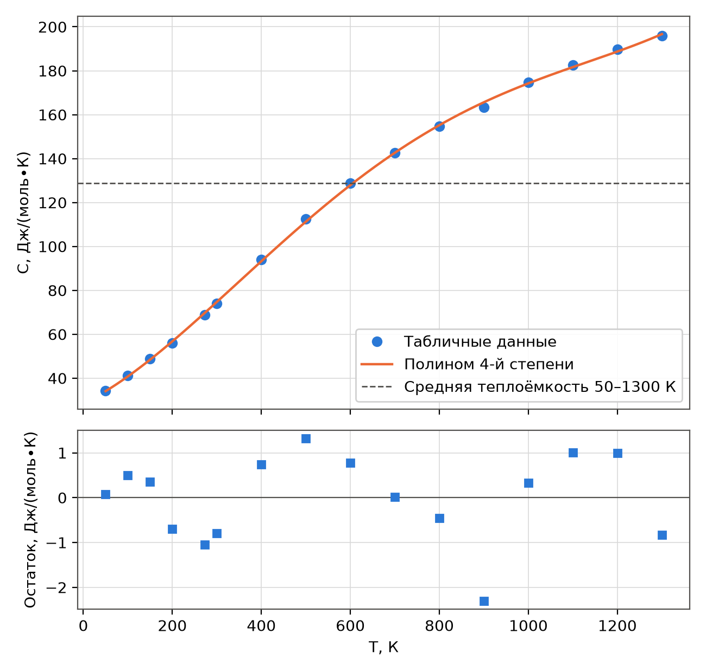{width=15cm}

| Способ вычисления интеграла | Интеграл, Дж/моль | $\langle C \rangle$, Дж/(моль∙К) | $\langle C \rangle$, кДж/(кг∙К) |
|:----------------------|:----------:|:----------:|:----------:|
| Интегрирование полинома 4-й степени | {{t11_Ip}} | {{t11_Cp}} | {{t11_Cpm}} |
| Метод трапеций по таблице (numpy.trapezoid) | {{t11_It}} | {{t11_Ct}} | {{t11_Ctm}} |

: Таблица {{tab:t11_res}} – Средняя теплоёмкость пропана в интервале 50–1300 К

Расхождение двух способов составляет {{t11_dabs}} Дж/(моль∙К), или {{t11_d}} %. Его можно разложить на две части. Погрешность самого метода трапеций: если применить формулу трапеций к значениям полинома в тех же узлах, отклонение от точного интеграла полинома равно {{t11_etr}} Дж/(моль∙К) (кривая $C(T)$ на большей части интервала выпукла вверх, и хорды лежат ниже неё). Вклад остатков модели равен {{t11_emod}} Дж/(моль∙К) и компенсирует первую часть с избытком.

**Вывод.** Полином 4-й степени описывает теплоёмкость пропана с $R^{2} = {{t11_R2}}$ без систематических отклонений. Средняя теплоёмкость в интервале 50–1300 К равна {{t11_Cp}} Дж/(моль∙К) по модели и {{t11_Ct}} Дж/(моль∙К) по таблице (метод трапеций); различие {{t11_d}} % пренебрежимо мало по сравнению с погрешностью исходных данных. Преимущество модели – возможность вычислить $\langle C \rangle$ для любой температуры внутри интервала, а не только для узлов таблицы. Опечатка в единицах условия исправлена: теплоёмкость дана в Дж/(моль∙К).

## 1.2 Задание 2. Содержание воды в дистилляте отпарной колонны

**Условие.** Построить эмпирическую модель зависимости содержания воды в дистилляте $y$ от расхода пара $x$ (таблица {{tabref:t12_data}}) в форме

$$y = a \cdot \left( \ln \frac{x}{b} \right)^{-2/3},$$

где $y$ – содержание воды в дистилляте, доли (безразмерно); $x$ – расход пара, кг/с; $a$ – эмпирический коэффициент (безразмерен); $b$ – эмпирический параметр, кг/с. Предложить другую функциональную форму модели.

| x, кг/с | y |
|:---:|:---:|
{{t12_data_rows}}

: Таблица {{tab:t12_data}} – Экспериментальные данные [{{ref:task}}]

**Метод.** Модель нелинейна по параметру $b$, поэтому используется нелинейный метод наименьших квадратов – функция scipy.optimize.curve_fit (итерационная минимизация $SSE$ методом доверительной области). Модель определена только при $\ln(x/b) > 0$, то есть $b < x_{\min} = 0{,}263$ кг/с, – это ограничение задано параметром bounds.

Начальное приближение имеет решающее значение. Линеаризация $y^{-3/2} = a^{-3/2} \cdot \ln x - a^{-3/2} \cdot \ln b$ даёт $b = {{t12_blin}}$ кг/с, что больше $x_{\min} = 0{,}263$ кг/с, – недопустимое значение: возведение в степень $-3/2$ многократно усиливает вес малых значений $y$ (точка $y = 0{,}04$ превращается в 125). Поэтому использован приём разделения переменных: при фиксированном $b$ модель линейна по $a$, и оптимальное $a(b) = \sum g_i \cdot y_i / \sum g_i^{2}$, где $g_i = \left( \ln(x_i / b) \right)^{-2/3}$. Перебором $b$ на сетке от 0,001 до 0,262 кг/с найдено начальное приближение $a_0 = {{t12_a0}}$, $b_0 = {{t12_b0}}$ кг/с, которое затем уточнено curve_fit.

Для сравнения построены три альтернативные модели с той же качественной зависимостью (монотонное убывание $y$ с ростом расхода пара):

- степенная $y = a \cdot x^{b}$ ($a$ – доли при $x = 1$ кг/с; $b$ – безразмерный показатель степени);
- гипербола со сдвигом $y = a / (x - c)$ ($a$ – кг/с; $c$ – кг/с, расход пара, при котором модель теряет смысл, аналог $b$ заданной модели);
- экспонента с асимптотой $y = a \cdot e^{-b \cdot x} + c$ ($a$, $c$ – доли; $b$ – с/кг).

Модели с разным числом параметров $k$ сравниваются по скорректированному коэффициенту детерминации и информационному критерию Акаике:

$$R^{2}_{\text{скор}} = 1 - \left( 1 - R^{2} \right) \cdot \frac{n - 1}{n - k}, \qquad AIC = n \cdot \ln \frac{SSE}{n} + 2 \cdot k,$$

где $n = 8$ – число точек; $k$ – число параметров модели. Лучшей считается модель с наибольшим $R^{2}_{\text{скор}}$ и наименьшим $AIC$.

**Программа.**

{{code:X2,Y2,m_given,m_power,m_hyper,m_exp,t1z2}}

**Результат работы программы.**

{{out:t1z2}}

**Результаты.** Параметры моделей (± стандартная ошибка по ковариационной матрице curve_fit) и показатели качества приведены в таблице {{tabref:t12_cmp}}, расчётные значения – в таблице {{tabref:t12_pred}}, графики – на рисунках {{figref:t12}} и {{figref:t12r}}.

| Модель | Параметры | $SSE$ | $R^{2}$ | $R^{2}_{\text{скор}}$ | $AIC$ |
|:------------|:-------------------------|:-------:|:------:|:------:|:------:|
| Заданная $a \cdot (\ln(x/b))^{-2/3}$ | $a$ = {{t12_given_p0}} ± {{t12_given_e0}}; $b$ = {{t12_given_p1}} ± {{t12_given_e1}} кг/с | {{t12_given_SSE}} | {{t12_given_R2}} | {{t12_given_R2adj}} | {{t12_given_AIC}} |
| Степенная $a \cdot x^{b}$ | $a$ = {{t12_power_p0}} ± {{t12_power_e0}}; $b$ = {{t12_power_p1}} ± {{t12_power_e1}} | {{t12_power_SSE}} | {{t12_power_R2}} | {{t12_power_R2adj}} | {{t12_power_AIC}} |
| Гипербола $a/(x - c)$ | $a$ = {{t12_hyper_p0}} ± {{t12_hyper_e0}} кг/с; $c$ = {{t12_hyper_p1}} ± {{t12_hyper_e1}} кг/с | {{t12_hyper_SSE}} | {{t12_hyper_R2}} | {{t12_hyper_R2adj}} | {{t12_hyper_AIC}} |
| Экспонента $a \cdot e^{-b \cdot x} + c$ | $a$ = {{t12_exp_p0}} ± {{t12_exp_e0}}; $b$ = {{t12_exp_p1}} ± {{t12_exp_e1}} с/кг; $c$ = {{t12_exp_p2}} ± {{t12_exp_e2}} | {{t12_exp_SSE}} | {{t12_exp_R2}} | {{t12_exp_R2adj}} | {{t12_exp_AIC}} |

: Таблица {{tab:t12_cmp}} – Сравнение эмпирических моделей y(x)

| x, кг/с | y (опыт) | Заданная | Степенная | Гипербола | Экспонента |
|:---:|:---:|:---:|:---:|:---:|:---:|
{{t12_res_rows}}

: Таблица {{tab:t12_pred}} – Экспериментальные и расчётные значения y

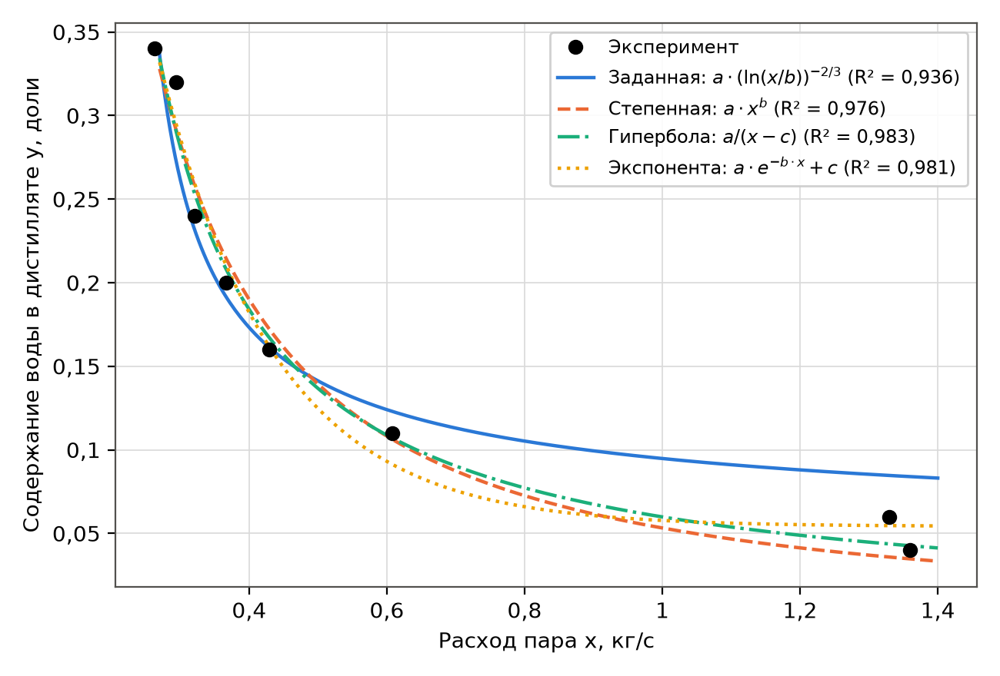{width=15cm}

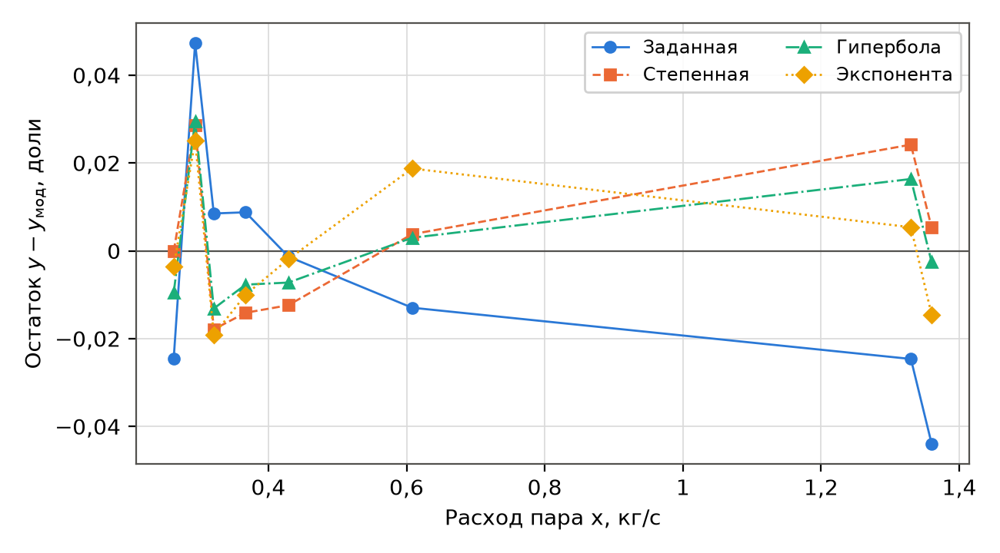{width=15cm}

Заданная модель найдена с параметрами $a = {{t12_given_p0}}$, $b = {{t12_given_p1}}$ кг/с ($R^{2} = {{t12_given_R2}}$). Её остатки систематичны: при больших расходах пара модель завышает $y$ (функция $(\ln(x/b))^{-2/3}$ убывает слишком медленно), наибольшее отклонение {{t12_maxres_given}}. Все три альтернативные формы описывают данные лучше. Наилучшая по $R^{2}_{\text{скор}}$ и $AIC$ – двухпараметрическая гипербола со сдвигом

$$y = \frac{{{t12_hyper_p0}}}{x - {{t12_hyper_p1}}}$$

($R^{2} = {{t12_hyper_R2}}$, наибольшее отклонение {{t12_maxres_hyper}}). Трёхпараметрическая экспонента даёт близкую $SSE$, но проигрывает по $R^{2}_{\text{скор}}$ и $AIC$ из-за лишнего параметра, а её горизонтальная асимптота $c > 0$ физически сомнительна. Гипербола физически осмыслена: при $x \rightarrow \infty$ содержание воды стремится к нулю, а параметр $c \approx 0{,}11$ кг/с играет роль минимального расхода пара, ниже которого колонна не работает (так же, как $b$ в заданной модели).

**Вывод.** Модель заданной формы построена ($a = {{t12_given_p0}}$, $b = {{t12_given_p1}}$ кг/с), но описывает данные удовлетворительно лишь в среднем ($R^{2} = {{t12_given_R2}}$) и систематически завышает $y$ при больших расходах пара. Другие функциональные формы существуют; рекомендуется гипербола со сдвигом $y = a/(x - c)$ ($R^{2} = {{t12_hyper_R2}}$) – она точнее, содержит столько же параметров и сохраняет физический смысл. Начальное приближение нелинейной регрессии следует искать с учётом области определения модели ($b < x_{\min}$): прямая линеаризация здесь даёт недопустимое значение параметра.

## 1.3 Задание 3. Уравнение Аррениуса

**Условие.** По зависимости константы скорости реакции от температуры (таблица {{tabref:t13}}, вариант «7 и 8») определить параметры уравнения Аррениуса

$$k = A \cdot e^{-E_a / (R \cdot T)},$$

где $k$ – константа скорости, с^−1^; $A$ – предэкспоненциальный множитель, с^−1^; $E_a$ – энергия активации, Дж/моль; $R = 8{,}314$ Дж/(моль∙К) – универсальная газовая постоянная; $T$ – абсолютная температура, К.

**Метод.** Температуры переведены в кельвины: $T = t + 273{,}15$. Логарифмирование даёт линейную зависимость

$$\ln k = \ln A - \frac{E_a}{R} \cdot \frac{1}{T},$$

параметры которой находятся линейным МНК (функция scipy.stats.linregress возвращает и стандартные ошибки коэффициентов): $E_a = -R \cdot b_1$, $A = e^{b_0}$, где $b_1$ – угловой коэффициент прямой, К; $b_0$ – свободный член. Доверительные интервалы рассчитаны с квантилем распределения Стьюдента $t_{0{,}975;\,7}$. Для анализа устойчивости оценок дополнительно выполнены расчёт без крайних точек (100 и 500 °C) и нелинейный МНК непосредственно по $k$ (curve_fit).

**Программа.**

{{code:T3_t,T3_k,arrhenius,t1z3}}

**Результат работы программы.**

{{out:t1z3}}

**Результаты.** Уравнение Аррениуса по всем точкам:

$$\ln k = {{t13_lnA}} - \frac{{{t13_slopeabs}}}{T}, \qquad E_a = {{t13_Ea}} \pm {{t13_Eaci}} \text{ кДж/моль}, \qquad A = {{t13_Am}} \text{ с}^{-1}.$$

| t, °C | T, К | 1000/T, 1/К | k, с^−1^ | ln k | $k_{\text{расч}}$, с^−1^ | Остаток ln k | $k / k_{\text{расч}}$ |
|:---:|:---:|:---:|:---:|:---:|:---:|:---:|:---:|
{{t13_rows}}

: Таблица {{tab:t13}} – Исходные данные [{{ref:task}}] и расчёт по уравнению Аррениуса

| Способ оценки | $E_a$, кДж/моль | $A$, с^−1^ | Показатель качества |
|:---------------------|:--------:|:----------:|:------------------|
| Линеаризация, все 9 точек (основной) | {{t13_Ea}} ± {{t13_Eaci}} | {{t13_A}} | $R^{2}$(ln k) = {{t13_R2ln}}; $R^{2}$(k) = {{t13_R2k}} |
| Линеаризация без точек 100 и 500 °C | {{t13_Eain}} | {{t13_Ain}} | $R^{2}$(ln k) = {{t13_R2in}} |
| Нелинейный МНК по k | {{t13_Eanl}} | {{t13_Anl}} | $R^{2}$(k) = {{t13_R2nlk}}; $R^{2}$(ln k) = {{t13_R2nlln}} |

: Таблица {{tab:t13_alt}} – Параметры уравнения Аррениуса, полученные разными способами

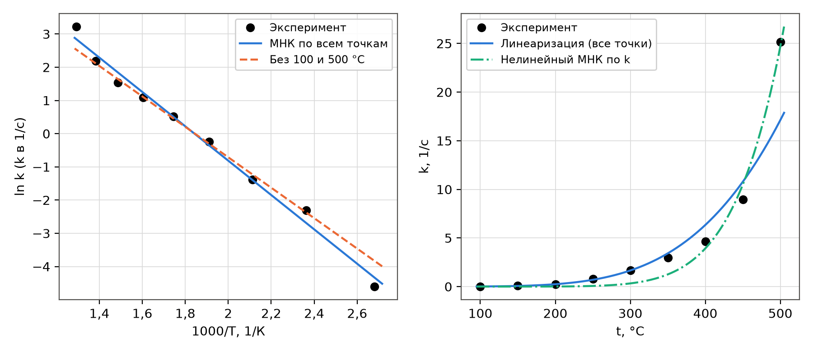{width=16cm}

Оценка адекватности. В координатах $\ln k$ – $1/T$ точки ложатся близко к прямой ($R^{2} = {{t13_R2ln}}$), то есть описание уравнением Аррениуса в целом допустимо. Однако остатки (таблица {{tabref:t13}}) распределены не случайно: точки на краях интервала (100, 150 и 500 °C) лежат дальше от прямой, чем средние, а при 350–450 °C три остатка подряд отрицательны – признак систематического, а не случайного отклонения от прямой. Точка 100 °C ($k = 0{,}01$ с^−1^) дана с одной значащей цифрой: округление до 0,01 означает неопределённость до ±50 % (от 0,005 до 0,015), поэтому её отклонение ($k / k_{\text{расч}} = {{t13_r100}}$) объяснимо погрешностью записи. Точка 150 °C ($k / k_{\text{расч}} = {{t13_r150}}$, остаток {{t13_res150}} – наибольший по модулю) отклоняется в основном потому, что прямая по всем точкам «повёрнута» крайними точкам 100 и 500 °C: без них остаток при 150 °C уменьшается до 0,07. Точка 500 °C лежит выше прямой в {{t13_r500}} раза: при переходе от 450 к 500 °C константа выросла в {{t13_step}} раза, тогда как по уравнению Аррениуса с найденной энергией активации ожидается рост в {{t13_step_arr}} раза (на трёх предыдущих шагах, 300–450 °C, – в 1,6–1,9 раза). Это может указывать на смену механизма (подключение параллельного маршрута с большей энергией активации) или на ошибку эксперимента; без этой точки и без неточной точки 100 °C $E_a = {{t13_Eain}}$ кДж/моль при $R^{2} = {{t13_R2in}}$.

Нелинейный МНК по $k$ подгоняет модель под самые большие значения константы (вклад точки 500 °C в $SSE$ доминирует), поэтому даёт завышенную энергию активации {{t13_Eanl}} кДж/моль и неверно описывает низкотемпературную область ($R^{2}$ по $\ln k$ равен {{t13_R2nlln}}). Для уравнения Аррениуса правильнее минимизировать относительные отклонения, что и делает линеаризация.

**Вывод.** Энергия активации реакции $E_a = {{t13_Ea}} \pm {{t13_Eaci}}$ кДж/моль, предэкспоненциальный множитель $A = {{t13_Am}}$ с^−1^ ($R^{2} = {{t13_R2ln}}$ в линейных координатах). Уравнение Аррениуса адекватно описывает данные в интервале 150–450 °C (по прямой, построенной без крайних точек, отклонения в этом интервале не превышают 15 %); отклонение точки 500 °C (в {{t13_r500}} раза выше расчёта по всем точкам) систематическое и требует проверки опытом. С учётом разброса оценок энергия активации лежит в интервале {{t13_Eain}}–{{t13_Ea}} кДж/моль.

## 1.4 Задание 4. Вязкость гексана: полиномы 1–3 степени

**Условие.** Для зависимости динамической вязкости гексана от температуры (таблица {{tabref:t14_data}}) построить полиномиальные модели 1–3 степени, оценить их адекватность (коэффициент детерминации, остаточная сумма) и сравнить.

{{t14_data_rows}}

: Таблица {{tab:t14_data}} – Динамическая вязкость гексана, мПа∙с [{{ref:task}}]

**Метод.** Модели

$$\mu(T) = \sum_{j=0}^{m} b_j \cdot T^{j}, \qquad m = 1, 2, 3,$$

где $\mu$ – динамическая вязкость, мПа∙с; $T$ – температура, К; $b_j$ – коэффициенты, мПа∙с/К^j^; $m$ – степень полинома. Коэффициенты находятся функцией numpy.polyfit. Кроме $R^{2}$ и $SSE$ рассчитаны: скорректированный $R^{2}_{\text{скор}}$; стандартное отклонение остатков $S = \sqrt{SSE / (n - m - 1)}$, мПа∙с; сумма квадратов ошибок перекрёстной проверки «без одной точки» $PRESS$, (мПа∙с)^2^ – каждая точка поочерёдно исключается, модель строится по остальным и прогнозирует исключённую; показатель чувствителен к переобучению. Значимость добавления кубического члена проверена F-критерием Фишера:

$$F = \frac{SSE_2 - SSE_3}{SSE_3 / (n - 4)},$$

где $SSE_2$, $SSE_3$ – остаточные суммы полиномов 2-й и 3-й степени, (мПа∙с)^2^; $n = 12$ – число точек. Для сопоставления построено также физически обоснованное уравнение Андраде $\ln \mu = A + B / T$ ($A$ – безразмерный коэффициент; $B$ – коэффициент, К).

**Программа.**

{{code:T4_T,T4_mu,t1z4}}

**Результат работы программы.**

{{out:t1z4}}

**Результаты.**

| Степень | Коэффициенты (μ в мПа∙с, T в К) | $R^{2}$ | $R^{2}_{\text{скор}}$ | $SSE$, (мПа∙с)^2^ | $S$, мПа∙с | $PRESS$, (мПа∙с)^2^ |
|:-----:|:-----------------------|:------:|:------:|:--------:|:------:|:--------:|
{{t14_rows}}

: Таблица {{tab:t14}} – Полиномиальные модели вязкости гексана

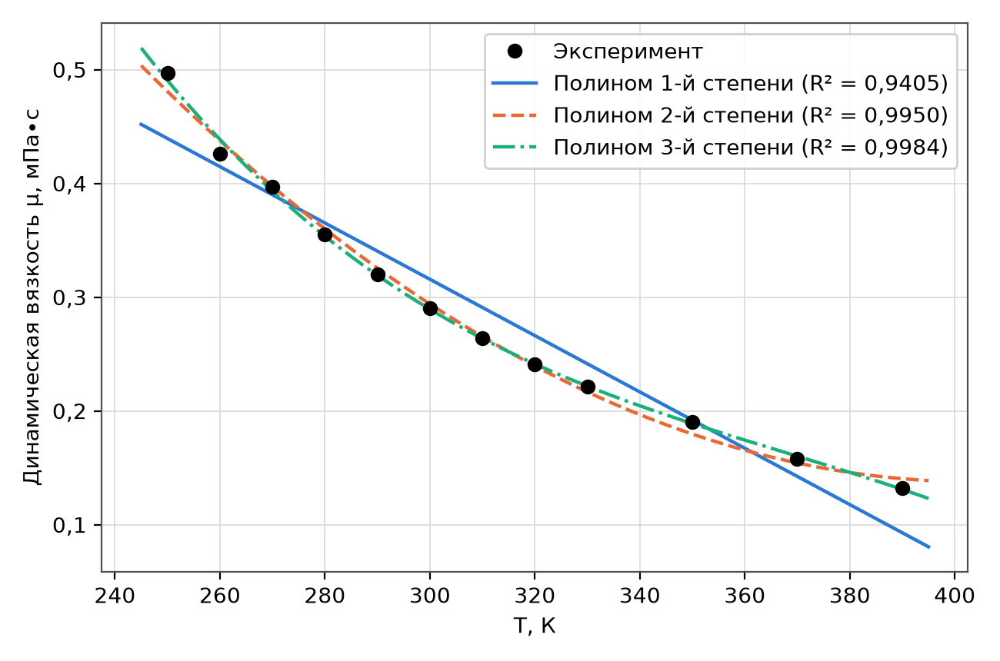{width=15cm}

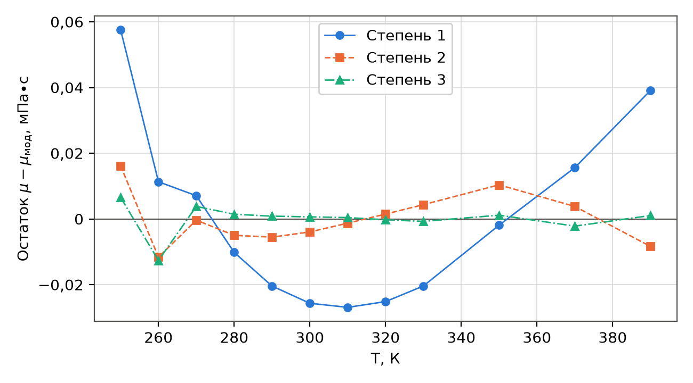{width=15cm}

Линейная модель неадекватна: $R^{2} = {{t14_R2_1}}$, остатки образуют выраженную «подкову» (рисунок {{figref:t14r}}) – зависимость вязкости от температуры нелинейна (вязкость жидкостей убывает с температурой приблизительно экспоненциально). Квадратичная модель снижает $SSE$ в 12 раз ($R^{2} = {{t14_R2_2}}$), но её остатки ещё имеют волнообразную структуру. Кубическая модель даёт $R^{2} = {{t14_R2_3}}$ и наименьшие $S = {{t14_S_3}}$ мПа∙с и $PRESS$; F-критерий $F = {{t14_F}} > F_{\text{кр}}(0{,}95;\ 1;\ 8) = {{t14_Fcrit}}$ подтверждает значимость кубического члена, а уменьшение $PRESS$ показывает, что улучшение не является переобучением. Уравнение Андраде с двумя параметрами ($R^{2} = {{t14_R2and}}$) точнее линейного полинома и надёжнее полиномов при экстраполяции за пределы 250–390 К.

Наибольший остаток всех моделей приходится на точку 260 К (для кубической модели {{t14_res260}} мПа∙с). По уравнению Андраде и полиному 3-й степени, построенным без этой точки, вязкость при 260 К ожидается {{t14_mu260a}} и {{t14_mu260p}} мПа∙с соответственно, а в таблице – 0,426 мПа∙с. Вероятна опечатка или ошибка измерения (значение рекомендуется сверить с первоисточником).

**Вывод.** С ростом степени полинома качество описания монотонно улучшается: $R^{2}$ = {{t14_R2_1}}, {{t14_R2_2}} и {{t14_R2_3}} для 1-й, 2-й и 3-й степени. Рекомендуется полином 3-й степени: он статистически значимо лучше квадратичного (F-критерий) и имеет наименьшую ошибку перекрёстной проверки. Применять его можно только внутри интервала 250–390 К; для экстраполяции предпочтительно уравнение Андраде. Точка 260 К выбивается из общей закономерности и требует проверки.

\newpage

# 2 Уравнения состояния и расчёт однофазных потоков

## 2.1 Задание 1. Мольный объём аммиака

**Условие.** Определить мольный объём аммиака при $P = 80$ атм ({{t2z1_P}} МПа) и $T = 450$ К по уравнениям идеального газа, Редлиха–Квонга и Соаве–Редлиха–Квонга; результат – в л/моль; сравнить и объяснить различия.

**Справочные данные.** Критические параметры и ацентрические факторы всех веществ темы 2 взяты из таблицы A2 справочника IFP [{{ref:ifp}}] (таблица {{tabref:t2_crit}}).

| Вещество | $T_c$, К | $P_c$, атм | $P_c$, МПа | $\omega$ |
|:---|:---:|:---:|:---:|:---:|
| Аммиак NH~3~ | 405,6 | 111,3 | 11,278 | 0,250 |
| Диоксид углерода CO~2~ | 304,2 | 72,8 | 7,376 | 0,225 |
| Кислород O~2~ | 154,6 | 49,8 | 5,046 | 0,021 |
| Азот N~2~ | 126,2 | 33,5 | 3,394 | 0,040 |

: Таблица {{tab:t2_crit}} – Критические температура и давление, ацентрический фактор [{{ref:ifp}}, A2, лист 1]

**Метод.** Уравнение идеального газа:

$$v = \frac{R \cdot T}{P},$$

где $v$ – мольный объём, м^3^/моль; $P$ – давление, Па; $T$ – температура, К; $R$ – универсальная газовая постоянная, Дж/(моль∙К).

Уравнения Редлиха–Квонга (RK) [{{ref:rk}}] и Соаве–Редлиха–Квонга (SRK) [{{ref:soave}}] имеют одинаковый вид

$$P = \frac{R \cdot T}{v - b} - \frac{a}{v \cdot (v + b)}, \qquad a = 0{,}42748 \cdot \frac{R^{2} \cdot T_c^{2}}{P_c} \cdot \alpha, \qquad b = 0{,}08664 \cdot \frac{R \cdot T_c}{P_c},$$

где $a$ – параметр притяжения молекул, Па∙м^6^/моль^2^; $b$ – собственный («исключённый») объём молекул, м^3^/моль; $T_c$ – критическая температура, К; $P_c$ – критическое давление, Па; $\alpha$ – безразмерная температурная функция. Уравнения различаются функцией $\alpha$:

$$\alpha_{\text{RK}} = T_r^{-0{,}5}, \qquad \alpha_{\text{SRK}} = \left( 1 + m \cdot \left( 1 - T_r^{0{,}5} \right) \right)^{2}, \qquad m = 0{,}480 + 1{,}574 \cdot \omega - 0{,}176 \cdot \omega^{2},$$

где $T_r = T / T_c$ – приведённая температура; $\omega$ – ацентрический фактор (учитывает несферичность молекулы); $m$ – безразмерный коэффициент Соаве.

Относительно $v$ уравнение кубическое [{{ref:lectures}}]:

$$P \cdot v^{3} - R \cdot T \cdot v^{2} + \left( a - P \cdot b^{2} - R \cdot T \cdot b \right) \cdot v - a \cdot b = 0.$$

Все три корня находятся функцией numpy.roots. Физичный корень выбирается по правилам: он действительный и больше $b$ (объём не может быть меньше собственного объёма молекул), а для газовой фазы – наибольший из действительных (наименьший корень соответствует жидкости, средний – неустойчивому состоянию). Коэффициент сжимаемости $Z = P \cdot v / (R \cdot T)$ показывает отклонение от идеального газа, для которого $Z = 1$.

Для независимого контроля рассчитан $Z$ по обобщённой корреляции Ли–Кеслера [{{ref:leekesler}}]: $Z = Z^{(0)}(T_r, P_r) + \omega \cdot Z^{(1)}(T_r, P_r)$, где $P_r = P/P_c$ – приведённое давление; $Z^{(0)}$ – коэффициент сжимаемости простого вещества; $Z^{(1)}$ – поправка на ацентричность. Реализация проверена по таблицам справочника IFP (раздел I4 [{{ref:ifp}}]): для шести табличных точек $Z^{(0)}$ воспроизводится с точностью ±0,0001.

**Программа.**

{{code:CRIT,eos_ab,cubic_volume,LK_SIMPLE,LK_REF,_lk_z,lee_kesler_z,t2z1}}

**Результат работы программы.**

{{out:t2z1}}

**Результаты.** Приведённые параметры: $T_r = {{t2z1_Tr}}$, $P_r = {{t2z1_Pr}}$ – аммиак находится в сверхкритической области вблизи критической точки, где отклонения от идеальности велики. Параметры уравнений: RK – $a = {{t2z1_RK_a}}$ Па∙м^6^/моль^2^; SRK – $a = {{t2z1_SRK_a}}$ Па∙м^6^/моль^2^; $b$ = {{t2z1_RK_b}} м^3^/моль для обоих уравнений. Кубическое уравнение имеет один действительный корень и пару комплексно-сопряжённых (для RK {{t2z1_RK_cplx}} л/моль), поэтому выбор корня однозначен (рисунок {{figref:t2}}).

| Уравнение | v, л/моль | v, м^3^/моль | Z | Отклонение от ИГ, % |
|:-------------------|:-------:|:----------:|:-------:|:--------:|
{{t2z1_rows}}

: Таблица {{tab:t2z1}} – Мольный объём аммиака при 80 атм и 450 К

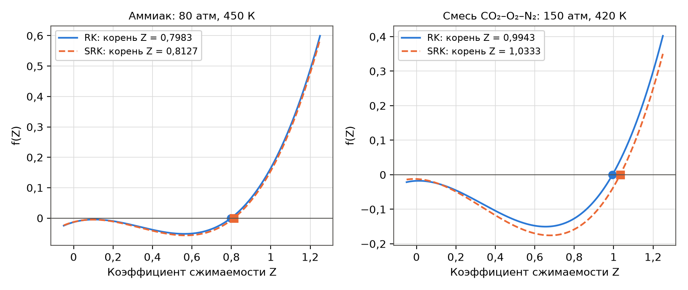{width=16cm}

Различия объясняются физикой моделей. Идеальный газ не учитывает ни притяжения молекул, ни их собственного объёма. При $T_r \approx 1{,}1$ доминирует притяжение (параметр $a$): реальный объём на {{t2z1_dSRK}}–{{t2z1_dRK}} % меньше идеального. Уравнение RK использует универсальную функцию $\alpha = T_r^{-0{,}5}$, одинаковую для всех веществ; SRK учитывает индивидуальность вещества через ацентрический фактор ($\omega = 0{,}25$ для аммиака), поэтому функция $\alpha$ и притяжение несколько меньше, а объём на {{t2z1_SRKvsRK}} % больше, чем по RK. Контрольный расчёт по Ли–Кеслеру ({{t2z1_LK_v}} л/моль) лежит между RK и SRK и отличается от SRK на {{t2z1_LKvsSRK}} %. Для полярного аммиака кубические уравнения с классическими параметрами имеют ограниченную точность (порядка нескольких процентов), но SRK точнее RK, так как его функция $\alpha$ настроена на давление насыщенных паров реальных веществ.

**Вывод.** Мольный объём аммиака при 80 атм и 450 К: по уравнению идеального газа {{t2z1_IG_v}} л/моль, по RK {{t2z1_RK_v}} л/моль ($Z = {{t2z1_RK_Z}}$), по SRK {{t2z1_SRK_v}} л/моль ($Z = {{t2z1_SRK_Z}}$). Аммиак в этих условиях существенно неидеален: уравнение идеального газа завышает объём на {{t2z1_over_SRK}}–{{t2z1_over_RK}} %. Рекомендуемое значение – по SRK, {{t2z1_SRK_v}} л/моль; его подтверждает независимая корреляция Ли–Кеслера.

## 2.2 Задание 2. Мольный объём смеси CO~2~ – O~2~ – N~2~

**Условие.** Смесь содержит 25 % (мол.) диоксида углерода, остальное – кислород и азот в мольном соотношении 1 : 3. Рассчитать мольный объём смеси при $P = 150$ атм ({{t2z2_P}} МПа) и $T = 420$ К по уравнениям идеального газа, RK и SRK (результат в л/моль), сравнить и ответить, является ли газ идеальным.

**Состав.** $y_{\mathrm{CO_2}} = 0{,}25$; $y_{\mathrm{O_2}} = 0{,}75 \cdot 1/4 = 0{,}1875$; $y_{\mathrm{N_2}} = 0{,}75 \cdot 3/4 = 0{,}5625$; сумма равна 1.

**Метод.** Параметры $a_i$, $b_i$ каждого компонента рассчитываются по формулам задания 2.1 (для SRK – со своими $\alpha_i$ и $m_i$), критические параметры – по таблице {{tabref:t2_crit}}. Параметры смеси находятся по правилам смешения [{{ref:finlayson}}, {{ref:lectures}}]:

$$a = \left( \sum_{i=1}^{N} y_i \cdot \sqrt{a_i} \right)^{2}, \qquad b = \sum_{i=1}^{N} y_i \cdot b_i,$$

где $y_i$ – мольная доля $i$-го компонента; $N = 3$ – число компонентов; $a$, Па∙м^6^/моль^2^, и $b$, м^3^/моль, – параметры смеси. Правило для $a$ эквивалентно комбинированию $a_{ij} = \sqrt{a_i \cdot a_j}$ (правило Лоренца–Бертло без поправок на бинарное взаимодействие). Далее решается то же кубическое уравнение, что и для чистого вещества. Для контроля по Ли–Кеслеру смесь заменена псевдочистым веществом с псевдокритическими параметрами по правилу Кея: $T_{pc} = \sum y_i \cdot T_{c,i} = {{t2z2_Tpc}}$ К, $P_{pc} = \sum y_i \cdot P_{c,i} = {{t2z2_Ppc}}$ атм, $\omega = \sum y_i \cdot \omega_i = {{t2z2_w}}$.

**Программа.**

{{code:t2z2}}

**Результат работы программы.**

{{out:t2z2}}

**Результаты.**

| Компонент | $y_i$ | $a_i$ (RK), Па∙м^6^/моль^2^ | $a_i$ (SRK), Па∙м^6^/моль^2^ | $b_i$, м^3^/моль | $T_{r,i}$ |
|:---------:|:------:|:-------:|:-------:|:----------:|:-----:|
{{t2z2_ab_rows}}

: Таблица {{tab:t2z2_ab}} – Параметры уравнений состояния компонентов и смеси при 420 К

| Уравнение | v, л/моль | v, м^3^/моль | Z | Отклонение от ИГ, % |
|:-------------------|:-------:|:----------:|:-------:|:--------:|
{{t2z2_rows}}

: Таблица {{tab:t2z2}} – Мольный объём смеси 25 % CO~2~, 18,75 % O~2~, 56,25 % N~2~ при 150 атм и 420 К

Смесь находится в сверхкритической области: псевдоприведённые параметры $T_{pr} = {{t2z2_Tr}}$, $P_{pr} = {{t2z2_Pr}}$. Здесь конкурируют два эффекта: притяжение молекул (в основном CO~2~, у которого $T_r = 1{,}38$) уменьшает объём, а собственный объём молекул при высоком давлении его увеличивает. По RK эффекты почти компенсируются ($Z = {{t2z2_RK_Z}}$). Функция Соаве для лёгких газов при высоких $T_r$ (у азота $T_r = 3{,}33$) убывает быстрее, чем $T_r^{-0{,}5}$: параметр $a$ смеси по SRK на {{t2z2_aratio}} % меньше, чем по RK, и преобладает отталкивание ($Z = {{t2z2_SRK_Z}}$). Это согласуется с тем, что азот при 420 К находится заметно выше своей температуры Бойля (около 327 К), а кислород – вблизи неё (около 406 К); выше температуры Бойля $Z > 1$ при любых давлениях. Контроль по Ли–Кеслеру даёт $Z = {{t2z2_LK_Z}}$ – между RK и SRK.

Ответ на вопрос «является ли газ идеальным?»: по совокупному коэффициенту сжимаемости ($Z$ от {{t2z2_RK_Z}} до {{t2z2_SRK_Z}}) отклонение мольного объёма от идеального газа не превышает {{t2z2_maxdev}} %, то есть для оценочных расчётов объёма уравнение идеального газа здесь применимо. Строго идеальным газ не является: близость $Z$ к единице – результат взаимной компенсации притяжения и отталкивания при 150 атм, а не отсутствия межмолекулярных взаимодействий. При другом давлении или для расчёта других свойств (фугитивность, энтальпия) отклонения будут существенны.

**Вывод.** Мольный объём смеси: идеальный газ – {{t2z2_IG_v}} л/моль, RK – {{t2z2_RK_v}} л/моль ($Z = {{t2z2_RK_Z}}$), SRK – {{t2z2_SRK_v}} л/моль ($Z = {{t2z2_SRK_Z}}$). Газ близок к идеальному по объёму (отклонение до {{t2z2_maxdev}} %), но не идеален по сути. Различие RK и SRK обусловлено разной температурной функцией $\alpha$ при высоких приведённых температурах; независимая корреляция Ли–Кеслера ({{t2z2_LK_v}} л/моль) лежит между ними.

\newpage

# 3 Расчёт фазовых равновесий

## 3.1 Задание 1. Температуры начала и конца кипения

**Условие.** Рассчитать температуры начала и конца кипения (°C) идеальной смеси 15 % метана, 30 % этана, 35 % пропана и 20 % н-пентана (мольные доли) при абсолютном давлении 14 атм ({{t31_P}} МПа).

**Справочные данные.** Константы фазового равновесия рассчитываются по корреляции McWilliams [{{ref:mcw}}], которая аппроксимирует номограммы ДеПристера для лёгких углеводородов:

$$\ln K_i = -\frac{A_i}{T^{2}} + B_i - C_i \cdot \ln P + \frac{D_i}{P^{2}} \quad (1), \qquad \ln K_i = -\frac{A_i}{T^{2}} + B_i - C_i \cdot \ln P + \frac{D_i}{P} \quad (2),$$

где $K_i = y_i / x_i$ – константа фазового равновесия $i$-го компонента (безразмерна); $T$ – температура, °R; $P$ – давление, psia; $A_i$ – коэффициент, °R^2^; $B_i$, $C_i$ – безразмерные коэффициенты; $D_i$ – коэффициент, psia^2^ (форма 1) или psia (форма 2). Коэффициенты – из задания (таблица {{tabref:mcw}}).

| Компонент | A | B | C | D | Форма |
|:---|:---:|:---:|:---:|:---:|:---:|
{{mcw_rows}}

: Таблица {{tab:mcw}} – Коэффициенты корреляции McWilliams [{{ref:task}}, {{ref:mcw}}]

Пересчёт единиц: $T_{°\text{R}} = 1{,}8 \cdot T_{\text{К}}$; $P_{\text{psia}} = P_{\text{Па}} / 6894{,}757$. При 14 атм давление равно {{t31_Ppsia}} psia.

**Метод.** Для идеальной смеси $K_i$ не зависит от состава. Температура начала кипения $T_{\text{нк}}$ (появление первого пузырька пара из жидкости состава $x_i = z_i$) удовлетворяет условию $\sum y_i = 1$, а температура конца кипения $T_{\text{кк}}$ (исчезновение последней капли жидкости, пар состава $y_i = z_i$) – условию $\sum x_i = 1$ [{{ref:lectures}}]. Для многокомпонентной смеси сходимость лучше в логарифмической форме:

$$\ln \left( \sum_{i=1}^{N} K_i(T, P) \cdot x_i \right) = 0, \qquad \ln \left( \sum_{i=1}^{N} \frac{y_i}{K_i(T, P)} \right) = 0,$$

где $x_i$, $y_i$ – мольные доли компонентов в жидкости и паре; $z_i$ – мольная доля в исходной смеси; $N$ – число компонентов. Каждое уравнение – нелинейное с одной неизвестной $T$; функции монотонны по $T$, поэтому после графической локализации (рисунок {{figref:t31}}) корень уточняется методом Брента (scipy.optimize.brentq) на интервале, где функция меняет знак.

**Программа.**

{{code:MCW,k_mcw,bubble_T,dew_T,T3Z1_NAMES,T3Z1_Z,t3z1}}

**Результат работы программы.**

{{out:t3z1}}

**Результаты.**

| Компонент | $z_i$ | $K_i$ при $t_{\text{нк}}$ | $y_i$ первого пузырька | $K_i$ при $t_{\text{кк}}$ | $x_i$ первой капли |
|:---|:---:|:---:|:---:|:---:|:---:|
{{t31_rows}}

: Таблица {{tab:t31}} – Константы равновесия и составы равновесных фаз в точках начала и конца кипения при 14 атм

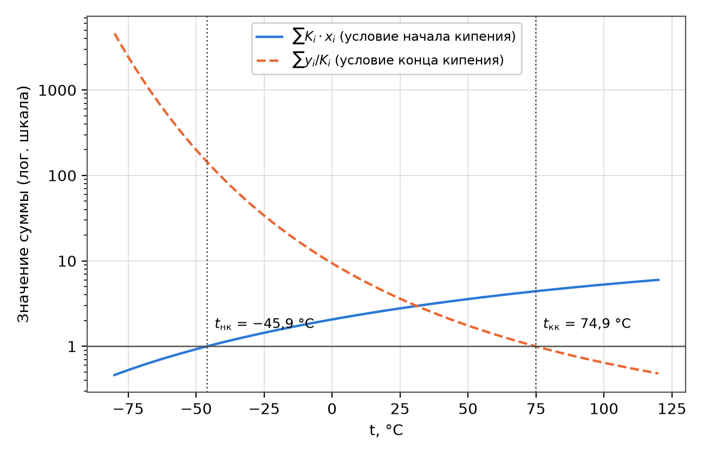{width=15cm}

Температура начала кипения $t_{\text{нк}} = {{t31_tb}}$ °C ($T = {{t31_Tb}}$ К, или {{t31_TbR}} °R), температура конца кипения $t_{\text{кк}} = {{t31_td}}$ °C ($T = {{t31_Td}}$ К, или {{t31_TdR}} °R). Широкий интервал кипения (около {{t31_range}} °C) объясняется большим различием летучестей компонентов: при $t_{\text{нк}}$ константа равновесия метана в {{t31_Kratio}} раз больше, чем н-пентана. Первый пузырёк пара на {{t31_yCH4}} % состоит из метана, последняя капля жидкости на {{t31_xC5}} % – из н-пентана. Условия расчёта (от −46 до +75 °C, 1,42 МПа) лежат внутри области построения номограмм ДеПристера, поэтому корреляция McWilliams здесь надёжна.

**Вывод.** При абсолютном давлении 14 атм смесь начинает кипеть при {{t31_tb}} °C и полностью испаряется при {{t31_td}} °C. Задача свелась к решению двух нелинейных уравнений с одной неизвестной; невязки в найденных точках менее $10^{-15}$.

## 3.2 Задание 2. Расчёт сепарационного блока

**Условие.** Сырьё (природный газ с тяжёлыми углеводородами, состав – в таблице {{tabref:t32_base}}) последовательно проходит три сепаратора (рисунок {{figref:t32s}}): газ сепаратора С1 поступает в С2, газ С2 – в С3; из каждого сепаратора отводится жидкая фаза. Базовые условия: С1 – $P_1 = 9{,}8$ МПа, $t_1 = 40{,}8$ °C; С2 – $P_2 = 8{,}7$ МПа, $t_2 = 12{,}8$ °C; С3 – $P_3 = 8{,}7$ МПа, $t_3 = -40{,}8$ °C. Рассчитать составы газовых и жидких потоков, затем (вариант 8) исследовать влияние давления во втором сепараторе и выбрать эффективный режим разделения. Константы равновесия – по корреляции McWilliams (таблица {{tabref:mcw}}; компонент «C~4~» задания – н-бутан, «C~5~» – н-пентан).

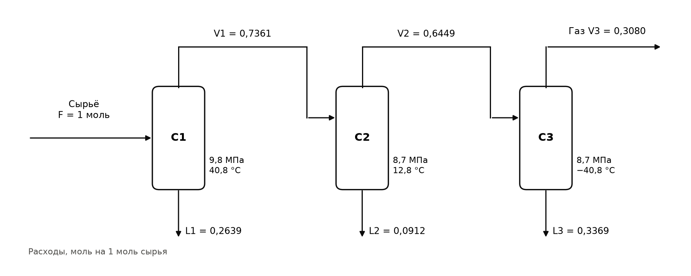{width=16cm}

**Метод.** Каждый сепаратор – аппарат однократного испарения при заданных $P$ и $T$. Доля отгона $e = V / F$ (мольная доля питания, перешедшая в газ) находится из уравнения Рачфорда–Райса [{{ref:rr}}]

$$f(e) = \sum_{i=1}^{N} \frac{z_i \cdot (K_i - 1)}{1 + e \cdot (K_i - 1)} = 0,$$

после чего составы фаз и потоки:

$$x_i = \frac{z_i}{1 + e \cdot (K_i - 1)}, \qquad y_i = K_i \cdot x_i, \qquad V = e \cdot F, \qquad L = (1 - e) \cdot F,$$

где $z_i$ – мольная доля компонента в питании сепаратора; $x_i$, $y_i$ – мольные доли в жидкости и газе; $F$, $V$, $L$ – мольные расходы питания, газа и жидкости, моль на 1 моль сырья блока; $e$ – доля отгона, моль/моль. Функция $f(e)$ монотонно убывает между асимптотами $e_{\min} = 1/(1 - K_{\max})$ и $e_{\max} = 1/(1 - K_{\min})$, поэтому корень на этом интервале единственный и надёжно находится методом Брента. Если найденный корень $e < 0$ (равносильно $\sum z_i \cdot K_i \le 1$), питание – недогретая жидкость; если $e > 1$ ($\sum z_i / K_i \le 1$) – перегретый газ. В обоих случаях сепаратор работает вхолостую: поток проходит его однофазным, программа присваивает $e = 0$ или $e = 1$ и сообщает формальное значение корня.

Показатели работы блока: выход газа сепаратора С3 $V_3$; содержание углеводородов C~3+~ в этом газе; извлечение компонента $i$ в суммарную жидкость

$$\varepsilon_i = \frac{\sum_{j=1}^{3} L_j \cdot x_{i,j}}{F \cdot z_i},$$

где $L_j$ – расход жидкости из $j$-го сепаратора, моль; $x_{i,j}$ – мольная доля компонента в ней; и показатель чёткости разделения $\text{Ч} = \varepsilon_{\mathrm{C_3H_8}} - \varepsilon_{\mathrm{CH_4}}$ (доля пропана сырья, ушедшая в жидкость, минус доля метана, ушедшая в жидкость; при идеальном разделении $\text{Ч} = 1$).

**Программа.**

{{code:SEP_NAMES,SEP_Z,SEP_BASE,rachford_rice,flash,separator_train,train_summary,t3z2_base,p_dew_at,t3z2_study}}

**Результат работы программы.**

{{out:t3z2}}

### 3.2.1 Базовый режим

| Компонент | Сырьё $z_i$ | С1: $x_i$ | С1: $y_i$ | С2: $x_i$ | С2: $y_i$ | С3: $x_i$ | С3: $y_i$ |
|:----------|:------:|:------:|:------:|:------:|:------:|:------:|:------:|
{{t32_base_rows}}

: Таблица {{tab:t32_base}} – Составы жидких ($x_i$) и газовых ($y_i$) потоков сепараторов в базовом режиме, мольные доли

| Компонент | $K_i$ в С1 | $K_i$ в С2 | $K_i$ в С3 |
|:---|:---:|:---:|:---:|
{{t32_K_rows}}

: Таблица {{tab:t32_K}} – Константы фазового равновесия в сепараторах (McWilliams)

| Сепаратор | P, МПа | t, °C | P, psia | T, °R | Питание F | Газ V | Жидкость L | Невязка f(e) |
|:-----:|:----:|:----:|:-----:|:-----:|:-----:|:-----:|:-----:|:-----------:|
{{t32_flow_rows}}

: Таблица {{tab:t32_flow}} – Условия и мольные потоки сепараторов, моль на 1 моль сырья

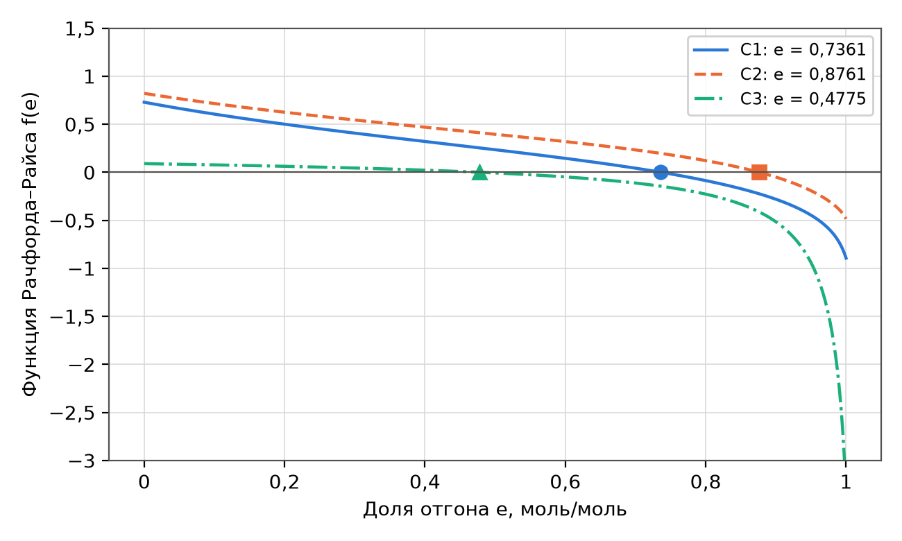{width=15cm}

Во всех трёх сепараторах в базовом режиме смесь двухфазна ($0 < e < 1$), суммы $\sum x_i = \sum y_i = 1$ выполняются с точностью $10^{-10}$, покомпонентный материальный баланс блока (жидкости трёх сепараторов плюс газ С3 равны сырью) сходится до $10^{-16}$. В С1 при 40,8 °C в жидкость уходит {{t32_L1pct}} % сырья, в основном пропан и более тяжёлые углеводороды. В С2 охлаждение до 12,8 °C при небольшом снижении давления конденсирует ещё {{t32_c2pct}} % поступающего газа. В С3 при −40,8 °C конденсируется около половины поступающего газа ($e_3 = {{t32_e3}}$): константа равновесия метана здесь всего {{t32_KCH4_3}}, поэтому жидкость С3 на {{t32_xCH4_3}} % состоит из метана. Итог базового режима: выход газа {{t32_Vout}} моль на 1 моль сырья с содержанием метана {{t32_yCH4out}} % и C~3+~ {{t32_yC3p}} %; извлечение пропана в жидкость {{t32_recC3}} %, однако в жидкость уходит и {{t32_lossCH4}} % метана сырья ($\text{Ч} = {{t32_sharp}}$).

### 3.2.2 Влияние давления во втором сепараторе

**Правило изменения давлений.** Газ из С2 поступает в С3 без компрессора, поэтому $P_3 \le P_2$; газ из С1 поступает в С2 через дроссель, поэтому $P_2 \le P_1 = 9{,}8$ МПа. Принято, как в базовом режиме, $P_3 = P_2$ (сопротивлением трубопровода и теплообменника между С2 и С3 пренебрегаем). Давление $P_2$ изменялось от 4,0 до 9,8 МПа с шагом 0,1 МПа; температуры и условия С1 – базовые. Давление начала конденсации (точки росы) газа С1 при 12,8 °C составляет $P_2^{\text{р}} = {{t32_P2dew}}$ МПа: при $P_2 < P_2^{\text{р}}$ сепаратор С2 работает однофазно.

| $P_2 = P_3$, МПа | С2: e | С3: e | Выход газа С3, моль/моль | C~3+~ в газе С3, % мол. | $\varepsilon_{\mathrm{C_3H_8}}$, % | $\varepsilon_{\mathrm{CH_4}}$, % | Ч |
|:---:|:---:|:---:|:---:|:---:|:---:|:---:|:---:|
{{t32_study_rows}}

: Таблица {{tab:t32_study}} – Влияние давления во втором сепараторе (в скобках – формальный корень уравнения Рачфорда–Райса для однофазного сепаратора)

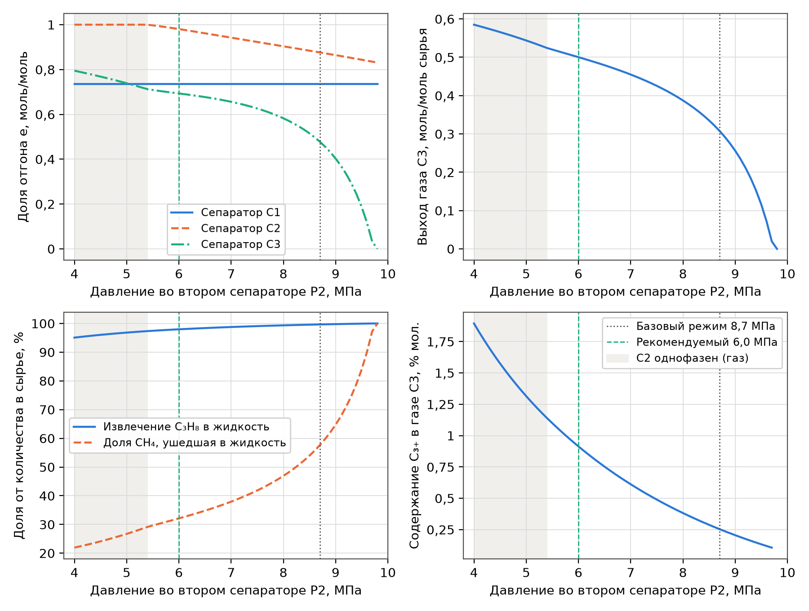{width=16cm}

**Анализ.** С ростом $P_2$ (рисунок {{figref:t32p}}) все константы равновесия уменьшаются (в корреляции $\partial \ln K / \partial P < 0$), и конденсация в С2 и С3 усиливается:

- при $P_2 < P_2^{\text{р}}$ сепаратор С2 однофазен (газ, формальное $e > 1$) – аппарат не работает, схема вырождается в двухступенчатую;
- извлечение пропана в жидкость растёт от {{t32_r40_rec}} % (4 МПа) до {{t32_recC3}} % (8,7 МПа), а содержание C~3+~ в газе падает с {{t32_r40_y}} до {{t32_yC3p}} %; кривая $\varepsilon_{\mathrm{C_3H_8}}(P_2)$ выполаживается выше 7 МПа;
- одновременно резко растёт растворение метана в жидкости: от {{t32_r40_loss}} % (4 МПа) до {{t32_lossCH4}} % (8,7 МПа) и {{t32_r95_loss}} % (9,5 МПа); выход товарного газа падает, а при $P_2 = 9{,}8$ МПа газ С2 в С3 полностью конденсируется (формальный корень $e_3 = {{t32_r98_ef}}$) – газа на выходе нет;
- показатель чёткости разделения $\text{Ч}$ монотонно снижается с ростом $P_2$: по мере приближения константы равновесия метана к единице сепаратор С3 теряет селективность.

**Выбор эффективного режима.** Критерии: (1) все три сепаратора должны работать в двухфазной области, то есть $P_2 > P_2^{\text{р}} = {{t32_P2dew}}$ МПа; (2) максимальная чёткость разделения $\text{Ч}$ (минимум метана в жидкости при высоком извлечении пропана) – требует по возможности низкого $P_2$; (3) результат должен лежать в области надёжности корреляции McWilliams (номограммы ДеПристера построены до давлений около 6–7 МПа); (4) товарный газ желательно выдавать при давлении, близком к давлению газопровода, – это требует высокого $P_2$. Компромисс – $P_2 = P_3 = {{P2_choice}}$ МПа: сепаратор С2 гарантированно двухфазен ($e_2 = {{t32c_e2}}$), извлечение пропана {{t32c_rec}} %, содержание C~3+~ в газе {{t32c_y}} %, в жидкость уходит лишь {{t32c_loss}} % метана, $\text{Ч} = {{t32c_sharp}}$ против {{t32b_sharp}} в базовом режиме. Сравнение с базовым режимом – в таблице {{tabref:t32_cmp}}.

| Показатель | Базовый режим, $P_2 = 8{,}7$ МПа | Рекомендуемый, $P_2 = {{P2_choice}}$ МПа | Изменение |
|:----------------------|:--------:|:--------:|:-------:|
{{t32_cmp_rows}}

: Таблица {{tab:t32_cmp}} – Сравнение базового и рекомендуемого режимов

Если к товарному газу предъявляется более жёсткое требование по содержанию C~3+~ (например, не более 0,5 %), давление $P_2$ следует поднять до 7,5 МПа ($\text{Ч} = {{t32_r75_sharp}}$); выигрыш по извлечению пропана при дальнейшем повышении давления мал, а потери метана с жидкостью быстро растут. При альтернативном правиле $P_3 = \min(P_2;\ 8{,}7\ \text{МПа})$ результаты отличаются только при $P_2 > 8{,}7$ МПа ({{t32_alt}}) и выводов не меняют.

**Ограничения модели.** Корреляция McWilliams аппроксимирует номограммы ДеПристера, построенные для давлений до 6–7 МПа (по разным источникам 870–1000 psia), и не учитывает влияния состава на $K_i$ и сближения констант с единицей вблизи критической области (давления схождения). Базовые условия С1–С3 (8,7–9,8 МПа) лежат за пределами этой области, поэтому расчёт базового режима ориентировочный: реальные $K$ лёгких компонентов ближе к единице, и конденсация метана в С3, вероятно, переоценена. Рекомендуемый режим ({{P2_choice}} МПа) для С2 и С3 находится у границы области применимости и потому надёжнее. Для проектного расчёта следует использовать уравнение состояния (SRK, Пенга–Робинсона).

**Вывод.** Базовый режим рассчитан: доли отгона С1, С2, С3 равны {{t32_e1}}, {{t32_e2}} и {{t32_e3}}; на 1 моль сырья получается {{t32_Vout}} моль газа (CH~4~ {{t32_yCH4out}} %), извлечение пропана в жидкость {{t32_recC3}} %. Повышение давления во втором сепараторе улучшает извлечение тяжёлых углеводородов, но увеличивает потери метана с жидкостью и снижает выход газа; при $P_2 < {{t32_P2dew}}$ МПа сепаратор С2 не работает. Эффективный режим – $P_2 = P_3 \approx {{P2_choice}}$ МПа: выход газа возрастает на {{t32_gain}} % по сравнению с базовым режимом при извлечении пропана {{t32c_rec}} %.

\newpage

# 4 Расчёт химического равновесия

## 4.1 Задание 1. Синтез аммиака

**Условие.** Найти мольные расходы веществ на выходе из равновесного реактора синтеза аммиака

$$\mathrm{\tfrac{1}{2} N_2 + \tfrac{3}{2} H_2 \rightleftarrows NH_3},$$

если на вход поступает смесь азот : водород : аммиак = 1,1 : 3 : 0,2 (моль); $K_p = 0{,}05$ атм^−1^, $T = 589$ К, $P = 220$ атм.

**Метод.** Вводится степень полноты реакции $\xi$, моль (количество образовавшегося NH~3~). Количества веществ $n_i = n_{i,0} + \nu_i \cdot \xi$, где $n_{i,0}$ – начальное количество, моль; $\nu_i$ – стехиометрический коэффициент (для N~2~, H~2~ и NH~3~ соответственно $-1/2$, $-3/2$ и $+1$). Для идеальной газовой смеси [{{ref:lectures}}]

$$K_p = \frac{y_{\mathrm{NH_3}}}{y_{\mathrm{N_2}}^{0{,}5} \cdot y_{\mathrm{H_2}}^{1{,}5}} \cdot P^{-1}, \qquad y_i = \frac{n_i}{\sum n_i},$$

где $K_p$ – константа равновесия, атм^−1^; $y_i$ – равновесная мольная доля; $P$ – общее давление, атм ($\Delta \nu = -1$). Подстановка $n_i(\xi)$ даёт нелинейное уравнение с одной неизвестной

$$f(\xi) = \frac{(0{,}2 + \xi) \cdot (4{,}3 - \xi)}{(1{,}1 - 0{,}5 \cdot \xi)^{0{,}5} \cdot (3 - 1{,}5 \cdot \xi)^{1{,}5}} \cdot \frac{1}{P} - K_p = 0.$$

Физически допустимый интервал: $-0{,}2 < \xi < 2$ (аммиак не может разложиться в большем количестве, чем его было; водород исчерпывается при $\xi = 2$). На этом интервале функция монотонна (проверено подсчётом смен знака на сетке из 2000 точек – корень один); корень уточняется методом Брента.

**Программа.**

{{code:t4z1}}

**Результат работы программы.**

{{out:t4z1}}

**Результаты.** Степень полноты реакции $\xi = {{t41_xi}}$ моль.

| Вещество | Начало, моль | Конец (равновесие), моль | Равновесная мольная доля $y_i$ |
|:---:|:---:|:---:|:---:|
{{t41_rows}}

: Таблица {{tab:t41}} – Равновесный состав на выходе из реактора синтеза аммиака (589 К, 220 атм)

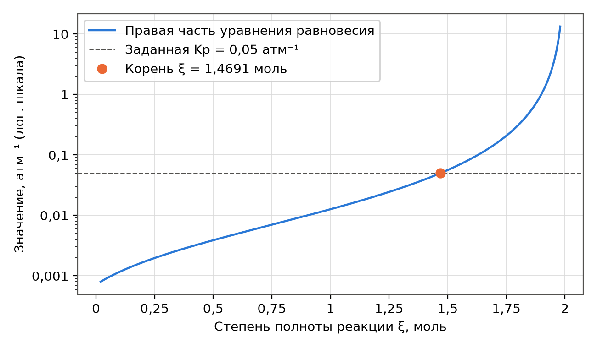{width=15cm}

Степень превращения азота {{t41_cN2}} %, водорода {{t41_cH2}} %. Высокая степень превращения объясняется высоким давлением: реакция идёт с уменьшением числа молей, и произведение $K_p \cdot P = {{t41_KP}}$ велико (принцип Ле Шателье). Расчёт выполнен в приближении идеального газа; при 220 атм коэффициенты фугитивности заметно отличаются от единицы, и для точного расчёта константу следует записывать через фугитивности: $K_f = K_p \cdot K_\varphi$, где $K_\varphi$ – произведение коэффициентов фугитивности в степенях стехиометрических коэффициентов.

**Вывод.** На выходе из реактора из 4,3 моль исходной смеси получается {{t41_ntot}} моль равновесной смеси: N~2~ {{t41_nN2}} моль, H~2~ {{t41_nH2}} моль, NH~3~ {{t41_nNH3}} моль ($y_{\mathrm{NH_3}} = {{t41_yNH3}}$). Расход питания в условии задан только соотношением, поэтому расчёт выполнен на 4,3 моль/ч питания (1,1 + 3 + 0,2): найденные количества – это мольные расходы в моль/ч; при другом расходе питания они пропорционально масштабируются, а мольные доли не меняются. Задача свелась к одному нелинейному уравнению, имеющему на физическом интервале единственный корень.

## 4.2 Задание 2. Получение этилена дегидрированием этана

### 4.2.1 Одна реакция, 1100 К (пункт а)

**Условие.** В реактор поступает чистый этан; протекает реакция

$$\mathrm{C_2H_6 \rightleftarrows C_2H_4 + H_2}.$$

Определить равновесный состав при 1100 К и 1 атм; константу равновесия рассчитать по справочным данным.

**Справочные данные.** Энтальпии и энергии Гиббса образования веществ в идеально-газовом состоянии взяты из разделов E18 и E19 справочника IFP [{{ref:ifp}}] (таблица {{tabref:t42_ref}}). Замечание: заголовок раздела E19 в справочнике ошибочно повторяет «Standard enthalpy of formation», хотя в таблице приведены энергии Гиббса $\Delta G^{\circ}_{f}$ – это следует из обозначения единиц и из того, что при 0 К значения совпадают с $\Delta H^{\circ}_{f}$. Водород – простое вещество, для него $\Delta H^{\circ}_{f} = \Delta G^{\circ}_{f} = 0$.

| T, К | $\Delta H^{\circ}_{f}$ C~2~H~6~ | $\Delta H^{\circ}_{f}$ C~2~H~4~ | $\Delta H^{\circ}_{f}$ C~2~H~2~ | $\Delta G^{\circ}_{f}$ C~2~H~6~ | $\Delta G^{\circ}_{f}$ C~2~H~4~ | $\Delta G^{\circ}_{f}$ C~2~H~2~ |
|:---:|:---:|:---:|:---:|:---:|:---:|:---:|
{{t42_ref_rows}}

: Таблица {{tab:t42_ref}} – Стандартные энтальпии и энергии Гиббса образования, кал/моль [{{ref:ifp}}, E18, E19]

**Метод.** Стандартная энергия Гиббса реакции и константа равновесия:

$$\Delta G^{\circ}_{r}(T) = \sum_i \nu_i \cdot \Delta G^{\circ}_{f,i}(T), \qquad K = \exp \left( -\frac{\Delta G^{\circ}_{r}}{R \cdot T} \right),$$

где $\Delta G^{\circ}_{r}$ – стандартная энергия Гиббса реакции, Дж/моль (1 кал = 4,184 Дж); $\nu_i$ – стехиометрические коэффициенты (продукты – плюс, исходные вещества – минус); $K$ – безразмерная константа равновесия, численно равная $K_p$ в атм^Δν^ при стандартном давлении 1 атм.

Справочник приводит данные только до 1000 К, поэтому значение при 1100 К получено экстраполяцией двумя способами – линейно по температуре (по точкам 800 и 1000 К) и через энтальпию и энтропию реакции:

$$\Delta G^{\circ}_{r}(1100) = \Delta G^{\circ}_{r}(1000) + \frac{\Delta G^{\circ}_{r}(1000) - \Delta G^{\circ}_{r}(800)}{200} \cdot 100,$$

$$\Delta G^{\circ}_{r}(T) = \Delta H^{\circ}_{r}(1000) - T \cdot \Delta S^{\circ}_{r}(1000), \qquad \Delta S^{\circ}_{r}(1000) = \frac{\Delta H^{\circ}_{r}(1000) - \Delta G^{\circ}_{r}(1000)}{1000},$$

где $\Delta H^{\circ}_{r}$ – стандартная энтальпия реакции, кал/моль; $\Delta S^{\circ}_{r}$ – стандартная энтропия реакции, кал/(моль∙К). Второй способ предполагает постоянство $\Delta H^{\circ}_{r}$ и $\Delta S^{\circ}_{r}$ выше 1000 К; это оправдано, так как $\Delta H^{\circ}_{r}$ от 800 до 1000 К меняется лишь на 0,6 %.

Для 1 моль этана при превращении $x$ моль: C~2~H~6~ $1 - x$, C~2~H~4~ $x$, H~2~ $x$, всего $1 + x$ моль. Тогда

$$K_p = \frac{y_{\mathrm{C_2H_4}} \cdot y_{\mathrm{H_2}}}{y_{\mathrm{C_2H_6}}} \cdot P = \frac{x^{2}}{(1 - x) \cdot (1 + x)} \cdot P, \qquad x = \sqrt{\frac{K_p}{K_p + P}},$$

где $x$ – степень превращения этана; $P$ – давление, атм.

**Программа.**

{{code:DGF,DHF,k_extrap,ethane_equilibrium,t4z2a}}

**Результат работы программы.**

{{out:t4z2a}}

**Результаты.**

| T, К | $\Delta G^{\circ}_{r}$, кал/моль | $\Delta G^{\circ}_{r}$, кДж/моль | K |
|:---:|:---:|:---:|:---:|
{{t42_dG_rows}}

: Таблица {{tab:t42_dG}} – Энергия Гиббса и константа равновесия реакции дегидрирования этана по справочным данным

Экстраполяция к 1100 К: линейно $\Delta G^{\circ}_{r} = {{t42_dGlin}}$ кал/моль ({{t42_dGlinJ}} Дж/моль), $K = {{t42_Klin}}$; через $\Delta H^{\circ}_{r} = {{t42_dH}}$ кал/моль и $\Delta S^{\circ}_{r} = {{t42_dS}}$ кал/(моль∙К) – $\Delta G^{\circ}_{r} = {{t42_dGhs}}$ кал/моль, $K = {{t42_Khs}}$. Способы согласуются в пределах {{t42_KK}} %; основным принят первый. При 1100 К $\Delta G^{\circ}_{r} < 0$ – реакция термодинамически выгодна; по сравнению с 1000 К ($K = {{t42_K1000}}$) константа выросла в {{t42_Kgrow}} раза, так как реакция сильно эндотермическая.

| Вещество | Начало, моль | Конец (равновесие), моль | Равновесная мольная доля $y_i$ |
|:---:|:---:|:---:|:---:|
{{t42_rows}}

: Таблица {{tab:t42}} – Равновесный состав при дегидрировании этана (1100 К, 1 атм)

| Способ определения K(1100 К) | K | x | $y_{\mathrm{C_2H_6}}$ | $y_{\mathrm{C_2H_4}} = y_{\mathrm{H_2}}$ |
|:------------------------|:------:|:------:|:------:|:-------:|
{{t42_sens_rows}}

: Таблица {{tab:t42_sens}} – Чувствительность равновесного состава к способу определения константы

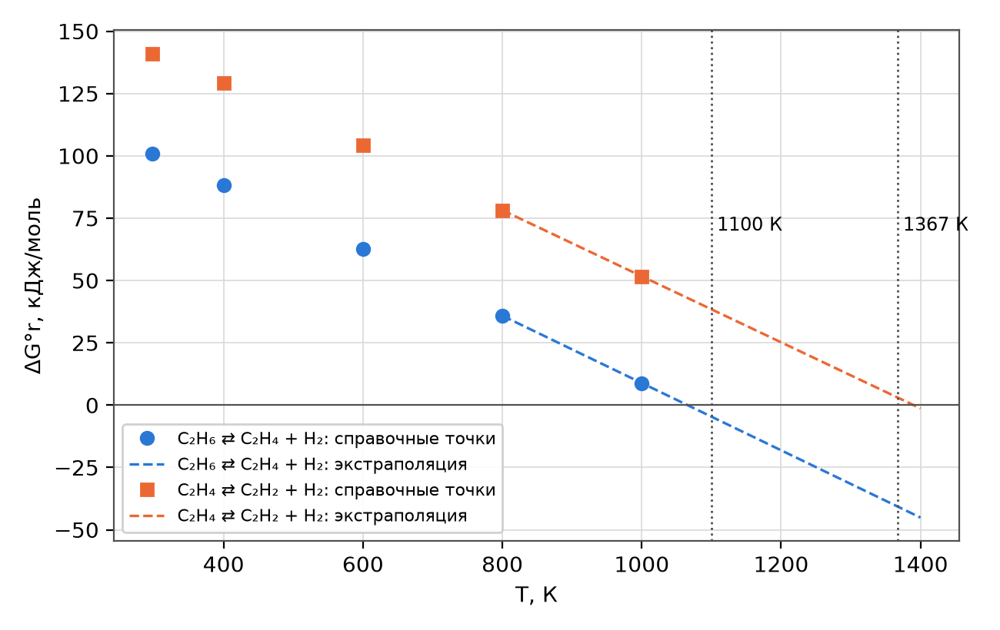{width=15cm}

Чувствительность: $dx/dK = {{t42_dxdK}}$, то есть различие констант в {{t42_Kdiff}} % (значение по справочнику IFP и значение 1,76 из задачника [{{ref:finlayson}}]) меняет степень превращения лишь на {{t42_dx}} – результат устойчив к способу экстраполяции.

**Вывод.** По справочным данным IFP константа равновесия при 1100 К $K = {{t42_Klin}}$; равновесная степень превращения этана $x = {{t42_x}}$, равновесный состав: этан {{t42_yC2H6}} %, этилен {{t42_yC2H4}} %, водород {{t42_yC2H4}} % (мол.). Экстраполяция за пределы справочной таблицы – основное допущение расчёта; оба способа экстраполяции и литературное значение дают $x$ от 0,790 до 0,799.

### 4.2.2 Две реакции, 1367 К (пункт б)

**Условие.** Добавляется вторая реакция

$$\mathrm{C_2H_4 \rightleftarrows C_2H_2 + H_2},$$

температура повышается до 1367 К; $K_{p1} = 37{,}6$ атм, $K_{p2} = 0{,}769$ атм. Давление 1 атм (в условии не изменяется).

**Метод.** Для каждого стехиометрического уравнения вводится своя неизвестная: $x_1$ – моль прореагировавшего этана, $x_2$ – моль этилена, превратившегося в ацетилен. Количества на 1 моль этана: C~2~H~6~ $1 - x_1$; C~2~H~4~ $x_1 - x_2$; H~2~ $x_1 + x_2$; C~2~H~2~ $x_2$; всего $1 + x_1 + x_2$. Система двух нелинейных уравнений:

$$\frac{(x_1 - x_2) \cdot (x_1 + x_2)}{(1 - x_1) \cdot (1 + x_1 + x_2)} \cdot P = K_{p1}, \qquad \frac{x_2 \cdot (x_1 + x_2)}{(x_1 - x_2) \cdot (1 + x_1 + x_2)} \cdot P = K_{p2}.$$

Физическая область: $0 < x_2 < x_1 < 1$ (все количества положительны). Система решена функцией scipy.optimize.least_squares с ограничениями на переменные. Для сравнения показано, что fsolve без ограничений из того же начального приближения (0,9; 0,3) уходит в нефизичную область ($x_1 = {{t43_raw1}}$, $x_2 = {{t43_raw2}}$) и не сходится. Единственность физичного решения проверена перебором 120 начальных приближений внутри области: все сошедшиеся решения совпадают.

**Программа.**

{{code:t4z2b}}

**Результат работы программы.**

{{out:t4z2b}}

**Результаты.** $x_1 = {{t43_x1}}$, $x_2 = {{t43_x2}}$; невязки уравнений менее {{t43_res}}.

| Вещество | Начало, моль | Конец (равновесие), моль | Равновесная мольная доля $y_i$ |
|:---:|:---:|:---:|:---:|
{{t43_rows}}

: Таблица {{tab:t43}} – Равновесный состав при пиролизе этана с образованием ацетилена (1367 К, 1 атм)

Контроль исходных данных: константы, рассчитанные по справочнику IFP экстраполяцией к 1367 К через $\Delta H^{\circ}_{r}$ и $\Delta S^{\circ}_{r}$ при 1000 К, равны $K_{p1} = {{t42_K1_1367}}$ и $K_{p2} = {{t42_K2_1367}}$ (линейная экстраполяция $\Delta G^{\circ}_{r}$ даёт {{t42_K1_1367l}} и {{t42_K2_1367l}}), что согласуется с заданными 37,6 и 0,769 в пределах 5 %. Это подтверждает и данные задания, и корректность справочных величин.

**Вывод.** При 1367 К этан превращается практически полностью ($x_1 = {{t43_x1}}$); равновесная смесь содержит {{t43_yH2}} % водорода, {{t43_yC2H2}} % ацетилена, {{t43_yC2H4}} % этилена и {{t43_yC2H6}} % этана (мол.). Повышение температуры смещает равновесие обеих эндотермических реакций вправо, и {{t43_sel}} % превращённого этана переходит в ацетилен. Задача с двумя реакциями свелась к системе двух нелинейных уравнений, физичное решение которой единственно; численный метод необходимо ограничивать физической областью.

\newpage

# 5 Расчёт материальных балансов

## 5.1 Задание 1. Схема разделения ксилол – стирол – толуол – бензол

**Условие.** Смесь (1000 моль/ч) разделяется в трёх колоннах (рисунок {{figref:t51}}): колонна 1 делит сырьё F на дистиллят D и кубовый остаток B, колонна 2 делит D на D~1~ и B~1~, колонна 3 делит B на D~2~ и B~2~. Составы потоков F, D~1~, B~1~, D~2~, B~2~ заданы (таблица {{tabref:t51}}). Найти расходы и составы всех потоков.

**Метод.** Покомпонентные балансы всей схемы (D и B – внутренние потоки):

$$F \cdot x_{F,i} = D_1 \cdot x_{D_1,i} + B_1 \cdot x_{B_1,i} + D_2 \cdot x_{D_2,i} + B_2 \cdot x_{B_2,i}, \qquad i = 1, \ldots, 4,$$

где $F$, $D_1$, $B_1$, $D_2$, $B_2$ – мольные расходы потоков, моль/ч; $x_{j,i}$ – мольная доля $i$-го компонента (ксилол, стирол, толуол, бензол) в потоке $j$. Это система четырёх линейных уравнений с четырьмя неизвестными $\mathbf{A} \cdot \mathbf{X} = \mathbf{b}$, где столбцы матрицы $\mathbf{A}$ – составы продуктов, $\mathbf{b} = F \cdot \mathbf{x}_F$ [{{ref:lectures}}]. Решение – numpy.linalg.solve (метод Гаусса с выбором ведущего элемента, без явного обращения матрицы). Затем из балансов колонн 2 и 3:

$$D = D_1 + B_1, \qquad x_{D,i} = \frac{D_1 \cdot x_{D_1,i} + B_1 \cdot x_{B_1,i}}{D}, \qquad B = D_2 + B_2, \qquad x_{B,i} = \frac{D_2 \cdot x_{D_2,i} + B_2 \cdot x_{B_2,i}}{B}.$$

Проверяются неотрицательность расходов, суммы долей, покомпонентные балансы каждой колонны и обусловленность матрицы.

**Программа.**

{{code:T5_COMP,T5_X,t5z1}}

**Результат работы программы.**

{{out:t5z1}}

**Результаты.**

| Компонент | F | D | B | D~1~ | B~1~ | D~2~ | B~2~ |
|:------------|:------:|:------:|:------:|:------:|:------:|:------:|:------:|
| **Расход, моль/ч** | | | | | | | |
{{t51_rows}}

: Таблица {{tab:t51}} – Расходы (моль/ч) и составы (мольные доли) потоков схемы разделения

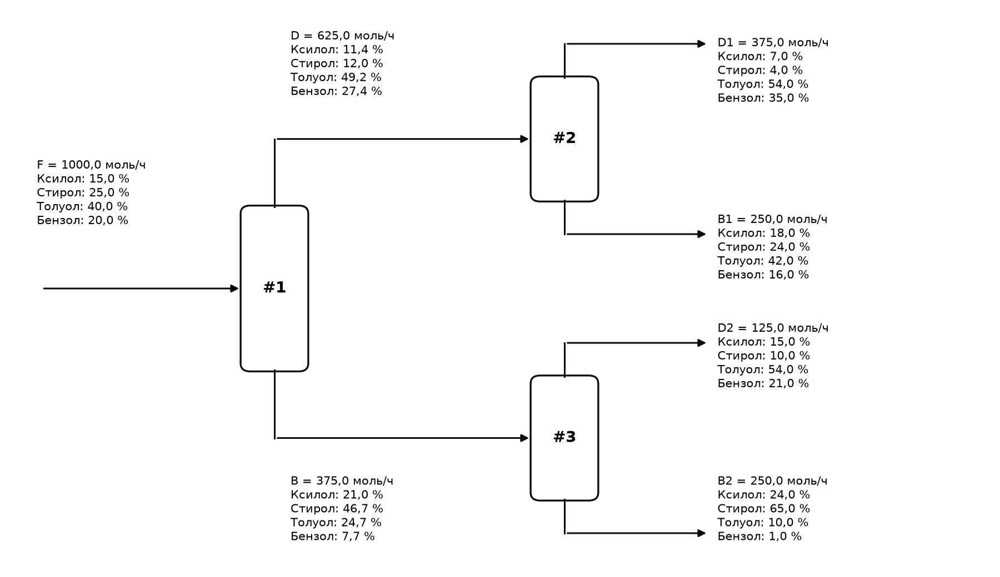{width=16cm}

Все расходы положительны, суммы долей равны 1, невязки балансов всех трёх колонн не превышают $10^{-13}$ моль/ч. Определитель матрицы мал ($\det \mathbf{A}$ = {{t51_det}}), число обусловленности $\text{cond}(\mathbf{A}) = {{t51_cond}}$ (отношение наибольшего сингулярного числа {{t51_svmax}} к наименьшему {{t51_svmin}}). Причина – почти линейная зависимость составов продуктов: состав B~1~ практически совпадает со смесью потоков D~2~ и B~2~ в пропорции {{t51_cD2}} : {{t51_cB2}}, поэтому часть расхода можно «перекладывать» между B~1~ и парой D~2~ + B~2~ почти без нарушения балансов. Практическое следствие – высокая чувствительность расходов B~1~ и D~2~ к погрешности анализа: при случайных ошибках составов ±0,1 % (абс.) 90 %-интервалы расходов составляют {{t51_mc01}} моль/ч, а при ±0,25 % в {{t51_neg025}} % случаев получаются отрицательные расходы. Расходы D~1~ и B~2~ определяются надёжно.

**Вывод.** Расходы потоков: D = 625, B = 375, D~1~ = 375, B~1~ = 250, D~2~ = 125, B~2~ = 250 моль/ч. Составы промежуточных потоков: D – {{t51_xDX}} % ксилола, {{t51_xDS}} % стирола, {{t51_xDT}} % толуола, {{t51_xDB}} % бензола; B – {{t51_xBX}} %, {{t51_xBS}} %, {{t51_xBT}} % и {{t51_xBB}} % соответственно. Материальный баланс сходится точно. Из-за плохой обусловленности задачи составы продуктов должны определяться с точностью не хуже 0,1 % (абс.), иначе расходы B~1~ и D~2~ будут найдены с большой ошибкой.

## 5.2 Задание 2. Процесс Toray: бензол из толуола с рециклом

**Условие.** Свежий толуол (поток 1, 100 моль/ч) смешивается с рециклом (поток 7) в смесителе M и поступает (поток 2) в реактор R, где протекает диспропорционирование

$$\mathrm{2 C_7H_8 \rightleftarrows C_6H_6 + C_8H_{10}}$$

с конверсией толуола за проход 58 %. Поток 3 разделяется в S~1~: поток 4 (бензол) содержит 99,5 % бензола, 0,1 % толуола и 0 % ксилола потока 3; остальное – поток 5. В S~2~ поток 7 (рецикл) содержит весь бензол, 99,5 % толуола и 0,1 % ксилола потока 5; остальное – поток 6 (ксилол). Рассчитать материальный баланс и конверсию толуола в ксилол. В условии задания опечатка «кислол» – имеется в виду ксилол.

**Метод.** Мольные расходы компонентов (толуол Т, бензол Б, ксилол К) образуют вектор $\mathbf{n}_j = (n_{\text{Т}}, n_{\text{Б}}, n_{\text{К}})_j$, моль/ч. Уравнения блоков [{{ref:lectures}}]:

- смеситель: $\mathbf{n}_2 = \mathbf{n}_1 + \mathbf{n}_7$;
- реактор (прореагировало $\alpha \cdot n_{\text{Т},2}$ толуола, $\alpha = 0{,}58$; образовалось по $\alpha \cdot n_{\text{Т},2} / 2$ бензола и ксилола): $n_{\text{Т},3} = (1 - \alpha) \cdot n_{\text{Т},2}$, $n_{\text{Б},3} = n_{\text{Б},2} + \alpha \cdot n_{\text{Т},2}/2$, $n_{\text{К},3} = n_{\text{К},2} + \alpha \cdot n_{\text{Т},2}/2$, то есть $\mathbf{n}_3 = \mathbf{M} \cdot \mathbf{n}_2$;
- разделители: $n_{i,4} = f_{i}^{(4)} \cdot n_{i,3}$, $\mathbf{n}_5 = \mathbf{n}_3 - \mathbf{n}_4$; $n_{i,7} = f_{i}^{(7)} \cdot n_{i,5}$, $\mathbf{n}_6 = \mathbf{n}_5 - \mathbf{n}_7$, где $f^{(4)} = (0{,}001;\ 0{,}995;\ 0)$ и $f^{(7)} = (0{,}995;\ 1;\ 0{,}001)$ – доли компонентов, направляемые в потоки 4 и 7.

Из-за рецикла расход потока 2 заранее неизвестен. Разрываем рецикл по потоку 7: все блоки линейны, поэтому $\mathbf{n}_7 = \mathbf{G} \cdot (\mathbf{n}_1 + \mathbf{n}_7)$, где $\mathbf{G} = \text{diag}(f^{(7)}) \cdot \text{diag}(1 - f^{(4)}) \cdot \mathbf{M}$. Задача решена двумя способами: (а) методом простой итерации по разрываемому потоку, начиная с $\mathbf{n}_7 = 0$ (как в практическом занятии); (б) прямым решением линейной системы $(\mathbf{E} - \mathbf{G}) \cdot \mathbf{n}_7 = \mathbf{G} \cdot \mathbf{n}_1$, где $\mathbf{E}$ – единичная матрица. Для толуола решение получается и аналитически: $n_{\text{Т},7} = 100 \cdot a / (1 - a)$, $a = 0{,}995 \cdot 0{,}999 \cdot 0{,}42$.

Конверсия толуола в ксилол определена как доля свежего толуола, превращённая в ксилол. По стехиометрии из двух молекул толуола одна становится ксилолом (принимает метильную группу), другая – бензолом, поэтому на 1 моль ксилола расходуется 1 моль толуола «в ксилол»:

$$X_{\text{Т} \rightarrow \text{К}} = \frac{n_{\text{К},6}}{n_{\text{Т},1}}, \qquad X_{\text{Т}} = \frac{n_{\text{Т},1} - n_{\text{Т},4} - n_{\text{Т},6}}{n_{\text{Т},1}},$$

где $X_{\text{Т} \rightarrow \text{К}}$ – конверсия толуола в ксилол; $X_{\text{Т}}$ – общая конверсия толуола по схеме; $n_{\text{К},6}$ – ксилол в продуктовом потоке 6, моль/ч; $n_{\text{Т},j}$ – толуол в потоке $j$, моль/ч.

**Программа.**

{{code:MW,t5z2}}

**Результат работы программы.**

{{out:t5z2}}

**Результаты.**

| Компонент | 1 | 2 | R (изм.) | 3 | 4 | 5 | 6 | 7 |
|:----------|:------:|:------:|:------:|:------:|:------:|:------:|:------:|:------:|
{{t52_rows}}
| Конверсия толуола в ксилол | {{t52_cX}} % | | | | | | | |

: Таблица {{tab:t52}} – Материальный баланс процесса Toray, моль/ч (R – изменение количества в реакторе)

| Итерация | Толуол в потоке 7 | Бензол в потоке 7 | Ксилол в потоке 7 |
|:---:|:---:|:---:|:---:|
{{t52_iter_rows}}

: Таблица {{tab:t52_it}} – Сходимость метода простой итерации по рециклу, моль/ч

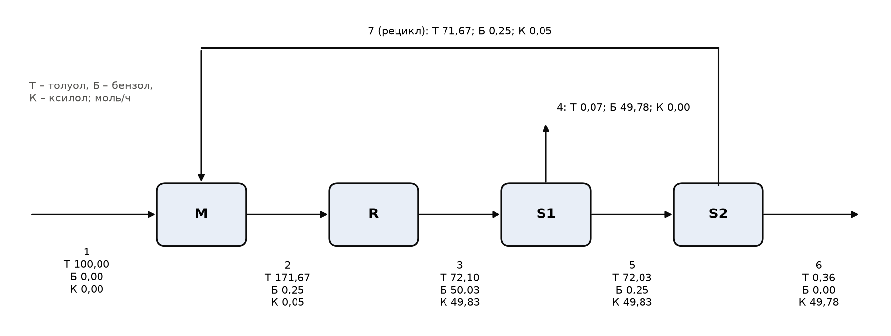{width=16cm}

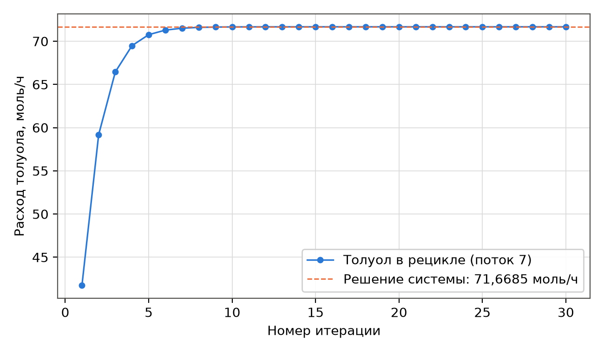{width=14cm}

Простая итерация сходится за {{t52_iters}} итераций (точность $10^{-12}$ моль/ч) к прямому решению; скорость сходимости определяется множителем $a \approx 0{,}42$ – долей толуола, возвращаемой за один проход. Проверка баланса: покомпонентный баланс схемы с учётом реакции ($\xi = {{t52_xi}}$ моль/ч), балансы узлов, балансы атомов углерода и водорода и массы ({{t52_min}} г/ч на входе и на выходе) сходятся с невязками не более $10^{-13}$. Кратность рецикла (поток 7 / поток 1) равна {{t52_rr}}, расход толуола на входе реактора {{t52_T2}} моль/ч.

Судьба свежего толуола: {{t52_cX}} % превращается в ксилол (поток 6 содержит {{t52_X6}} моль/ч ксилола), {{t52_cB}} % – в бензол (поток 4 содержит {{t52_B4}} моль/ч бензола), {{t52_loss}} % уходит непрореагировавшим с продуктовыми потоками 4 и 6; сумма равна 100 %. Общая конверсия толуола по схеме $X_{\text{Т}}$ = {{t52_cT}} %, выход ксилола от теоретически возможного (50 моль/ч) – {{t52_yX}} %.

**Вывод.** Благодаря рециклу толуол при конверсии за проход 58 % превращается практически полностью ({{t52_cT}} %). Конверсия толуола в ксилол составляет {{t52_cX}} % (столько же – в бензол, что предопределено стехиометрией); продукты: {{t52_F4}} моль/ч бензольного потока (бензол {{t52_pB4}} %) и {{t52_F6}} моль/ч ксилольного потока (ксилол {{t52_pX6}} %). Материальный баланс сходится точно; прямое решение линейной системы и итерационный метод дают одинаковый результат.

\newpage

# Заключение

Решены все 12 задач варианта 8. Основные результаты сведены в таблицу {{tabref:summary}}.

| Тема, задание | Искомая величина | Результат |
|:--------------|:----------------|:----------------------|
| 1.1 Теплоёмкость пропана | $\langle C \rangle$ в интервале 50–1300 К (полином / трапеции) | {{t11_Cp}} / {{t11_Ct}} Дж/(моль∙К); расхождение {{t11_d}} % |
| 1.2 Вода в дистилляте | Заданная модель; лучшая альтернатива | $a$ = {{t12_given_p0}}, $b$ = {{t12_given_p1}} кг/с ($R^{2}$ = {{t12_given_R2}}); $y = {{t12_hyper_p0}}/(x - {{t12_hyper_p1}})$ ($R^{2}$ = {{t12_hyper_R2}}) |
| 1.3 Уравнение Аррениуса | $E_a$; $A$ | {{t13_Ea}} ± {{t13_Eaci}} кДж/моль; {{t13_A}} с^−1^ ($R^{2}$ = {{t13_R2ln}}) |
| 1.4 Вязкость гексана | $R^{2}$ полиномов 1, 2, 3 степени | {{t14_R2_1}}; {{t14_R2_2}}; {{t14_R2_3}} – выбран полином 3-й степени |
| 2.1 Аммиак, 80 атм, 450 К | v по ИГ / RK / SRK | {{t2z1_IG_v}} / {{t2z1_RK_v}} / {{t2z1_SRK_v}} л/моль |
| 2.2 Смесь CO~2~–O~2~–N~2~, 150 атм, 420 К | v по ИГ / RK / SRK; Z | {{t2z2_IG_v}} / {{t2z2_RK_v}} / {{t2z2_SRK_v}} л/моль; Z = {{t2z2_RK_Z}}–{{t2z2_SRK_Z}} |
| 3.1 Кипение смеси при 14 атм | $t_{\text{нк}}$; $t_{\text{кк}}$ | {{t31_tb}} °C; {{t31_td}} °C |
| 3.2 Сепарационный блок | e С1 / С2 / С3 (база); рекомендуемое $P_2$ | {{t32_e1}} / {{t32_e2}} / {{t32_e3}}; $P_2 = P_3$ ≈ {{P2_choice}} МПа |
| 4.1 Синтез аммиака | ξ; $y_{\mathrm{NH_3}}$ | {{t41_xi}} моль; {{t41_yNH3}} |
| 4.2а Этан, 1100 К | K; степень превращения | {{t42_Klin}}; {{t42_x}} |
| 4.2б Этан, 1367 К, две реакции | $x_1$; $x_2$ | {{t43_x1}}; {{t43_x2}} |
| 5.1 Схема из трёх колонн | D; B; D~1~; B~1~; D~2~; B~2~ | 625; 375; 375; 250; 125; 250 моль/ч |
| 5.2 Процесс Toray | Рецикл толуола; конверсия толуола в ксилол | {{t52_T7}} моль/ч; {{t52_cX}} % |

: Таблица {{tab:summary}} – Сводка результатов

Общие выводы по работе:

1. Эмпирические модели следует выбирать не только по $R^{2}$, но и по структуре остатков, числу параметров ($R^{2}_{\text{скор}}$, $AIC$, перекрёстная проверка) и физическому смыслу; нелинейная регрессия требует обоснованного начального приближения и учёта области определения модели.
2. Отклонения реальных газов от идеальности определяются приведёнными параметрами: для аммиака вблизи критической точки объём на 19–20 % меньше идеального, для смеси при $T_{pr} \approx 2{,}4$ отклонение не превышает 3,3 % из-за компенсации притяжения и отталкивания. Уравнение SRK точнее RK благодаря учёту ацентрического фактора.
3. Расчёт фазовых равновесий сводится к нелинейным уравнениям с одной неизвестной (точки кипения, уравнение Рачфорда–Райса), которые надёжно решаются после локализации корня. Эмпирические корреляции констант равновесия нельзя применять за пределами области их построения без оговорок.
4. Равновесный состав находится из нелинейного уравнения или системы; численное решение должно ограничиваться физической областью и проверяться на единственность и по балансу атомов.
5. Материальные балансы схем без реакций и с рециклом сводятся к системам линейных уравнений; обусловленность матрицы определяет требования к точности исходных данных.

Для проверки результатов подготовлен скрипт check.py: он независимо пересчитывает ключевые величины, проверяет суммы мольных долей, невязки равновесий и материальных балансов и завершается с ошибкой при любом расхождении.

\newpage

# Список литературы

<!-- BIBLIOGRAPHY -->

[[task]] Горбунов, В. А. Задачи для 7 семестра по курсу «Моделирование химико-технологических процессов» / В. А. Горбунов ; Омский государственный технический университет. – Омск : ОмГТУ, 2025. – 9 с. – Текст : электронный.
[[finlayson]] Finlayson, B. A. Introduction to Chemical Engineering Computing / B. A. Finlayson. – 2nd ed. – Hoboken : John Wiley & Sons, 2012. – 391 p. – ISBN 978-0-470-93295-7. – Текст : непосредственный.
[[numpy]] NumPy documentation : [сайт]. – URL: https://numpy.org/doc/stable/ (дата обращения: 03.10.2026). – Текст : электронный.
[[scipy]] SciPy documentation : [сайт]. – URL: https://docs.scipy.org/doc/scipy/ (дата обращения: 03.10.2026). – Текст : электронный.
[[ifp]] Refining & Chemicals. Folder Zero : Index of Data and Diagrams / IFP Training. – [S. l.] : IFP Training, 2014. – 309 p. – Текст : непосредственный.
[[rk]] Redlich, O. On the Thermodynamics of Solutions. V. An Equation of State. Fugacities of Gaseous Solutions / O. Redlich, J. N. S. Kwong // Chemical Reviews. – 1949. – Vol. 44, № 1. – P. 233–244. – Текст : непосредственный.
[[soave]] Soave, G. Equilibrium constants from a modified Redlich–Kwong equation of state / G. Soave // Chemical Engineering Science. – 1972. – Vol. 27, № 6. – P. 1197–1203. – Текст : непосредственный.
[[lectures]] Горбунов, В. А. Моделирование химико-технологических процессов : лекции и практические занятия / В. А. Горбунов ; Омский государственный технический университет. – Омск : ОмГТУ, 2024–2025. – Текст : электронный.
[[leekesler]] Lee, B. I. A generalized thermodynamic correlation based on three-parameter corresponding states / B. I. Lee, M. G. Kesler // AIChE Journal. – 1975. – Vol. 21, № 3. – P. 510–527. – Текст : непосредственный.
[[mcw]] McWilliams, M. L. An equation to relate K-factors to pressure and temperature / M. L. McWilliams // Chemical Engineering. – 1973. – Vol. 80, № 25. – P. 138. – Текст : непосредственный.
[[gumerov]] Математическое моделирование химико-технологических процессов : учебное пособие / Ас. М. Гумеров, Н. Н. Валеев, Аз. М. Гумеров, В. М. Емельянов ; Казанский государственный технологический университет. – Казань : КГТУ, 2006. – 216 с. – Текст : непосредственный.
[[usheva]] Математическое моделирование химико-технологических процессов : учебное пособие / Н. В. Ушева, О. Е. Мойзес, О. Е. Митянина, Е. А. Кузьменко ; Томский политехнический университет. – Томск : Изд-во ТПУ, 2014. – 135 с. – Текст : непосредственный.
[[samoylov]] Самойлов, Н. А. Моделирование в химической технологии и расчет реакторов : учебное пособие / Н. А. Самойлов. – Уфа : Изд-во УГНТУ, 2006. – 195 с. – Текст : непосредственный.
[[rr]] Rachford, H. H. Procedure for use of electronic digital computers in calculating flash vaporization hydrocarbon equilibrium / H. H. Rachford, J. D. Rice // Journal of Petroleum Technology. – 1952. – Vol. 4, № 10. – P. 19. – Текст : непосредственный.

<!-- LIST -->
