# Введение

Цель работы – решить двенадцать расчётных задач 7 семестра курса «Моделирование химико-технологических процессов» по пяти темам: эмпирические модели и регрессия, уравнения состояния и расчёт однофазных потоков, фазовые равновесия, химическое равновесие, материальные балансы. Условия задач приведены в задании на 7 семестр [1]; вариант 1 (группа ЗХТ-232) – во всех таблицах вариантов используется строка «1 и 2». Теоретическая основа – курс лекций и практических занятий [2] и учебные пособия [3, 4, 5]; первоисточник большинства постановок – задачник Б. Финлейсона [6].

Расчёты выполнены на языке Python 3 в среде Google Colab (colab.research.google.com) с библиотеками NumPy, SciPy и Matplotlib [7, 8]. Решение каждой задачи оформлено отдельной ячейкой блокнота; перед ними выполняется общая ячейка 0 с подключением библиотек, физическими константами и функциями оценки качества моделей. Для каждой задачи в отчёте приведены: условие и исходные данные, расчётные формулы с расшифровкой обозначений, программа, результат её работы, таблицы и графики, анализ и вывод.

Внутри расчётов используются единицы СИ (К, Па, моль, с, Дж). Если в условии величины заданы в атмосферах, градусах Цельсия, psia, градусах Ранкина или калориях, перевод выполняется явно: 1 атм = 101325 Па; T, К = t, °C + 273.15; 1 psi = 6894.757 Па; T, °R = 1.8∙T, К; 1 кал = 4.184 Дж. Десятичный разделитель во всём отчёте – точка, как в исходных данных задания и в программе.

Программа (ячейка Google Colab):

```python
# Ячейка 0. Общие библиотеки, константы и функции (выполнить первой)
import numpy as np
import matplotlib.pyplot as plt
from scipy.optimize import curve_fit, brentq, fsolve

R = 8.314462618      # универсальная газовая постоянная, Дж/(моль∙К)
ATM = 101325.0       # 1 атм = 101325 Па
PSI = 6894.757       # 1 psi = 6894.757 Па
CAL = 4.184          # 1 кал = 4.184 Дж


def sse(y, y_calc):
    """Остаточная сумма квадратов."""
    return float(np.sum((np.asarray(y) - np.asarray(y_calc)) ** 2))


def r2(y, y_calc):
    """Коэффициент детерминации R2 = 1 - SSE/SST."""
    y = np.asarray(y)
    return 1.0 - sse(y, y_calc) / float(np.sum((y - y.mean()) ** 2))


def style_axes(ax):
    """Сетка на графике (десятичный разделитель — точка, как во всём отчёте)."""
    ax.grid(alpha=0.3)


FIG_DIR = None      # при сборке отчёта сюда записывается папка для рисунков
RESULTS = {}        # результаты задач: выводятся вместе в последней ячейке блокнота
FIGS = []           # графики задач: выводятся в самой последней ячейке
_CUR = [None]


def task(key, title):
    """Начать задачу: дальнейший вывод out() относится к ней."""
    _CUR[0] = key
    RESULTS[key] = {"title": title, "lines": []}


def out(*args, sep=" "):
    """Запомнить строку результата текущей задачи (вместо print)."""
    RESULTS[_CUR[0]]["lines"].append(sep.join(str(a) for a in args))


def show(fig, name):
    """Сохранить рисунок: в Colab он выводится в конце, при сборке отчёта — в PNG."""
    fig.tight_layout()
    if FIG_DIR is not None:
        fig.savefig(f"{FIG_DIR}/{name}.png")
    else:
        FIGS.append((name, fig))
    plt.close(fig)


def show_results():
    """Все результаты подряд; каждый блок — один скриншот (имя файла указано в заголовке)."""
    for key, r in RESULTS.items():
        print("=" * 78)
        print(f"{r['title']}   ->  скриншот: {key}.png")
        print("=" * 78)
        print("\n".join(r["lines"]))
        print()


def show_figures():
    """Все графики (в отчёте они уже вставлены как рисунки; скриншоты не нужны)."""
    try:
        from IPython.display import display
    except ImportError:
        display = None
    for name, fig in FIGS:
        print(name)
        if display:
            display(fig)


plt.rcParams.update({"figure.dpi": 110, "font.size": 10, "savefig.dpi": 200})
```


Остаточная сумма квадратов и коэффициент детерминации, используемые во всех задачах темы 1:

$$SSE = \sum_{i=1}^{n} \left( y_i - \hat{y}_i \right)^{2}, \qquad R^{2} = 1 - \frac{SSE}{\sum_{i=1}^{n} \left( y_i - \bar{y} \right)^{2}},$$

где $y_i$ – экспериментальное значение отклика в $i$-й точке; $\hat{y}_i$ – значение, рассчитанное по модели; $\bar{y}$ – среднее экспериментальное значение; $n$ – число точек. $SSE$ имеет размерность квадрата отклика, $R^{2}$ безразмерен.


```{=openxml}
<w:p><w:r><w:br w:type="page"/></w:r></w:p>
```


# 1 Эмпирические модели и регрессия

## 1.1 Задание 1. Средняя теплоёмкость пропана

**Условие.** По табличной зависимости теплоёмкости пропана от температуры построить эмпирическую модель C(T) в виде алгебраического полинома; степень полинома для варианта 1 равна 1 [1]. По модели вычислить среднюю теплоёмкость ⟨C⟩ при T = 1300 К (T~0~ = 50 К), затем вычислить тот же интеграл по табличным данным методом трапеций (функция trapz/trapezoid библиотеки NumPy) и сравнить результаты.


: Таблица 1 – Зависимость теплоёмкости пропана от температуры (задача 1.1) [1]

| T, К | C | T, К | C | T, К | C | T, К | C |
|--------------|:------------:|:----------:|:--------------:|:----------:|:--------------:|:----------:|:--------------:|
| 50 | 34.16 | 100 | 41.3 | 150 | 48.79 | 200 | 56.07 |
| 273.15 | 68.74 | 300 | 73.93 | 400 | 94.01 | 500 | 112.59 |
| 600 | 128.7 | 700 | 142.67 | 800 | 154.77 | 900 | 163.35 |
| 1000 | 174.6 | 1100 | 182.67 | 1200 | 189.74 | 1300 | 195.85 |

**Единицы теплоёмкости.** В шапке таблицы задания указано «C, кДж/кг К». По величине значения соответствуют мольной изобарной теплоёмкости пропана в Дж/(моль∙К): расчёт по справочному полиному [9, разд. D1] даёт при 300 К 74.04 Дж/(моль∙К) при табличных 73.93, а удельная теплоёмкость пропана при 300 К около 1.7 кДж/(кг∙К) (таблица 2). Числовые значения в расчёте не меняются; результаты приведены в Дж/(моль∙К). При буквальном прочтении шапки те же числа относятся к кДж/(кг∙К).


: Таблица 2 – Сравнение табличных значений с мольной теплоёмкостью пропана по справочнику [9, разд. D1]

| T, К | C из задания | C~p~ по [9], Дж/(моль∙К) | C/M, кДж/(кг∙К) |
|------------------|:---------------------------:|:------------------------------:|:------------------------:|
| 300 | 73.93 | 74.04 | 1.677 |
| 600 | 128.7 | 128.98 | 2.919 |
| 1000 | 174.6 | 175.12 | 3.959 |

**Метод.** Модель первой степени

$$C(T) = a_0 + a_1 \cdot T,$$

где $C$ – мольная теплоёмкость, Дж/(моль∙К); $T$ – температура, К; $a_0$, Дж/(моль∙К), и $a_1$, Дж/(моль∙К^2^) – эмпирические коэффициенты. Коэффициенты находятся методом наименьших квадратов (минимум $SSE$) функцией numpy.polyfit. Средняя теплоёмкость по определению:

$$\langle C \rangle = \frac{\int_{T_0}^{T} C\,dT}{T - T_0}.$$

Для линейной модели интеграл берётся аналитически:

$$\langle C \rangle = \frac{a_0 (T - T_0) + \frac{a_1}{2} (T^{2} - T_0^{2})}{T - T_0} = a_0 + a_1 \cdot \frac{T + T_0}{2},$$

то есть средняя теплоёмкость равна значению модели в середине интервала, при 675 К. Метод трапеций по табличным точкам $(T_i, C_i)$:

$$\int_{T_0}^{T} C\,dT \approx \sum_{i=1}^{n-1} \frac{C_i + C_{i+1}}{2} \cdot (T_{i+1} - T_i).$$

Программа (ячейка Google Colab):

```python
# Задача 1.1. Полином 1-й степени C(T) и средняя теплоёмкость пропана
task("t11", "Задача 1.1")
T11 = np.array([50, 100, 150, 200, 273.15, 300, 400, 500, 600, 700,
                800, 900, 1000, 1100, 1200, 1300])                      # К
C11 = np.array([34.16, 41.3, 48.79, 56.07, 68.74, 73.93, 94.01, 112.59,
                128.7, 142.67, 154.77, 163.35, 174.6, 182.67, 189.74, 195.85])
deg = 1                                     # степень полинома (вариант 1)
T0, Tk = 50.0, 1300.0                       # пределы интегрирования, К

p11 = np.polyfit(T11, C11, deg)             # МНК: [a1, a0]
C_fit = np.polyval(p11, T11)
P_int = np.polyint(p11)                     # первообразная полинома
I_poly = np.polyval(P_int, Tk) - np.polyval(P_int, T0)
trap = getattr(np, "trapezoid", None) or np.trapz   # NumPy 2.x / 1.x
I_trap = trap(C11, T11)                     # интеграл по таблице (трапеции)
Cm_poly = I_poly / (Tk - T0)
Cm_trap = I_trap / (Tk - T0)
res11 = dict(a1=p11[0], a0=p11[1], R2=r2(C11, C_fit), SSE=sse(C11, C_fit),
             I_poly=I_poly, I_trap=I_trap, Cm_poly=Cm_poly, Cm_trap=Cm_trap,
             d_rel=abs(Cm_poly - Cm_trap) / Cm_trap * 100, resid=C11 - C_fit)
out(f"C(T) = {p11[1]:.4f} + {p11[0]:.6f}*T")
out(f"R2 = {res11['R2']:.5f};  SSE = {res11['SSE']:.2f}")
out(f"Интеграл: полином {I_poly:.1f}, трапеции {I_trap:.1f}")
out(f"<C>(1300 K): полином {Cm_poly:.3f}, трапеции {Cm_trap:.3f}, "
    f"расхождение {res11['d_rel']:.3f} %")

fig, ax = plt.subplots(1, 2, figsize=(9, 3.6))
Tg = np.linspace(T0, Tk, 200)
ax[0].plot(T11, C11, "o", label="эксперимент")
ax[0].plot(Tg, np.polyval(p11, Tg), "-", label="полином 1-й степени")
ax[0].set(xlabel="T, К", ylabel="C, Дж/(моль∙К)")
ax[0].legend()
ax[1].bar(T11, res11["resid"], width=25)
ax[1].axhline(0, color="k", lw=0.8)
ax[1].set(xlabel="T, К", ylabel="Остаток C − Cрасч, Дж/(моль∙К)")
for a in ax:
    style_axes(a)
show(fig, "t11")
```

Результат работы программы (скриншот Google Colab):

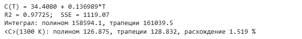{width=12.79cm}


**Результаты.** Модель: $C(T) = 34.4080 + 0.136989 \cdot T$, Дж/(моль∙К). Подстановка в формулу средней теплоёмкости:

$$\langle C \rangle = 34.4080 + 0.136989 \cdot \frac{1300 + 50}{2} = 126.875\ \text{Дж/(моль∙К)};$$

$$\langle C \rangle_{трап} = \frac{161039.5\ \text{Дж/моль}}{1300 - 50\ \text{К}} = 128.832\ \text{Дж/(моль∙К)}.$$


: Таблица 3 – Результаты задачи 1.1

| Величина | Значение |
|-------------------------------------------------------------------------------|:--------------------:|
| Коэффициент a~0~, Дж/(моль∙К) | 34.4080 |
| Коэффициент a~1~, Дж/(моль∙К^2^) | 0.136989 |
| Коэффициент детерминации R^2^ | 0.97725 |
| Остаточная сумма SSE, (Дж/(моль∙К))^2^ | 1119.07 |
| Интеграл по полиному, Дж/моль | 158594.1 |
| Интеграл методом трапеций, Дж/моль | 161039.5 |
| ⟨C⟩ по полиному, Дж/(моль∙К) | 126.875 |
| ⟨C⟩ методом трапеций, Дж/(моль∙К) | 128.832 |
| Относительное расхождение, % | 1.519 |


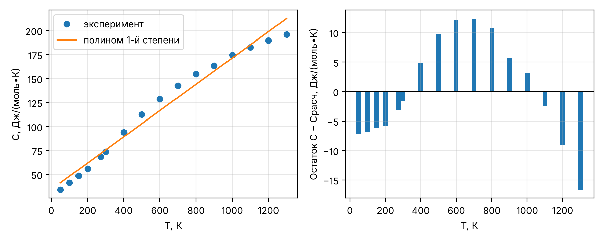{width=16cm}


**Анализ.** Коэффициент детерминации R^2^ = 0.9773 высокий, но остатки имеют систематический знак: модель занижает теплоёмкость в середине интервала (до 12.4 Дж/(моль∙К)) и завышает на краях (до 16.6 Дж/(моль∙К)). Причина – выпуклая кривая C(T) описывается прямой, т.е. вид модели не соответствует физике (теплоёмкость растёт с замедлением). Средние теплоёмкости по модели и по трапециям различаются на 1.52 %: ошибки прямой на краях и в середине интервала частично компенсируются при интегрировании. Метод трапеций по 16 точкам с шагом 50–100 К точнее, его погрешность для выпуклой функции – малое занижение.

**Вывод.** Средняя теплоёмкость пропана в интервале 50–1300 К: 126.88 Дж/(моль∙К) по полиному 1-й степени и 128.83 Дж/(моль∙К) по таблице методом трапеций (расхождение 1.52 %). Для оценки среднего значения линейная модель приемлема, но для расчёта C при конкретной температуре она непригодна (ошибка до 21 % при 50 К); для этого нужен полином более высокой степени.

## 1.2 Задание 2. Содержание воды в дистилляте отпарной колонны

**Условие.** Построить эмпирическую модель зависимости содержания воды в дистилляте y от расхода пара x в форме $y = a \cdot \left(\ln(x/b)\right)^{-2/3}$ и предложить другую функциональную форму модели [1].


: Таблица 4 – Исходные данные задачи 1.2 [1]

| x, кг/с | 0.263 | 0.294 | 0.321 | 0.367 | 0.429 | 0.608 | 1.33 | 1.36 |
|----------|:-----------:|:-----------:|:-----------:|:-----------:|:-----------:|:-----------:|:----------:|:----------:|
| y | 0.34 | 0.32 | 0.24 | 0.20 | 0.16 | 0.11 | 0.06 | 0.04 |

**Метод.** Обозначения: $x$ – расход пара, кг/с; $y$ – содержание воды в дистилляте, доли; $a$ – коэффициент, доли; $b$ – параметр, кг/с. Модель определена только при $\ln(x/b) > 0$, т.е. при $0 < b < x_{min} = 0.263$ кг/с. Модель можно линеаризовать: $y^{-3/2} = a^{-3/2} \cdot \ln x - a^{-3/2} \cdot \ln b$. Однако линейный МНК по преобразованным данным даёт b = 0.2884 кг/с > x~min~, т.е. недопустимое значение (при x < b логарифм отрицателен). Поэтому параметры найдены нелинейным МНК по исходным y (функция scipy.optimize.curve_fit) с ограничением 0 < b < 0.2629 кг/с. Для сравнения построены две альтернативные модели: степенная $y = a \cdot x^{-k}$ и экспоненциальная с асимптотой $y = a \cdot e^{-k x} + c$. Для сравнения моделей с разным числом параметров $p$ используется скорректированный коэффициент детерминации

$$R^{2}_{скорр} = 1 - (1 - R^{2}) \cdot \frac{n - 1}{n - p}.$$

Программа (ячейка Google Colab):

```python
# Задача 1.2. Модель y = a·(ln(x/b))^(-2/3) для отпарной колонны
task("t12", "Задача 1.2")
x12 = np.array([0.263, 0.294, 0.321, 0.367, 0.429, 0.608, 1.33, 1.36])   # кг/с
y12 = np.array([0.34, 0.32, 0.24, 0.20, 0.16, 0.11, 0.06, 0.04])


def model_given(x, a, b):
    return a * np.log(x / b) ** (-2 / 3)


def model_power(x, a, n):                   # альтернатива: степенная
    return a * x ** (-n)


def model_exp(x, a, k, c):                  # альтернатива: экспонента
    return a * np.exp(-k * x) + c


# Ограничение модели: ln(x/b) > 0 при всех x, т.е. 0 < b < x_min = 0,263 кг/с.
# Линеаризация y^(-3/2) = a^(-3/2)·(ln x − ln b) даёт b > x_min (проверка ниже),
# поэтому параметры ищутся нелинейным МНК с границами.
k_lin, m_lin = np.polyfit(np.log(x12), y12 ** -1.5, 1)
b_linearized = np.exp(-m_lin / k_lin)
out(f"b по линеаризации = {b_linearized:.4f} кг/с > x_min = {x12.min()}"
    " -> недопустимо")
models = {"заданная": (model_given, [0.1, 0.2], ([0, 1e-4], [np.inf, 0.2629])),
          "степенная": (model_power, [0.05, 1.0], (-np.inf, np.inf)),
          "экспоненциальная": (model_exp, [1.0, 3.0, 0.05], (-np.inf, np.inf))}
res12 = {"b_linearized": b_linearized}
for name, (fn, p0, bnd) in models.items():
    p, cov = curve_fit(fn, x12, y12, p0=p0, bounds=bnd, maxfev=20000)
    yc = fn(x12, *p)
    n, k = len(y12), len(p)
    res12[name] = dict(p=p, R2=r2(y12, yc), SSE=sse(y12, yc), k=k, yc=yc,
                       R2adj=1 - (1 - r2(y12, yc)) * (n - 1) / (n - k),
                       max_abs=np.max(np.abs(y12 - yc)))
    out(f"{name:17s} p = {np.round(p, 5)}  R2 = {res12[name]['R2']:.4f}  "
        f"R2adj = {res12[name]['R2adj']:.4f}  SSE = {res12[name]['SSE']:.5f}")

fig, ax = plt.subplots(figsize=(6, 3.8))
xg = np.linspace(0.263, 1.4, 300)
ax.plot(x12, y12, "ko", label="эксперимент")
for name, (fn, _, _) in models.items():
    ax.plot(xg, fn(xg, *res12[name]["p"]), label=f"{name} модель")
ax.set(xlabel="Расход пара x, кг/с", ylabel="Содержание воды y, доли")
ax.legend()
style_axes(ax)
show(fig, "t12")
```

Результат работы программы (скриншот Google Colab):

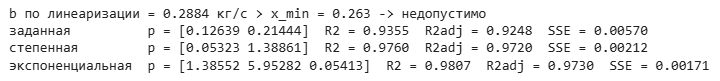{width=14.85cm}


: Таблица 5 – Сравнение эмпирических моделей задачи 1.2

| Модель | Параметры | R^2^ | R^2^~скорр~ | SSE | max \|y − y~расч~\| |
|-------------------------------------|:----------------------------------------:|:--------:|:---------:|:---------:|:---------:|
| $y = a \cdot \left(\ln(x/b)\right)^{-2/3}$ (заданная) | a = 0.1264; b = 0.2144 кг/с | 0.9355 | 0.9248 | 0.00570 | 0.0473 |
| $y = a \cdot x^{-k}$ (степенная) | a = 0.0532; k = 1.3886 | 0.9760 | 0.9720 | 0.00212 | 0.0287 |
| $y = a \cdot e^{-k x} + c$ (экспоненциальная) | a = 1.3855; k = 5.953 с/кг; c = 0.0541 | 0.9807 | 0.9730 | 0.00171 | 0.0251 |


{width=14cm}


Заданная модель с найденными параметрами:

$$y = 0.1264 \cdot \left( \ln \frac{x}{0.2144} \right)^{-2/3}.$$

Например, при x = 0.429 кг/с: $y = 0.1264 \cdot (\ln(0.429/0.2144))^{-2/3} = 0.1613$ при опытном 0.16.

**Вывод.** Заданная модель описывает данные с R^2^ = 0.936; её параметры: a = 0.1264, b = 0.2144 кг/с. Параметр b ограничен сверху минимальным расходом пара, а линеаризация даёт недопустимое b, поэтому нужен нелинейный МНК с ограничениями. Другие функциональные формы существуют и точнее: степенная модель $y = 0.0532 \cdot x^{-1.3886}$ (R^2^ = 0.976, два параметра) и экспонента с асимптотой (R^2^ = 0.981, три параметра). По скорректированному R^2^ степенная и экспоненциальная модели практически равноценны (0.9720 и 0.9730); рекомендуется степенная как более простая. Экспоненциальная модель даёт ненулевой предел y = 0.054 при большом расходе пара, что физически правдоподобно (остаточная влажность), но при 8 точках третий параметр статистически не обоснован.

## 1.3 Задание 3. Уравнение Аррениуса

**Условие.** По зависимости константы скорости реакции от температуры (вариант 1) определить параметры уравнения Аррениуса – энергию активации и предэкспоненциальный множитель [1].

**Метод.** Уравнение Аррениуса и его линейная форма:

$$k = A \cdot e^{-E_a/(R T)}, \qquad \ln k = \ln A - \frac{E_a}{R} \cdot \frac{1}{T},$$

где $k$ – константа скорости, 1/с; $A$ – предэкспоненциальный множитель, 1/с; $E_a$ – энергия активации, Дж/моль; $R$ = 8.314 Дж/(моль∙К); $T$ – температура, К ($T = t + 273.15$). По МНК для $\ln k$ от $1/T$ находятся наклон $-E_a/R$ и отрезок $\ln A$. Дополнительно параметры найдены нелинейным МНК по самим значениям k (curve_fit), начальное приближение – результат линеаризации.


: Таблица 6 – Константа скорости реакции, вариант 1 [1]

| t, °C | T, К | 1/T, 1/К | k, 1/с | ln k | ln k~расч~ | остаток |
|---------|:-------------:|:----------------------:|:---------:|:--------------:|:--------------:|:--------------:|
| 100 | 373.15 | $2.6799 \cdot 10^{-3}$ | 0.05 | −2.9957 | −2.6826 | −0.313 |
| 150 | 423.15 | $2.3632 \cdot 10^{-3}$ | 0.25 | −1.3863 | −1.6359 | 0.250 |
| 200 | 473.15 | $2.1135 \cdot 10^{-3}$ | 0.60 | −0.5108 | −0.8104 | 0.300 |
| 250 | 523.15 | $1.9115 \cdot 10^{-3}$ | 0.98 | −0.0202 | −0.1427 | 0.122 |
| 300 | 573.15 | $1.7447 \cdot 10^{-3}$ | 1.35 | 0.3001 | 0.4085 | −0.108 |
| 350 | 623.15 | $1.6048 \cdot 10^{-3}$ | 1.99 | 0.6881 | 0.8713 | −0.183 |
| 400 | 673.15 | $1.4856 \cdot 10^{-3}$ | 2.87 | 1.0543 | 1.2653 | −0.211 |
| 450 | 723.15 | $1.3828 \cdot 10^{-3}$ | 4.56 | 1.5173 | 1.6048 | −0.087 |
| 500 | 773.15 | $1.2934 \cdot 10^{-3}$ | 8.43 | 2.1318 | 1.9004 | 0.231 |

Программа (ячейка Google Colab):

```python
# Задача 1.3. Уравнение Аррениуса (вариант 1)
task("t13", "Задача 1.3")
t13 = np.array([100, 150, 200, 250, 300, 350, 400, 450, 500.0])        # °C
k13 = np.array([0.05, 0.25, 0.60, 0.98, 1.35, 1.99, 2.87, 4.56, 8.43])  # 1/с
T13 = t13 + 273.15                                                       # К

# 1) линеаризация: ln k = ln A − (Ea/R)·(1/T)
slope, intercept = np.polyfit(1 / T13, np.log(k13), 1)
Ea_lin, A_lin = -slope * R, np.exp(intercept)
lnk_calc = intercept + slope / T13
# 2) нелинейный МНК по самим k (начальное приближение — из линеаризации)
(A_nl, Ea_nl), _ = curve_fit(lambda T, A, Ea: A * np.exp(-Ea / (R * T)),
                             T13, k13, p0=[A_lin, Ea_lin], maxfev=20000)
k_lin = A_lin * np.exp(-Ea_lin / (R * T13))
k_nl = A_nl * np.exp(-Ea_nl / (R * T13))
res13 = dict(Ea_lin=Ea_lin, A_lin=A_lin, Ea_nl=Ea_nl, A_nl=A_nl,
             R2_ln=r2(np.log(k13), lnk_calc), R2_k_lin=r2(k13, k_lin),
             R2_k_nl=r2(k13, k_nl), R2_ln_nl=r2(np.log(k13), np.log(k_nl)),
             resid_ln=np.log(k13) - lnk_calc, k_lin=k_lin, k_nl=k_nl)
out(f"Линеаризация: Ea = {Ea_lin/1000:.2f} кДж/моль, A = {A_lin:.4e} 1/с, "
    f"R2(ln k) = {res13['R2_ln']:.4f}, R2(k) = {res13['R2_k_lin']:.4f}")
out(f"Нелинейный МНК: Ea = {Ea_nl/1000:.2f} кДж/моль, A = {A_nl:.4e} 1/с, "
    f"R2(k) = {res13['R2_k_nl']:.4f}")
out("Остатки ln k:", np.round(res13["resid_ln"], 3))
# проверка постоянства Ea: «локальная» энергия активации по соседним точкам
Ea_loc = -R * np.diff(np.log(k13)) / np.diff(1 / T13)
res13["Ea_loc"] = Ea_loc
out("Ea по соседним точкам, кДж/моль:", np.round(Ea_loc / 1000, 1))

fig, ax = plt.subplots(1, 2, figsize=(9, 3.6))
ax[0].plot(1000 / T13, np.log(k13), "ko", label="эксперимент")
ax[0].plot(1000 / T13, lnk_calc, "-", label="линеаризация")
ax[0].set(xlabel="1000/T, 1/К", ylabel="ln k (k в 1/с)")
ax[0].legend()
Tg = np.linspace(T13[0], T13[-1], 200)
ax[1].plot(T13, k13, "ko", label="эксперимент")
ax[1].plot(Tg, A_lin * np.exp(-Ea_lin / (R * Tg)), "-", label="линеаризация")
ax[1].plot(Tg, A_nl * np.exp(-Ea_nl / (R * Tg)), "--", label="нелинейный МНК")
ax[1].set(xlabel="T, К", ylabel="k, 1/с")
ax[1].legend()
for a in ax:
    style_axes(a)
show(fig, "t13")
```

Результат работы программы (скриншот Google Colab):

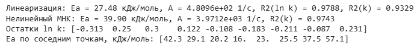{width=14.40cm}


: Таблица 7 – Параметры уравнения Аррениуса

| Способ | E~a~, кДж/моль | A, 1/с | R^2^ по ln k | R^2^ по k |
|--------------------------------------------|:-----------:|:-------------------:|:------------:|:------------:|
| Линеаризация (МНК по ln k) | 27.48 | $4.810 \cdot 10^{2}$ | 0.9788 | 0.9329 |
| Нелинейный МНК по k | 39.90 | $3.971 \cdot 10^{3}$ | 0.5918 | 0.9743 |

Расчёт по линеаризации: наклон прямой $-E_a/R = -3305.5$ К, откуда

$$E_a = 3305.5 \cdot 8.314 = 27484\ \text{Дж/моль} = 27.48\ \text{кДж/моль}, \qquad A = e^{6.1758} = 481.0\ \text{с}^{-1}.$$


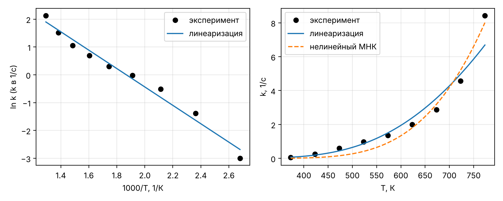{width=16cm}


**Анализ.** Линейная модель ln k(1/T) объясняет 97.9 % дисперсии, но остатки ln k меняют знак систематически (−, +, +, +, −, −, −, −, +): точки ложатся на кривую, а не на прямую. Энергия активации, рассчитанная по соседним точкам, не постоянна и лежит в диапазоне 16.0–57.1 кДж/моль (42.3, 29.1, 20.2, 16.0, 23.0, 25.5, 37.5, 57.1 кДж/моль по интервалам 100–150, …, 450–500 °C) – уменьшается в средней части интервала и резко растёт выше 400 °C. Это признак смены лимитирующей стадии или механизма. Две оценки E~a~ различаются (27.5 и 39.9 кДж/моль), потому что методы по-разному взвешивают точки: линеаризация минимизирует относительные отклонения, а нелинейный МНК – абсолютные, и в нём преобладают большие k при 450–500 °C.

**Вывод.** Параметры уравнения Аррениуса по линеаризации: E~a~ = 27.48 кДж/моль, A = 481.0 с^−1^ (R^2^ = 0.9788 по ln k). Нелинейный МНК даёт E~a~ = 39.90 кДж/моль, A = 3971 с^−1^ и лучше описывает высокотемпературную область (R^2^ = 0.9743 по k). Уравнение Аррениуса с постоянными параметрами описывает данные лишь приближённо: остатки систематические, локальная энергия активации меняется в 3.5 раза. Для расчётов во всём интервале 100–500 °C лучше разбить его на два участка или использовать модель с зависимостью E~a~ от температуры.

## 1.4 Задание 4. Вязкость ацетона: полиномы 1–3 степени

**Условие.** По зависимости вязкости жидкости от температуры (вариант 1 – ацетон) построить полиномиальные модели 1–3 степени, оценить их адекватность по коэффициенту детерминации и остаточной сумме, сравнить модели [1].


: Таблица 8 – Динамическая вязкость ацетона, мПа∙с, вариант 1 [1]

| T, К | 250 | 260 | 270 | 280 | 290 | 300 |
|-------------------|:-------------:|:-------------:|:-------------:|:-------------:|:-------------:|:-------------:|
| μ, мПа∙с | 0.500 | 0.442 | 0.395 | 0.356 | 0.322 | 0.293 |

| T, К | 310 | 320 | 330 | 350 | 370 | 390 |
|-------------------|:-------------:|:-------------:|:-------------:|:-------------:|:-------------:|:-------------:|
| μ, мПа∙с | 0.268 | 0.246 | 0.230 | 0.200 | 0.170 | 0.150 |

**Метод.** Модели $\mu(T) = \sum_{j=0}^{d} b_j \cdot T^{j}$, $d$ = 1, 2, 3, где $\mu$ – динамическая вязкость, мПа∙с (1 мПа∙с = 10^−3^ Па∙с); $T$ – температура, К; $b_j$ – коэффициенты, мПа∙с/К^j^. Коэффициенты найдены МНК (numpy.polynomial.Polynomial.fit – с масштабированием аргумента, что устраняет плохую обусловленность при T ≈ 300 К). Для сравнения используются R^2^, скорректированный R^2^, остаточная сумма SSE, стандартное отклонение остатков $s = \sqrt{SSE/(n - d - 1)}$ и максимальная относительная ошибка δ.

Программа (ячейка Google Colab):

```python
# Задача 1.4. Вязкость ацетона: полиномы 1–3 степени (вариант 1)
task("t14", "Задача 1.4")
T14 = np.array([250, 260, 270, 280, 290, 300, 310, 320, 330, 350, 370, 390.0])  # К
mu14 = np.array([0.500, 0.442, 0.395, 0.356, 0.322, 0.293, 0.268, 0.246,
                 0.230, 0.200, 0.170, 0.150])                                  # мПа∙с
res14 = {}
for d in (1, 2, 3):
    p = np.polynomial.Polynomial.fit(T14, mu14, d).convert().coef   # b0, b1, ...
    mc = np.polynomial.polynomial.polyval(T14, p)
    n = len(mu14)
    res14[d] = dict(b=p, mu_calc=mc, R2=r2(mu14, mc), SSE=sse(mu14, mc),
                    R2adj=1 - (1 - r2(mu14, mc)) * (n - 1) / (n - d - 1),
                    s=np.sqrt(sse(mu14, mc) / (n - d - 1)),
                    max_err=np.max(np.abs(mu14 - mc) / mu14) * 100)
    out(f"степень {d}: b = {np.array2string(p, precision=6)}")
    out(f"   R2 = {res14[d]['R2']:.5f}, R2adj = {res14[d]['R2adj']:.5f}, "
        f"SSE = {res14[d]['SSE']:.3e}, s = {res14[d]['s']:.4f} мПа∙с, "
        f"макс. отн. ошибка = {res14[d]['max_err']:.2f} %")

fig, ax = plt.subplots(1, 2, figsize=(9, 3.6))
Tg = np.linspace(250, 390, 200)
ax[0].plot(T14, mu14, "ko", label="эксперимент")
for d in (1, 2, 3):
    ax[0].plot(Tg, np.polynomial.polynomial.polyval(Tg, res14[d]["b"]),
               label=f"полином {d}-й степени")
    ax[1].plot(T14, mu14 - res14[d]["mu_calc"], "o-", label=f"{d}-я степень")
ax[0].set(xlabel="T, К", ylabel="μ, мПа∙с")
ax[1].axhline(0, color="k", lw=0.8)
ax[1].set(xlabel="T, К", ylabel="Остаток μ − μрасч, мПа∙с")
for a in ax:
    a.legend()
    style_axes(a)
show(fig, "t14")
```

Результат работы программы (скриншот Google Colab):

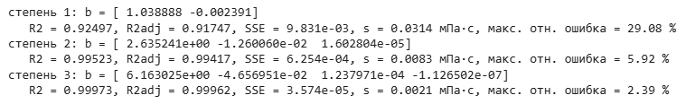{width=15.65cm}


: Таблица 9 – Полиномиальные модели вязкости ацетона μ(T), μ в мПа∙с, T в К

| Степень | Коэффициенты | R^2^ | R^2^~скорр~ | SSE, (мПа∙с)^2^ | s, мПа∙с | max δ, % |
|---------|:-------------------------------------------:|:---------:|:---------:|:-------------:|:--------:|:-------:|
| 1 | $b_0 = 1.0389$; $b_1 = -2.3910 \cdot 10^{-3}$ | 0.92497 | 0.91747 | $9.831 \cdot 10^{-3}$ | 0.0314 | 29.08 |
| 2 | $b_0 = 2.6352$; $b_1 = -1.2601 \cdot 10^{-2}$; $b_2 = 1.6028 \cdot 10^{-5}$ | 0.99523 | 0.99417 | $6.254 \cdot 10^{-4}$ | 0.0083 | 5.92 |
| 3 | $b_0 = 6.1630$; $b_1 = -4.6570 \cdot 10^{-2}$; $b_2 = 1.2380 \cdot 10^{-4}$; $b_3 = -1.1265 \cdot 10^{-7}$ | 0.99973 | 0.99962 | $3.574 \cdot 10^{-5}$ | 0.0021 | 2.39 |


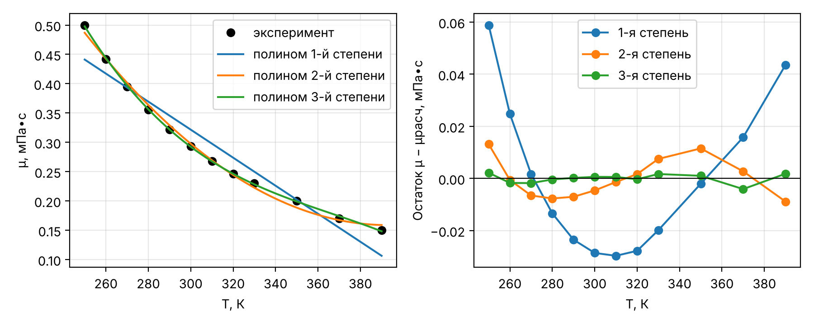{width=16cm}


**Анализ.** Прямая (R^2^ = 0.9250) непригодна: остатки имеют форму параболы, ошибка достигает 29.1 % – вязкость жидкости убывает с температурой нелинейно (близко к закону Андраде ln μ = A + B/T). Полином 2-й степени снижает SSE в 16 раз (R^2^ = 0.9952, ошибка до 5.9 %), но остатки ещё систематические. Полином 3-й степени снижает SSE ещё в 18 раз; его стандартное отклонение s = 0.0021 мПа∙с сопоставимо с точностью исходных данных (третий знак после точки), а скорректированный R^2^ = 0.99962 – наибольший, т.е. рост числа параметров оправдан.

**Вывод.** Для вязкости ацетона в интервале 250–390 К адекватна модель 3-й степени: μ = 6.1630 − 0.04657∙T + 1.2380∙10^−4^∙T^2^ − 1.1265∙10^−7^∙T^3^ (мПа∙с), R^2^ = 0.9997, максимальная ошибка 2.4 %. Модель 2-й степени допустима для оценочных расчётов (ошибка до 6 %), линейная – нет. Полиномы применимы только внутри интервала данных: за его пределами кубический член быстро искажает зависимость.


```{=openxml}
<w:p><w:r><w:br w:type="page"/></w:r></w:p>
```


# 2 Уравнения состояния и расчёт однофазных потоков

## 2.0 Расчётные зависимости и справочные данные

Мольный объём газа $v$, м^3^/моль, по уравнению идеального газа: $v = R T / P$. Кубические уравнения состояния Редлиха–Квонга [10] и Соаве–Редлиха–Квонга [11]:

$$P = \frac{R T}{v - b} - \frac{a}{v \cdot (v + b)}, \qquad a = 0.42748 \cdot \frac{R^{2} T_c^{2}}{P_c} \cdot \alpha(T), \qquad b = 0.08664 \cdot \frac{R T_c}{P_c},$$

$$\alpha_{RK} = T_r^{-0.5}, \qquad \alpha_{SRK} = \left(1 + m \cdot \left(1 - \sqrt{T_r}\right)\right)^{2}, \qquad m = 0.480 + 1.574 \cdot \omega - 0.176 \cdot \omega^{2},$$

где $P$ – давление, Па; $T$ – температура, К; $R$ = 8.314 Дж/(моль∙К); $a$ – параметр притяжения, Па∙м^6^/моль^2^; $b$ – собственный объём молекул, м^3^/моль; $T_c$, К, и $P_c$, Па – критические температура и давление; $T_r = T/T_c$ – приведённая температура; $\omega$ – ацентрический фактор. В переменных коэффициента сжимаемости $Z = P v / (R T)$ уравнение приводится к кубическому:

$$Z^{3} - Z^{2} + \left(A - B - B^{2}\right) \cdot Z - A \cdot B = 0, \qquad A = \frac{a P}{(R T)^{2}}, \qquad B = \frac{b P}{R T}.$$

Все три корня находятся функцией numpy.roots; для газовой фазы берётся наибольший действительный корень, больший B. Для смеси используются правила смешения ван-дер-ваальсового типа (коэффициенты бинарного взаимодействия равны нулю):

$$a = \sum_{i} \sum_{j} y_i y_j \sqrt{a_i a_j}, \qquad b = \sum_{i} y_i b_i,$$

где $y_i$ – мольная доля компонента. Результат переводится в л/моль: 1 м^3^/моль = 1000 л/моль.


: Таблица 10 – Критические параметры и ацентрический фактор [9, разд. A2]

| Вещество | T~c~, К | P~c~, атм | P~c~, МПа | ω |
|-----------------------------|:-----------------:|:-----------------:|:-------------------:|:-----------------:|
| Метан CH~4~ | 190.6 | 45.4 | 4.600 | 0.008 |
| Аммиак NH~3~ | 405.6 | 111.3 | 11.277 | 0.25 |
| Азот N~2~ | 126.2 | 33.5 | 3.394 | 0.04 |
| Водород H~2~ | 33.2 | 12.8 | 1.297 | -0.22 |

Программа (ячейка Google Colab):

```python
# Задачи 2.1–2.2. Общая часть: параметры RK/SRK и решение кубического уравнения
# Tc, К; Pc, атм; ω — справочник Refining & Chemicals (IFP Training, 2014), раздел A2
CRIT = {"CH4": (190.6, 45.4, 0.008),
        "NH3": (405.6, 111.3, 0.250),
        "N2": (126.2, 33.5, 0.040),
        "H2": (33.2, 12.8, -0.22)}


def eos_ab(gas, T, eos):
    """a, Па∙м6/моль2 и b, м3/моль для RK или SRK."""
    Tc, Pc_atm, w = CRIT[gas]
    Pc, Tr = Pc_atm * ATM, T / Tc
    if eos == "RK":
        alpha = Tr ** -0.5
    else:
        m = 0.480 + 1.574 * w - 0.176 * w ** 2
        alpha = (1 + m * (1 - Tr ** 0.5)) ** 2
    return 0.42748 * R ** 2 * Tc ** 2 / Pc * alpha, 0.08664 * R * Tc / Pc


def solve_z(a, b, T, P):
    """Z^3 − Z^2 + (A − B − B^2)·Z − A·B = 0; газ — наибольший корень Z > B."""
    A, B = a * P / (R * T) ** 2, b * P / (R * T)
    roots = np.roots([1.0, -1.0, A - B - B ** 2, -A * B])
    real = roots[np.abs(roots.imag) < 1e-10].real
    return real[real > B].max(), roots, A, B


def volumes(names, y, T, P_atm):
    P = P_atm * ATM
    res = {"ИГ": dict(Z=1.0, v=R * T / P)}
    for eos in ("RK", "SRK"):
        ab = np.array([eos_ab(g, T, eos) for g in names])
        ai, bi = ab[:, 0], ab[:, 1]
        a = np.sum(np.outer(y, y) * np.sqrt(np.outer(ai, ai)))  # ΣΣ yi·yj·√(ai·aj)
        b = np.sum(y * bi)                                       # b = Σ yi·bi
        Z, roots, A, B = solve_z(a, b, T, P)
        res[eos] = dict(Z=Z, v=Z * R * T / P, a=a, b=b, ai=ai, bi=bi,
                        A=A, B=B, roots=roots)
    for k, d in res.items():
        d["v_L"] = d["v"] * 1000                                  # м3/моль -> л/моль
        d["dev"] = (d["v"] / res["ИГ"]["v"] - 1) * 100
        out(f"{k:4s} Z = {d['Z']:.4f}  v = {d['v']:.4e} м3/моль"
            f" = {d['v_L']:.4f} л/моль"
            f"  отклонение от ИГ {d['dev']:+.2f} %")
    return res
```


## 2.1 Задание 1. Мольный объём метана

**Условие.** Определить мольный объём метана при P = 40 атм и T = 350 К по уравнениям идеального газа, RK и SRK; результаты представить в л/моль, сравнить и объяснить различия [1].

**Перевод единиц.** P = 40 атм ∙ 101325 Па/атм = 4053000 Па = 4.0530 МПа. Приведённые параметры: T~r~ = 350/190.6 = 1.836; P~r~ = 40/45.4 = 0.881.

**Расчёт.** Идеальный газ:

$$v = \frac{R T}{P} = \frac{8.314 \cdot 350}{4053000} = 7.1800 \cdot 10^{-4}\ \text{м}^{3}\text{/моль} = 0.7180\ \text{л/моль}.$$

Параметры RK: $b = 0.08664 \cdot 8.314 \cdot 190.6 / 4600155 = 2.9847 \cdot 10^{-5}$ м^3^/моль; $a = 0.42748 \cdot 8.314^{2} \cdot 190.6^{2} / 4600155 \cdot 1.8363^{-0.5} = 0.17222$ Па∙м^6^/моль^2^. Для SRK: $m = 0.480 + 1.574 \cdot 0.008 - 0.176 \cdot 0.008^{2} = 0.4926$; $\alpha = (1 + 0.4926 \cdot (1 - \sqrt{1.8363}))^{2} = 0.6808$; $a = 0.15887$ Па∙м^6^/моль^2^ (параметр b тот же). Безразмерные коэффициенты: RK – A = 0.08242, B = 0.04157; SRK – A = 0.07604, B = 0.04157.

Программа (ячейка Google Colab):

```python
# Задача 2.1. Метан, P = 40 атм, T = 350 К
task("t21", "Задача 2.1")
T21, P21 = 350.0, 40.0
out(f"P = {P21} атм = {P21*ATM/1e6:.4f} МПа; Tr = {T21/CRIT['CH4'][0]:.3f}; "
    f"Pr = {P21/CRIT['CH4'][1]:.3f}")
res21 = volumes(["CH4"], np.array([1.0]), T21, P21)
for eos in ("RK", "SRK"):
    out(eos, "корни Z:", np.round(res21[eos]["roots"], 5))
```

Результат работы программы (скриншот Google Colab):

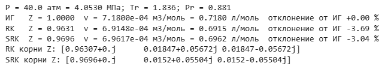{width=13.26cm}


Кубические уравнения имеют по одному действительному корню (два других комплексные), что соответствует однофазной области: T > T~c~.

$$v_{SRK} = \frac{Z R T}{P} = \frac{0.9696 \cdot 8.314 \cdot 350}{4053000} = 6.9617 \cdot 10^{-4}\ \text{м}^{3}\text{/моль} = 0.6962\ \text{л/моль}.$$


: Таблица 11 – Мольный объём метана при 40 атм и 350 К

| Уравнение | Z | v, м^3^/моль | v, л/моль | Отклонение от ИГ, % |
|----------------------------------------|:-----------:|:--------------------:|:-----------:|:-----------------:|
| Идеальный газ | 1.0000 | $7.1800 \cdot 10^{-4}$ | 0.7180 | 0.00 |
| Редлиха–Квонга (RK) | 0.9631 | $6.9148 \cdot 10^{-4}$ | 0.6915 | −3.69 |
| Соаве–Редлиха–Квонга (SRK) | 0.9696 | $6.9617 \cdot 10^{-4}$ | 0.6962 | −3.04 |

**Анализ.** Оба кубических уравнения дают Z < 1: при T~r~ ≈ 1.8 и P~r~ ≈ 0.9 силы притяжения между молекулами (параметр a) преобладают над эффектом собственного объёма (параметр b), и газ сжат сильнее идеального. Модель идеального газа завышает объём на 3.1 % относительно SRK. RK и SRK различаются на 0.7 %: в SRK функция α(T) учитывает ацентрический фактор, поэтому SRK для углеводородов, как правило, точнее; для метана (ω = 0.008, молекула почти сферическая) уравнения близки.

**Вывод.** Мольный объём метана при 40 атм и 350 К: 0.7180 л/моль (идеальный газ), 0.6915 л/моль (RK), 0.6962 л/моль (SRK). Метан в этих условиях – умеренно неидеальный газ (Z = 0.970); для инженерных расчётов с точностью лучше 3–4 % следует использовать уравнение SRK.

## 2.2 Задание 2. Мольный объём смеси аммиак – азот – водород

**Условие.** Смесь содержит 25 % (мол.) аммиака, остальное – азот и водород в мольном соотношении 1 : 3. Рассчитать мольный объём смеси при P = 250 атм, T = 520 К по уравнениям идеального газа, RK и SRK; определить, является ли газ идеальным [1].

**Состав и единицы.** y~NH3~ = 0.25; y~N2~ = 0.75 ∙ 1/4 = 0.1875; y~H2~ = 0.75 ∙ 3/4 = 0.5625. P = 250 ∙ 101325 = 25331250 Па = 25.3313 МПа.

Программа (ячейка Google Colab):

```python
# Задача 2.2. Смесь 25 % NH3, остальное N2 : H2 = 1 : 3; P = 250 атм, T = 520 К
task("t22", "Задача 2.2")
names22 = ["NH3", "N2", "H2"]
y22 = np.array([0.25, 0.75 * 1 / 4, 0.75 * 3 / 4])
T22, P22 = 520.0, 250.0
out("Состав, мол. доли:", ", ".join(f"{n} {v:.4f}" for n, v in zip(names22, y22)))
res22 = volumes(names22, y22, T22, P22)
for eos in ("RK", "SRK"):
    out(eos, "a_i =", np.round(res22[eos]["ai"], 5), " b_i =", res22[eos]["bi"])

fig, ax = plt.subplots(1, 2, figsize=(9, 3.6))
for axx, res, T, P, title in ((ax[0], res21, T21, P21, "Метан, 40 атм, 350 К"),
                              (ax[1], res22, T22, P22, "NH₃–N₂–H₂, 250 атм, 520 К")):
    Zg = np.linspace(-0.1, 1.4, 300)
    for eos in ("RK", "SRK"):
        A, B = res[eos]["A"], res[eos]["B"]
        axx.plot(Zg, Zg ** 3 - Zg ** 2 + (A - B - B ** 2) * Zg - A * B, label=eos)
        axx.plot(res[eos]["Z"], 0, "o")
    axx.axhline(0, color="k", lw=0.8)
    axx.axvline(1, color="gray", ls=":", label="ИГ (Z = 1)")
    axx.set(xlabel="Z", ylabel="f(Z)", title=title, ylim=(-0.3, 0.6))
    axx.legend()
    style_axes(axx)
show(fig, "t2")
```

Результат работы программы (скриншот Google Colab):

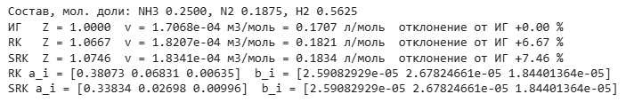{width=14.50cm}


: Таблица 12 – Параметры компонентов и смеси (T = 520 К)

| Компонент | y~i~ | T~r~ | a~i~ (RK), Па∙м^6^/моль^2^ | a~i~ (SRK), Па∙м^6^/моль^2^ | b~i~, м^3^/моль |
|--------------------|:-------------:|:-------------:|:---------------:|:---------------:|:-----------------------:|
| Аммиак NH~3~ | 0.2500 | 1.282 | 0.38073 | 0.33834 | $2.5908 \cdot 10^{-5}$ |
| Азот N~2~ | 0.1875 | 4.120 | 0.06831 | 0.02698 | $2.6782 \cdot 10^{-5}$ |
| Водород H~2~ | 0.5625 | 15.663 | 0.00635 | 0.00996 | $1.8440 \cdot 10^{-5}$ |
| Смесь | 1.0000 | — | 0.06154 | 0.05399 | $2.1871 \cdot 10^{-5}$ |

Параметры смеси по правилам смешения (SRK): $a = \left(\sum y_i \sqrt{a_i}\right)^{2} = \left(0.25 \cdot \sqrt{0.33834} + 0.1875 \cdot \sqrt{0.02698} + 0.5625 \cdot \sqrt{0.00996}\right)^{2} = 0.05399$ Па∙м^6^/моль^2^; $b = \sum y_i b_i = 2.1871 \cdot 10^{-5}$ м^3^/моль.

$$v_{ИГ} = \frac{8.314 \cdot 520}{25331250} = 1.7068 \cdot 10^{-4}\ \text{м}^{3}\text{/моль}, \qquad v_{SRK} = \frac{1.0746 \cdot 8.314 \cdot 520}{25331250} = 1.8341 \cdot 10^{-4}\ \text{м}^{3}\text{/моль}.$$


: Таблица 13 – Мольный объём смеси NH~3~–N~2~–H~2~ при 250 атм и 520 К

| Уравнение | Z | v, м^3^/моль | v, л/моль | Отклонение от ИГ, % |
|----------------------------------------|:-----------:|:--------------------:|:-----------:|:-----------------:|
| Идеальный газ | 1.0000 | $1.7068 \cdot 10^{-4}$ | 0.1707 | 0.00 |
| Редлиха–Квонга (RK) | 1.0667 | $1.8207 \cdot 10^{-4}$ | 0.1821 | 6.67 |
| Соаве–Редлиха–Квонга (SRK) | 1.0746 | $1.8341 \cdot 10^{-4}$ | 0.1834 | 7.46 |


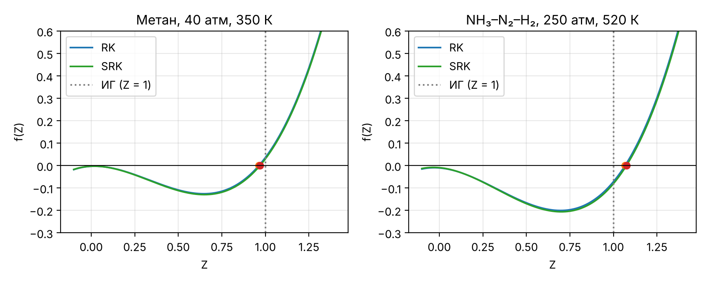{width=16cm}


**Анализ.** В отличие от метана, для смеси Z > 1: объём больше идеального на 6.7–7.5 %. Смесь на 75 % состоит из водорода и азота, приведённые температуры которых велики (T~r~ = 15.7 и 4.1): притяжение молекул слабое, а при 250 атм существенна доля собственного объёма молекул (B = 0.1281), поэтому преобладает отталкивание. Аммиак (T~r~ = 1.28) вносит основной вклад в параметр a, но его 25 % недостаточно, чтобы Z стал меньше 1. Псевдокритические параметры смеси по правилу Кэя: T~pc~ = 143.7 К, P~pc~ = 41.3 атм, т.е. T~pr~ = 3.62, P~pr~ = 6.1 – область, где идеально-газовое приближение не работает. Для водорода классические критические параметры применяются с оговоркой (квантовый газ), однако его вклад в a мал, и это не меняет вывода.

**Вывод.** Мольный объём смеси при 250 атм и 520 К: 0.1707 л/моль (идеальный газ), 0.1821 л/моль (RK), 0.1834 л/моль (SRK). Газ не является идеальным: Z = 1.075, и уравнение идеального газа занижает объём на 6.9 %. Для расчёта потоков синтез-газа при таких давлениях нужно кубическое уравнение состояния.


```{=openxml}
<w:p><w:r><w:br w:type="page"/></w:r></w:p>
```


# 3 Расчёт фазовых равновесий

## 3.0 Константы фазового равновесия

Для идеальных углеводородных смесей константа фазового равновесия $K_i = y_i / x_i$ зависит только от температуры и давления. В задании [1] она задана корреляцией (аппроксимация номограмм ДеПриестера [12]):

$$\ln K = -\frac{A}{T^{2}} + B - C \cdot \ln P + \frac{D}{P^{2}} \ (1), \qquad \ln K = -\frac{A}{T^{2}} + B - C \cdot \ln P + \frac{D}{P} \ (2),$$

где $T$ – температура, °R; $P$ – давление, psia; $A$, $B$, $C$, $D$ – коэффициенты компонента. Программа принимает T в К и P в Па и пересчитывает: $T_{°R} = 1.8 \cdot T_{К}$, $P_{psia} = P_{Па} / 6894.757$.


: Таблица 14 – Коэффициенты корреляции для констант фазового равновесия [1, 12]

| Компонент | A | B | C | D | Форма |
|-------------------|:-----------------:|:----------------:|:----------------:|:-----------------:|:------------:|
| CH~4~ | 292860 | 8.2445 | 0.8951 | 59.8465 | (1) |
| C~2~H~6~ | 687248.2 | 7.90694 | 0.866 | 49.02654 | (1) |
| C~3~H~8~ | 970688.6 | 7.15059 | 0.76984 | 6.90224 | (2) |
| i-C~4~ | 1166846 | 7.72668 | 0.92213 | 0 | (1) |
| C~4~ | 1280557 | 7.94986 | 0.96455 | 0 | (1) |
| C~5~ | 1524891 | 7.33129 | 0.89143 | 0 | (1) |

Программа (ячейка Google Colab):

```python
# Задачи 3.1–3.2. Общая часть: константы фазового равновесия K(T, P)
# ln K = −A/T^2 + B − C·ln P + D/P^2 (форма 1) или + D/P (форма 2); T в °R, P в psia
KCOEF = {"CH4":   (292860.0, 8.2445, 0.8951, 59.8465, 1),
         "C2H6":  (687248.2, 7.90694, 0.866, 49.02654, 1),
         "C3H8":  (970688.6, 7.15059, 0.76984, 6.90224, 2),
         "i-C4":  (1166846.0, 7.72668, 0.92213, 0.0, 1),
         "n-C4":  (1280557.0, 7.94986, 0.96455, 0.0, 1),
         "n-C5":  (1524891.0, 7.33129, 0.89143, 0.0, 1)}


def K_values(names, T, P):
    """T в К, P в Па -> массив K_i (внутри перевод в °R и psia)."""
    TR, Pp = 1.8 * T, P / PSI
    K = []
    for n in names:
        A, B, C, D, form = KCOEF[n]
        last = D / Pp ** 2 if form == 1 else D / Pp
        K.append(np.exp(-A / TR ** 2 + B - C * np.log(Pp) + last))
    return np.array(K)
```


## 3.1 Задание 1. Температуры начала и конца кипения

**Условие.** Рассчитать температуры начала (ТНК) и конца (ТКК) кипения смеси при абсолютном давлении 14 атм; смесь идеальная [1]. Состав (вариант 1): метан – 20 %, этан – 25 %, пропан – 35 %, н-бутан – 20 %.

**Перевод единиц.** P = 14 ∙ 101325 = 1418550 Па = 1.4185 МПа = 1418550/6894.757 = 205.74 psia.

**Метод.** В точке начала кипения жидкость состава $x_i = z_i$ находится в равновесии с первым пузырьком пара $y_i = K_i x_i$; условие $\sum y_i = 1$ даёт уравнение для температуры. В точке конца кипения пар состава $y_i = z_i$ равновесен первой капле жидкости $x_i = y_i / K_i$:

$$f_{ТНК}(T) = \sum_{i} K_i(T, P) \cdot z_i - 1 = 0, \qquad f_{ТКК}(T) = \sum_{i} \frac{z_i}{K_i(T, P)} - 1 = 0.$$

Уравнения решаются методом Брента (scipy.optimize.brentq) на отрезке 100–500 К, где функции меняют знак (рисунок 6).

Программа (ячейка Google Colab):

```python
# Задача 3.1. ТНК и ТКК смеси (вариант 1) при 14 атм
task("t31", "Задача 3.1")
names31 = ["CH4", "C2H6", "C3H8", "n-C4"]
z31 = np.array([0.20, 0.25, 0.35, 0.20])
P31 = 14 * ATM                                   # 14 атм = 1,4186 МПа = 205,7 psia
f_bub = lambda T: np.sum(K_values(names31, T, P31) * z31) - 1      # Σ Ki·xi = 1
f_dew = lambda T: np.sum(z31 / K_values(names31, T, P31)) - 1      # Σ yi/Ki = 1
Tb = brentq(f_bub, 100.0, 500.0)
Td = brentq(f_dew, 100.0, 500.0)
Kb, Kd = K_values(names31, Tb, P31), K_values(names31, Td, P31)
res31 = dict(P=P31, Ppsia=P31 / PSI, Tb=Tb, Td=Td, tb=Tb - 273.15, td=Td - 273.15,
             Kb=Kb, Kd=Kd, y_b=Kb * z31, x_d=z31 / Kd)
out(f"P = {P31/1e6:.4f} МПа = {P31/PSI:.2f} psia")
out(f"ТНК = {Tb:.2f} К = {Tb-273.15:.2f} °C; ТКК = {Td:.2f} К = {Td-273.15:.2f} °C")
out("K при ТНК:", np.round(Kb, 4))
out("   состав первого пузырька y:", np.round(Kb * z31, 4))
out("K при ТКК:", np.round(Kd, 4))
out("   состав первой капли x:", np.round(z31 / Kd, 4))

Tg = np.linspace(180, 380, 300)
fig, ax = plt.subplots(figsize=(6, 3.6))
ax.plot(Tg - 273.15, [f_bub(T) for T in Tg], label="Σ Ki∙xi − 1 (ТНК)")
ax.plot(Tg - 273.15, [f_dew(T) for T in Tg], label="Σ yi/Ki − 1 (ТКК)")
ax.plot([Tb - 273.15, Td - 273.15], [0, 0], "ko")
ax.axhline(0, color="k", lw=0.8)
ax.set(xlabel="t, °C", ylabel="Невязка", ylim=(-1.5, 3))
ax.legend()
style_axes(ax)
show(fig, "t31")
```

Результат работы программы (скриншот Google Colab):

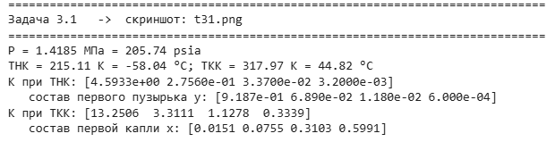{width=12.79cm}


: Таблица 15 – Составы и константы равновесия в точках начала и конца кипения (P = 14 атм)

| Компонент | z~i~ | K~i~ при ТНК | y~i~ = K~i~∙z~i~ | K~i~ при ТКК | x~i~ = z~i~/K~i~ |
|----------------------|:------------:|:----------------:|:----------------:|:------------------:|:----------------:|
| Метан | 0.20 | 4.5933 | 0.9187 | 13.2506 | 0.0151 |
| Этан | 0.25 | 0.2756 | 0.0689 | 3.3111 | 0.0755 |
| Пропан | 0.35 | 0.0337 | 0.0118 | 1.1278 | 0.3103 |
| н-Бутан | 0.20 | 0.0032 | 0.0006 | 0.3339 | 0.5991 |
| Сумма | 1.00 | — | 1.0000 | — | 1.0000 |

Проверка для ТНК: при T = 215.11 К = 387.20 °R константа метана $\ln K = -292860/387.20^{2} + 8.2445 - 0.8951 \cdot \ln 205.74 + 59.8465/205.74^{2}$, $K = 4.5933$; $\sum K_i z_i = 1.0000$.


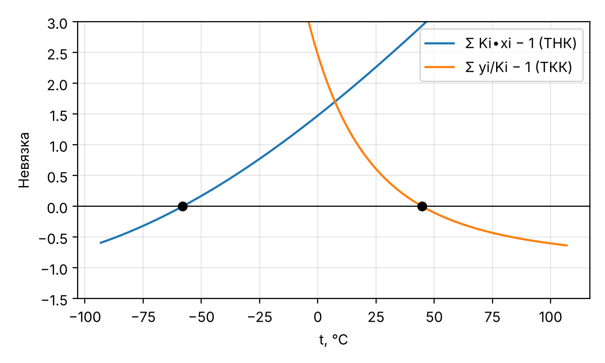{width=13cm}


**Вывод.** При 14 атм (1.419 МПа) смесь начинает кипеть при −58.04 °C (215.11 К) и полностью испаряется при 44.82 °C (317.97 К). Интервал кипения около 103 °C широкий, потому что компоненты сильно различаются по летучести: K метана в точке начала кипения в 1414 раз больше, чем K н-бутана. Первый пузырёк пара на 92 % состоит из метана, а последняя капля жидкости на 60 % – из н-бутана.

## 3.2 Задание 2. Расчёт сепарационного блока

**Условие.** Рассчитать составы газовых и жидких потоков на выходе из каждого сепаратора блока С1 → С2 → С3 (газ С1 поступает в С2, газ С2 – в С3; жидкость выводится из каждого сепаратора). Базовые условия: С1 – 9.8 МПа, 40.8 °C; С2 – 8.7 МПа, 12.8 °C; С3 – 8.7 МПа, −40.8 °C. Затем исследовать влияние температуры в первом сепараторе (вариант 1) и выбрать эффективный режим разделения [1]. Состав сырья (мольные доли): CH~4~ 0.72211, C~2~H~6~ 0.03608, C~3~H~8~ 0.22363, i-C~4~ 0.00646, C~4~ 0.00466, C~5~ 0.00706. Компоненты «C~4~» и «C~5~» рассчитываются по коэффициентам строк н-бутана и н-пентана таблицы задания.


![Рисунок 7 – Схема сепарационного блока [1]](fig/scheme32.png){width=9cm}


**Метод.** Каждый сепаратор – ступень однократного испарения. Мольная доля отгона $e = V/F$ находится из уравнения Рачфорда–Райса [13]:

$$\sum_{i} \frac{z_i \cdot (K_i - 1)}{1 + e \cdot (K_i - 1)} = 0, \qquad x_i = \frac{z_i}{1 + e \cdot (K_i - 1)}, \qquad y_i = K_i \cdot x_i,$$

где $z_i$ – мольная доля компонента в питании; $x_i$, $y_i$ – в жидкости и газе; $F$, $V$, $L$ – мольные расходы питания, газа и жидкости ($V = e F$, $L = F - V$). Перед решением проверяется фазовое состояние: при $\sum z_i K_i \le 1$ питание – жидкость ниже ТНК ($e = 0$), при $\sum z_i / K_i \le 1$ – газ выше ТКК ($e = 1$). Расчёт выполнен на базис 1 моль сырья (результат в мольных долях от сырья масштабируется на любой расход).

Программа (ячейка Google Colab):

```python
# Задача 3.2. Сепарационный блок С1 -> С2 -> С3: базовый расчёт
task("t32", "Задача 3.2 (базовый режим)")
names32 = ["CH4", "C2H6", "C3H8", "i-C4", "n-C4", "n-C5"]
z32 = np.array([0.72211, 0.03608, 0.22363, 0.00646, 0.00466, 0.00706])
BASE = [(9.8e6, 40.8), (8.7e6, 12.8), (8.7e6, -40.8)]       # (P, Па; t, °C) для С1–С3


def flash(z, T, P):
    """Однократное испарение: уравнение Рачфорда–Райса Σ zi(Ki−1)/(1+e(Ki−1)) = 0."""
    K = K_values(names32, T, P)
    if np.sum(z * K) <= 1:                  # ниже ТНК — только жидкость
        return dict(e=0.0, x=z.copy(), y=np.full_like(z, np.nan), K=K,
                    phase="жидкость")
    if np.sum(z / K) <= 1:                  # выше ТКК — только газ
        return dict(e=1.0, x=np.full_like(z, np.nan), y=z.copy(), K=K, phase="газ")
    rr = lambda e: np.sum(z * (K - 1) / (1 + e * (K - 1)))
    e = brentq(rr, 0.0, 1.0, xtol=1e-14)
    x = z / (1 + e * (K - 1))
    return dict(e=e, x=x, y=K * x, K=K, phase="две фазы")


def train(conds, z=z32, F=1.0):
    """Газ сепаратора i — сырьё сепаратора i+1. F — расход сырья, моль/с."""
    stages, feed, Fi = [], z, F
    for P, t in conds:
        if Fi == 0:                         # газа из предыдущего сепаратора нет
            nan = np.full_like(z, np.nan)
            stages.append(dict(e=np.nan, x=nan, y=nan, K=nan, phase="нет сырья",
                            P=P, t=t, F=0.0, V=0.0, L=0.0))
            continue
        s = flash(feed, t + 273.15, P)
        s.update(P=P, t=t, F=Fi, V=Fi * s["e"], L=Fi * (1 - s["e"]))
        stages.append(s)
        feed, Fi = s["y"], s["V"]
    return stages


def summary(tr, z=z32):
    """Выход газа С3, C3+ в газе, извлечение C3H8 в жидкость, потери CH4."""
    V, y = tr[-1]["V"], tr[-1]["y"]
    liq = sum(s["L"] * np.nan_to_num(s["x"]) for s in tr)          # Σ жидкостей, моль
    yC3p = np.sum(y[2:]) if V > 0 else np.nan
    return dict(V_out=V, y_out=y, yC3p=yC3p, rec_C3=liq[2] / z[2],
                loss_CH4=liq[0] / z[0], rec_C3p=np.sum(liq[2:]) / np.sum(z[2:]))


base = train(BASE)
res32 = dict(base=base, sum=summary(base))
for i, s in enumerate(base, 1):
    out(f"С{i}: P = {s['P']/1e6} МПа, t = {s['t']} °C, фаза: {s['phase']}, "
        f"e = {s['e']:.5f}, V = {s['V']:.5f}, L = {s['L']:.5f} моль")
    out("    K =", " ".join(f"{v:.4f}" for v in s["K"]))
    out("    x =", " ".join(f"{v:.5f}" for v in s["x"]))
    out("    y =", " ".join(f"{v:.5f}" for v in s["y"]))
sb = res32["sum"]
out(f"Газ С3: {sb['V_out']:.4f} моль/моль сырья, C3+ в газе {sb['yC3p']*100:.3f} %")
out(f"Извлечение C3H8 в жидкость {sb['rec_C3']*100:.2f} %; "
    f"CH4 в жидкость {sb['loss_CH4']*100:.2f} %")
```

Результат работы программы (скриншот Google Colab):

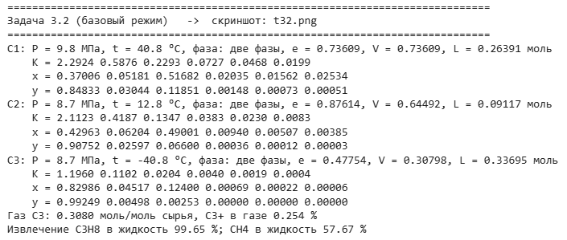{width=14.54cm}


### 3.2.1 Базовый режим


: Таблица 17 – Условия и материальные потоки сепараторов (базис – 1 моль сырья)

| Сепаратор | P, МПа | P, psia | t, °C | T, К | T, °R | Питание, моль | Газ V, моль | Жидкость L, моль |
|--------------|:-------:|:----------:|:---------:|:----------:|:----------:|:------------:|:-----------:|:------------:|
| С1 | 9.8 | 1421.4 | 40.8 | 313.95 | 565.11 | 1.00000 | 0.73609 | 0.26391 |
| С2 | 8.7 | 1261.8 | 12.8 | 285.95 | 514.71 | 0.73609 | 0.64492 | 0.09117 |
| С3 | 8.7 | 1261.8 | -40.8 | 232.35 | 418.23 | 0.64492 | 0.30798 | 0.33695 |


: Таблица 18 – Константы фазового равновесия K~i~ в сепараторах

| Компонент | С1 | С2 | С3 |
|-------------------------------|:----------------------:|:----------------------:|:----------------------:|
| CH~4~ | 2.2924 | 2.1123 | 1.1960 |
| C~2~H~6~ | 0.5876 | 0.4187 | 0.1102 |
| C~3~H~8~ | 0.2293 | 0.1347 | 0.0204 |
| i-C~4~ | 0.0727 | 0.0383 | 0.0040 |
| C~4~ | 0.0468 | 0.0230 | 0.0019 |
| C~5~ | 0.0199 | 0.0083 | 0.0004 |


: Таблица 16 – Составы фаз в сепараторах при базовых условиях, мольные доли

| Компонент | Сырьё z~i~ | С1: x~i~ | С1: y~i~ | С2: x~i~ | С2: y~i~ | С3: x~i~ | С3: y~i~ |
|---------------|:----------:|:----------:|:----------:|:----------:|:--------------:|:--------------:|:--------------:|
| CH~4~ | 0.72211 | 0.37006 | 0.84833 | 0.42963 | 0.90752 | 0.82986 | 0.99249 |
| C~2~H~6~ | 0.03608 | 0.05181 | 0.03044 | 0.06204 | 0.02597 | 0.04517 | 0.00498 |
| C~3~H~8~ | 0.22363 | 0.51682 | 0.11851 | 0.49001 | 0.06600 | 0.12400 | 0.00253 |
| i-C~4~ | 0.00646 | 0.02035 | 0.00148 | 0.00940 | 0.00036 | 0.00069 | $2.73 \cdot 10^{-6}$ |
| C~4~ | 0.00466 | 0.01562 | 0.00073 | 0.00507 | 0.00012 | 0.00022 | $4.27 \cdot 10^{-7}$ |
| C~5~ | 0.00706 | 0.02534 | 0.00051 | 0.00385 | $3.20 \cdot 10^{-5}$ | $6.13 \cdot 10^{-5}$ | $2.64 \cdot 10^{-8}$ |
| Всего | 1.00000 | 1.00000 | 1.00000 | 1.00000 | 1.00000 | 1.00000 | 1.00000 |
| Доля отгона | — | 0.73609 |  | 0.87614 |  | 0.47754 |  |

Проверка для С1: при e = 0.73609 для метана $x = 0.72211 / (1 + 0.73609 \cdot (2.2924 - 1)) = 0.37006$, $y = 2.2924 \cdot 0.37006 = 0.84833$; суммы $\sum x_i = \sum y_i = 1$ выполняются во всех сепараторах (таблица 16).

Результат базового режима: из 1 моль сырья в С3 получается 0.3080 моль газа с содержанием метана 99.25 % и C~3+~ 0.254 %; в жидкости трёх сепараторов извлекается 99.65 % пропана, но вместе с ним в жидкость уходит 57.7 % метана сырья. Основная причина – С3: при −40.8 °C и 8.7 МПа константа метана K = 1.196 близка к единице, и метан хорошо растворяется в жидкости (x~CH4~ = 0.830). Давления 8.7–9.8 МПа лежат выше области, для которой построены номограммы ДеПриестера (примерно до 7 МПа), поэтому результаты в этой области оценочные.

### 3.2.2 Влияние температуры в первом сепараторе

Температура t~1~ изменялась от −30 до 90 °C с шагом 1 °C при P~1~ = 9.8 МПа; условия в С2 и С3 – базовые. Критерии сравнения режимов: доли отгона, выход газа С3 (товарный газ), содержание C~3+~ в нём, извлечение пропана в жидкость и потери метана с жидкостью.

Программа (ячейка Google Colab):

```python
# Задача 3.2. Исследование влияния температуры в первом сепараторе (вариант 1)
task("t32_study", "Задача 3.2 (исследование влияния t1)")
t1_grid = np.round(np.arange(-30.0, 90.01, 1.0), 1)
study = []
for t1 in t1_grid:
    tr = train([(BASE[0][0], t1), BASE[1], BASE[2]])
    s = summary(tr)
    study.append(dict(t1=t1, e=[x["e"] for x in tr], ph=[x["phase"] for x in tr],
                      L=[x["L"] for x in tr], **s))
V_arr = np.array([s["V_out"] for s in study])
# эффективный режим: максимум выхода газа С3 при t1 >= 30 °C (охлаждение воздухом,
# без холодильного цикла), состав газа (C3+) практически не зависит от t1
ok = t1_grid >= 30
t1_best = t1_grid[ok][np.argmax(V_arr[ok])]
t1_cold = t1_grid[np.argmax(V_arr)]       # глобальный максимум (с захолаживанием)
res32.update(study=study, t1_best=t1_best, t1_cold=t1_cold,
             best=train([(BASE[0][0], t1_best), BASE[1], BASE[2]]))
out(" t1,°C   e1      e2      e3     V(С3)   C3+,%  изв.C3H8,%  CH4 в жидк.,%")
for s in study:
    if s["t1"] % 10 == 0 or s["t1"] in (t1_best, t1_cold):
        e = ["  —   " if np.isnan(v) else f"{v:.4f}" for v in s["e"]]
        out(f"{s['t1']:6.1f}  {'  '.join(e)}  {s['V_out']:.4f}"
            f"  {s['yC3p']*100:6.3f}"
            f"  {s['rec_C3']*100:8.2f}  {s['loss_CH4']*100:8.2f}")
out(f"Максимум газа при t1 >= 30 °C: t1 = {t1_best} °C, V = {V_arr[ok].max():.4f};"
    f" глобальный максимум: t1 = {t1_cold} °C, V = {V_arr.max():.4f}")

fig, ax = plt.subplots(1, 3, figsize=(11, 3.4))
for j, lab in enumerate(("С1", "С2", "С3")):
    ax[0].plot(t1_grid, [s["e"][j] for s in study], label=lab)
    ax[1].plot(t1_grid, [s["L"][j] for s in study], label=f"жидкость {lab}")
ax[0].set(xlabel="t1, °C", ylabel="Доля отгона e")
ax[1].set(xlabel="t1, °C", ylabel="Расход жидкости, моль/моль сырья")
ax[2].plot(t1_grid, V_arr, label="газ С3")
ax[2].axvline(40.8, color="gray", ls=":", label="базовый режим")
ax[2].axvline(t1_best, color="r", ls="--", label="выбранный режим")
ax[2].set(xlabel="t1, °C", ylabel="Выход газа С3, моль/моль сырья")
for a in ax:
    a.legend(fontsize=8)
    style_axes(a)
show(fig, "t32_study")
```

Результат работы программы (скриншот Google Colab):

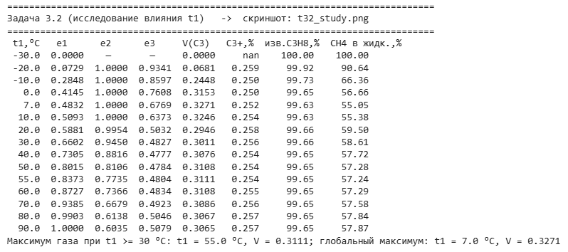{width=16.46cm}


: Таблица 19 – Влияние температуры в сепараторе С1 на работу блока (P~1~ = 9.8 МПа; С2, С3 – базовые условия)

| t~1~, °C | e~1~ | e~2~ | e~3~ | Газ С3, моль | C~3+~ в газе, % | Извлечение C~3~H~8~, % | CH~4~ в жидкость, % |
|--------------|:----------------:|:----------------:|:---------:|:---------:|:--------:|:-------------:|:------------:|
| -20 | 0.0729 | 1.0000 (газ) | 0.9341 | 0.0681 | 0.259 | 99.92 | 90.64 |
| -10 | 0.2848 | 1.0000 (газ) | 0.8597 | 0.2448 | 0.250 | 99.73 | 66.36 |
| 0 | 0.4145 | 1.0000 (газ) | 0.7608 | 0.3153 | 0.250 | 99.65 | 56.66 |
| 7 | 0.4832 | 1.0000 (газ) | 0.6769 | 0.3271 | 0.252 | 99.63 | 55.05 |
| 10 | 0.5093 | 1.0000 (газ) | 0.6373 | 0.3246 | 0.254 | 99.63 | 55.38 |
| 20 | 0.5881 | 0.9954 | 0.5032 | 0.2946 | 0.258 | 99.66 | 59.50 |
| 30 | 0.6602 | 0.9450 | 0.4827 | 0.3011 | 0.256 | 99.66 | 58.61 |
| 40 | 0.7305 | 0.8816 | 0.4777 | 0.3076 | 0.254 | 99.65 | 57.72 |
| 40.8 (база) | 0.7361 | 0.8761 | 0.4775 | 0.3080 | 0.254 | 99.65 | 57.67 |
| 50 | 0.8015 | 0.8106 | 0.4784 | 0.3108 | 0.254 | 99.65 | 57.28 |
| 55 (выбор) | 0.8373 | 0.7735 | 0.4804 | 0.3111 | 0.254 | 99.65 | 57.24 |
| 60 | 0.8727 | 0.7366 | 0.4834 | 0.3108 | 0.255 | 99.65 | 57.29 |
| 70 | 0.9385 | 0.6679 | 0.4923 | 0.3086 | 0.256 | 99.65 | 57.58 |
| 80 | 0.9903 | 0.6138 | 0.5046 | 0.3067 | 0.257 | 99.65 | 57.84 |
| 90 | 1.0000 (газ) | 0.6035 | 0.5079 | 0.3065 | 0.257 | 99.65 | 57.87 |


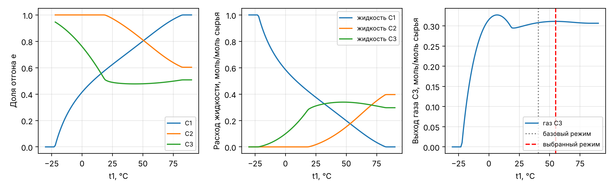{width=16cm}


**Анализ.** С ростом t~1~ доля отгона в С1 растёт от нуля (при t~1~ ≤ −23 °C сырьё полностью жидкое, газа нет) до единицы (при t~1~ ≥ 83 °C сырьё полностью газообразно, С1 не работает). При t~1~ ≤ 18 °C газ С1, нагреваясь до 12.8 °C в С2, оказывается выше точки росы: С2 работает как однофазный аппарат (e~2~ = 1), и блок фактически становится двухступенчатым. Увеличение t~1~ перераспределяет нагрузку: жидкость С1 уменьшается, жидкость С2 растёт, а количество и состав газа С3 меняются слабо, потому что они определяются самой холодной ступенью – С3. В интервале 30–90 °C выход газа С3 меняется лишь в пределах 0.3011–0.3111 моль, содержание C~3+~ в газе – 0.256–0.257 %, извлечение пропана – 99.65 %.

**Выбор режима.** Качество газа (C~3+~ около 0.25 %) и извлечение пропана (99.6 %) от t~1~ практически не зависят, поэтому критерий выбора – максимальный выход товарного газа С3 при минимальных потерях метана с жидкостью и без искусственного охлаждения сырья перед С1 (t~1~ ≥ 30 °C достижимо воздушным холодильником). Максимум выхода газа в этой области – при t~1~ = 55 °C: 0.3111 моль газа против 0.3080 моль в базовом режиме (+1.0 %), потери метана 57.24 % против 57.67 %; С1 и С2 работают в двухфазной области (e~1~ = 0.8373, e~2~ = 0.7735). Глобальный максимум выхода газа (0.3271 моль, +6.2 %) достигается при t~1~ = 7 °C, но требует охлаждения сырья холодильным агентом ниже температуры окружающей среды, а сепаратор С2 при этом не работает (e~2~ = 1).

Составы потоков в выбранном режиме (t~1~ = 55 °C): газ С3 – CH~4~ 0.99251, C~2~H~6~ 0.00495, C~3~H~8~ 0.00254; доли отгона e~1~ = 0.83726, e~2~ = 0.77353, e~3~ = 0.48041.

**Вывод.** При базовых условиях доли отгона в сепараторах С1, С2, С3 равны 0.7361, 0.8761 и 0.4775; товарный газ С3 (0.3080 моль на 1 моль сырья) содержит 99.25 % метана, пропан извлекается в жидкость на 99.65 %. Температура в первом сепараторе в интервале 30–90 °C слабо влияет на конечные показатели блока и в основном перераспределяет жидкость между С1 и С2. Эффективный режим – t~1~ = 55 °C (охлаждение сырья воздухом): выход газа на 1.0 % выше базового при том же качестве газа. Захолаживание сырья до 7 °C даёт +6.2 % газа, но требует холодильного цикла и выводит из работы С2. Наибольшее влияние на потери метана оказывает режим С3, а не С1.


```{=openxml}
<w:p><w:r><w:br w:type="page"/></w:r></w:p>
```


# 4 Расчёт химического равновесия

## 4.1 Задание 1. Синтез аммиака

**Условие.** Найти мольный расход каждого вещества на выходе из реактора синтеза аммиака, если на входе смесь N~2~ : H~2~ : NH~3~ = 1.1 : 3 : 0.2; K~p~ = 0.05, T = 589 К, P = 220 атм [1]. Реакция в форме задания и в целых коэффициентах:

½N~2~ + 3/2H~2~ ⇄ NH~3~;  N~2~ + 3H~2~ ⇄ 2NH~3~.

Баланс атомов: N: 2 = 2∙1; H: 3∙2 = 2∙3. Константа K~p~ = 0.05 атм^−1^ относится к форме с одним моль NH~3~ (для формы с целыми коэффициентами K~p~ = 0.05^2^ = 0.0025 атм^−2^). Расход питания задан соотношением, поэтому расчёт выполнен на 4.3 моль/ч питания (1.1 + 3 + 0.2); при другом расходе все потоки пропорциональны.

**Метод.** При степени полноты реакции ξ, моль/ч: $n_{N_2} = 1.1 - 0.5\xi$, $n_{H_2} = 3 - 1.5\xi$, $n_{NH_3} = 0.2 + \xi$, $n = 4.3 - \xi$. Для идеальной газовой смеси с парциальными давлениями $p_i = y_i P$ (P в атм, стандартное давление 1 атм = 101325 Па):

$$K_p = \frac{p_{NH_3}}{p_{N_2}^{0.5} \cdot p_{H_2}^{1.5}} = \frac{y_{NH_3}}{y_{N_2}^{0.5} \cdot y_{H_2}^{1.5}} \cdot P^{-1} \quad \Rightarrow \quad \frac{y_{NH_3}}{y_{N_2}^{0.5} \cdot y_{H_2}^{1.5}} = K_p \cdot P = 0.05 \cdot 220 = 11.$$

Уравнение относительно ξ решено методом Брента на отрезке 0 < ξ < 2 (при ξ = 2 расходуется весь водород и азот).

Программа (ячейка Google Colab):

```python
# Задача 4.1. Синтез аммиака: 1/2 N2 + 3/2 H2 <=> NH3 (N2 + 3 H2 <=> 2 NH3)
task("t41", "Задача 4.1")
Kp41, P41, T41 = 0.05, 220.0, 589.0          # Kp, 1/атм; P, атм; T, К
n0_41 = np.array([1.1, 3.0, 0.2])            # N2, H2, NH3, моль/ч (1.1 : 3 : 0.2)
nu41 = np.array([-0.5, -1.5, 1.0])           # стехиометрические коэффициенты


def comp41(xi):
    n = n0_41 + nu41 * xi                    # моль/ч на выходе
    return n, n / n.sum()


def eq41(xi):                                # Kp·P = yNH3 / (yN2^0,5 · yH2^1,5)
    n, y = comp41(xi)
    return y[2] / (y[0] ** 0.5 * y[1] ** 1.5) - Kp41 * P41


xi_max = min(n0_41[0] / 0.5, n0_41[1] / 1.5)          # ограничение по N2 и H2
xi41 = brentq(eq41, 0.0, xi_max * (1 - 1e-12), xtol=1e-14)
n41, y41 = comp41(xi41)
res41 = dict(xi=xi41, n=n41, y=y41,
             X_N2=xi41 * 0.5 / n0_41[0], X_H2=xi41 * 1.5 / n0_41[1],
             check=y41[2] / (y41[0] ** 0.5 * y41[1] ** 1.5) / P41)
out(f"xi = {xi41:.6f} моль/ч (xi_max = {xi_max:.4f})")
for nm, a, b, c in zip(("N2", "H2", "NH3"), n0_41, n41, y41):
    out(f"{nm:4s} начало {a:.4f}  конец {b:.4f} моль/ч  y = {c:.4f}")
out(f"Всего {n0_41.sum():.4f} -> {n41.sum():.4f} моль/ч; "
    f"проверка Kp = {res41['check']:.6f} 1/атм")
out(f"Степень превращения: N2 {res41['X_N2']*100:.2f} %,"
    f" H2 {res41['X_H2']*100:.2f} %")
```

Результат работы программы (скриншот Google Colab):

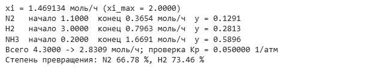{width=12.79cm}


: Таблица 20 – Материальный баланс реактора синтеза аммиака (T = 589 К, P = 220 атм)

| Вещество | Начало, моль/ч | Конец (равновесие), моль/ч | Равновесная мольная доля y~i~ |
|---------------------|:-------------------:|:-------------------------------:|:---------------------------:|
| N~2~ | 1.1 | 0.3654 | 0.1291 |
| H~2~ | 3.0 | 0.7963 | 0.2813 |
| NH~3~ | 0.2 | 1.6691 | 0.5896 |
| Всего | 4.3 | 2.8309 | 1.0000 |

Проверка: $\frac{0.5896}{0.1291^{0.5} \cdot 0.2813^{1.5}} \cdot \frac{1}{220} = 0.0500$ атм^−1^ = K~p~. Баланс атомов N: 2∙0.3654 + 1.6691 = 2.4000 = 2∙1.1 + 0.2 = 2.4 моль/ч.

**Вывод.** Степень полноты реакции ξ = 1.4691 моль/ч; на выходе 0.3654 моль/ч N~2~, 0.7963 моль/ч H~2~ и 1.6691 моль/ч NH~3~ (суммарно 2.8309 моль/ч), мольная доля аммиака 0.5896. Степень превращения азота 66.8 %, водорода 73.5 %. Высокий выход обусловлен большим давлением (реакция идёт с уменьшением числа молей) и сравнительно низкой температурой 589 К.

## 4.2 Задание 2. Получение этилена из этана

### 4.2.1 Одна реакция при 1100 К (пункт а)

**Условие.** В реактор поступает чистый этан; реакция C~2~H~6~ ⇄ C~2~H~4~ + H~2~ (баланс: C 2 = 2; H 6 = 4 + 2). Определить равновесный состав при 1100 К и 1 атм; константу равновесия рассчитать по справочным данным [1].

**Константа равновесия.** Для реакции $\Delta G^{\circ}_r = \Delta G^{\circ}_{f,C_2H_4} - \Delta G^{\circ}_{f,C_2H_6}$ (для H~2~ равна нулю) и $K = \exp\left(-\Delta G^{\circ}_r / (R T)\right)$. Справочник [9] содержит ΔG°~f~ и ΔH°~f~ до 1000 К (таблица 21), поэтому K(1100 К) получена интегрированием уравнения изобары Вант-Гоффа от 1000 до 1100 К:

$$\ln K(1100) = \ln K(1000) + \int_{1000}^{1100} \frac{\Delta H^{\circ}_r(T)}{R T^{2}}\,dT,$$

где ΔH°~r~(T), Дж/моль, линейно экстраполирована по точкам 800 и 1000 К (ΔH°~r~ меняется медленно: 143.47 и 144.29 кДж/моль). Перевод единиц: 1 кал = 4.184 Дж. При 1000 К: $\Delta G^{\circ}_r = (28249 - 26130) \cdot 4.184 = 8866$ Дж/моль; $K(1000) = \exp(-8866/(8.314 \cdot 1000)) = 0.3443$. Проверка другим способом – линейная экстраполяция ΔG°~r~(T) по точкам 800 и 1000 К – даёт K = 1.6590, расхождение 0.7 %.

**Равновесный состав.** На 1 моль этана при степени превращения x: C~2~H~6~ 1 − x, C~2~H~4~ x, H~2~ x, всего 1 + x моль;

$$K_p = \frac{y_{C_2H_4} \cdot y_{H_2}}{y_{C_2H_6}} \cdot P = \frac{x^{2}}{(1 - x)(1 + x)} \cdot P \quad \Rightarrow \quad x = \sqrt{\frac{K_p}{K_p + P}} = \sqrt{\frac{1.6710}{1.6710 + 1}} = 0.7910.$$


: Таблица 21 – Энтальпии и энергии Гиббса образования, кал/моль [9, разд. E18, E19]

| T, К | ΔH°~f~ C~2~H~6~ | ΔH°~f~ C~2~H~4~ | ΔG°~f~ C~2~H~6~ | ΔG°~f~ C~2~H~4~ |
|-----------------|:----------------------:|:--------------------:|:--------------------:|:--------------------:|
| 298 | −20236 | 12496 | −7860 | 16282 |
| 400 | −21419 | 11766 | −3447 | 17675 |
| 600 | −23280 | 10600 | 5970 | 20918 |
| 800 | −24530 | 9760 | 15920 | 24490 |
| 1000 | −25280 | 9205 | 26130 | 28249 |

Программа (ячейка Google Colab):

```python
# Задача 4.2а. C2H6 <=> C2H4 + H2 при 1100 К и 1 атм; K по справочным данным
task("t42a", "Задача 4.2а")
# ΔH°f и ΔG°f, кал/моль (справочник IFP, разделы E18 и E19); H2 — простое вещество, 0
Tref = np.array([298.0, 400.0, 600.0, 800.0, 1000.0])
dHf = {"C2H6": np.array([-20236, -21419, -23280, -24530, -25280.0]),
       "C2H4": np.array([12496, 11766, 10600, 9760, 9205.0])}
dGf = {"C2H6": np.array([-7860, -3447, 5970, 15920, 26130.0]),
       "C2H4": np.array([16282, 17675, 20918, 24490, 28249.0])}
dH_r = (dHf["C2H4"] - dHf["C2H6"]) * CAL          # Дж/моль
dG_r = (dGf["C2H4"] - dGf["C2H6"]) * CAL          # Дж/моль
K_ref = np.exp(-dG_r / (R * Tref))                # K = exp(−ΔG°/(R·T))
T42, P42 = 1100.0, 1.0
# Основной способ: уравнение Вант-Гоффа d ln K/dT = ΔH°/(R·T^2) от 1000 до 1100 К,
# ΔH°r(T) — линейная экстраполяция по точкам 800 и 1000 К
dH_lin = lambda T: dH_r[-1] + (dH_r[-1] - dH_r[-2]) / 200.0 * (T - 1000.0)
Tq = np.linspace(1000.0, T42, 2001)
trap = getattr(np, "trapezoid", None) or np.trapz
lnK_vh = np.log(K_ref[-1]) + trap(dH_lin(Tq) / (R * Tq ** 2), Tq)
K42 = np.exp(lnK_vh)
# Проверка: линейная экстраполяция ΔG°r(T) по точкам 800 и 1000 К
dG_ext = dG_r[-1] + (dG_r[-1] - dG_r[-2]) / 200.0 * (T42 - 1000.0)
K42_check = np.exp(-dG_ext / (R * T42))
x42 = np.sqrt(K42 / (K42 + P42))                  # Kp = x^2·P/((1 − x)(1 + x))
n42 = np.array([1 - x42, x42, x42])               # C2H6, C2H4, H2 на 1 моль этана
y42 = n42 / n42.sum()
res42 = dict(dH_r=dH_r, dG_r=dG_r, K_ref=K_ref, K=K42, K_check=K42_check,
             dG_ext=dG_ext,
             dH1100=dH_lin(T42), x=x42, n=n42, y=y42,
             x_check=np.sqrt(K42_check / (K42_check + P42)))
for T, a, b, k in zip(Tref, dH_r, dG_r, K_ref):
    out(f"T = {T:6.0f} К  ΔH°r = {a/1000:7.2f}  ΔG°r = {b/1000:7.2f} кДж/моль"
        f"  K = {k:.4e}")
out(f"K(1100 К): Вант-Гофф {K42:.4f}; экстраполяция ΔG° {K42_check:.4f}")
out(f"x = {x42:.5f}; y: C2H6 {y42[0]:.4f}, C2H4 {y42[1]:.4f}, H2 {y42[2]:.4f}")

fig, ax = plt.subplots(figsize=(6, 3.6))
ax.plot(Tref, dG_r / 1000, "o-", label="ΔG°r по справочнику")
ax.plot([1000, T42], [dG_r[-1] / 1000, -R * T42 * lnK_vh / 1000], "s--",
        label="Вант-Гофф")
ax.axhline(0, color="k", lw=0.8)
ax.set(xlabel="T, К", ylabel="ΔG°r, кДж/моль")
ax.legend()
style_axes(ax)
show(fig, "t42")
```

Результат работы программы (скриншот Google Colab):

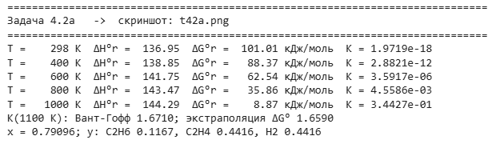{width=12.79cm}


: Таблица 22 – Тепловой эффект, энергия Гиббса и константа равновесия реакции C~2~H~6~ ⇄ C~2~H~4~ + H~2~

| T, К | ΔH°~r~, кДж/моль | ΔG°~r~, кДж/моль | K |
|--------------------------------|:-----------------:|:-----------------:|:--------------------------------:|
| 298 | 136.95 | 101.01 | $1.9719 \cdot 10^{-18}$ |
| 400 | 138.85 | 88.37 | $2.8821 \cdot 10^{-12}$ |
| 600 | 141.75 | 62.54 | $3.5917 \cdot 10^{-6}$ |
| 800 | 143.47 | 35.86 | $4.5586 \cdot 10^{-3}$ |
| 1000 | 144.29 | 8.87 | $3.4427 \cdot 10^{-1}$ |
| 1100 (расчёт) | 144.69 | −4.696 | 1.6710 |


: Таблица 23 – Равновесный состав при дегидрировании этана (1100 К, 1 атм), на 1 моль этана

| Вещество | Начало, моль | Конец (равновесие), моль | Равновесная мольная доля y~i~ |
|---------------------|:-------------------:|:-------------------------------:|:---------------------------:|
| C~2~H~6~ | 1.0 | 0.2090 | 0.1167 |
| C~2~H~4~ | 0.0 | 0.7910 | 0.4416 |
| H~2~ | 0.0 | 0.7910 | 0.4416 |
| Всего | 1.0 | 1.7910 | 1.0000 |


{width=13cm}


**Вывод.** Реакция сильно эндотермична (ΔH°~r~ ≈ 144 кДж/моль), поэтому K быстро растёт с температурой: от $4.56 \cdot 10^{-3}$ при 800 К до 1.671 при 1100 К. При 1100 К и 1 атм равновесная степень превращения этана 79.1 %; равновесный состав: C~2~H~6~ 11.67 %, C~2~H~4~ 44.16 %, H~2~ 44.16 % (мол.). Неопределённость экстраполяции K за пределы справочных данных (0.7 %) меняет степень превращения лишь на 0.0011.

### 4.2.2 Две реакции при 1367 К (пункт б)

**Условие.** Добавляется реакция C~2~H~4~ ⇄ C~2~H~2~ + H~2~ (баланс: C 2 = 2; H 4 = 2 + 2); T = 1367 К, P = 1 атм; K~p1~ = 37.6, K~p2~ = 0.769 [1].

**Метод.** Две независимые реакции со степенями полноты x~1~ и x~2~ (моль на 1 моль этана): C~2~H~6~ 1 − x~1~; C~2~H~4~ x~1~ − x~2~; H~2~ x~1~ + x~2~; C~2~H~2~ x~2~; всего 1 + x~1~ + x~2~. Система нелинейных уравнений

$$K_{p1} = \frac{y_{C_2H_4} \cdot y_{H_2}}{y_{C_2H_6}} \cdot P, \qquad K_{p2} = \frac{y_{C_2H_2} \cdot y_{H_2}}{y_{C_2H_4}} \cdot P$$

решена функцией scipy.optimize.fsolve (начальное приближение x~1~ = 0.9, x~2~ = 0.3); проверено, что все количества неотрицательны.

Программа (ячейка Google Colab):

```python
# Задача 4.2б. Две реакции при 1367 К: C2H6 <=> C2H4 + H2, C2H4 <=> C2H2 + H2
task("t42b", "Задача 4.2б")
K1, K2, P43 = 37.6, 0.769, 1.0


def comp43(x):
    x1, x2 = x
    n = np.array([1 - x1, x1 - x2, x1 + x2, x2])   # C2H6, C2H4, H2, C2H2
    return n, n / n.sum()


def eqs43(x):
    n, y = comp43(x)
    return [y[1] * y[2] * P43 - K1 * y[0],         # K1 = yC2H4·yH2·P / yC2H6
            y[3] * y[2] * P43 - K2 * y[1]]         # K2 = yC2H2·yH2·P / yC2H4


x43 = fsolve(eqs43, [0.9, 0.3], xtol=1e-14)
n43, y43 = comp43(x43)
res43 = dict(x=x43, n=n43, y=y43, resid=np.array(eqs43(x43)),
             K1c=y43[1] * y43[2] * P43 / y43[0], K2c=y43[3] * y43[2] * P43 / y43[1])
out(f"x1 = {x43[0]:.5f}, x2 = {x43[1]:.5f}; невязки {res43['resid']}")
for nm, a, b in zip(("C2H6", "C2H4", "H2", "C2H2"), n43, y43):
    out(f"{nm:5s} {a:.5f} моль  y = {b:.4f}")
out(f"Проверка: K1 = {res43['K1c']:.4f}, K2 = {res43['K2c']:.5f}")
```

Результат работы программы (скриншот Google Colab):

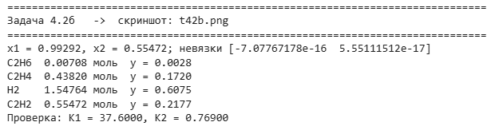{width=12.79cm}


: Таблица 24 – Равновесный состав при двух реакциях (1367 К, 1 атм), на 1 моль этана

| Вещество | Начало, моль | Конец (равновесие), моль | Равновесная мольная доля y~i~ |
|---------------------|:-------------------:|:-------------------------------:|:---------------------------:|
| C~2~H~6~ | 1.0 | 0.0071 | 0.0028 |
| C~2~H~4~ | 0.0 | 0.4382 | 0.1720 |
| H~2~ | 0.0 | 1.5476 | 0.6075 |
| C~2~H~2~ | 0.0 | 0.5547 | 0.2177 |
| Всего | 1.0 | 2.5476 | 1.0000 |

Проверка: $K_{p1} = 0.1720 \cdot 0.6075 / 0.0028 = 37.60$; $K_{p2} = 0.2177 \cdot 0.6075 / 0.1720 = 0.7690$.

**Вывод.** При 1367 К этан превращается практически полностью (x~1~ = 0.9929), а 55.9 % образовавшегося этилена дегидрируется дальше до ацетилена (x~2~ = 0.5547). Равновесная смесь: H~2~ 60.7 %, C~2~H~2~ 21.8 %, C~2~H~4~ 17.2 %, C~2~H~6~ 0.28 % (мол.). Повышение температуры для увеличения конверсии этана снижает селективность по этилену, поэтому в промышленном пиролизе время контакта ограничивают, не допуская достижения равновесия по второй реакции.


```{=openxml}
<w:p><w:r><w:br w:type="page"/></w:r></w:p>
```


# 5 Расчёт материальных балансов

## 5.1 Задание 1. Схема разделения ксилол – стирол – толуол – бензол

**Условие.** Найти составы и расходы всех потоков схемы из трёх колонн (рисунок 10); на разделение поступает F = 1000 моль/ч сырья [1]. Колонна №1 делит сырьё на дистиллят D (питание колонны №2) и куб B (питание колонны №3); составы F, D~1~, B~1~, D~2~, B~2~ заданы.


![Рисунок 10 – Схема разделения смеси ксилол, стирол, толуол, бензол [1]](fig/scheme51.png){width=11cm}


**Метод.** Неизвестны четыре расхода продуктов D~1~, B~1~, D~2~, B~2~. Покомпонентный баланс всей схемы даёт четыре линейных уравнения:

$$x_{D_1,i} \cdot D_1 + x_{B_1,i} \cdot B_1 + x_{D_2,i} \cdot D_2 + x_{B_2,i} \cdot B_2 = z_{F,i} \cdot F, \quad i = \text{ксилол, стирол, толуол, бензол},$$

где $x_{j,i}$ – мольная доля компонента $i$ в потоке $j$; $D_1$, $B_1$, $D_2$, $B_2$, $F$ – расходы, моль/ч. Система решена функцией numpy.linalg.solve. Затем $D = D_1 + B_1$, $B = D_2 + B_2$, состав $x_{D,i} = (x_{D_1,i} D_1 + x_{B_1,i} B_1)/D$, аналогично для B. Например, по ксилолу: $0.07 D_1 + 0.18 B_1 + 0.15 D_2 + 0.24 B_2 = 0.15 \cdot 1000$.

Программа (ячейка Google Colab):

```python
# Задача 5.1. Схема из трёх колонн: ксилол, стирол, толуол, бензол
task("t51", "Задача 5.1")
F = 1000.0                                           # моль/ч
zF = np.array([0.15, 0.25, 0.40, 0.20])              # ксилол, стирол, толуол, бензол
xD1 = np.array([0.07, 0.04, 0.54, 0.35])
xB1 = np.array([0.18, 0.24, 0.42, 0.16])
xD2 = np.array([0.15, 0.10, 0.54, 0.21])
xB2 = np.array([0.24, 0.65, 0.10, 0.01])
# покомпонентный баланс всей схемы: xD1·D1 + xB1·B1 + xD2·D2 + xB2·B2 = zF·F
A = np.column_stack([xD1, xB1, xD2, xB2])
D1, B1, D2, B2 = np.linalg.solve(A, zF * F)
D, B = D1 + B1, D2 + B2
flows = {"F": F, "D": D, "B": B, "D1": D1, "B1": B1, "D2": D2, "B2": B2}
comp = {"F": zF, "D": (xD1 * D1 + xB1 * B1) / D, "B": (xD2 * D2 + xB2 * B2) / B,
        "D1": xD1, "B1": xB1, "D2": xD2, "B2": xB2}
res51 = dict(flows=flows, comp=comp, cond=np.linalg.cond(A), det=np.linalg.det(A),
             err=np.max(np.abs(A @ [D1, B1, D2, B2] - zF * F)))
out(f"{'':8s}" + "".join(f"{k:>9s}" for k in flows))
for i, nm in enumerate(("Ксилол", "Стирол", "Толуол", "Бензол")):
    out(f"{nm:8s}" + "".join(f"{flows[k]*comp[k][i]:9.2f}" for k in flows))
out(f"{'Всего':8s}" + "".join(f"{flows[k]:9.2f}" for k in flows))
for i, nm in enumerate(("Ксилол", "Стирол", "Толуол", "Бензол")):
    out(f"{nm:8s}" + "".join(f"{comp[k][i]:9.4f}" for k in flows))
out(f"Невязка баланса {res51['err']:.1e} моль/ч; "
    f"число обусловленности {res51['cond']:.1f}")
```

Результат работы программы (скриншот Google Colab):

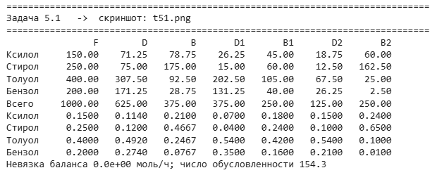{width=12.79cm}


: Таблица 25 – Расходы и составы потоков схемы разделения

|  | F | D | B | D~1~ | B~1~ | D~2~ | B~2~ |
|---------------------|:------------:|:----------:|:----------:|:----------:|:----------:|:----------:|:----------:|
| **Расход, моль/ч** |  |  |  |  |  |  |  |
| Ксилол | 150.00 | 71.25 | 78.75 | 26.25 | 45.00 | 18.75 | 60.00 |
| Стирол | 250.00 | 75.00 | 175.00 | 15.00 | 60.00 | 12.50 | 162.50 |
| Толуол | 400.00 | 307.50 | 92.50 | 202.50 | 105.00 | 67.50 | 25.00 |
| Бензол | 200.00 | 171.25 | 28.75 | 131.25 | 40.00 | 26.25 | 2.50 |
| Всего | 1000.00 | 625.00 | 375.00 | 375.00 | 250.00 | 125.00 | 250.00 |
| **Доля** |  |  |  |  |  |  |  |
| Ксилол | 0.1500 | 0.1140 | 0.2100 | 0.0700 | 0.1800 | 0.1500 | 0.2400 |
| Стирол | 0.2500 | 0.1200 | 0.4667 | 0.0400 | 0.2400 | 0.1000 | 0.6500 |
| Толуол | 0.4000 | 0.4920 | 0.2467 | 0.5400 | 0.4200 | 0.5400 | 0.1000 |
| Бензол | 0.2000 | 0.2740 | 0.0767 | 0.3500 | 0.1600 | 0.2100 | 0.0100 |
| Всего | 1.0000 | 1.0000 | 1.0000 | 1.0000 | 1.0000 | 1.0000 | 1.0000 |

Проверка по ксилолу: 0.07∙375 + 0.18∙250 + 0.15∙125 + 0.24∙250 = 150.00 моль/ч = 0.15∙1000. Невязка решения $2.8 \cdot 10^{-14}$ моль/ч; число обусловленности матрицы 154: при погрешности составов в третьем знаке погрешность расходов может достигать единиц процентов.

**Вывод.** Расходы продуктов: D~1~ = 375.0, B~1~ = 250.0, D~2~ = 125.0, B~2~ = 250.0 моль/ч; промежуточные потоки D = 625.0 моль/ч (ксилол 11.4 %, стирол 12.0 %, толуол 49.2 %, бензол 27.4 %) и B = 375.0 моль/ч (ксилол 21.0 %, стирол 46.7 %, толуол 24.7 %, бензол 7.7 %). Колонна №1 концентрирует лёгкие толуол и бензол в дистилляте, стирол – в кубе; стирол выводится преимущественно потоком B~2~ (65.0 % стирола сырья).

## 5.2 Задание 2. Процесс Toray: бензол из толуола с рециклом

**Условие.** Толуол (100 моль/ч) превращается в бензол и ксилол по реакции 2C~7~H~8~ ⇄ C~6~H~6~ + C~8~H~10~ (в тексте задания «кислол» – опечатка: продукт C~8~H~10~ – ксилол). Баланс атомов: C 2∙7 = 6 + 8; H 2∙8 = 6 + 10. Конверсия толуола за проход 58 %. Разделитель S~1~: поток бензола 4 содержит 99.5 % бензола, 0.1 % толуола и не содержит ксилола из поступившего потока 3. Разделитель S~2~: рецикл 7 содержит весь бензол, 99.5 % толуола и 0.1 % ксилола потока 5. Рассчитать материальный баланс и конверсию толуола в ксилол [1].


![Рисунок 11 – Схема процесса Toray: M – смеситель, R – реактор, S~1~, S~2~ – разделители [1]](fig/scheme52.png){width=15cm}


**Метод.** Неизвестные – покомпонентные расходы потоков 2–7 и число пробегов реакции ξ, моль/ч. Уравнения (T – толуол, B – бензол, X – ксилол):

- смеситель M: $T_2 = 100 + T_7$, $B_2 = B_7$, $X_2 = X_7$;
- реактор R: $\xi = 0.58 \cdot T_2 / 2$; $T_3 = T_2 - 2\xi$, $B_3 = B_2 + \xi$, $X_3 = X_2 + \xi$;
- разделитель S~1~: $B_4 = 0.995 \cdot B_3$, $T_4 = 0.001 \cdot T_3$, $X_4 = 0$; поток 5 = поток 3 − поток 4;
- разделитель S~2~: $B_7 = B_5$, $T_7 = 0.995 \cdot T_5$, $X_7 = 0.001 \cdot X_5$; поток 6 = поток 5 − поток 7.

Все уравнения линейны, поэтому рецикл рассчитан без итераций – решением системы 14 линейных уравнений (numpy.linalg.solve). Столбец R таблицы результатов – изменение количества каждого вещества в реакторе (−2ξ для толуола, +ξ для бензола и ксилола).

Программа (ячейка Google Colab):

```python
# Задача 5.2. Процесс Toray: 2 C7H8 <=> C6H6 + C8H10 с рециклом толуола
task("t52", "Задача 5.2")
F1, X = 100.0, 0.58                  # свежий толуол, моль/ч; конверсия за проход
# неизвестные: [T2, B2, X2, xi, T4, B4, T5, B5, X5, T7, B7, X7, T6, X6] (T — толуол,
# B — бензол, X — ксилол; xi — число пробегов реакции, моль/ч)
M = np.zeros((14, 14)); rhs = np.zeros(14)
iT2, iB2, iX2, ixi, iT4, iB4, iT5, iB5, iX5, iT7, iB7, iX7, iT6, iX6 = range(14)
eqs = [({iT2: 1, iT7: -1}, F1),                 # смеситель: T2 = F1 + T7
       ({iB2: 1, iB7: -1}, 0), ({iX2: 1, iX7: -1}, 0),
       ({ixi: 1, iT2: -X / 2}, 0),              # реактор: xi = X·T2/2
       ({iB4: 1, iB2: -0.995, ixi: -0.995}, 0),  # S1: 99,5 % бензола потока 3
       ({iT4: 1, iT2: -0.001 * (1 - X)}, 0),     # S1: 0,1 % толуола потока 3
       ({iT5: 1, iT2: -(1 - X), iT4: 1}, 0),    # поток 5 = поток 3 − поток 4
       ({iB5: 1, iB2: -1, ixi: -1, iB4: 1}, 0),
       ({iX5: 1, iX2: -1, ixi: -1}, 0),          # ксилол в поток 4 не уходит
       ({iT7: 1, iT5: -0.995}, 0),              # S2: 99,5 % толуола -> рецикл
       ({iB7: 1, iB5: -1}, 0),                  # S2: весь бензол -> рецикл
       ({iX7: 1, iX5: -0.001}, 0),              # S2: 0,1 % ксилола -> рецикл
       ({iT6: 1, iT5: -1, iT7: 1}, 0),
       ({iX6: 1, iX5: -1, iX7: 1}, 0)]
for r_, (coef, b) in enumerate(eqs):
    for j, c in coef.items():
        M[r_, j] = c
    rhs[r_] = b
u = np.linalg.solve(M, rhs)
xi = u[ixi]
S = {"1": np.array([F1, 0, 0]),
     "2": u[[iT2, iB2, iX2]],
     "R": np.array([-2 * xi, xi, xi]),           # изменение в реакторе, моль/ч
     "3": u[[iT2, iB2, iX2]] + np.array([-2 * xi, xi, xi]),
     "4": np.array([u[iT4], u[iB4], 0.0]),
     "5": u[[iT5, iB5, iX5]],
     "6": np.array([u[iT6], 0.0, u[iX6]]),
     "7": u[[iT7, iB7, iX7]]}
T_out = S["4"][0] + S["6"][0]               # толуол, ушедший с продуктами
res52 = dict(S=S, xi=xi, conv_X=S["6"][2] / F1, conv_total=1 - T_out / F1,
             yield_B=S["4"][1] / F1,
             check_C=7 * F1 - (7 * T_out + 6 * S["4"][1] + 8 * S["6"][2]))
out(f"{'':8s}" + "".join(f"{k:>9s}" for k in S))
for i, nm in enumerate(("Толуол", "Бензол", "Ксилол")):
    out(f"{nm:8s}" + "".join(f"{S[k][i]:9.3f}" for k in S))
out(f"{'Всего':8s}" + "".join(f"{S[k].sum():9.3f}" for k in S))
out(f"xi = {xi:.4f} моль/ч; конверсия толуола в ксилол {res52['conv_X']*100:.2f} %;"
    f" общая конверсия толуола {res52['conv_total']*100:.2f} %")
out(f"Баланс атомов C: {res52['check_C']:.2e} моль/ч")
```

Результат работы программы (скриншот Google Colab):

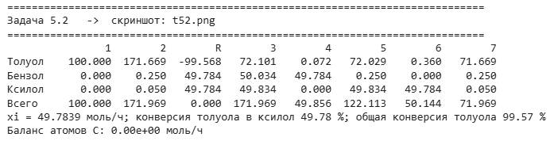{width=14.38cm}


: Таблица 26 – Материальный баланс процесса Toray, моль/ч (R – изменение количества в реакторе)

|  | 1 | 2 | R | 3 | 4 | 5 | 6 | 7 |
|-------------------------------|:----------:|:--------:|:--------:|:--------:|:-------:|:--------:|:-------:|:-------:|
| Толуол | 100.00 | 171.67 | −99.57 | 72.10 | 0.07 | 72.03 | 0.36 | 71.67 |
| Бензол | 0.00 | 0.25 | 49.78 | 50.03 | 49.78 | 0.25 | 0.00 | 0.25 |
| Ксилол | 0.00 | 0.05 | 49.78 | 49.83 | 0.00 | 49.83 | 49.78 | 0.05 |
| Всего | 100.00 | 171.97 | 0.00 | 171.97 | 49.86 | 122.11 | 50.14 | 71.97 |
| Конверсия толуола в ксилол | 49.78 % |  |  |  |  |  |  |  |

Проверка: на входе в реактор $T_2 = 100 + 71.669 = 171.669$ моль/ч, $\xi = 0.58 \cdot 171.669/2 = 49.784$ моль/ч. Общий баланс: вход 100 моль/ч = выход 49.856 + 50.144 = 100.000 моль/ч (реакция идёт без изменения числа молей). Баланс атомов углерода: 7∙100 = 7∙(0.072 + 0.360) + 6∙49.784 + 8∙49.784, невязка 0.

**Конверсия.** Конверсия толуола в ксилол – доля свежего толуола, превращённая в товарный ксилол (моль ксилола на моль толуола):

$$X_{T \to X} = \frac{X_6}{T_1} = \frac{49.784}{100} = 0.4978\ (49.78\ \%).$$

Общая конверсия толуола по установке $1 - (T_4 + T_6)/T_1 = 99.57$ %; по стехиометрии из 2 моль толуола получается 1 моль ксилола и 1 моль бензола, поэтому предельная конверсия толуола в ксилол равна 50 %.

**Вывод.** При свежем толуоле 100 моль/ч рецикл толуола составляет 71.67 моль/ч, на реактор поступает 171.97 моль/ч, реакция проходит 49.78 раз в час (моль/ч). Продукты: бензол 49.78 моль/ч (чистота потока 4 99.86 %) и ксилол 49.78 моль/ч (чистота потока 6 99.28 %). Благодаря рециклу общая конверсия толуола 99.57 % при конверсии за проход 58 %; конверсия толуола в ксилол 49.78 % – 99.6 % от стехиометрического предела.


```{=openxml}
<w:p><w:r><w:br w:type="page"/></w:r></w:p>
```


# Заключение

Решены все двенадцать задач 7 семестра (вариант 1). Основные результаты сведены в таблицу 27.


: Таблица 27 – Основные результаты

| Задача | Показатель | Значение |
|--------|---------------------------------------------|:---------------------------------------------:|
| 1.1 | ⟨C⟩ пропана, 50–1300 К, полином 1-й степени / трапеции | 126.88 / 128.83 Дж/(моль∙К) |
| 1.2 | y = a∙(ln(x/b))^−2/3^: a; b; R^2^ | 0.1264; 0.2144 кг/с; 0.936 |
| 1.3 | Уравнение Аррениуса: E~a~; A (линеаризация) | 27.48 кДж/моль; 481.0 с^−1^ |
| 1.4 | Вязкость ацетона: лучшая модель | полином 3-й степени, R^2^ = 0.9997 |
| 2.1 | v метана (ИГ / RK / SRK), 40 атм, 350 К | 0.7180 / 0.6915 / 0.6962 л/моль |
| 2.2 | v смеси NH~3~–N~2~–H~2~ (ИГ / RK / SRK), 250 атм, 520 К | 0.1707 / 0.1821 / 0.1834 л/моль |
| 3.1 | ТНК / ТКК при 14 атм | −58.04 / 44.82 °C |
| 3.2 | Доли отгона С1 / С2 / С3 (база) | 0.7361 / 0.8761 / 0.4775 |
| 3.2 | Эффективный режим | t~1~ = 55 °C, газ С3 0.3111 моль/моль сырья |
| 4.1 | Выход NH~3~ / ξ (питание 4.3 моль/ч) | 1.6691 / 1.4691 моль/ч |
| 4.2а | K(1100 К); степень превращения этана | 1.671; 0.7910 |
| 4.2б | x~1~; x~2~ при 1367 К | 0.9929; 0.5547 |
| 5.1 | D~1~ / B~1~ / D~2~ / B~2~ | 375.0 / 250.0 / 125.0 / 250.0 моль/ч |
| 5.2 | Рецикл толуола; конверсия толуола в ксилол | 71.67 моль/ч; 49.78 % |

По темам работы получены следующие общие выводы.

1. Эмпирические модели: качество модели нельзя оценивать только по R^2^ – систематический характер остатков (задачи 1.1, 1.3, 1.4) указывает на неверный вид зависимости. Линеаризация удобна для начального приближения, но может дать недопустимые значения параметров (задача 1.2) и меняет веса точек (задача 1.3).
2. Уравнения состояния: при умеренных давлениях и T > T~c~ преобладает притяжение (метан, Z < 1), а для смеси с преобладанием водорода при 250 атм – отталкивание (Z > 1); в обоих случаях модель идеального газа ошибается на 3–8 %.
3. Фазовые равновесия: для смеси лёгких углеводородов интервал кипения при 14 атм превышает 100 °C; в блоке сепараторов качество газа определяется самой холодной ступенью, а температура первой ступени в основном перераспределяет нагрузку между С1 и С2.
4. Химическое равновесие: давление смещает равновесие синтеза аммиака в сторону продукта, температура – равновесие эндотермического дегидрирования этана; при 1367 К последовательная реакция до ацетилена снижает выход этилена.
5. Материальные балансы схем без реакций и с рециклом сводятся к системам линейных уравнений; рецикл позволяет довести общую конверсию толуола до 99.6 % при 58 % за проход.

# Список литературы

1. Горбунов, В. А. Задачи для 7 семестра по курсу «Моделирование химико-технологических процессов» / В. А. Горбунов ; Омский государственный технический университет. – Омск : ОмГТУ, 2026. – 9 с. – Текст : электронный.
2. Горбунов, В. А. Моделирование химико-технологических процессов : курс лекций и практических занятий / В. А. Горбунов ; Омский государственный технический университет. – Омск : ОмГТУ, 2025. – Текст : электронный.
3. Математическое моделирование химико-технологических процессов : учебное пособие / Ас. М. Гумеров, Н. Н. Валеев, Аз. М. Гумеров, В. М. Емельянов ; Казанский государственный технологический университет. – Казань : КГТУ, 2006. – 216 с. – Текст : непосредственный.
4. Математическое моделирование химико-технологических процессов : учебное пособие / Н. В. Ушева, О. Е. Мойзес, О. Е. Митянина, Е. А. Кузьменко ; Томский политехнический университет. – Томск : Изд-во ТПУ, 2014. – 135 с. – Текст : непосредственный.
5. Самойлов, Н. А. Моделирование в химической технологии и расчет реакторов : учебное пособие / Н. А. Самойлов. – Уфа : Изд-во УГНТУ, 2006. – 195 с. – Текст : непосредственный.
6. Finlayson, B. A. Introduction to Chemical Engineering Computing / B. A. Finlayson. – 2nd ed. – Hoboken : John Wiley & Sons, 2012. – 391 p. – ISBN 978-0-470-93295-7. – Текст : непосредственный.
7. NumPy documentation : официальный сайт. – URL: https://numpy.org/doc/stable/ (дата обращения: 12.10.2026). – Текст : электронный.
8. SciPy documentation : официальный сайт. – URL: https://docs.scipy.org/doc/scipy/ (дата обращения: 12.10.2026). – Текст : электронный.
9. Refining & Chemicals. Folder Zero : Index of Data and Diagrams / IFP Training. – Rueil-Malmaison : IFP Training, 2014. – 309 p. – Текст : непосредственный.
10. Redlich, O. On the Thermodynamics of Solutions. V. An Equation of State. Fugacities of Gaseous Solutions / O. Redlich, J. N. S. Kwong // Chemical Reviews. – 1949. – Vol. 44, № 1. – P. 233–244. – Текст : непосредственный.
11. Soave, G. Equilibrium constants from a modified Redlich–Kwong equation of state / G. Soave // Chemical Engineering Science. – 1972. – Vol. 27, № 6. – P. 1197–1203. – Текст : непосредственный.
12. McWilliams, M. L. An equation to relate K-factors to pressure and temperature / M. L. McWilliams // Chemical Engineering. – 1973. – Vol. 80, № 25. – P. 138. – Текст : непосредственный.
13. Rachford, H. H. Procedure for use of electronic digital computers in calculating flash vaporization hydrocarbon equilibrium / H. H. Rachford, J. D. Rice // Journal of Petroleum Technology. – 1952. – Vol. 4, № 10. – P. 19. – Текст : непосредственный.

