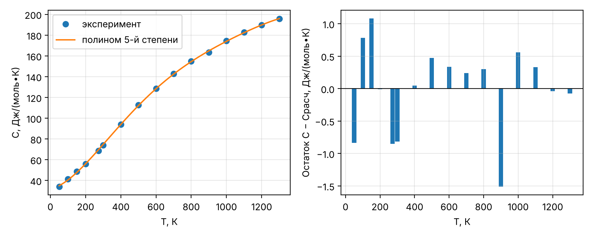
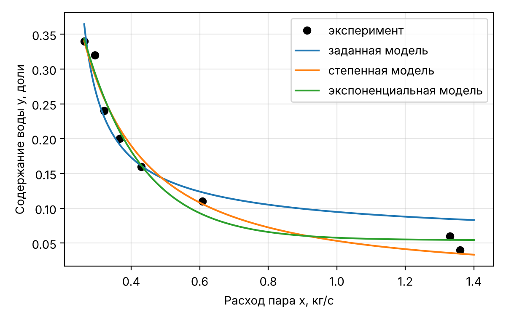
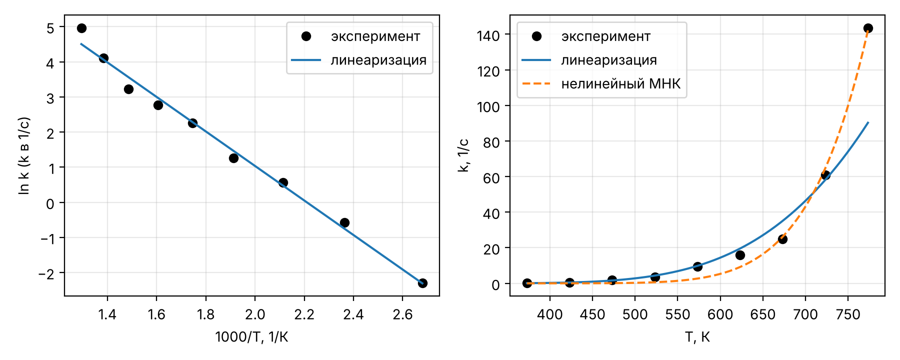
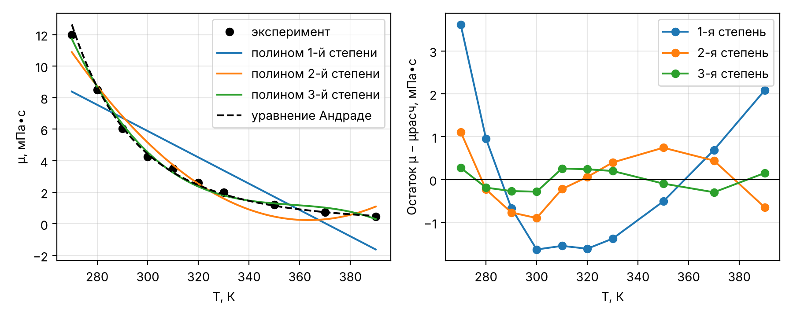
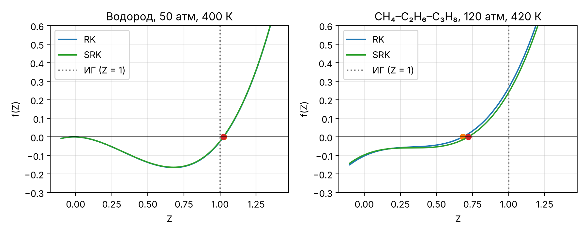
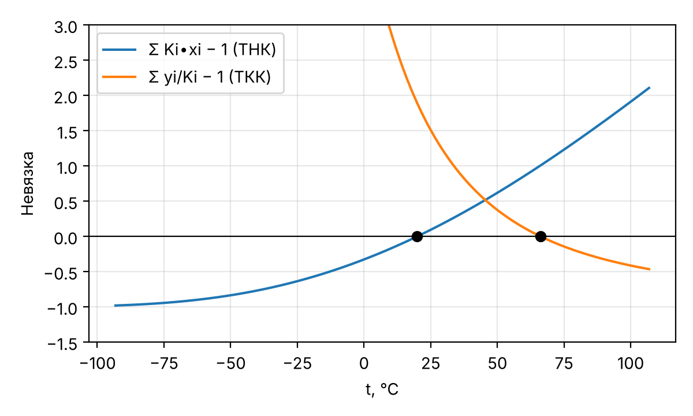
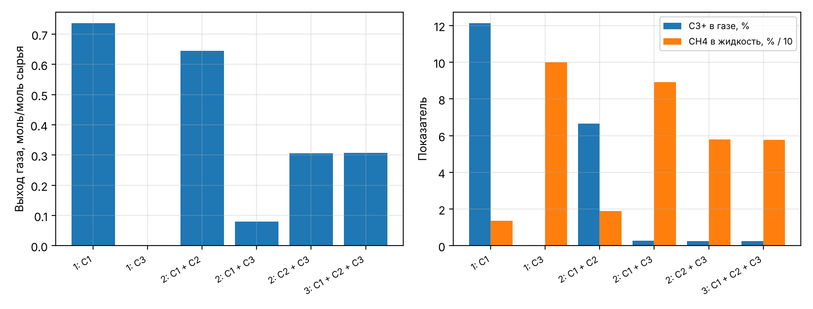
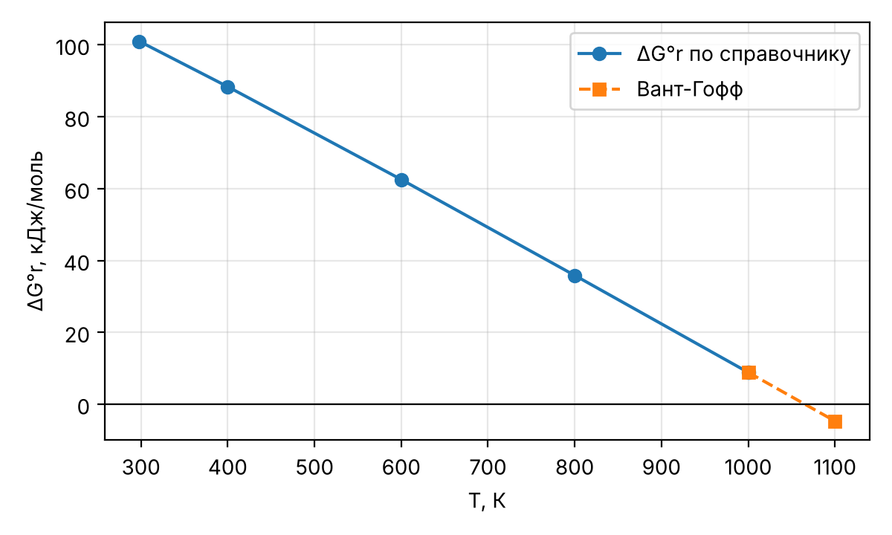

# Введение

Цель работы – решить двенадцать расчётных задач 7 семестра курса «Моделирование химико-технологических процессов» по пяти темам: эмпирические модели и регрессия, уравнения состояния и расчёт однофазных потоков, фазовые равновесия, химическое равновесие, материальные балансы. Условия задач приведены в задании на 7 семестр [1]; вариант 9 (группа ЗХТ-232) – во всех таблицах вариантов используется строка «9 и 10». Теоретическая основа – курс лекций и практических занятий [2] и учебные пособия [3, 4, 5]; первоисточник большинства постановок – задачник Б. Финлейсона [6].

Расчёты выполнены на языке Python 3 в среде Google Colab (colab.research.google.com) с библиотеками NumPy, SciPy и Matplotlib [7, 8]. Решение каждой задачи оформлено отдельной ячейкой блокнота; перед ними выполняется общая ячейка 0 с подключением библиотек, физическими константами и функциями оценки качества моделей. Для каждой задачи в отчёте приведены: условие и исходные данные, расчётные формулы с расшифровкой обозначений, программа, результат её работы, таблицы и графики, анализ и вывод.

Внутри расчётов используются единицы СИ (К, Па, моль, с, Дж). Если в условии величины заданы в атмосферах, градусах Цельсия, psia, градусах Ранкина или калориях, перевод выполняется явно: 1 атм = 101325 Па; T, К = t, °C + 273.15; 1 psi = 6894.757 Па; T, °R = 1.8∙T, К; 1 кал = 4.184 Дж. Десятичный разделитель во всём отчёте – точка, как в исходных данных задания и в программе.

Программа (ячейка Google Colab):

```python
# Ячейка 0. Общие библиотеки, константы и функции (выполнить первой)
import numpy as np
import matplotlib.pyplot as plt
from scipy.optimize import curve_fit, brentq, fsolve

R = 8.314462618      # универсальная газовая постоянная, Дж/(моль∙К)
ATM = 101325.0       # 1 атм = 101325 Па
PSI = 6894.757       # 1 psi = 6894.757 Па
CAL = 4.184          # 1 кал = 4.184 Дж


def sse(y, y_calc):
    """Остаточная сумма квадратов."""
    return float(np.sum((np.asarray(y) - np.asarray(y_calc)) ** 2))


def r2(y, y_calc):
    """Коэффициент детерминации R2 = 1 - SSE/SST."""
    y = np.asarray(y)
    return 1.0 - sse(y, y_calc) / float(np.sum((y - y.mean()) ** 2))


def style_axes(ax):
    """Сетка на графике."""
    ax.grid(alpha=0.3)


FIG_DIR = None      # папка для сохранения рисунков (None - рисунки выводятся в конце)
RESULTS = {}        # результаты расчёта по задачам
FIGS = []           # построенные графики
_CUR = [None]


def task(key, title):
    """Начало новой задачи."""
    _CUR[0] = key
    RESULTS[key] = {"title": title, "lines": []}


def out(*args, sep=" "):
    """Запись строки результата текущей задачи."""
    RESULTS[_CUR[0]]["lines"].append(sep.join(str(a) for a in args))


def show(fig, name):
    """Сохранение рисунка в файл или отложенный вывод."""
    fig.tight_layout()
    if FIG_DIR is not None:
        fig.savefig(f"{FIG_DIR}/{name}.png")
    else:
        FIGS.append((name, fig))
    plt.close(fig)


def show_results():
    """Вывод результатов всех задач."""
    for key, r in RESULTS.items():
        print("=" * 78)
        print(r["title"])
        print("=" * 78)
        print("\n".join(r["lines"]))
        print()


def show_figures():
    """Вывод всех графиков."""
    from IPython.display import display
    for name, fig in FIGS:
        display(fig)


plt.rcParams.update({"figure.dpi": 110, "font.size": 10, "savefig.dpi": 200})
```


Остаточная сумма квадратов и коэффициент детерминации, используемые во всех задачах темы 1:

$$SSE = \sum_{i=1}^{n} \left( y_i - \hat{y}_i \right)^{2}, \qquad R^{2} = 1 - \frac{SSE}{\sum_{i=1}^{n} \left( y_i - \bar{y} \right)^{2}},$$

где $y_i$ – экспериментальное значение отклика в $i$-й точке; $\hat{y}_i$ – значение, рассчитанное по модели; $\bar{y}$ – среднее экспериментальное значение; $n$ – число точек. $SSE$ имеет размерность квадрата отклика, $R^{2}$ безразмерен.


```{=openxml}
<w:p><w:r><w:br w:type="page"/></w:r></w:p>
```


# 1 Эмпирические модели и регрессия

## 1.1 Задание 1. Средняя теплоёмкость пропана

**Условие.** По табличной зависимости теплоёмкости пропана от температуры построить эмпирическую модель C(T) в виде алгебраического полинома; степень полинома для вариантов 9 и 10 равна 5 [1]. По модели вычислить среднюю теплоёмкость ⟨C⟩ при T = 1300 К (T~0~ = 50 К), затем вычислить тот же интеграл по табличным данным методом трапеций (функция trapz/trapezoid библиотеки NumPy) и сравнить результаты.


: Таблица 1 – Зависимость теплоёмкости пропана от температуры (задача 1.1) [1]

| T, К | C | T, К | C | T, К | C | T, К | C |
|--------------|:------------:|:----------:|:--------------:|:----------:|:--------------:|:----------:|:--------------:|
| 50 | 34.16 | 100 | 41.3 | 150 | 48.79 | 200 | 56.07 |
| 273.15 | 68.74 | 300 | 73.93 | 400 | 94.01 | 500 | 112.59 |
| 600 | 128.7 | 700 | 142.67 | 800 | 154.77 | 900 | 163.35 |
| 1000 | 174.6 | 1100 | 182.67 | 1200 | 189.74 | 1300 | 195.85 |

**Единицы теплоёмкости.** В шапке таблицы задания указано «C, кДж/кг К». По величине значения соответствуют мольной изобарной теплоёмкости пропана в Дж/(моль∙К): расчёт по справочному полиному [9, разд. D1] даёт при 300 К 74.04 Дж/(моль∙К) при табличных 73.93, а удельная теплоёмкость пропана при 300 К около 1.7 кДж/(кг∙К) (таблица 2). Числовые значения в расчёте не меняются; результаты приведены в Дж/(моль∙К). При буквальном прочтении шапки те же числа относятся к кДж/(кг∙К).


: Таблица 2 – Сравнение табличных значений с мольной теплоёмкостью пропана по справочнику [9, разд. D1]

| T, К | C из задания | C~p~ по [9], Дж/(моль∙К) | C/M, кДж/(кг∙К) |
|------------------|:---------------------------:|:------------------------------:|:------------------------:|
| 300 | 73.93 | 74.04 | 1.677 |
| 600 | 128.7 | 128.98 | 2.919 |
| 1000 | 174.6 | 175.12 | 3.959 |

**Метод.** Модель – полином 5-й степени

$$C(T) = \sum_{j=0}^{5} a_j \cdot T^{j} = a_0 + a_1 T + a_2 T^{2} + a_3 T^{3} + a_4 T^{4} + a_5 T^{5},$$

где $C$ – мольная теплоёмкость, Дж/(моль∙К); $T$ – температура, К; $a_j$ – эмпирические коэффициенты, Дж/(моль∙К^j+1^). Коэффициенты находятся методом наименьших квадратов (минимум $SSE$). При T до 1300 К столбец T^5^ матрицы МНК в 10^15^ раз больше столбца свободного члена, и прямое решение плохо обусловлено. Поэтому использована функция numpy.polynomial.Polynomial.fit: она приводит аргумент к отрезку [−1; 1], решает задачу МНК и пересчитывает коэффициенты к исходной переменной T. Средняя теплоёмкость по определению:

$$\langle C \rangle = \frac{\int_{T_0}^{T} C\,dT}{T - T_0} = \frac{1}{T - T_0} \cdot \sum_{j=0}^{5} \frac{a_j}{j + 1} \cdot \left( T^{j+1} - T_0^{j+1} \right).$$

Первообразная полинома вычисляется методом integ(). Метод трапеций по табличным точкам $(T_i, C_i)$:

$$\int_{T_0}^{T} C\,dT \approx \sum_{i=1}^{n-1} \frac{C_i + C_{i+1}}{2} \cdot (T_{i+1} - T_i).$$

Программа (ячейка Google Colab):

```python
# Задача 1.1. Полином 5-й степени C(T) и средняя теплоёмкость пропана
task("t11", "Задача 1.1")
T11 = np.array([50, 100, 150, 200, 273.15, 300, 400, 500, 600, 700,
                800, 900, 1000, 1100, 1200, 1300])                      # К
C11 = np.array([34.16, 41.3, 48.79, 56.07, 68.74, 73.93, 94.01, 112.59,
                128.7, 142.67, 154.77, 163.35, 174.6, 182.67, 189.74, 195.85])
deg = 5                                     # степень полинома
T0, Tk = 50.0, 1300.0                       # пределы интегрирования, К

# МНК с масштабированием аргумента (без него матрица для T^5 плохо обусловлена)
P11 = np.polynomial.Polynomial.fit(T11, C11, deg)
a11 = P11.convert().coef                    # a0, a1, ..., a5 для T в К
C_fit = P11(T11)
P_int = P11.integ()                         # первообразная полинома
I_poly = P_int(Tk) - P_int(T0)
trap = getattr(np, "trapezoid", None) or np.trapz   # NumPy 2.x / 1.x
I_trap = trap(C11, T11)                     # интеграл по таблице (трапеции)
Cm_poly = I_poly / (Tk - T0)
Cm_trap = I_trap / (Tk - T0)
res11 = dict(a=a11, R2=r2(C11, C_fit), SSE=sse(C11, C_fit),
             I_poly=I_poly, I_trap=I_trap, Cm_poly=Cm_poly, Cm_trap=Cm_trap,
             d_rel=abs(Cm_poly - Cm_trap) / Cm_trap * 100, resid=C11 - C_fit,
             s=np.sqrt(sse(C11, C_fit) / (len(C11) - deg - 1)))
for j, c in enumerate(a11):
    out(f"a{j} = {c: .6e}")
out(f"R2 = {res11['R2']:.6f};  SSE = {res11['SSE']:.3f};  s = {res11['s']:.3f}")
out(f"Интеграл: полином {I_poly:.1f}, трапеции {I_trap:.1f}")
out(f"<C>(1300 K): полином {Cm_poly:.3f}, трапеции {Cm_trap:.3f}, "
    f"расхождение {res11['d_rel']:.3f} %")

fig, ax = plt.subplots(1, 2, figsize=(9, 3.6))
Tg = np.linspace(T0, Tk, 200)
ax[0].plot(T11, C11, "o", label="эксперимент")
ax[0].plot(Tg, P11(Tg), "-", label="полином 5-й степени")
ax[0].set(xlabel="T, К", ylabel="C, Дж/(моль∙К)")
ax[0].legend()
ax[1].bar(T11, res11["resid"], width=25)
ax[1].axhline(0, color="k", lw=0.8)
ax[1].set(xlabel="T, К", ylabel="Остаток C − Cрасч, Дж/(моль∙К)")
for a in ax:
    style_axes(a)
show(fig, "t11")
```

Результат работы программы:

```text
a0 =  3.172577e+01
a1 =  3.872877e-02
a2 =  5.801396e-04
a3 = -9.408495e-07
a4 =  6.109064e-10
a5 = -1.466088e-13
R2 = 0.999856;  SSE = 7.064;  s = 0.840
Интеграл: полином 161085.9, трапеции 161039.5
<C>(1300 K): полином 128.869, трапеции 128.832, расхождение 0.029 %
```


**Результаты.** Модель, Дж/(моль∙К):

$$C(T) = 31.7258 + 3.8729 \cdot 10^{-2} \cdot T + 5.8014 \cdot 10^{-4} \cdot T^{2}$$

$$ - 9.4085 \cdot 10^{-7} \cdot T^{3} + 6.1091 \cdot 10^{-10} \cdot T^{4} - 1.4661 \cdot 10^{-13} \cdot T^{5}.$$

Средняя теплоёмкость:

$$\langle C \rangle = \frac{161085.9\ \text{Дж/моль}}{1300 - 50\ \text{К}} = 128.869\ \text{Дж/(моль∙К)}; \qquad \langle C \rangle_{трап} = \frac{161039.5}{1250} = 128.832\ \text{Дж/(моль∙К)}.$$


: Таблица 3 – Результаты задачи 1.1

| Величина | Значение |
|----------------------------------------------------------------------|:------------------------------:|
| Коэффициент a~0~, Дж/(моль∙К^1^) | $3.172577 \cdot 10^{1}$ |
| Коэффициент a~1~, Дж/(моль∙К^2^) | $3.872877 \cdot 10^{-2}$ |
| Коэффициент a~2~, Дж/(моль∙К^3^) | $5.801396 \cdot 10^{-4}$ |
| Коэффициент a~3~, Дж/(моль∙К^4^) | $-9.408495 \cdot 10^{-7}$ |
| Коэффициент a~4~, Дж/(моль∙К^5^) | $6.109064 \cdot 10^{-10}$ |
| Коэффициент a~5~, Дж/(моль∙К^6^) | $-1.466088 \cdot 10^{-13}$ |
| Коэффициент детерминации R^2^ | 0.999856 |
| Остаточная сумма SSE, (Дж/(моль∙К))^2^ | 7.064 |
| Стандартное отклонение остатков s, Дж/(моль∙К) | 0.840 |
| Интеграл по полиному, Дж/моль | 161085.9 |
| Интеграл методом трапеций, Дж/моль | 161039.5 |
| ⟨C⟩ по полиному, Дж/(моль∙К) | 128.869 |
| ⟨C⟩ методом трапеций, Дж/(моль∙К) | 128.832 |
| Относительное расхождение, % | 0.029 |


{width=16cm}


**Анализ.** Полином 5-й степени описывает данные с R^2^ = 0.99986; стандартное отклонение остатков s = 0.84 Дж/(моль∙К), наибольший остаток 1.51 Дж/(моль∙К) при 900 К. Остатки знакопеременные, без явной систематики – вид модели достаточен. Средние теплоёмкости по модели и по трапециям различаются всего на 0.029 %. Интеграл по полиному немного больше: кривая C(T) выпуклая, и хорды метода трапеций лежат под ней, поэтому метод трапеций слегка занижает интеграл. Пять параметров при 16 точках – верхний разумный предел: дальнейший рост степени приведёт к подгонке под погрешности данных, а за пределами 50–1300 К полином 5-й степени экстраполировать нельзя.

**Вывод.** Средняя теплоёмкость пропана в интервале 50–1300 К: 128.87 Дж/(моль∙К) по полиному 5-й степени и 128.83 Дж/(моль∙К) по таблице методом трапеций (расхождение 0.029 %). Оба способа дают практически одинаковый результат. Полином 5-й степени пригоден и для расчёта теплоёмкости при отдельных температурах внутри интервала (ошибка не более 2.5 %), но для численного интегрирования по густой таблице построение модели не обязательно.

## 1.2 Задание 2. Содержание воды в дистилляте отпарной колонны

**Условие.** Построить эмпирическую модель зависимости содержания воды в дистилляте y от расхода пара x в форме $y = a \cdot \left(\ln(x/b)\right)^{-2/3}$ и предложить другую функциональную форму модели [1].


: Таблица 4 – Исходные данные задачи 1.2 [1]

| x, кг/с | 0.263 | 0.294 | 0.321 | 0.367 | 0.429 | 0.608 | 1.33 | 1.36 |
|----------|:-----------:|:-----------:|:-----------:|:-----------:|:-----------:|:-----------:|:----------:|:----------:|
| y | 0.34 | 0.32 | 0.24 | 0.20 | 0.16 | 0.11 | 0.06 | 0.04 |

**Метод.** Обозначения: $x$ – расход пара, кг/с; $y$ – содержание воды в дистилляте, доли; $a$ – коэффициент, доли; $b$ – параметр, кг/с. Модель определена только при $\ln(x/b) > 0$, т.е. при $0 < b < x_{min} = 0.263$ кг/с. Модель можно линеаризовать: $y^{-3/2} = a^{-3/2} \cdot \ln x - a^{-3/2} \cdot \ln b$. Однако линейный МНК по преобразованным данным даёт b = 0.2884 кг/с > x~min~, т.е. недопустимое значение (при x < b логарифм отрицателен). Поэтому параметры найдены нелинейным МНК по исходным y (функция scipy.optimize.curve_fit) с ограничением 0 < b < 0.2629 кг/с. Для сравнения построены две альтернативные модели: степенная $y = a \cdot x^{-k}$ и экспоненциальная с асимптотой $y = a \cdot e^{-k x} + c$. Для сравнения моделей с разным числом параметров $p$ используется скорректированный коэффициент детерминации

$$R^{2}_{скорр} = 1 - (1 - R^{2}) \cdot \frac{n - 1}{n - p}.$$

Программа (ячейка Google Colab):

```python
# Задача 1.2. Модель y = a·(ln(x/b))^(-2/3) для отпарной колонны
task("t12", "Задача 1.2")
x12 = np.array([0.263, 0.294, 0.321, 0.367, 0.429, 0.608, 1.33, 1.36])   # кг/с
y12 = np.array([0.34, 0.32, 0.24, 0.20, 0.16, 0.11, 0.06, 0.04])


def model_given(x, a, b):
    return a * np.log(x / b) ** (-2 / 3)


def model_power(x, a, n):                   # альтернатива: степенная
    return a * x ** (-n)


def model_exp(x, a, k, c):                  # альтернатива: экспонента
    return a * np.exp(-k * x) + c


# Ограничение модели: ln(x/b) > 0 при всех x, т.е. 0 < b < x_min = 0.263 кг/с.
# Линеаризация y^(-3/2) = a^(-3/2)·(ln x − ln b) даёт b > x_min (проверка ниже),
# поэтому параметры ищутся нелинейным МНК с границами.
k_lin, m_lin = np.polyfit(np.log(x12), y12 ** -1.5, 1)
b_linearized = np.exp(-m_lin / k_lin)
out(f"b по линеаризации = {b_linearized:.4f} кг/с > x_min = {x12.min()}"
    " -> недопустимо")
models = {"заданная": (model_given, [0.1, 0.2], ([0, 1e-4], [np.inf, 0.2629])),
          "степенная": (model_power, [0.05, 1.0], (-np.inf, np.inf)),
          "экспоненциальная": (model_exp, [1.0, 3.0, 0.05], (-np.inf, np.inf))}
res12 = {"b_linearized": b_linearized}
for name, (fn, p0, bnd) in models.items():
    p, cov = curve_fit(fn, x12, y12, p0=p0, bounds=bnd, maxfev=20000)
    yc = fn(x12, *p)
    n, k = len(y12), len(p)
    res12[name] = dict(p=p, R2=r2(y12, yc), SSE=sse(y12, yc), k=k, yc=yc,
                       R2adj=1 - (1 - r2(y12, yc)) * (n - 1) / (n - k),
                       max_abs=np.max(np.abs(y12 - yc)))
    out(f"{name:17s} p = {np.round(p, 5)}  R2 = {res12[name]['R2']:.4f}  "
        f"R2adj = {res12[name]['R2adj']:.4f}  SSE = {res12[name]['SSE']:.5f}")

fig, ax = plt.subplots(figsize=(6, 3.8))
xg = np.linspace(0.263, 1.4, 300)
ax.plot(x12, y12, "ko", label="эксперимент")
for name, (fn, _, _) in models.items():
    ax.plot(xg, fn(xg, *res12[name]["p"]), label=f"{name} модель")
ax.set(xlabel="Расход пара x, кг/с", ylabel="Содержание воды y, доли")
ax.legend()
style_axes(ax)
show(fig, "t12")
```

Результат работы программы:

```text
b по линеаризации = 0.2884 кг/с > x_min = 0.263 -> недопустимо
заданная          p = [0.12639 0.21444]  R2 = 0.9355  R2adj = 0.9248  SSE = 0.00570
степенная         p = [0.05323 1.38861]  R2 = 0.9760  R2adj = 0.9720  SSE = 0.00212
экспоненциальная  p = [1.38552 5.95282 0.05413]  R2 = 0.9807  R2adj = 0.9730  SSE = 0.00171
```


: Таблица 5 – Сравнение эмпирических моделей задачи 1.2

| Модель | Параметры | R^2^ | R^2^~скорр~ | SSE | max \|y − y~расч~\| |
|-------------------------------------|:----------------------------------------:|:--------:|:---------:|:---------:|:---------:|
| $y = a \cdot \left(\ln(x/b)\right)^{-2/3}$ (заданная) | a = 0.1264; b = 0.2144 кг/с | 0.9355 | 0.9248 | 0.00570 | 0.0473 |
| $y = a \cdot x^{-k}$ (степенная) | a = 0.0532; k = 1.3886 | 0.9760 | 0.9720 | 0.00212 | 0.0287 |
| $y = a \cdot e^{-k x} + c$ (экспоненциальная) | a = 1.3855; k = 5.953 с/кг; c = 0.0541 | 0.9807 | 0.9730 | 0.00171 | 0.0251 |


{width=14cm}


Заданная модель с найденными параметрами:

$$y = 0.1264 \cdot \left( \ln \frac{x}{0.2144} \right)^{-2/3}.$$

Например, при x = 0.429 кг/с: $y = 0.1264 \cdot (\ln(0.429/0.2144))^{-2/3} = 0.1613$ при опытном 0.16.

**Вывод.** Заданная модель описывает данные с R^2^ = 0.936; её параметры: a = 0.1264, b = 0.2144 кг/с. Параметр b ограничен сверху минимальным расходом пара, а линеаризация даёт недопустимое b, поэтому нужен нелинейный МНК с ограничениями. Другие функциональные формы существуют и точнее: степенная модель $y = 0.0532 \cdot x^{-1.3886}$ (R^2^ = 0.976, два параметра) и экспонента с асимптотой (R^2^ = 0.981, три параметра). По скорректированному R^2^ степенная и экспоненциальная модели практически равноценны (0.9720 и 0.9730); рекомендуется степенная как более простая. Экспоненциальная модель даёт ненулевой предел y = 0.054 при большом расходе пара, что физически правдоподобно (остаточная влажность), но при 8 точках третий параметр статистически не обоснован.

## 1.3 Задание 3. Уравнение Аррениуса

**Условие.** По зависимости константы скорости реакции от температуры (строка «9 и 10») определить параметры уравнения Аррениуса – энергию активации и предэкспоненциальный множитель [1].

**Метод.** Уравнение Аррениуса и его линейная форма:

$$k = A \cdot e^{-E_a/(R T)}, \qquad \ln k = \ln A - \frac{E_a}{R} \cdot \frac{1}{T},$$

где $k$ – константа скорости, 1/с; $A$ – предэкспоненциальный множитель, 1/с; $E_a$ – энергия активации, Дж/моль; $R$ = 8.314 Дж/(моль∙К); $T$ – температура, К ($T = t + 273.15$). По МНК для $\ln k$ от $1/T$ находятся наклон $-E_a/R$ и отрезок $\ln A$. Дополнительно параметры найдены нелинейным МНК по самим значениям k (curve_fit), начальное приближение – результат линеаризации.


: Таблица 6 – Константа скорости реакции, варианты 9 и 10 [1]

| t, °C | T, К | 1/T, 1/К | k, 1/с | ln k | ln k~расч~ | остаток |
|---------|:------------:|:----------------------:|:------------:|:--------------:|:--------------:|:--------------:|
| 100 | 373.15 | $2.6799 \cdot 10^{-3}$ | 0.10 | −2.3026 | −2.3066 | 0.004 |
| 150 | 423.15 | $2.3632 \cdot 10^{-3}$ | 0.56 | −0.5798 | −0.7515 | 0.172 |
| 200 | 473.15 | $2.1135 \cdot 10^{-3}$ | 1.76 | 0.5653 | 0.4749 | 0.090 |
| 250 | 523.15 | $1.9115 \cdot 10^{-3}$ | 3.54 | 1.2641 | 1.4669 | −0.203 |
| 300 | 573.15 | $1.7447 \cdot 10^{-3}$ | 9.53 | 2.2544 | 2.2858 | −0.031 |
| 350 | 623.15 | $1.6048 \cdot 10^{-3}$ | 15.98 | 2.7713 | 2.9733 | −0.202 |
| 400 | 673.15 | $1.4856 \cdot 10^{-3}$ | 25.04 | 3.2205 | 3.5587 | −0.338 |
| 450 | 723.15 | $1.3828 \cdot 10^{-3}$ | 60.74 | 4.1066 | 4.0631 | 0.043 |
| 500 | 773.15 | $1.2934 \cdot 10^{-3}$ | 143.60 | 4.9670 | 4.5023 | 0.465 |

Программа (ячейка Google Colab):

```python
# Задача 1.3. Уравнение Аррениуса
task("t13", "Задача 1.3")
t13 = np.array([100, 150, 200, 250, 300, 350, 400, 450, 500.0])        # °C
k13 = np.array([0.10, 0.56, 1.76, 3.54, 9.53, 15.98, 25.04, 60.74, 143.60])  # 1/с
T13 = t13 + 273.15                                                       # К

# 1) линеаризация: ln k = ln A − (Ea/R)·(1/T)
slope, intercept = np.polyfit(1 / T13, np.log(k13), 1)
Ea_lin, A_lin = -slope * R, np.exp(intercept)
lnk_calc = intercept + slope / T13
# 2) нелинейный МНК по самим k (начальное приближение — из линеаризации)
(A_nl, Ea_nl), _ = curve_fit(lambda T, A, Ea: A * np.exp(-Ea / (R * T)),
                             T13, k13, p0=[A_lin, Ea_lin], maxfev=20000)
k_lin = A_lin * np.exp(-Ea_lin / (R * T13))
k_nl = A_nl * np.exp(-Ea_nl / (R * T13))
res13 = dict(Ea_lin=Ea_lin, A_lin=A_lin, Ea_nl=Ea_nl, A_nl=A_nl,
             R2_ln=r2(np.log(k13), lnk_calc), R2_k_lin=r2(k13, k_lin),
             R2_k_nl=r2(k13, k_nl), R2_ln_nl=r2(np.log(k13), np.log(k_nl)),
             resid_ln=np.log(k13) - lnk_calc, k_lin=k_lin, k_nl=k_nl)
out(f"Линеаризация: Ea = {Ea_lin/1000:.2f} кДж/моль, A = {A_lin:.4e} 1/с, "
    f"R2(ln k) = {res13['R2_ln']:.4f}, R2(k) = {res13['R2_k_lin']:.4f}")
out(f"Нелинейный МНК: Ea = {Ea_nl/1000:.2f} кДж/моль, A = {A_nl:.4e} 1/с, "
    f"R2(k) = {res13['R2_k_nl']:.4f}")
out("Остатки ln k:", np.round(res13["resid_ln"], 3))
# проверка постоянства Ea: «локальная» энергия активации по соседним точкам
Ea_loc = -R * np.diff(np.log(k13)) / np.diff(1 / T13)
res13["Ea_loc"] = Ea_loc
out("Ea по соседним точкам, кДж/моль:", np.round(Ea_loc / 1000, 1))

fig, ax = plt.subplots(1, 2, figsize=(9, 3.6))
ax[0].plot(1000 / T13, np.log(k13), "ko", label="эксперимент")
ax[0].plot(1000 / T13, lnk_calc, "-", label="линеаризация")
ax[0].set(xlabel="1000/T, 1/К", ylabel="ln k (k в 1/с)")
ax[0].legend()
Tg = np.linspace(T13[0], T13[-1], 200)
ax[1].plot(T13, k13, "ko", label="эксперимент")
ax[1].plot(Tg, A_lin * np.exp(-Ea_lin / (R * Tg)), "-", label="линеаризация")
ax[1].plot(Tg, A_nl * np.exp(-Ea_nl / (R * Tg)), "--", label="нелинейный МНК")
ax[1].set(xlabel="T, К", ylabel="k, 1/с")
ax[1].legend()
for a in ax:
    style_axes(a)
show(fig, "t13")
```

Результат работы программы:

```text
Линеаризация: Ea = 40.83 кДж/моль, A = 5.1752e+04 1/с, R2(ln k) = 0.9894, R2(k) = 0.8325
Нелинейный МНК: Ea = 73.15 кДж/моль, A = 1.2437e+07 1/с, R2(k) = 0.9930
Остатки ln k: [ 0.004  0.172  0.09  -0.203 -0.031 -0.202 -0.338  0.043  0.465]
Ea по соседним точкам, кДж/моль: [45.2 38.1 28.8 49.4 30.7 31.3 71.7 80. ]
```


: Таблица 7 – Параметры уравнения Аррениуса

| Способ | E~a~, кДж/моль | A, 1/с | R^2^ по ln k | R^2^ по k |
|-------------------------------------------|:----------:|:------------------:|:--------------:|:------------:|
| Линеаризация (МНК по ln k) | 40.83 | $5.175 \cdot 10^{4}$ | 0.9894 | 0.8325 |
| Нелинейный МНК по k | 73.15 | $1.244 \cdot 10^{7}$ | −0.2224 | 0.9930 |

Расчёт по линеаризации: наклон прямой $-E_a/R = -4911.0$ К, откуда

$$E_a = 4911.0 \cdot 8.314 = 40832\ \text{Дж/моль} = 40.83\ \text{кДж/моль}, \qquad A = e^{10.8542} = 51752.3\ \text{с}^{-1}.$$


{width=16cm}


**Анализ.** Линейная модель ln k(1/T) объясняет 98.9 % дисперсии, но остатки ln k меняют знак систематически (+, +, +, −, −, −, −, +, +): точки ложатся на кривую, а не на прямую; наибольшее отклонение – при 500 °C (0.465). Энергия активации, рассчитанная по соседним точкам, не постоянна и лежит в диапазоне 28.8–80.0 кДж/моль (45.2, 38.1, 28.8, 49.4, 30.7, 31.3, 71.7, 80.0 кДж/моль по интервалам 100–150, …, 450–500 °C) – в интервале 150–400 °C она колеблется около 30–50 кДж/моль, а выше 400 °C возрастает до 80 кДж/моль. Это признак смены лимитирующей стадии или механизма при высоких температурах. Две оценки E~a~ различаются (40.8 и 73.1 кДж/моль), потому что методы по-разному взвешивают точки: линеаризация минимизирует относительные отклонения, а нелинейный МНК – абсолютные, и в нём преобладают большие k при 450–500 °C (k = 60.74 и 143.60 с^−1^).

**Вывод.** Параметры уравнения Аррениуса по линеаризации: E~a~ = 40.83 кДж/моль, A = 51752.3 с^−1^ (R^2^ = 0.9894 по ln k). Нелинейный МНК даёт E~a~ = 73.15 кДж/моль, A = 12437253 с^−1^ и лучше описывает высокотемпературную область (R^2^ = 0.9930 по k). Уравнение Аррениуса с постоянными параметрами описывает данные лишь приближённо: остатки систематические, локальная энергия активации меняется в 2.8 раза. Для расчётов во всём интервале 100–500 °C лучше разбить его на два участка или использовать модель с зависимостью E~a~ от температуры.

## 1.4 Задание 4. Вязкость глицерина: полиномы 1–3 степени

**Условие.** По зависимости вязкости жидкости от температуры (варианты 9 и 10 – глицерин) построить полиномиальные модели 1–3 степени, оценить их адекватность по коэффициенту детерминации и остаточной сумме, сравнить модели [1].


: Таблица 8 – Динамическая вязкость глицерина, мПа∙с, варианты 9 и 10 [1]

| T, К | 250 | 260 | 270 | 280 | 290 |
|----------------------|:-------------:|:-------------:|:------------------:|:---------------:|:---------------:|
| μ, мПа∙с | – | – | 12.000 | 8.500 | 6.050 |

| T, К | 300 | 310 | 320 | 330 | 350 | 370 | 390 |
|----------------|:-----------:|:-----------:|:-----------:|:-----------:|:-----------:|:-----------:|:-----------:|
| μ, мПа∙с | 4.250 | 3.500 | 2.600 | 2.000 | 1.200 | 0.730 | 0.450 |

**Метод.** Модели $\mu(T) = \sum_{j=0}^{d} b_j \cdot T^{j}$, $d$ = 1, 2, 3, где $\mu$ – динамическая вязкость, мПа∙с (1 мПа∙с = 10^−3^ Па∙с); $T$ – температура, К; $b_j$ – коэффициенты, мПа∙с/К^j^. При 250 и 260 К данных нет (в таблице задания – прочерк), поэтому модели строятся по 10 точкам 270–390 К. Коэффициенты найдены МНК (numpy.polynomial.Polynomial.fit – с масштабированием аргумента, что устраняет плохую обусловленность при T ≈ 300 К). Для сравнения дополнительно построено уравнение Андраде $\ln \mu = A + B/T$ (линейный МНК по $\ln \mu$ от $1/T$). Для сравнения используются R^2^, скорректированный R^2^, остаточная сумма SSE, стандартное отклонение остатков $s = \sqrt{SSE/(n - d - 1)}$ и максимальная относительная ошибка δ.

Программа (ячейка Google Colab):

```python
# Задача 1.4. Вязкость глицерина: полиномы 1–3 степени
task("t14", "Задача 1.4")
# при 250 и 260 К данных нет («-» в таблице задания)
T14 = np.array([270, 280, 290, 300, 310, 320, 330, 350, 370, 390.0])            # К
mu14 = np.array([12.00, 8.500, 6.050, 4.250, 3.500, 2.600, 2.000, 1.200,
                 0.730, 0.450])                                                # мПа∙с
res14 = {}
for d in (1, 2, 3):
    p = np.polynomial.Polynomial.fit(T14, mu14, d).convert().coef   # b0, b1, ...
    mc = np.polynomial.polynomial.polyval(T14, p)
    n = len(mu14)
    res14[d] = dict(b=p, mu_calc=mc, R2=r2(mu14, mc), SSE=sse(mu14, mc),
                    R2adj=1 - (1 - r2(mu14, mc)) * (n - 1) / (n - d - 1),
                    s=np.sqrt(sse(mu14, mc) / (n - d - 1)),
                    max_err=np.max(np.abs(mu14 - mc) / mu14) * 100)
    out(f"степень {d}: b = {np.array2string(p, precision=6)}")
    out(f"   R2 = {res14[d]['R2']:.5f}, R2adj = {res14[d]['R2adj']:.5f}, "
        f"SSE = {res14[d]['SSE']:.3e}, s = {res14[d]['s']:.4f} мПа∙с, "
        f"макс. отн. ошибка = {res14[d]['max_err']:.2f} %")

# для сравнения: уравнение Андраде ln μ = A + B/T (линейный МНК по ln μ)
B_and, A_and = np.polyfit(1 / T14, np.log(mu14), 1)
mu_and = np.exp(A_and + B_and / T14)
res14["andrade"] = dict(A=A_and, B=B_and, mu_calc=mu_and, R2=r2(mu14, mu_and),
                        SSE=sse(mu14, mu_and),
                        max_err=np.max(np.abs(mu14 - mu_and) / mu14) * 100)
out(f"Андраде: ln mu = {A_and:.4f} + {B_and:.1f}/T; R2 = {res14['andrade']['R2']:.5f}, "
    f"SSE = {res14['andrade']['SSE']:.3e}, "
    f"макс. отн. ошибка = {res14['andrade']['max_err']:.2f} %")

fig, ax = plt.subplots(1, 2, figsize=(9, 3.6))
Tg = np.linspace(270, 390, 200)
ax[0].plot(T14, mu14, "ko", label="эксперимент")
for d in (1, 2, 3):
    ax[0].plot(Tg, np.polynomial.polynomial.polyval(Tg, res14[d]["b"]),
               label=f"полином {d}-й степени")
    ax[1].plot(T14, mu14 - res14[d]["mu_calc"], "o-", label=f"{d}-я степень")
ax[0].plot(Tg, np.exp(A_and + B_and / Tg), "k--", label="уравнение Андраде")
ax[0].set(xlabel="T, К", ylabel="μ, мПа∙с")
ax[1].axhline(0, color="k", lw=0.8)
ax[1].set(xlabel="T, К", ylabel="Остаток μ − μрасч, мПа∙с")
for a in ax:
    a.legend()
    style_axes(a)
show(fig, "t14")
```

Результат работы программы:

```text
степень 1: b = [30.907581 -0.083425]
   R2 = 0.76909, R2adj = 0.74022, SSE = 2.902e+01, s = 1.9048 мПа∙с, макс. отн. ошибка = 461.86 %
степень 2: b = [ 1.613281e+02 -8.864351e-01  1.219435e-03]
   R2 = 0.96772, R2adj = 0.95850, SSE = 4.057e+00, s = 0.7613 мПа∙с, макс. отн. ошибка = 143.21 %
степень 3: b = [ 6.659683e+02 -5.565931e+00  1.556622e-02 -1.454136e-05]
   R2 = 0.99566, R2adj = 0.99350, SSE = 5.450e-01, s = 0.3014 мПа∙с, макс. отн. ошибка = 40.46 %
Андраде: ln mu = -7.9664 + 2835.9/T; R2 = 0.99535, SSE = 5.839e-01, макс. отн. ошибка = 10.92 %
```


: Таблица 9 – Модели вязкости глицерина μ(T), μ в мПа∙с, T в К

| Степень | Коэффициенты | R^2^ | R^2^~скорр~ | SSE, (мПа∙с)^2^ | s, мПа∙с | max δ, % |
|---------------------|:------------------------------------------:|:---------:|:---------:|:-------------:|:--------:|:--------:|
| 1 | $b_0 = 3.0908 \cdot 10^{1}$; $b_1 = -8.3425 \cdot 10^{-2}$ | 0.76909 | 0.74022 | $2.902 \cdot 10^{1}$ | 1.9048 | 461.86 |
| 2 | $b_0 = 1.6133 \cdot 10^{2}$; $b_1 = -8.8644 \cdot 10^{-1}$; $b_2 = 1.2194 \cdot 10^{-3}$ | 0.96772 | 0.95850 | $4.057$ | 0.7613 | 143.21 |
| 3 | $b_0 = 6.6597 \cdot 10^{2}$; $b_1 = -5.5659$; $b_2 = 1.5566 \cdot 10^{-2}$; $b_3 = -1.4541 \cdot 10^{-5}$ | 0.99566 | 0.99350 | $5.450 \cdot 10^{-1}$ | 0.3014 | 40.46 |
| Андраде (сравнение) | A = −7.9664; B = 2835.9 К | 0.99535 | — | $5.839 \cdot 10^{-1}$ | — | 10.92 |


{width=16cm}


**Анализ.** Вязкость глицерина убывает с температурой очень резко – в 27 раз в интервале 270–390 К, по закону, близкому к экспоненциальному. Прямая (R^2^ = 0.769) непригодна: при высоких температурах она даёт отрицательную вязкость, относительная ошибка до 462 %. Полином 2-й степени повышает R^2^ до 0.9677, но остатки систематические, ошибка до 143 %. Полином 3-й степени – лучший из полиномов: R^2^ = 0.9957, скорректированный R^2^ = 0.9935, SSE в 7.4 раза меньше, чем у квадратичного. Однако высокий R^2^ обеспечивается в основном точками с большой вязкостью: в абсолютных единицах остатки 0.1–0.3 мПа∙с примерно одинаковы по всему интервалу, а в относительных при 370–390 К ошибка достигает 34–40 %. Уравнение Андраде с двумя параметрами даёт тот же R^2^ = 0.9954, а максимальную относительную ошибку – всего 10.9 %.

**Вывод.** Из полиномиальных моделей 1–3 степени для вязкости глицерина лучшая – кубическая: μ = 665.97 − 5.5659∙T + 1.5566∙10^−2^∙T^2^ − 1.4541∙10^−5^∙T^3^ (мПа∙с), R^2^ = 0.9957. Она удовлетворительна при 270–350 К (ошибка до 10 %), но при 370–390 К относительная ошибка велика (34–40 %). Для жидкостей с сильной зависимостью вязкости от температуры полином – неудачный вид модели; физически обоснованное уравнение Андраде ln μ = −7.966 + 2836/T описывает данные лучше при меньшем числе параметров.


```{=openxml}
<w:p><w:r><w:br w:type="page"/></w:r></w:p>
```


# 2 Уравнения состояния и расчёт однофазных потоков

## 2.0 Расчётные зависимости и справочные данные

Мольный объём газа $v$, м^3^/моль, по уравнению идеального газа: $v = R T / P$. Кубические уравнения состояния Редлиха–Квонга [10] и Соаве–Редлиха–Квонга [11]:

$$P = \frac{R T}{v - b} - \frac{a}{v \cdot (v + b)}, \qquad a = 0.42748 \cdot \frac{R^{2} T_c^{2}}{P_c} \cdot \alpha(T), \qquad b = 0.08664 \cdot \frac{R T_c}{P_c},$$

$$\alpha_{RK} = T_r^{-0.5}, \qquad \alpha_{SRK} = \left(1 + m \cdot \left(1 - \sqrt{T_r}\right)\right)^{2}, \qquad m = 0.480 + 1.574 \cdot \omega - 0.176 \cdot \omega^{2},$$

где $P$ – давление, Па; $T$ – температура, К; $R$ = 8.314 Дж/(моль∙К); $a$ – параметр притяжения, Па∙м^6^/моль^2^; $b$ – собственный объём молекул, м^3^/моль; $T_c$, К, и $P_c$, Па – критические температура и давление; $T_r = T/T_c$ – приведённая температура; $\omega$ – ацентрический фактор. В переменных коэффициента сжимаемости $Z = P v / (R T)$ уравнение приводится к кубическому:

$$Z^{3} - Z^{2} + \left(A - B - B^{2}\right) \cdot Z - A \cdot B = 0, \qquad A = \frac{a P}{(R T)^{2}}, \qquad B = \frac{b P}{R T}.$$

Все три корня находятся функцией numpy.roots; физический смысл имеет только действительный корень $Z > B$ (объём больше собственного объёма молекул), для газа берётся наибольший из них. Для смеси используются правила смешения ван-дер-ваальсового типа (коэффициенты бинарного взаимодействия равны нулю):

$$a = \sum_{i} \sum_{j} y_i y_j \sqrt{a_i a_j}, \qquad b = \sum_{i} y_i b_i,$$

где $y_i$ – мольная доля компонента. Результат переводится в л/моль: 1 м^3^/моль = 1000 л/моль.


: Таблица 10 – Критические параметры и ацентрический фактор [9, разд. A2]

| Вещество | T~c~, К | P~c~, атм | P~c~, МПа | ω |
|--------------------------------|:-----------------:|:---------------:|:-----------------:|:-----------------:|
| Водород H~2~ | 33.2 | 12.8 | 1.297 | -0.22 |
| Метан CH~4~ | 190.6 | 45.4 | 4.600 | 0.008 |
| Этан C~2~H~6~ | 305.4 | 48.2 | 4.884 | 0.098 |
| Пропан C~3~H~8~ | 369.8 | 41.9 | 4.246 | 0.152 |

Программа (ячейка Google Colab):

```python
# Задачи 2.1–2.2. Общая часть: параметры RK/SRK и решение кубического уравнения
# Tc, К; Pc, атм; ω — справочник Refining & Chemicals (IFP Training, 2014), раздел A2
CRIT = {"H2": (33.2, 12.8, -0.22),
        "CH4": (190.6, 45.4, 0.008),
        "C2H6": (305.4, 48.2, 0.098),
        "C3H8": (369.8, 41.9, 0.152)}


def eos_ab(gas, T, eos):
    """a, Па∙м6/моль2 и b, м3/моль для RK или SRK."""
    Tc, Pc_atm, w = CRIT[gas]
    Pc, Tr = Pc_atm * ATM, T / Tc
    if eos == "RK":
        alpha = Tr ** -0.5
    else:
        m = 0.480 + 1.574 * w - 0.176 * w ** 2
        alpha = (1 + m * (1 - Tr ** 0.5)) ** 2
    return 0.42748 * R ** 2 * Tc ** 2 / Pc * alpha, 0.08664 * R * Tc / Pc


def solve_z(a, b, T, P):
    """Z^3 − Z^2 + (A − B − B^2)·Z − A·B = 0; газ — наибольший корень Z > B."""
    A, B = a * P / (R * T) ** 2, b * P / (R * T)
    roots = np.roots([1.0, -1.0, A - B - B ** 2, -A * B])
    real = roots[np.abs(roots.imag) < 1e-10].real
    return real[real > B].max(), roots, A, B


def volumes(names, y, T, P_atm):
    P = P_atm * ATM
    res = {"ИГ": dict(Z=1.0, v=R * T / P)}
    for eos in ("RK", "SRK"):
        ab = np.array([eos_ab(g, T, eos) for g in names])
        ai, bi = ab[:, 0], ab[:, 1]
        a = np.sum(np.outer(y, y) * np.sqrt(np.outer(ai, ai)))  # ΣΣ yi·yj·√(ai·aj)
        b = np.sum(y * bi)                                       # b = Σ yi·bi
        Z, roots, A, B = solve_z(a, b, T, P)
        res[eos] = dict(Z=Z, v=Z * R * T / P, a=a, b=b, ai=ai, bi=bi,
                        A=A, B=B, roots=roots)
    for k, d in res.items():
        d["v_L"] = d["v"] * 1000                                  # м3/моль -> л/моль
        d["dev"] = (d["v"] / res["ИГ"]["v"] - 1) * 100
        out(f"{k:4s} Z = {d['Z']:.4f}  v = {d['v']:.4e} м3/моль"
            f" = {d['v_L']:.4f} л/моль"
            f"  отклонение от ИГ {d['dev']:+.2f} %")
    return res
```


## 2.1 Задание 1. Мольный объём водорода

**Условие.** Определить мольный объём водорода при P = 50 атм и T = 400 К по уравнениям идеального газа, RK и SRK; результаты представить в л/моль, сравнить и объяснить различия [1].

**Перевод единиц.** P = 50 атм ∙ 101325 Па/атм = 5066250 Па = 5.0663 МПа. Приведённые параметры: T~r~ = 400/33.2 = 12.048; P~r~ = 50/12.8 = 3.906.

**Расчёт.** Идеальный газ:

$$v = \frac{R T}{P} = \frac{8.314 \cdot 400}{5066250} = 6.5646 \cdot 10^{-4}\ \text{м}^{3}\text{/моль} = 0.6565\ \text{л/моль}.$$

Параметры RK: $b = 0.08664 \cdot 8.314 \cdot 33.2 / 1296960 = 1.8440 \cdot 10^{-5}$ м^3^/моль; $a = 0.42748 \cdot 8.314^{2} \cdot 33.2^{2} / 1296960 \cdot 12.048^{-0.5} = 7.2356 \cdot 10^{-3}$ Па∙м^6^/моль^2^. Для SRK: $m = 0.480 + 1.574 \cdot (-0.22) - 0.176 \cdot (-0.22)^{2} = 0.1252$; $\alpha = (1 + 0.1252 \cdot (1 - \sqrt{12.048}))^{2} = 0.4770$; $a = 1.1979 \cdot 10^{-2}$ Па∙м^6^/моль^2^ (параметр b тот же). Безразмерные коэффициенты: RK – A = 0.00331, B = 0.02809; SRK – A = 0.00549, B = 0.02809.

Программа (ячейка Google Colab):

```python
# Задача 2.1. Водород, P = 50 атм, T = 400 К
task("t21", "Задача 2.1")
T21, P21 = 400.0, 50.0
out(f"P = {P21} атм = {P21*ATM/1e6:.4f} МПа; Tr = {T21/CRIT['H2'][0]:.3f}; "
    f"Pr = {P21/CRIT['H2'][1]:.3f}")
res21 = volumes(["H2"], np.array([1.0]), T21, P21)
for eos in ("RK", "SRK"):
    out(eos, "корни Z:", np.round(res21[eos]["roots"], 5))
```

Результат работы программы:

```text
P = 50.0 атм = 5.0663 МПа; Tr = 12.048; Pr = 3.906
ИГ   Z = 1.0000  v = 6.5646e-04 м3/моль = 0.6565 л/моль  отклонение от ИГ +0.00 %
RK   Z = 1.0250  v = 6.7289e-04 м3/моль = 0.6729 л/моль  отклонение от ИГ +2.50 %
SRK  Z = 1.0230  v = 6.7157e-04 м3/моль = 0.6716 л/моль  отклонение от ИГ +2.30 %
RK корни Z: [ 1.02503 -0.02063 -0.0044 ]
SRK корни Z: [ 1.02301+0.j      -0.01151+0.00427j -0.01151-0.00427j]
```


Уравнение RK имеет три действительных корня: Z = 1.02503, −0.00440 и −0.02063. Два последних отрицательны (меньше B), т.е. физического смысла не имеют; у SRK два корня комплексные. Мольный объём по SRK:

$$v_{SRK} = \frac{Z R T}{P} = \frac{1.0230 \cdot 8.314 \cdot 400}{5066250} = 6.7157 \cdot 10^{-4}\ \text{м}^{3}\text{/моль} = 0.6716\ \text{л/моль}.$$


: Таблица 11 – Мольный объём водорода при 50 атм и 400 К

| Уравнение | Z | v, м^3^/моль | v, л/моль | Отклонение от ИГ, % |
|----------------------------------------|:-----------:|:--------------------:|:-----------:|:-----------------:|
| Идеальный газ | 1.0000 | $6.5646 \cdot 10^{-4}$ | 0.6565 | 0.00 |
| Редлиха–Квонга (RK) | 1.0250 | $6.7289 \cdot 10^{-4}$ | 0.6729 | 2.50 |
| Соаве–Редлиха–Квонга (SRK) | 1.0230 | $6.7157 \cdot 10^{-4}$ | 0.6716 | 2.30 |

**Анализ.** Для водорода оба кубических уравнения дают Z > 1. Температура в 12 раз выше критической, поэтому притяжение молекул (параметр a, A = 0.0055) пренебрежимо мало, а при 50 атм уже заметен собственный объём молекул (B = 0.0281): газ сжимается хуже идеального. Модель идеального газа занижает объём на 2.2 % относительно SRK. RK и SRK различаются всего на 0.2 %: при столь высокой T~r~ функция α(T) мала в обоих уравнениях. Водород – квантовый газ, и классические критические параметры описывают его приближённо; при T~r~ ≈ 12 это влияет слабо.

**Вывод.** Мольный объём водорода при 50 атм и 400 К: 0.6565 л/моль (идеальный газ), 0.6729 л/моль (RK), 0.6716 л/моль (SRK). Водород близок к идеальному газу (Z = 1.023); для оценочных расчётов допустимо уравнение идеального газа (ошибка около 2 %), для точных – кубическое уравнение состояния.

## 2.2 Задание 2. Мольный объём смеси метан – этан – пропан

**Условие.** Смесь содержит 25 % (мол.) метана, остальное – этан и пропан в мольном соотношении 1 : 3. Рассчитать мольный объём смеси при P = 120 атм, T = 420 К по уравнениям идеального газа, RK и SRK; определить, является ли газ идеальным [1].

**Состав и единицы.** y~CH4~ = 0.25; y~C2H6~ = 0.75 ∙ 1/4 = 0.1875; y~C3H8~ = 0.75 ∙ 3/4 = 0.5625. P = 120 ∙ 101325 = 12159000 Па = 12.1590 МПа.

Программа (ячейка Google Colab):

```python
# Задача 2.2. Смесь 25 % CH4, остальное C2H6 : C3H8 = 1 : 3; P = 120 атм, T = 420 К
task("t22", "Задача 2.2")
names22 = ["CH4", "C2H6", "C3H8"]
y22 = np.array([0.25, 0.75 * 1 / 4, 0.75 * 3 / 4])
T22, P22 = 420.0, 120.0
out("Состав, мол. доли:", ", ".join(f"{n} {v:.4f}" for n, v in zip(names22, y22)))
res22 = volumes(names22, y22, T22, P22)
for eos in ("RK", "SRK"):
    out(eos, "a_i =", np.round(res22[eos]["ai"], 5), " b_i =", res22[eos]["bi"])
    out(eos, "корни Z:", np.round(res22[eos]["roots"], 5))

fig, ax = plt.subplots(1, 2, figsize=(9, 3.6))
for axx, res, T, P, title in ((ax[0], res21, T21, P21, "Водород, 50 атм, 400 К"),
                              (ax[1], res22, T22, P22, "CH₄–C₂H₆–C₃H₈, 120 атм, 420 К")):
    Zg = np.linspace(-0.1, 1.4, 300)
    for eos in ("RK", "SRK"):
        A, B = res[eos]["A"], res[eos]["B"]
        axx.plot(Zg, Zg ** 3 - Zg ** 2 + (A - B - B ** 2) * Zg - A * B, label=eos)
        axx.plot(res[eos]["Z"], 0, "o")
    axx.axhline(0, color="k", lw=0.8)
    axx.axvline(1, color="gray", ls=":", label="ИГ (Z = 1)")
    axx.set(xlabel="Z", ylabel="f(Z)", title=title, ylim=(-0.3, 0.6))
    axx.legend()
    style_axes(axx)
show(fig, "t2")
```

Результат работы программы:

```text
Состав, мол. доли: CH4 0.2500, C2H6 0.1875, C3H8 0.5625
ИГ   Z = 1.0000  v = 2.8720e-04 м3/моль = 0.2872 л/моль  отклонение от ИГ +0.00 %
RK   Z = 0.6831  v = 1.9620e-04 м3/моль = 0.1962 л/моль  отклонение от ИГ -31.69 %
SRK  Z = 0.7206  v = 2.0696e-04 м3/моль = 0.2070 л/моль  отклонение от ИГ -27.94 %
RK a_i = [0.15722 0.48125 0.89319]  b_i = [2.98471632e-05 4.50461844e-05 6.27464125e-05]
RK корни Z: [0.68314+0.j      0.15843+0.35429j 0.15843-0.35429j]
SRK a_i = [0.13529 0.44779 0.86452]  b_i = [2.98471632e-05 4.50461844e-05 6.27464125e-05]
SRK корни Z: [0.72061+0.j      0.1397 +0.34019j 0.1397 -0.34019j]
```


: Таблица 12 – Параметры компонентов и смеси (T = 420 К)

| Компонент | y~i~ | T~r~ | a~i~ (RK), Па∙м^6^/моль^2^ | a~i~ (SRK), Па∙м^6^/моль^2^ | b~i~, м^3^/моль |
|---------------------|:-------------:|:-----------:|:---------------:|:---------------:|:-----------------------:|
| Метан CH~4~ | 0.2500 | 2.204 | 0.15722 | 0.13529 | $2.9847 \cdot 10^{-5}$ |
| Этан C~2~H~6~ | 0.1875 | 1.375 | 0.48125 | 0.44779 | $4.5046 \cdot 10^{-5}$ |
| Пропан C~3~H~8~ | 0.5625 | 1.136 | 0.89319 | 0.86452 | $6.2746 \cdot 10^{-5}$ |
| Смесь | 1.0000 | — | 0.57883 | 0.54824 | $5.1203 \cdot 10^{-5}$ |

Параметры смеси по правилам смешения (SRK): $a = \left(\sum y_i \sqrt{a_i}\right)^{2} = \left(0.25 \cdot \sqrt{0.13529} + 0.1875 \cdot \sqrt{0.44779} + 0.5625 \cdot \sqrt{0.86452}\right)^{2} = 0.54824$ Па∙м^6^/моль^2^; $b = \sum y_i b_i = 5.1203 \cdot 10^{-5}$ м^3^/моль.

$$v_{ИГ} = \frac{8.314 \cdot 420}{12159000} = 2.8720 \cdot 10^{-4}\ \text{м}^{3}\text{/моль}, \qquad v_{SRK} = \frac{0.7206 \cdot 8.314 \cdot 420}{12159000} = 2.0696 \cdot 10^{-4}\ \text{м}^{3}\text{/моль}.$$


: Таблица 13 – Мольный объём смеси CH~4~–C~2~H~6~–C~3~H~8~ при 120 атм и 420 К

| Уравнение | Z | v, м^3^/моль | v, л/моль | Отклонение от ИГ, % |
|----------------------------------------|:-----------:|:--------------------:|:-----------:|:-----------------:|
| Идеальный газ | 1.0000 | $2.8720 \cdot 10^{-4}$ | 0.2872 | 0.00 |
| Редлиха–Квонга (RK) | 0.6831 | $1.9620 \cdot 10^{-4}$ | 0.1962 | −31.69 |
| Соаве–Редлиха–Квонга (SRK) | 0.7206 | $2.0696 \cdot 10^{-4}$ | 0.2070 | −27.94 |


{width=16cm}


**Анализ.** Смесь сильно неидеальна: Z = 0.683 (RK) и 0.721 (SRK), т.е. модель идеального газа завышает объём на 39–46 %. На 56 % смесь состоит из пропана, приведённая температура которого всего 1.14, а приведённое давление 2.86: молекулы сильно притягиваются (параметр a смеси 0.548 Па∙м^6^/моль^2^ против 0.01198 у водорода). Псевдокритические параметры смеси по правилу Кэя: T~pc~ = 312.9 К, P~pc~ = 44.0 атм, т.е. T~pr~ = 1.34, P~pr~ = 2.73 – область вблизи критической точки, где отклонения от идеальности наибольшие. RK и SRK различаются на 5.5 %: для этана и пропана (ω = 0.098 и 0.152) учёт несферичности молекул в SRK существен, поэтому результат SRK надёжнее.

**Вывод.** Мольный объём смеси при 120 атм и 420 К: 0.2872 л/моль (идеальный газ), 0.1962 л/моль (RK), 0.2070 л/моль (SRK). Газ не является идеальным: Z = 0.721, уравнение идеального газа ошибается почти на 40 %. Для углеводородных смесей при таких давлениях необходимо уравнение состояния SRK (или Пенга–Робинсона).


```{=openxml}
<w:p><w:r><w:br w:type="page"/></w:r></w:p>
```


# 3 Расчёт фазовых равновесий

## 3.0 Константы фазового равновесия

Для идеальных углеводородных смесей константа фазового равновесия $K_i = y_i / x_i$ зависит только от температуры и давления. В задании [1] она задана корреляцией (аппроксимация номограмм ДеПриестера [12]):

$$\ln K = -\frac{A}{T^{2}} + B - C \cdot \ln P + \frac{D}{P^{2}} \ (1), \qquad \ln K = -\frac{A}{T^{2}} + B - C \cdot \ln P + \frac{D}{P} \ (2),$$

где $T$ – температура, °R; $P$ – давление, psia; $A$, $B$, $C$, $D$ – коэффициенты компонента. Программа принимает T в К и P в Па и пересчитывает: $T_{°R} = 1.8 \cdot T_{К}$, $P_{psia} = P_{Па} / 6894.757$.


: Таблица 14 – Коэффициенты корреляции для констант фазового равновесия [1, 12]

| Компонент | A | B | C | D | Форма |
|-------------------|:-----------------:|:----------------:|:----------------:|:-----------------:|:------------:|
| CH~4~ | 292860 | 8.2445 | 0.8951 | 59.8465 | (1) |
| C~2~H~4~ | 600076.9 | 7.90595 | 0.84677 | 42.94594 | (1) |
| C~2~H~6~ | 687248.2 | 7.90694 | 0.866 | 49.02654 | (1) |
| C~3~H~8~ | 970688.6 | 7.15059 | 0.76984 | 6.90224 | (2) |
| i-C~4~ | 1166846 | 7.72668 | 0.92213 | 0 | (1) |
| C~4~ | 1280557 | 7.94986 | 0.96455 | 0 | (1) |
| C~5~ | 1524891 | 7.33129 | 0.89143 | 0 | (1) |

Программа (ячейка Google Colab):

```python
# Задачи 3.1–3.2. Общая часть: константы фазового равновесия K(T, P)
# ln K = −A/T^2 + B − C·ln P + D/P^2 (форма 1) или + D/P (форма 2); T в °R, P в psia
KCOEF = {"CH4":   (292860.0, 8.2445, 0.8951, 59.8465, 1),
         "C2H4":  (600076.9, 7.90595, 0.84677, 42.94594, 1),
         "C2H6":  (687248.2, 7.90694, 0.866, 49.02654, 1),
         "C3H8":  (970688.6, 7.15059, 0.76984, 6.90224, 2),
         "i-C4":  (1166846.0, 7.72668, 0.92213, 0.0, 1),
         "n-C4":  (1280557.0, 7.94986, 0.96455, 0.0, 1),
         "n-C5":  (1524891.0, 7.33129, 0.89143, 0.0, 1)}


def K_values(names, T, P):
    """T в К, P в Па -> массив K_i (внутри перевод в °R и psia)."""
    TR, Pp = 1.8 * T, P / PSI
    K = []
    for n in names:
        A, B, C, D, form = KCOEF[n]
        last = D / Pp ** 2 if form == 1 else D / Pp
        K.append(np.exp(-A / TR ** 2 + B - C * np.log(Pp) + last))
    return np.array(K)
```


## 3.1 Задание 1. Температуры начала и конца кипения

**Условие.** Рассчитать температуры начала (ТНК) и конца (ТКК) кипения смеси при абсолютном давлении 14 атм; смесь идеальная [1]. Состав (варианты 9 и 10): этилен – 20 %, пропан – 30 %, изобутан – 30 %, н-бутан – 20 %.

**Перевод единиц.** P = 14 ∙ 101325 = 1418550 Па = 1.4185 МПа = 1418550/6894.757 = 205.74 psia.

**Метод.** В точке начала кипения жидкость состава $x_i = z_i$ находится в равновесии с первым пузырьком пара $y_i = K_i x_i$; условие $\sum y_i = 1$ даёт уравнение для температуры. В точке конца кипения пар состава $y_i = z_i$ равновесен первой капле жидкости $x_i = y_i / K_i$:

$$f_{ТНК}(T) = \sum_{i} K_i(T, P) \cdot z_i - 1 = 0, \qquad f_{ТКК}(T) = \sum_{i} \frac{z_i}{K_i(T, P)} - 1 = 0.$$

Уравнения решаются методом Брента (scipy.optimize.brentq) на отрезке 100–500 К, где функции меняют знак (рисунок 6).

Программа (ячейка Google Colab):

```python
# Задача 3.1. ТНК и ТКК смеси при 14 атм
task("t31", "Задача 3.1")
names31 = ["C2H4", "C3H8", "i-C4", "n-C4"]
z31 = np.array([0.20, 0.30, 0.30, 0.20])
P31 = 14 * ATM                                   # 14 атм = 1.4186 МПа = 205.7 psia
f_bub = lambda T: np.sum(K_values(names31, T, P31) * z31) - 1      # Σ Ki·xi = 1
f_dew = lambda T: np.sum(z31 / K_values(names31, T, P31)) - 1      # Σ yi/Ki = 1
Tb = brentq(f_bub, 100.0, 500.0)
Td = brentq(f_dew, 100.0, 500.0)
Kb, Kd = K_values(names31, Tb, P31), K_values(names31, Td, P31)
res31 = dict(P=P31, Ppsia=P31 / PSI, Tb=Tb, Td=Td, tb=Tb - 273.15, td=Td - 273.15,
             Kb=Kb, Kd=Kd, y_b=Kb * z31, x_d=z31 / Kd)
out(f"P = {P31/1e6:.4f} МПа = {P31/PSI:.2f} psia")
out(f"ТНК = {Tb:.2f} К = {Tb-273.15:.2f} °C; ТКК = {Td:.2f} К = {Td-273.15:.2f} °C")
out("K при ТНК:", np.round(Kb, 4))
out("   состав первого пузырька y:", np.round(Kb * z31, 4))
out("K при ТКК:", np.round(Kd, 4))
out("   состав первой капли x:", np.round(z31 / Kd, 4))

Tg = np.linspace(180, 380, 300)
fig, ax = plt.subplots(figsize=(6, 3.6))
ax.plot(Tg - 273.15, [f_bub(T) for T in Tg], label="Σ Ki∙xi − 1 (ТНК)")
ax.plot(Tg - 273.15, [f_dew(T) for T in Tg], label="Σ yi/Ki − 1 (ТКК)")
ax.plot([Tb - 273.15, Td - 273.15], [0, 0], "ko")
ax.axhline(0, color="k", lw=0.8)
ax.set(xlabel="t, °C", ylabel="Невязка", ylim=(-1.5, 3))
ax.legend()
style_axes(ax)
show(fig, "t31")
```

Результат работы программы:

```text
P = 1.4185 МПа = 205.74 psia
ТНК = 293.05 К = 19.90 °C; ТКК = 339.38 К = 66.23 °C
K при ТНК: [3.455  0.6668 0.2519 0.1669]
   состав первого пузырька y: [0.691  0.2001 0.0756 0.0334]
K при ТКК: [5.9807 1.6199 0.7321 0.5383]
   состав первой капли x: [0.0334 0.1852 0.4098 0.3716]
```


: Таблица 15 – Составы и константы равновесия в точках начала и конца кипения (P = 14 атм)

| Компонент | z~i~ | K~i~ при ТНК | y~i~ = K~i~∙z~i~ | K~i~ при ТКК | x~i~ = z~i~/K~i~ |
|----------------------|:------------:|:----------------:|:----------------:|:----------------:|:----------------:|
| Этилен | 0.20 | 3.4550 | 0.6910 | 5.9807 | 0.0334 |
| Пропан | 0.30 | 0.6668 | 0.2001 | 1.6199 | 0.1852 |
| Изобутан | 0.30 | 0.2519 | 0.0756 | 0.7321 | 0.4098 |
| н-Бутан | 0.20 | 0.1669 | 0.0334 | 0.5383 | 0.3716 |
| Сумма | 1.00 | — | 1.0000 | — | 1.0000 |

Проверка для ТНК: при T = 293.05 К = 527.48 °R константа этилена $\ln K = -600076.9/527.48^{2} + 7.90595 - 0.84677 \cdot \ln 205.74 + 42.9459/205.74^{2}$, $K = 3.4550$; $\sum K_i z_i = 1.0000$.


{width=13cm}


**Вывод.** При 14 атм (1.419 МПа) смесь начинает кипеть при 19.90 °C (293.05 К) и полностью испаряется при 66.23 °C (339.38 К). Интервал кипения около 46 °C широкий, потому что компоненты сильно различаются по летучести: K этилена в точке начала кипения в 21 раз больше, чем K н-бутана. Первый пузырёк пара на 69 % состоит из этилена, а последняя капля жидкости на 37 % – из н-бутана. Поскольку ТНК (19.9 °C) близка к температуре окружающей среды, при 14 атм смесь можно хранить в жидком виде без охлаждения лишь при температуре ниже 20 °C.

## 3.2 Задание 2. Расчёт сепарационного блока

**Условие.** Рассчитать составы газовых и жидких потоков на выходе из каждого сепаратора блока С1 → С2 → С3 (газ С1 поступает в С2, газ С2 – в С3; жидкость выводится из каждого сепаратора). Базовые условия: С1 – 9.8 МПа, 40.8 °C; С2 – 8.7 МПа, 12.8 °C; С3 – 8.7 МПа, −40.8 °C. Затем исследовать влияние количества сепараторов – 1, 2 или 3 (варианты 9 и 10) – и выбрать эффективный режим разделения [1]. Состав сырья (мольные доли): CH~4~ 0.72211, C~2~H~6~ 0.03608, C~3~H~8~ 0.22363, i-C~4~ 0.00646, C~4~ 0.00466, C~5~ 0.00706. Компоненты «C~4~» и «C~5~» рассчитываются по коэффициентам строк н-бутана и н-пентана таблицы задания.


![Рисунок 7 – Схема сепарационного блока [1]](fig/scheme32.png){width=9cm}


**Метод.** Каждый сепаратор – ступень однократного испарения. Мольная доля отгона $e = V/F$ находится из уравнения Рачфорда–Райса [13]:

$$\sum_{i} \frac{z_i \cdot (K_i - 1)}{1 + e \cdot (K_i - 1)} = 0, \qquad x_i = \frac{z_i}{1 + e \cdot (K_i - 1)}, \qquad y_i = K_i \cdot x_i,$$

где $z_i$ – мольная доля компонента в питании; $x_i$, $y_i$ – в жидкости и газе; $F$, $V$, $L$ – мольные расходы питания, газа и жидкости ($V = e F$, $L = F - V$). Перед решением проверяется фазовое состояние: при $\sum z_i K_i \le 1$ питание – жидкость ниже ТНК ($e = 0$), при $\sum z_i / K_i \le 1$ – газ выше ТКК ($e = 1$). Расчёт выполнен на базис 1 моль сырья (результат в мольных долях от сырья масштабируется на любой расход).

Программа (ячейка Google Colab):

```python
# Задача 3.2. Сепарационный блок С1 -> С2 -> С3: базовый расчёт
task("t32", "Задача 3.2 (базовый режим)")
names32 = ["CH4", "C2H6", "C3H8", "i-C4", "n-C4", "n-C5"]
z32 = np.array([0.72211, 0.03608, 0.22363, 0.00646, 0.00466, 0.00706])
BASE = [(9.8e6, 40.8), (8.7e6, 12.8), (8.7e6, -40.8)]       # (P, Па; t, °C) для С1–С3


def flash(z, T, P):
    """Однократное испарение: уравнение Рачфорда–Райса Σ zi(Ki−1)/(1+e(Ki−1)) = 0."""
    K = K_values(names32, T, P)
    if np.sum(z * K) <= 1:                  # ниже ТНК — только жидкость
        return dict(e=0.0, x=z.copy(), y=np.full_like(z, np.nan), K=K,
                    phase="жидкость")
    if np.sum(z / K) <= 1:                  # выше ТКК — только газ
        return dict(e=1.0, x=np.full_like(z, np.nan), y=z.copy(), K=K, phase="газ")
    rr = lambda e: np.sum(z * (K - 1) / (1 + e * (K - 1)))
    e = brentq(rr, 0.0, 1.0, xtol=1e-14)
    x = z / (1 + e * (K - 1))
    return dict(e=e, x=x, y=K * x, K=K, phase="две фазы")


def train(conds, z=z32, F=1.0):
    """Газ сепаратора i — сырьё сепаратора i+1. F — расход сырья, моль/с."""
    stages, feed, Fi = [], z, F
    for P, t in conds:
        if Fi == 0:                         # газа из предыдущего сепаратора нет
            nan = np.full_like(z, np.nan)
            stages.append(dict(e=np.nan, x=nan, y=nan, K=nan, phase="нет сырья",
                            P=P, t=t, F=0.0, V=0.0, L=0.0))
            continue
        s = flash(feed, t + 273.15, P)
        s.update(P=P, t=t, F=Fi, V=Fi * s["e"], L=Fi * (1 - s["e"]))
        stages.append(s)
        feed, Fi = s["y"], s["V"]
    return stages


def summary(tr, z=z32):
    """Выход газа С3, C3+ в газе, извлечение C3H8 в жидкость, потери CH4."""
    V, y = tr[-1]["V"], tr[-1]["y"]
    liq = sum(s["L"] * np.nan_to_num(s["x"]) for s in tr)          # Σ жидкостей, моль
    yC3p = np.sum(y[2:]) if V > 0 else np.nan
    return dict(V_out=V, y_out=y, yC3p=yC3p, rec_C3=liq[2] / z[2],
                loss_CH4=liq[0] / z[0], rec_C3p=np.sum(liq[2:]) / np.sum(z[2:]))


base = train(BASE)
res32 = dict(base=base, sum=summary(base))
for i, s in enumerate(base, 1):
    out(f"С{i}: P = {s['P']/1e6} МПа, t = {s['t']} °C, фаза: {s['phase']}, "
        f"e = {s['e']:.5f}, V = {s['V']:.5f}, L = {s['L']:.5f} моль")
    out("    K =", " ".join(f"{v:.4f}" for v in s["K"]))
    out("    x =", " ".join(f"{v:.5f}" for v in s["x"]))
    out("    y =", " ".join(f"{v:.5f}" for v in s["y"]))
sb = res32["sum"]
out(f"Газ С3: {sb['V_out']:.4f} моль/моль сырья, C3+ в газе {sb['yC3p']*100:.3f} %")
out(f"Извлечение C3H8 в жидкость {sb['rec_C3']*100:.2f} %; "
    f"CH4 в жидкость {sb['loss_CH4']*100:.2f} %")
```

Результат работы программы:

```text
С1: P = 9.8 МПа, t = 40.8 °C, фаза: две фазы, e = 0.73609, V = 0.73609, L = 0.26391 моль
    K = 2.2924 0.5876 0.2293 0.0727 0.0468 0.0199
    x = 0.37006 0.05181 0.51682 0.02035 0.01562 0.02534
    y = 0.84833 0.03044 0.11851 0.00148 0.00073 0.00051
С2: P = 8.7 МПа, t = 12.8 °C, фаза: две фазы, e = 0.87614, V = 0.64492, L = 0.09117 моль
    K = 2.1123 0.4187 0.1347 0.0383 0.0230 0.0083
    x = 0.42963 0.06204 0.49001 0.00940 0.00507 0.00385
    y = 0.90752 0.02597 0.06600 0.00036 0.00012 0.00003
С3: P = 8.7 МПа, t = -40.8 °C, фаза: две фазы, e = 0.47754, V = 0.30798, L = 0.33695 моль
    K = 1.1960 0.1102 0.0204 0.0040 0.0019 0.0004
    x = 0.82986 0.04517 0.12400 0.00069 0.00022 0.00006
    y = 0.99249 0.00498 0.00253 0.00000 0.00000 0.00000
Газ С3: 0.3080 моль/моль сырья, C3+ в газе 0.254 %
Извлечение C3H8 в жидкость 99.65 %; CH4 в жидкость 57.67 %
```


### 3.2.1 Базовый режим


: Таблица 17 – Условия и материальные потоки сепараторов (базис – 1 моль сырья)

| Сепаратор | P, МПа | P, psia | t, °C | T, К | T, °R | Питание, моль | Газ V, моль | Жидкость L, моль |
|--------------|:-------:|:----------:|:---------:|:----------:|:----------:|:------------:|:-----------:|:------------:|
| С1 | 9.8 | 1421.4 | 40.8 | 313.95 | 565.11 | 1.00000 | 0.73609 | 0.26391 |
| С2 | 8.7 | 1261.8 | 12.8 | 285.95 | 514.71 | 0.73609 | 0.64492 | 0.09117 |
| С3 | 8.7 | 1261.8 | -40.8 | 232.35 | 418.23 | 0.64492 | 0.30798 | 0.33695 |


: Таблица 18 – Константы фазового равновесия K~i~ в сепараторах

| Компонент | С1 | С2 | С3 |
|-------------------------------|:----------------------:|:----------------------:|:----------------------:|
| CH~4~ | 2.2924 | 2.1123 | 1.1960 |
| C~2~H~6~ | 0.5876 | 0.4187 | 0.1102 |
| C~3~H~8~ | 0.2293 | 0.1347 | 0.0204 |
| i-C~4~ | 0.0727 | 0.0383 | 0.0040 |
| C~4~ | 0.0468 | 0.0230 | 0.0019 |
| C~5~ | 0.0199 | 0.0083 | 0.0004 |


: Таблица 16 – Составы фаз в сепараторах при базовых условиях, мольные доли

| Компонент | Сырьё z~i~ | С1: x~i~ | С1: y~i~ | С2: x~i~ | С2: y~i~ | С3: x~i~ | С3: y~i~ |
|---------------|:----------:|:----------:|:----------:|:----------:|:--------------:|:--------------:|:--------------:|
| CH~4~ | 0.72211 | 0.37006 | 0.84833 | 0.42963 | 0.90752 | 0.82986 | 0.99249 |
| C~2~H~6~ | 0.03608 | 0.05181 | 0.03044 | 0.06204 | 0.02597 | 0.04517 | 0.00498 |
| C~3~H~8~ | 0.22363 | 0.51682 | 0.11851 | 0.49001 | 0.06600 | 0.12400 | 0.00253 |
| i-C~4~ | 0.00646 | 0.02035 | 0.00148 | 0.00940 | 0.00036 | 0.00069 | $2.73 \cdot 10^{-6}$ |
| C~4~ | 0.00466 | 0.01562 | 0.00073 | 0.00507 | 0.00012 | 0.00022 | $4.27 \cdot 10^{-7}$ |
| C~5~ | 0.00706 | 0.02534 | 0.00051 | 0.00385 | $3.20 \cdot 10^{-5}$ | $6.13 \cdot 10^{-5}$ | $2.64 \cdot 10^{-8}$ |
| Всего | 1.00000 | 1.00000 | 1.00000 | 1.00000 | 1.00000 | 1.00000 | 1.00000 |
| Доля отгона | — | 0.73609 |  | 0.87614 |  | 0.47754 |  |

Проверка для С1: при e = 0.73609 для метана $x = 0.72211 / (1 + 0.73609 \cdot (2.2924 - 1)) = 0.37006$, $y = 2.2924 \cdot 0.37006 = 0.84833$; суммы $\sum x_i = \sum y_i = 1$ выполняются во всех сепараторах (таблица 16).

Результат базового режима: из 1 моль сырья в С3 получается 0.3080 моль газа с содержанием метана 99.25 % и C~3+~ 0.254 %; в жидкости трёх сепараторов извлекается 99.65 % пропана, но вместе с ним в жидкость уходит 57.7 % метана сырья. Основная причина – С3: при −40.8 °C и 8.7 МПа константа метана K = 1.196 близка к единице, и метан хорошо растворяется в жидкости (x~CH4~ = 0.830). Давления 8.7–9.8 МПа лежат выше области, для которой построены номограммы ДеПриестера (примерно до 7 МПа), поэтому результаты в этой области оценочные.

### 3.2.2 Влияние количества сепараторов

Рассмотрены все схемы из одного, двух и трёх сепараторов, которые можно составить из ступеней С1, С2, С3 с базовыми условиями (газ предыдущей ступени – питание следующей): одна ступень – С1 или сразу С3 (сырьё охлаждается до −40.8 °C при 8.7 МПа); две ступени – С1 + С2, С1 + С3, С2 + С3; три ступени – базовая схема. Критерии сравнения: выход газа последней ступени (товарный газ), содержание в нём метана и C~3+~, извлечение пропана в жидкость и потери метана с жидкостью.

Программа (ячейка Google Colab):

```python
# Задача 3.2. Исследование влияния количества сепараторов: 1, 2 или 3
task("t32_study", "Задача 3.2 (исследование количества сепараторов)")
C1, C2, C3 = BASE
SCHEMES = {"1: С1": [C1],
           "1: С3 (сырьё сразу на -40.8 °C)": [C3],
           "2: С1 + С2": [C1, C2],
           "2: С1 + С3": [C1, C3],
           "2: С2 + С3": [C2, C3],
           "3: С1 + С2 + С3 (база)": [C1, C2, C3]}
study = {}
for name, conds in SCHEMES.items():
    tr = train(conds)
    study[name] = dict(n=len(conds), e=[x["e"] for x in tr], L=[x["L"] for x in tr],
                       **summary(tr))
res32["study"] = study
out(f"{'схема':34s} {'V газа':>7s} {'CH4,%':>6s} {'C3+,%':>6s} {'изв.C3H8,%':>10s}"
    f" {'CH4 в жидк.,%':>13s}")
for name, r in study.items():
    if r["V_out"] == 0:
        gas = f"{'газа нет':>7s} {'—':>6s} {'—':>6s}"
    else:
        gas = f"{r['V_out']:7.4f} {r['y_out'][0]*100:6.2f} {r['yC3p']*100:6.3f}"
    out(f"{name:34s} {gas} {r['rec_C3']*100:10.2f} {r['loss_CH4']*100:13.2f}")
for name, r in study.items():
    out(f"{name:34s} доли отгона:", " ".join(f"{v:.4f}" for v in r["e"]))

names = list(study)
fig, ax = plt.subplots(1, 2, figsize=(10, 3.8))
xs = np.arange(len(names))
ax[0].bar(xs, [study[k]["V_out"] for k in names], color="tab:blue")
ax[0].set(ylabel="Выход газа, моль/моль сырья")
ax[1].bar(xs - 0.2, [study[k]["yC3p"] * 100 for k in names], 0.4, label="C3+ в газе, %")
ax[1].bar(xs + 0.2, [study[k]["loss_CH4"] * 100 / 10 for k in names], 0.4,
          label="CH4 в жидкость, % / 10")
ax[1].set(ylabel="Показатель")
ax[1].legend(fontsize=8)
for a in ax:
    a.set_xticks(xs)
    a.set_xticklabels([k.split(" (")[0] for k in names], rotation=30, ha="right", fontsize=8)
    style_axes(a)
show(fig, "t32_study")
```

Результат работы программы:

```text
схема                               V газа  CH4,%  C3+,% изв.C3H8,% CH4 в жидк.,%
1: С1                               0.7361  84.83 12.123      60.99         13.52
1: С3 (сырьё сразу на -40.8 °C)    газа нет      —      —     100.00        100.00
2: С1 + С2                          0.6449  90.75  6.650      80.97         18.95
2: С1 + С3                          0.0794  99.36  0.272      99.90         89.08
2: С2 + С3                          0.3065  99.28  0.257      99.65         57.87
3: С1 + С2 + С3 (база)              0.3080  99.25  0.254      99.65         57.67
1: С1                              доли отгона: 0.7361
1: С3 (сырьё сразу на -40.8 °C)    доли отгона: 0.0000
2: С1 + С2                         доли отгона: 0.7361 0.8761
2: С1 + С3                         доли отгона: 0.7361 0.1079
2: С2 + С3                         доли отгона: 0.6035 0.5079
3: С1 + С2 + С3 (база)             доли отгона: 0.7361 0.8761 0.4775
```


: Таблица 19 – Влияние количества сепараторов на работу блока (условия каждого сепаратора – базовые)

| Схема | Доли отгона по ступеням | Газ, моль/моль сырья | CH~4~ в газе, % | C~3+~ в газе, % | Извлечение C~3~H~8~, % | CH~4~ в жидкость, % |
|---------------------------------|:--------------------------:|:----------:|:-------:|:--------:|:------------:|:-----------:|
| 1: С1 | 0.7361 | 0.7361 | 84.83 | 12.123 | 60.99 | 13.52 |
| 1: С3 (сырьё сразу на -40.8 °C) | 0.0000 | нет газа | — | — | 100.00 | 100.00 |
| 2: С1 + С2 | 0.7361 / 0.8761 | 0.6449 | 90.75 | 6.650 | 80.97 | 18.95 |
| 2: С1 + С3 | 0.7361 / 0.1079 | 0.0794 | 99.36 | 0.272 | 99.90 | 89.08 |
| 2: С2 + С3 | 0.6035 / 0.5079 | 0.3065 | 99.28 | 0.257 | 99.65 | 57.87 |
| 3: С1 + С2 + С3 (база) | 0.7361 / 0.8761 / 0.4775 | 0.3080 | 99.25 | 0.254 | 99.65 | 57.67 |


{width=16cm}


**Анализ.** Одна ступень С1 (9.8 МПа, 40.8 °C) даёт много газа (0.7361 моль), но плохого качества: C~3+~ 12.1 %, извлечение пропана только 61.0 %. Одна ступень при −40.8 °C вообще не работает: при 8.7 МПа сырьё ниже точки начала кипения и целиком конденсируется (e = 0). Схема С1 + С3 тоже неудачна: после С1 газ, содержащий 85 % метана, при −40.8 °C почти полностью сжижается (e = 0.1079), и в жидкость уходит 89.1 % метана. Схема С1 + С2 не обеспечивает требуемого качества газа (C~3+~ 6.65 %): нет низкотемпературной ступени. Только схемы с последовательным охлаждением до 12.8 °C и затем до −40.8 °C (С2 + С3 и С1 + С2 + С3) дают газ с 99.3 % метана и C~3+~ около 0.25 %. Промежуточная ступень при 12.8 °C удаляет основную часть пропана при умеренной температуре, и на холодную ступень поступает газ, богатый метаном, который сжижается меньше. Три ступени дают наибольший выход газа (0.3080 моль против 0.3065 у С2 + С3, +0.5 %) и наименьшие потери метана (57.67 % против 57.87 %).

**Выбор режима.** Эффективная схема – три сепаратора (базовая): максимальный выход товарного газа, наименьшее содержание C~3+~ (0.254 %) и наименьшие потери метана при извлечении 99.65 % пропана. Первая ступень при 40.8 °C даёт выигрыш в выходе газа лишь 0.5 %, но снимает 26 % сырья в виде жидкости до охлаждения и тем самым разгружает холодильники ступеней С2 и С3. Если упрощение схемы важнее, допустима двухступенчатая схема С2 + С3 практически с тем же качеством газа.

**Вывод.** При базовых условиях доли отгона в сепараторах С1, С2, С3 равны 0.7361, 0.8761 и 0.4775; товарный газ С3 (0.3080 моль на 1 моль сырья) содержит 99.25 % метана, пропан извлекается в жидкость на 99.65 %. Количество сепараторов определяющим образом влияет на результат: одна ступень либо не очищает газ (С1), либо сжижает всё сырьё (С3); две ступени работают только при последовательном охлаждении С2 → С3. Эффективна трёхступенчатая схема С1 + С2 + С3: при том же качестве газа она даёт наибольший выход товарного газа и наименьшие потери метана, а потери метана в целом определяет режим холодной ступени С3.


```{=openxml}
<w:p><w:r><w:br w:type="page"/></w:r></w:p>
```


# 4 Расчёт химического равновесия

## 4.1 Задание 1. Синтез аммиака

**Условие.** Найти мольный расход каждого вещества на выходе из реактора синтеза аммиака, если на входе смесь N~2~ : H~2~ : NH~3~ = 1.1 : 3 : 0.2; K~p~ = 0.05, T = 589 К, P = 220 атм [1]. Реакция в форме задания и в целых коэффициентах:

½N~2~ + 3/2H~2~ ⇄ NH~3~;  N~2~ + 3H~2~ ⇄ 2NH~3~.

Баланс атомов: N: 2 = 2∙1; H: 3∙2 = 2∙3. Константа K~p~ = 0.05 атм^−1^ относится к форме с одним моль NH~3~ (для формы с целыми коэффициентами K~p~ = 0.05^2^ = 0.0025 атм^−2^). Расход питания задан соотношением, поэтому расчёт выполнен на 4.3 моль/ч питания (1.1 + 3 + 0.2); при другом расходе все потоки пропорциональны.

**Метод.** При степени полноты реакции ξ, моль/ч: $n_{N_2} = 1.1 - 0.5\xi$, $n_{H_2} = 3 - 1.5\xi$, $n_{NH_3} = 0.2 + \xi$, $n = 4.3 - \xi$. Для идеальной газовой смеси с парциальными давлениями $p_i = y_i P$ (P в атм, стандартное давление 1 атм = 101325 Па):

$$K_p = \frac{p_{NH_3}}{p_{N_2}^{0.5} \cdot p_{H_2}^{1.5}} = \frac{y_{NH_3}}{y_{N_2}^{0.5} \cdot y_{H_2}^{1.5}} \cdot P^{-1} \quad \Rightarrow \quad \frac{y_{NH_3}}{y_{N_2}^{0.5} \cdot y_{H_2}^{1.5}} = K_p \cdot P = 0.05 \cdot 220 = 11.$$

Уравнение относительно ξ решено методом Брента на отрезке 0 < ξ < 2 (при ξ = 2 расходуется весь водород и азот).

Программа (ячейка Google Colab):

```python
# Задача 4.1. Синтез аммиака: 1/2 N2 + 3/2 H2 <=> NH3 (N2 + 3 H2 <=> 2 NH3)
task("t41", "Задача 4.1")
Kp41, P41, T41 = 0.05, 220.0, 589.0          # Kp, 1/атм; P, атм; T, К
n0_41 = np.array([1.1, 3.0, 0.2])            # N2, H2, NH3, моль/ч (1.1 : 3 : 0.2)
nu41 = np.array([-0.5, -1.5, 1.0])           # стехиометрические коэффициенты


def comp41(xi):
    n = n0_41 + nu41 * xi                    # моль/ч на выходе
    return n, n / n.sum()


def eq41(xi):                                # Kp·P = yNH3 / (yN2^0.5 · yH2^1.5)
    n, y = comp41(xi)
    return y[2] / (y[0] ** 0.5 * y[1] ** 1.5) - Kp41 * P41


xi_max = min(n0_41[0] / 0.5, n0_41[1] / 1.5)          # ограничение по N2 и H2
xi41 = brentq(eq41, 0.0, xi_max * (1 - 1e-12), xtol=1e-14)
n41, y41 = comp41(xi41)
res41 = dict(xi=xi41, n=n41, y=y41,
             X_N2=xi41 * 0.5 / n0_41[0], X_H2=xi41 * 1.5 / n0_41[1],
             check=y41[2] / (y41[0] ** 0.5 * y41[1] ** 1.5) / P41)
out(f"xi = {xi41:.6f} моль/ч (xi_max = {xi_max:.4f})")
for nm, a, b, c in zip(("N2", "H2", "NH3"), n0_41, n41, y41):
    out(f"{nm:4s} начало {a:.4f}  конец {b:.4f} моль/ч  y = {c:.4f}")
out(f"Всего {n0_41.sum():.4f} -> {n41.sum():.4f} моль/ч; "
    f"проверка Kp = {res41['check']:.6f} 1/атм")
out(f"Степень превращения: N2 {res41['X_N2']*100:.2f} %,"
    f" H2 {res41['X_H2']*100:.2f} %")
```

Результат работы программы:

```text
xi = 1.469134 моль/ч (xi_max = 2.0000)
N2   начало 1.1000  конец 0.3654 моль/ч  y = 0.1291
H2   начало 3.0000  конец 0.7963 моль/ч  y = 0.2813
NH3  начало 0.2000  конец 1.6691 моль/ч  y = 0.5896
Всего 4.3000 -> 2.8309 моль/ч; проверка Kp = 0.050000 1/атм
Степень превращения: N2 66.78 %, H2 73.46 %
```


: Таблица 20 – Материальный баланс реактора синтеза аммиака (T = 589 К, P = 220 атм)

| Вещество | Начало, моль/ч | Конец (равновесие), моль/ч | Равновесная мольная доля y~i~ |
|---------------------|:-------------------:|:-------------------------------:|:---------------------------:|
| N~2~ | 1.1 | 0.3654 | 0.1291 |
| H~2~ | 3.0 | 0.7963 | 0.2813 |
| NH~3~ | 0.2 | 1.6691 | 0.5896 |
| Всего | 4.3 | 2.8309 | 1.0000 |

Проверка: $\frac{0.5896}{0.1291^{0.5} \cdot 0.2813^{1.5}} \cdot \frac{1}{220} = 0.0500$ атм^−1^ = K~p~. Баланс атомов N: 2∙0.3654 + 1.6691 = 2.4000 = 2∙1.1 + 0.2 = 2.4 моль/ч.

**Вывод.** Степень полноты реакции ξ = 1.4691 моль/ч; на выходе 0.3654 моль/ч N~2~, 0.7963 моль/ч H~2~ и 1.6691 моль/ч NH~3~ (суммарно 2.8309 моль/ч), мольная доля аммиака 0.5896. Степень превращения азота 66.8 %, водорода 73.5 %. Высокий выход обусловлен большим давлением (реакция идёт с уменьшением числа молей) и сравнительно низкой температурой 589 К.

## 4.2 Задание 2. Получение этилена из этана

### 4.2.1 Одна реакция при 1100 К (пункт а)

**Условие.** В реактор поступает чистый этан; реакция C~2~H~6~ ⇄ C~2~H~4~ + H~2~ (баланс: C 2 = 2; H 6 = 4 + 2). Определить равновесный состав при 1100 К и 1 атм; константу равновесия рассчитать по справочным данным [1].

**Константа равновесия.** Для реакции $\Delta G^{\circ}_r = \Delta G^{\circ}_{f,C_2H_4} - \Delta G^{\circ}_{f,C_2H_6}$ (для H~2~ равна нулю) и $K = \exp\left(-\Delta G^{\circ}_r / (R T)\right)$. Справочник [9] содержит ΔG°~f~ и ΔH°~f~ до 1000 К (таблица 21), поэтому K(1100 К) получена интегрированием уравнения изобары Вант-Гоффа от 1000 до 1100 К:

$$\ln K(1100) = \ln K(1000) + \int_{1000}^{1100} \frac{\Delta H^{\circ}_r(T)}{R T^{2}}\,dT,$$

где ΔH°~r~(T), Дж/моль, линейно экстраполирована по точкам 800 и 1000 К (ΔH°~r~ меняется медленно: 143.47 и 144.29 кДж/моль). Перевод единиц: 1 кал = 4.184 Дж. При 1000 К: $\Delta G^{\circ}_r = (28249 - 26130) \cdot 4.184 = 8866$ Дж/моль; $K(1000) = \exp(-8866/(8.314 \cdot 1000)) = 0.3443$. Проверка другим способом – линейная экстраполяция ΔG°~r~(T) по точкам 800 и 1000 К – даёт K = 1.6590, расхождение 0.7 %.

**Равновесный состав.** На 1 моль этана при степени превращения x: C~2~H~6~ 1 − x, C~2~H~4~ x, H~2~ x, всего 1 + x моль;

$$K_p = \frac{y_{C_2H_4} \cdot y_{H_2}}{y_{C_2H_6}} \cdot P = \frac{x^{2}}{(1 - x)(1 + x)} \cdot P \quad \Rightarrow \quad x = \sqrt{\frac{K_p}{K_p + P}} = \sqrt{\frac{1.6710}{1.6710 + 1}} = 0.7910.$$


: Таблица 21 – Энтальпии и энергии Гиббса образования, кал/моль [9, разд. E18, E19]

| T, К | ΔH°~f~ C~2~H~6~ | ΔH°~f~ C~2~H~4~ | ΔG°~f~ C~2~H~6~ | ΔG°~f~ C~2~H~4~ |
|-----------------|:----------------------:|:--------------------:|:--------------------:|:--------------------:|
| 298 | −20236 | 12496 | −7860 | 16282 |
| 400 | −21419 | 11766 | −3447 | 17675 |
| 600 | −23280 | 10600 | 5970 | 20918 |
| 800 | −24530 | 9760 | 15920 | 24490 |
| 1000 | −25280 | 9205 | 26130 | 28249 |

Программа (ячейка Google Colab):

```python
# Задача 4.2а. C2H6 <=> C2H4 + H2 при 1100 К и 1 атм; K по справочным данным
task("t42a", "Задача 4.2а")
# ΔH°f и ΔG°f, кал/моль (справочник IFP, разделы E18 и E19); H2 — простое вещество, 0
Tref = np.array([298.0, 400.0, 600.0, 800.0, 1000.0])
dHf = {"C2H6": np.array([-20236, -21419, -23280, -24530, -25280.0]),
       "C2H4": np.array([12496, 11766, 10600, 9760, 9205.0])}
dGf = {"C2H6": np.array([-7860, -3447, 5970, 15920, 26130.0]),
       "C2H4": np.array([16282, 17675, 20918, 24490, 28249.0])}
dH_r = (dHf["C2H4"] - dHf["C2H6"]) * CAL          # Дж/моль
dG_r = (dGf["C2H4"] - dGf["C2H6"]) * CAL          # Дж/моль
K_ref = np.exp(-dG_r / (R * Tref))                # K = exp(−ΔG°/(R·T))
T42, P42 = 1100.0, 1.0
# Основной способ: уравнение Вант-Гоффа d ln K/dT = ΔH°/(R·T^2) от 1000 до 1100 К,
# ΔH°r(T) — линейная экстраполяция по точкам 800 и 1000 К
dH_lin = lambda T: dH_r[-1] + (dH_r[-1] - dH_r[-2]) / 200.0 * (T - 1000.0)
Tq = np.linspace(1000.0, T42, 2001)
trap = getattr(np, "trapezoid", None) or np.trapz
lnK_vh = np.log(K_ref[-1]) + trap(dH_lin(Tq) / (R * Tq ** 2), Tq)
K42 = np.exp(lnK_vh)
# Проверка: линейная экстраполяция ΔG°r(T) по точкам 800 и 1000 К
dG_ext = dG_r[-1] + (dG_r[-1] - dG_r[-2]) / 200.0 * (T42 - 1000.0)
K42_check = np.exp(-dG_ext / (R * T42))
x42 = np.sqrt(K42 / (K42 + P42))                  # Kp = x^2·P/((1 − x)(1 + x))
n42 = np.array([1 - x42, x42, x42])               # C2H6, C2H4, H2 на 1 моль этана
y42 = n42 / n42.sum()
res42 = dict(dH_r=dH_r, dG_r=dG_r, K_ref=K_ref, K=K42, K_check=K42_check,
             dG_ext=dG_ext,
             dH1100=dH_lin(T42), x=x42, n=n42, y=y42,
             x_check=np.sqrt(K42_check / (K42_check + P42)))
for T, a, b, k in zip(Tref, dH_r, dG_r, K_ref):
    out(f"T = {T:6.0f} К  ΔH°r = {a/1000:7.2f}  ΔG°r = {b/1000:7.2f} кДж/моль"
        f"  K = {k:.4e}")
out(f"K(1100 К): Вант-Гофф {K42:.4f}; экстраполяция ΔG° {K42_check:.4f}")
out(f"x = {x42:.5f}; y: C2H6 {y42[0]:.4f}, C2H4 {y42[1]:.4f}, H2 {y42[2]:.4f}")

fig, ax = plt.subplots(figsize=(6, 3.6))
ax.plot(Tref, dG_r / 1000, "o-", label="ΔG°r по справочнику")
ax.plot([1000, T42], [dG_r[-1] / 1000, -R * T42 * lnK_vh / 1000], "s--",
        label="Вант-Гофф")
ax.axhline(0, color="k", lw=0.8)
ax.set(xlabel="T, К", ylabel="ΔG°r, кДж/моль")
ax.legend()
style_axes(ax)
show(fig, "t42")
```

Результат работы программы:

```text
T =    298 К  ΔH°r =  136.95  ΔG°r =  101.01 кДж/моль  K = 1.9719e-18
T =    400 К  ΔH°r =  138.85  ΔG°r =   88.37 кДж/моль  K = 2.8821e-12
T =    600 К  ΔH°r =  141.75  ΔG°r =   62.54 кДж/моль  K = 3.5917e-06
T =    800 К  ΔH°r =  143.47  ΔG°r =   35.86 кДж/моль  K = 4.5586e-03
T =   1000 К  ΔH°r =  144.29  ΔG°r =    8.87 кДж/моль  K = 3.4427e-01
K(1100 К): Вант-Гофф 1.6710; экстраполяция ΔG° 1.6590
x = 0.79096; y: C2H6 0.1167, C2H4 0.4416, H2 0.4416
```


: Таблица 22 – Тепловой эффект, энергия Гиббса и константа равновесия реакции C~2~H~6~ ⇄ C~2~H~4~ + H~2~

| T, К | ΔH°~r~, кДж/моль | ΔG°~r~, кДж/моль | K |
|--------------------------------|:-----------------:|:-----------------:|:--------------------------------:|
| 298 | 136.95 | 101.01 | $1.9719 \cdot 10^{-18}$ |
| 400 | 138.85 | 88.37 | $2.8821 \cdot 10^{-12}$ |
| 600 | 141.75 | 62.54 | $3.5917 \cdot 10^{-6}$ |
| 800 | 143.47 | 35.86 | $4.5586 \cdot 10^{-3}$ |
| 1000 | 144.29 | 8.87 | $3.4427 \cdot 10^{-1}$ |
| 1100 (расчёт) | 144.69 | −4.696 | 1.6710 |


: Таблица 23 – Равновесный состав при дегидрировании этана (1100 К, 1 атм), на 1 моль этана

| Вещество | Начало, моль | Конец (равновесие), моль | Равновесная мольная доля y~i~ |
|---------------------|:-------------------:|:-------------------------------:|:---------------------------:|
| C~2~H~6~ | 1.0 | 0.2090 | 0.1167 |
| C~2~H~4~ | 0.0 | 0.7910 | 0.4416 |
| H~2~ | 0.0 | 0.7910 | 0.4416 |
| Всего | 1.0 | 1.7910 | 1.0000 |


{width=13cm}


**Вывод.** Реакция сильно эндотермична (ΔH°~r~ ≈ 144 кДж/моль), поэтому K быстро растёт с температурой: от $4.56 \cdot 10^{-3}$ при 800 К до 1.671 при 1100 К. При 1100 К и 1 атм равновесная степень превращения этана 79.1 %; равновесный состав: C~2~H~6~ 11.67 %, C~2~H~4~ 44.16 %, H~2~ 44.16 % (мол.). Неопределённость экстраполяции K за пределы справочных данных (0.7 %) меняет степень превращения лишь на 0.0011.

### 4.2.2 Две реакции при 1367 К (пункт б)

**Условие.** Добавляется реакция C~2~H~4~ ⇄ C~2~H~2~ + H~2~ (баланс: C 2 = 2; H 4 = 2 + 2); T = 1367 К, P = 1 атм; K~p1~ = 37.6, K~p2~ = 0.769 [1].

**Метод.** Две независимые реакции со степенями полноты x~1~ и x~2~ (моль на 1 моль этана): C~2~H~6~ 1 − x~1~; C~2~H~4~ x~1~ − x~2~; H~2~ x~1~ + x~2~; C~2~H~2~ x~2~; всего 1 + x~1~ + x~2~. Система нелинейных уравнений

$$K_{p1} = \frac{y_{C_2H_4} \cdot y_{H_2}}{y_{C_2H_6}} \cdot P, \qquad K_{p2} = \frac{y_{C_2H_2} \cdot y_{H_2}}{y_{C_2H_4}} \cdot P$$

решена функцией scipy.optimize.fsolve (начальное приближение x~1~ = 0.9, x~2~ = 0.3); проверено, что все количества неотрицательны.

Программа (ячейка Google Colab):

```python
# Задача 4.2б. Две реакции при 1367 К: C2H6 <=> C2H4 + H2, C2H4 <=> C2H2 + H2
task("t42b", "Задача 4.2б")
K1, K2, P43 = 37.6, 0.769, 1.0


def comp43(x):
    x1, x2 = x
    n = np.array([1 - x1, x1 - x2, x1 + x2, x2])   # C2H6, C2H4, H2, C2H2
    return n, n / n.sum()


def eqs43(x):
    n, y = comp43(x)
    return [y[1] * y[2] * P43 - K1 * y[0],         # K1 = yC2H4·yH2·P / yC2H6
            y[3] * y[2] * P43 - K2 * y[1]]         # K2 = yC2H2·yH2·P / yC2H4


x43 = fsolve(eqs43, [0.9, 0.3], xtol=1e-14)
n43, y43 = comp43(x43)
res43 = dict(x=x43, n=n43, y=y43, resid=np.array(eqs43(x43)),
             K1c=y43[1] * y43[2] * P43 / y43[0], K2c=y43[3] * y43[2] * P43 / y43[1])
out(f"x1 = {x43[0]:.5f}, x2 = {x43[1]:.5f}; невязки {res43['resid']}")
for nm, a, b in zip(("C2H6", "C2H4", "H2", "C2H2"), n43, y43):
    out(f"{nm:5s} {a:.5f} моль  y = {b:.4f}")
out(f"Проверка: K1 = {res43['K1c']:.4f}, K2 = {res43['K2c']:.5f}")
```

Результат работы программы:

```text
x1 = 0.99292, x2 = 0.55472; невязки [-7.07767178e-16  5.55111512e-17]
C2H6  0.00708 моль  y = 0.0028
C2H4  0.43820 моль  y = 0.1720
H2    1.54764 моль  y = 0.6075
C2H2  0.55472 моль  y = 0.2177
Проверка: K1 = 37.6000, K2 = 0.76900
```


: Таблица 24 – Равновесный состав при двух реакциях (1367 К, 1 атм), на 1 моль этана

| Вещество | Начало, моль | Конец (равновесие), моль | Равновесная мольная доля y~i~ |
|---------------------|:-------------------:|:-------------------------------:|:---------------------------:|
| C~2~H~6~ | 1.0 | 0.0071 | 0.0028 |
| C~2~H~4~ | 0.0 | 0.4382 | 0.1720 |
| H~2~ | 0.0 | 1.5476 | 0.6075 |
| C~2~H~2~ | 0.0 | 0.5547 | 0.2177 |
| Всего | 1.0 | 2.5476 | 1.0000 |

Проверка: $K_{p1} = 0.1720 \cdot 0.6075 / 0.0028 = 37.60$; $K_{p2} = 0.2177 \cdot 0.6075 / 0.1720 = 0.7690$.

**Вывод.** При 1367 К этан превращается практически полностью (x~1~ = 0.9929), а 55.9 % образовавшегося этилена дегидрируется дальше до ацетилена (x~2~ = 0.5547). Равновесная смесь: H~2~ 60.7 %, C~2~H~2~ 21.8 %, C~2~H~4~ 17.2 %, C~2~H~6~ 0.28 % (мол.). Повышение температуры для увеличения конверсии этана снижает селективность по этилену, поэтому в промышленном пиролизе время контакта ограничивают, не допуская достижения равновесия по второй реакции.


```{=openxml}
<w:p><w:r><w:br w:type="page"/></w:r></w:p>
```


# 5 Расчёт материальных балансов

## 5.1 Задание 1. Схема разделения ксилол – стирол – толуол – бензол

**Условие.** Найти составы и расходы всех потоков схемы из трёх колонн (рисунок 10); на разделение поступает F = 1000 моль/ч сырья [1]. Колонна №1 делит сырьё на дистиллят D (питание колонны №2) и куб B (питание колонны №3); составы F, D~1~, B~1~, D~2~, B~2~ заданы.


![Рисунок 10 – Схема разделения смеси ксилол, стирол, толуол, бензол [1]](fig/scheme51.png){width=11cm}


**Метод.** Неизвестны четыре расхода продуктов D~1~, B~1~, D~2~, B~2~. Покомпонентный баланс всей схемы даёт четыре линейных уравнения:

$$x_{D_1,i} \cdot D_1 + x_{B_1,i} \cdot B_1 + x_{D_2,i} \cdot D_2 + x_{B_2,i} \cdot B_2 = z_{F,i} \cdot F, \quad i = \text{ксилол, стирол, толуол, бензол},$$

где $x_{j,i}$ – мольная доля компонента $i$ в потоке $j$; $D_1$, $B_1$, $D_2$, $B_2$, $F$ – расходы, моль/ч. Система решена функцией numpy.linalg.solve. Затем $D = D_1 + B_1$, $B = D_2 + B_2$, состав $x_{D,i} = (x_{D_1,i} D_1 + x_{B_1,i} B_1)/D$, аналогично для B. Например, по ксилолу: $0.07 D_1 + 0.18 B_1 + 0.15 D_2 + 0.24 B_2 = 0.15 \cdot 1000$.

Программа (ячейка Google Colab):

```python
# Задача 5.1. Схема из трёх колонн: ксилол, стирол, толуол, бензол
task("t51", "Задача 5.1")
F = 1000.0                                           # моль/ч
zF = np.array([0.15, 0.25, 0.40, 0.20])              # ксилол, стирол, толуол, бензол
xD1 = np.array([0.07, 0.04, 0.54, 0.35])
xB1 = np.array([0.18, 0.24, 0.42, 0.16])
xD2 = np.array([0.15, 0.10, 0.54, 0.21])
xB2 = np.array([0.24, 0.65, 0.10, 0.01])
# покомпонентный баланс всей схемы: xD1·D1 + xB1·B1 + xD2·D2 + xB2·B2 = zF·F
A = np.column_stack([xD1, xB1, xD2, xB2])
D1, B1, D2, B2 = np.linalg.solve(A, zF * F)
D, B = D1 + B1, D2 + B2
flows = {"F": F, "D": D, "B": B, "D1": D1, "B1": B1, "D2": D2, "B2": B2}
comp = {"F": zF, "D": (xD1 * D1 + xB1 * B1) / D, "B": (xD2 * D2 + xB2 * B2) / B,
        "D1": xD1, "B1": xB1, "D2": xD2, "B2": xB2}
res51 = dict(flows=flows, comp=comp, cond=np.linalg.cond(A), det=np.linalg.det(A),
             err=np.max(np.abs(A @ [D1, B1, D2, B2] - zF * F)))
out(f"{'':8s}" + "".join(f"{k:>9s}" for k in flows))
for i, nm in enumerate(("Ксилол", "Стирол", "Толуол", "Бензол")):
    out(f"{nm:8s}" + "".join(f"{flows[k]*comp[k][i]:9.2f}" for k in flows))
out(f"{'Всего':8s}" + "".join(f"{flows[k]:9.2f}" for k in flows))
for i, nm in enumerate(("Ксилол", "Стирол", "Толуол", "Бензол")):
    out(f"{nm:8s}" + "".join(f"{comp[k][i]:9.4f}" for k in flows))
out(f"Невязка баланса {res51['err']:.1e} моль/ч; "
    f"число обусловленности {res51['cond']:.1f}")
```

Результат работы программы:

```text
                F        D        B       D1       B1       D2       B2
Ксилол     150.00    71.25    78.75    26.25    45.00    18.75    60.00
Стирол     250.00    75.00   175.00    15.00    60.00    12.50   162.50
Толуол     400.00   307.50    92.50   202.50   105.00    67.50    25.00
Бензол     200.00   171.25    28.75   131.25    40.00    26.25     2.50
Всего     1000.00   625.00   375.00   375.00   250.00   125.00   250.00
Ксилол     0.1500   0.1140   0.2100   0.0700   0.1800   0.1500   0.2400
Стирол     0.2500   0.1200   0.4667   0.0400   0.2400   0.1000   0.6500
Толуол     0.4000   0.4920   0.2467   0.5400   0.4200   0.5400   0.1000
Бензол     0.2000   0.2740   0.0767   0.3500   0.1600   0.2100   0.0100
Невязка баланса 2.8e-14 моль/ч; число обусловленности 154.3
```


: Таблица 25 – Расходы и составы потоков схемы разделения

|  | F | D | B | D~1~ | B~1~ | D~2~ | B~2~ |
|---------------------|:------------:|:----------:|:----------:|:----------:|:----------:|:----------:|:----------:|
| **Расход, моль/ч** |  |  |  |  |  |  |  |
| Ксилол | 150.00 | 71.25 | 78.75 | 26.25 | 45.00 | 18.75 | 60.00 |
| Стирол | 250.00 | 75.00 | 175.00 | 15.00 | 60.00 | 12.50 | 162.50 |
| Толуол | 400.00 | 307.50 | 92.50 | 202.50 | 105.00 | 67.50 | 25.00 |
| Бензол | 200.00 | 171.25 | 28.75 | 131.25 | 40.00 | 26.25 | 2.50 |
| Всего | 1000.00 | 625.00 | 375.00 | 375.00 | 250.00 | 125.00 | 250.00 |
| **Доля** |  |  |  |  |  |  |  |
| Ксилол | 0.1500 | 0.1140 | 0.2100 | 0.0700 | 0.1800 | 0.1500 | 0.2400 |
| Стирол | 0.2500 | 0.1200 | 0.4667 | 0.0400 | 0.2400 | 0.1000 | 0.6500 |
| Толуол | 0.4000 | 0.4920 | 0.2467 | 0.5400 | 0.4200 | 0.5400 | 0.1000 |
| Бензол | 0.2000 | 0.2740 | 0.0767 | 0.3500 | 0.1600 | 0.2100 | 0.0100 |
| Всего | 1.0000 | 1.0000 | 1.0000 | 1.0000 | 1.0000 | 1.0000 | 1.0000 |

Проверка по ксилолу: 0.07∙375 + 0.18∙250 + 0.15∙125 + 0.24∙250 = 150.00 моль/ч = 0.15∙1000. Невязка решения $2.8 \cdot 10^{-14}$ моль/ч; число обусловленности матрицы 154: при погрешности составов в третьем знаке погрешность расходов может достигать единиц процентов.

**Вывод.** Расходы продуктов: D~1~ = 375.0, B~1~ = 250.0, D~2~ = 125.0, B~2~ = 250.0 моль/ч; промежуточные потоки D = 625.0 моль/ч (ксилол 11.4 %, стирол 12.0 %, толуол 49.2 %, бензол 27.4 %) и B = 375.0 моль/ч (ксилол 21.0 %, стирол 46.7 %, толуол 24.7 %, бензол 7.7 %). Колонна №1 концентрирует лёгкие толуол и бензол в дистилляте, стирол – в кубе; стирол выводится преимущественно потоком B~2~ (65.0 % стирола сырья).

## 5.2 Задание 2. Процесс Toray: бензол из толуола с рециклом

**Условие.** Толуол (100 моль/ч) превращается в бензол и ксилол по реакции 2C~7~H~8~ ⇄ C~6~H~6~ + C~8~H~10~ (в тексте задания «кислол» – опечатка: продукт C~8~H~10~ – ксилол). Баланс атомов: C 2∙7 = 6 + 8; H 2∙8 = 6 + 10. Конверсия толуола за проход 58 %. Разделитель S~1~: поток бензола 4 содержит 99.5 % бензола, 0.1 % толуола и не содержит ксилола из поступившего потока 3. Разделитель S~2~: рецикл 7 содержит весь бензол, 99.5 % толуола и 0.1 % ксилола потока 5. Рассчитать материальный баланс и конверсию толуола в ксилол [1].


![Рисунок 11 – Схема процесса Toray: M – смеситель, R – реактор, S~1~, S~2~ – разделители [1]](fig/scheme52.png){width=15cm}


**Метод.** Неизвестные – покомпонентные расходы потоков 2–7 и число пробегов реакции ξ, моль/ч. Уравнения (T – толуол, B – бензол, X – ксилол):

- смеситель M: $T_2 = 100 + T_7$, $B_2 = B_7$, $X_2 = X_7$;
- реактор R: $\xi = 0.58 \cdot T_2 / 2$; $T_3 = T_2 - 2\xi$, $B_3 = B_2 + \xi$, $X_3 = X_2 + \xi$;
- разделитель S~1~: $B_4 = 0.995 \cdot B_3$, $T_4 = 0.001 \cdot T_3$, $X_4 = 0$; поток 5 = поток 3 − поток 4;
- разделитель S~2~: $B_7 = B_5$, $T_7 = 0.995 \cdot T_5$, $X_7 = 0.001 \cdot X_5$; поток 6 = поток 5 − поток 7.

Все уравнения линейны, поэтому рецикл рассчитан без итераций – решением системы 14 линейных уравнений (numpy.linalg.solve). Столбец R таблицы результатов – изменение количества каждого вещества в реакторе (−2ξ для толуола, +ξ для бензола и ксилола).

Программа (ячейка Google Colab):

```python
# Задача 5.2. Процесс Toray: 2 C7H8 <=> C6H6 + C8H10 с рециклом толуола
task("t52", "Задача 5.2")
F1, X = 100.0, 0.58                  # свежий толуол, моль/ч; конверсия за проход
# неизвестные: [T2, B2, X2, xi, T4, B4, T5, B5, X5, T7, B7, X7, T6, X6] (T — толуол,
# B — бензол, X — ксилол; xi — число пробегов реакции, моль/ч)
M = np.zeros((14, 14)); rhs = np.zeros(14)
iT2, iB2, iX2, ixi, iT4, iB4, iT5, iB5, iX5, iT7, iB7, iX7, iT6, iX6 = range(14)
eqs = [({iT2: 1, iT7: -1}, F1),                 # смеситель: T2 = F1 + T7
       ({iB2: 1, iB7: -1}, 0), ({iX2: 1, iX7: -1}, 0),
       ({ixi: 1, iT2: -X / 2}, 0),              # реактор: xi = X·T2/2
       ({iB4: 1, iB2: -0.995, ixi: -0.995}, 0),  # S1: 99.5 % бензола потока 3
       ({iT4: 1, iT2: -0.001 * (1 - X)}, 0),     # S1: 0.1 % толуола потока 3
       ({iT5: 1, iT2: -(1 - X), iT4: 1}, 0),    # поток 5 = поток 3 − поток 4
       ({iB5: 1, iB2: -1, ixi: -1, iB4: 1}, 0),
       ({iX5: 1, iX2: -1, ixi: -1}, 0),          # ксилол в поток 4 не уходит
       ({iT7: 1, iT5: -0.995}, 0),              # S2: 99.5 % толуола -> рецикл
       ({iB7: 1, iB5: -1}, 0),                  # S2: весь бензол -> рецикл
       ({iX7: 1, iX5: -0.001}, 0),              # S2: 0.1 % ксилола -> рецикл
       ({iT6: 1, iT5: -1, iT7: 1}, 0),
       ({iX6: 1, iX5: -1, iX7: 1}, 0)]
for r_, (coef, b) in enumerate(eqs):
    for j, c in coef.items():
        M[r_, j] = c
    rhs[r_] = b
u = np.linalg.solve(M, rhs)
xi = u[ixi]
S = {"1": np.array([F1, 0, 0]),
     "2": u[[iT2, iB2, iX2]],
     "R": np.array([-2 * xi, xi, xi]),           # изменение в реакторе, моль/ч
     "3": u[[iT2, iB2, iX2]] + np.array([-2 * xi, xi, xi]),
     "4": np.array([u[iT4], u[iB4], 0.0]),
     "5": u[[iT5, iB5, iX5]],
     "6": np.array([u[iT6], 0.0, u[iX6]]),
     "7": u[[iT7, iB7, iX7]]}
T_out = S["4"][0] + S["6"][0]               # толуол, ушедший с продуктами
res52 = dict(S=S, xi=xi, conv_X=S["6"][2] / F1, conv_total=1 - T_out / F1,
             yield_B=S["4"][1] / F1,
             check_C=7 * F1 - (7 * T_out + 6 * S["4"][1] + 8 * S["6"][2]))
out(f"{'':8s}" + "".join(f"{k:>9s}" for k in S))
for i, nm in enumerate(("Толуол", "Бензол", "Ксилол")):
    out(f"{nm:8s}" + "".join(f"{S[k][i]:9.3f}" for k in S))
out(f"{'Всего':8s}" + "".join(f"{S[k].sum():9.3f}" for k in S))
out(f"xi = {xi:.4f} моль/ч; конверсия толуола в ксилол {res52['conv_X']*100:.2f} %;"
    f" общая конверсия толуола {res52['conv_total']*100:.2f} %")
out(f"Баланс атомов C: {res52['check_C']:.2e} моль/ч")
```

Результат работы программы:

```text
                1        2        R        3        4        5        6        7
Толуол    100.000  171.669  -99.568   72.101    0.072   72.029    0.360   71.669
Бензол      0.000    0.250   49.784   50.034   49.784    0.250    0.000    0.250
Ксилол      0.000    0.050   49.784   49.834    0.000   49.834   49.784    0.050
Всего     100.000  171.969    0.000  171.969   49.856  122.113   50.144   71.969
xi = 49.7839 моль/ч; конверсия толуола в ксилол 49.78 %; общая конверсия толуола 99.57 %
Баланс атомов C: 0.00e+00 моль/ч
```


: Таблица 26 – Материальный баланс процесса Toray, моль/ч (R – изменение количества в реакторе)

|  | 1 | 2 | R | 3 | 4 | 5 | 6 | 7 |
|-------------------------------|:----------:|:--------:|:--------:|:--------:|:-------:|:--------:|:-------:|:-------:|
| Толуол | 100.00 | 171.67 | −99.57 | 72.10 | 0.07 | 72.03 | 0.36 | 71.67 |
| Бензол | 0.00 | 0.25 | 49.78 | 50.03 | 49.78 | 0.25 | 0.00 | 0.25 |
| Ксилол | 0.00 | 0.05 | 49.78 | 49.83 | 0.00 | 49.83 | 49.78 | 0.05 |
| Всего | 100.00 | 171.97 | 0.00 | 171.97 | 49.86 | 122.11 | 50.14 | 71.97 |
| Конверсия толуола в ксилол | 49.78 % |  |  |  |  |  |  |  |

Проверка: на входе в реактор $T_2 = 100 + 71.669 = 171.669$ моль/ч, $\xi = 0.58 \cdot 171.669/2 = 49.784$ моль/ч. Общий баланс: вход 100 моль/ч = выход 49.856 + 50.144 = 100.000 моль/ч (реакция идёт без изменения числа молей). Баланс атомов углерода: 7∙100 = 7∙(0.072 + 0.360) + 6∙49.784 + 8∙49.784, невязка 0.

**Конверсия.** Конверсия толуола в ксилол – доля свежего толуола, превращённая в товарный ксилол (моль ксилола на моль толуола):

$$X_{T \to X} = \frac{X_6}{T_1} = \frac{49.784}{100} = 0.4978\ (49.78\ \%).$$

Общая конверсия толуола по установке $1 - (T_4 + T_6)/T_1 = 99.57$ %; по стехиометрии из 2 моль толуола получается 1 моль ксилола и 1 моль бензола, поэтому предельная конверсия толуола в ксилол равна 50 %.

**Вывод.** При свежем толуоле 100 моль/ч рецикл толуола составляет 71.67 моль/ч, на реактор поступает 171.97 моль/ч, реакция проходит 49.78 раз в час (моль/ч). Продукты: бензол 49.78 моль/ч (чистота потока 4 99.86 %) и ксилол 49.78 моль/ч (чистота потока 6 99.28 %). Благодаря рециклу общая конверсия толуола 99.57 % при конверсии за проход 58 %; конверсия толуола в ксилол 49.78 % – 99.6 % от стехиометрического предела.


```{=openxml}
<w:p><w:r><w:br w:type="page"/></w:r></w:p>
```


# Заключение

Решены все двенадцать задач 7 семестра (вариант 9). Основные результаты сведены в таблицу 27.


: Таблица 27 – Основные результаты

| Задача | Показатель | Значение |
|--------|---------------------------------------------|:---------------------------------------------:|
| 1.1 | ⟨C⟩ пропана, 50–1300 К, полином 5-й степени / трапеции | 128.87 / 128.83 Дж/(моль∙К) |
| 1.2 | y = a∙(ln(x/b))^−2/3^: a; b; R^2^ | 0.1264; 0.2144 кг/с; 0.936 |
| 1.3 | Уравнение Аррениуса: E~a~; A (линеаризация) | 40.83 кДж/моль; 51752 с^−1^ |
| 1.4 | Вязкость глицерина: лучший полином; уравнение Андраде | 3-я степень, R^2^ = 0.9957; Андраде – ошибка ≤ 10.9 % |
| 2.1 | v водорода (ИГ / RK / SRK), 50 атм, 400 К | 0.6565 / 0.6729 / 0.6716 л/моль |
| 2.2 | v смеси CH~4~–C~2~H~6~–C~3~H~8~ (ИГ / RK / SRK), 120 атм, 420 К | 0.2872 / 0.1962 / 0.2070 л/моль |
| 3.1 | ТНК / ТКК при 14 атм | 19.90 / 66.23 °C |
| 3.2 | Доли отгона С1 / С2 / С3 (база) | 0.7361 / 0.8761 / 0.4775 |
| 3.2 | Эффективная схема | 3 сепаратора, газ 0.3080 моль/моль сырья, C~3+~ 0.254 % |
| 4.1 | Выход NH~3~ / ξ (питание 4.3 моль/ч) | 1.6691 / 1.4691 моль/ч |
| 4.2а | K(1100 К); степень превращения этана | 1.671; 0.7910 |
| 4.2б | x~1~; x~2~ при 1367 К | 0.9929; 0.5547 |
| 5.1 | D~1~ / B~1~ / D~2~ / B~2~ | 375.0 / 250.0 / 125.0 / 250.0 моль/ч |
| 5.2 | Рецикл толуола; конверсия толуола в ксилол | 71.67 моль/ч; 49.78 % |

По темам работы получены следующие общие выводы.

1. Эмпирические модели: выбор вида модели важнее числа параметров. Полином 5-й степени точно описывает теплоёмкость пропана, но для вязкости глицерина, меняющейся в 27 раз, полиномы дают большие относительные ошибки, а двухпараметрическое уравнение Андраде – ошибку около 10 %. Систематический характер остатков (задачи 1.3, 1.4) указывает на неверный вид зависимости даже при высоком R^2^.
2. Уравнения состояния: водород при T~r~ ≈ 12 близок к идеальному газу (Z = 1.023), а углеводородная смесь вблизи псевдокритической области сильно неидеальна (Z = 0.721); для неё уравнение идеального газа ошибается почти на 40 %.
3. Фазовые равновесия: смесь этилена с пропаном и бутанами при 14 атм кипит в интервале 20–66 °C. В блоке сепараторов эффективна трёхступенчатая схема: последовательное охлаждение с промежуточным отводом жидкости уменьшает растворение метана на холодной ступени.
4. Химическое равновесие: давление смещает равновесие синтеза аммиака в сторону продукта, температура – равновесие эндотермического дегидрирования этана; при 1367 К последовательная реакция до ацетилена снижает выход этилена.
5. Материальные балансы схем без реакций и с рециклом сводятся к системам линейных уравнений; рецикл позволяет довести общую конверсию толуола до 99.6 % при 58 % за проход.

# Список литературы

1. Горбунов, В. А. Задачи для 7 семестра по курсу «Моделирование химико-технологических процессов» / В. А. Горбунов ; Омский государственный технический университет. – Омск : ОмГТУ, 2026. – 9 с. – Текст : электронный.
2. Горбунов, В. А. Моделирование химико-технологических процессов : курс лекций и практических занятий / В. А. Горбунов ; Омский государственный технический университет. – Омск : ОмГТУ, 2025. – Текст : электронный.
3. Математическое моделирование химико-технологических процессов : учебное пособие / Ас. М. Гумеров, Н. Н. Валеев, Аз. М. Гумеров, В. М. Емельянов ; Казанский государственный технологический университет. – Казань : КГТУ, 2006. – 216 с. – Текст : непосредственный.
4. Математическое моделирование химико-технологических процессов : учебное пособие / Н. В. Ушева, О. Е. Мойзес, О. Е. Митянина, Е. А. Кузьменко ; Томский политехнический университет. – Томск : Изд-во ТПУ, 2014. – 135 с. – Текст : непосредственный.
5. Самойлов, Н. А. Моделирование в химической технологии и расчет реакторов : учебное пособие / Н. А. Самойлов. – Уфа : Изд-во УГНТУ, 2006. – 195 с. – Текст : непосредственный.
6. Finlayson, B. A. Introduction to Chemical Engineering Computing / B. A. Finlayson. – 2nd ed. – Hoboken : John Wiley & Sons, 2012. – 391 p. – ISBN 978-0-470-93295-7. – Текст : непосредственный.
7. NumPy documentation : официальный сайт. – URL: https://numpy.org/doc/stable/ (дата обращения: 12.10.2026). – Текст : электронный.
8. SciPy documentation : официальный сайт. – URL: https://docs.scipy.org/doc/scipy/ (дата обращения: 12.10.2026). – Текст : электронный.
9. Refining & Chemicals. Folder Zero : Index of Data and Diagrams / IFP Training. – Rueil-Malmaison : IFP Training, 2014. – 309 p. – Текст : непосредственный.
10. Redlich, O. On the Thermodynamics of Solutions. V. An Equation of State. Fugacities of Gaseous Solutions / O. Redlich, J. N. S. Kwong // Chemical Reviews. – 1949. – Vol. 44, № 1. – P. 233–244. – Текст : непосредственный.
11. Soave, G. Equilibrium constants from a modified Redlich–Kwong equation of state / G. Soave // Chemical Engineering Science. – 1972. – Vol. 27, № 6. – P. 1197–1203. – Текст : непосредственный.
12. McWilliams, M. L. An equation to relate K-factors to pressure and temperature / M. L. McWilliams // Chemical Engineering. – 1973. – Vol. 80, № 25. – P. 138. – Текст : непосредственный.
13. Rachford, H. H. Procedure for use of electronic digital computers in calculating flash vaporization hydrocarbon equilibrium / H. H. Rachford, J. D. Rice // Journal of Petroleum Technology. – 1952. – Vol. 4, № 10. – P. 19. – Текст : непосредственный.

